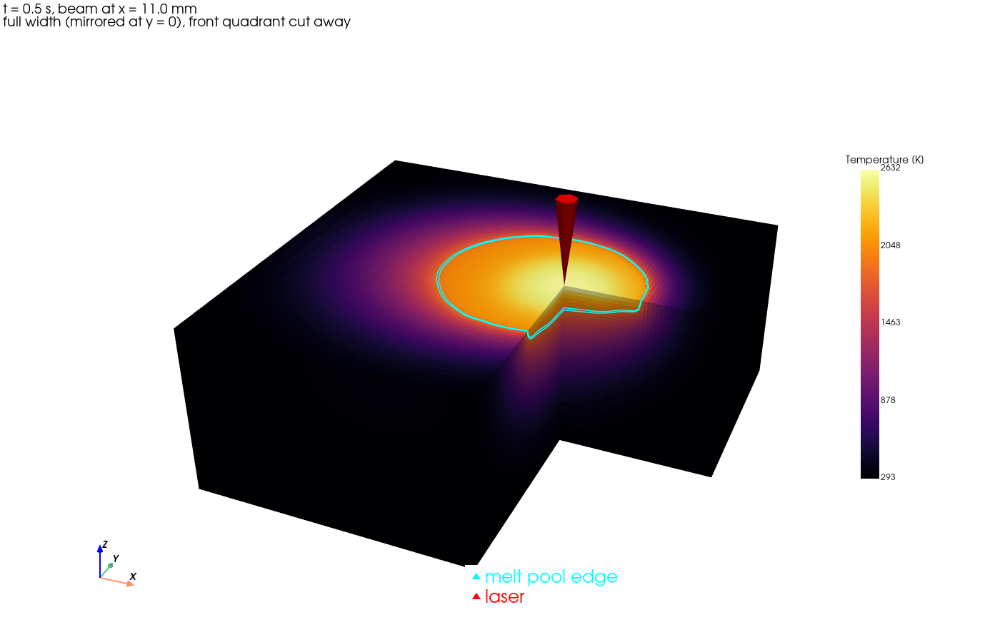
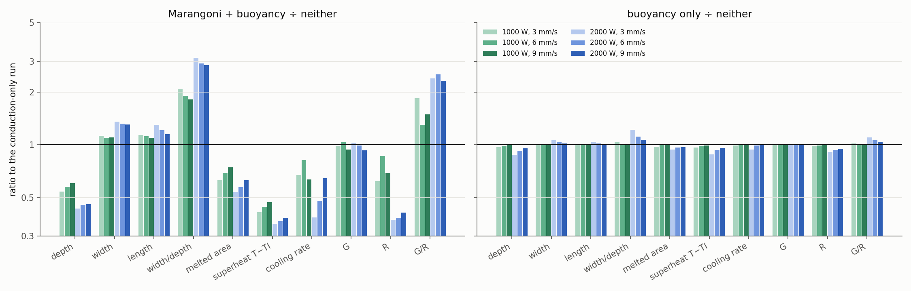
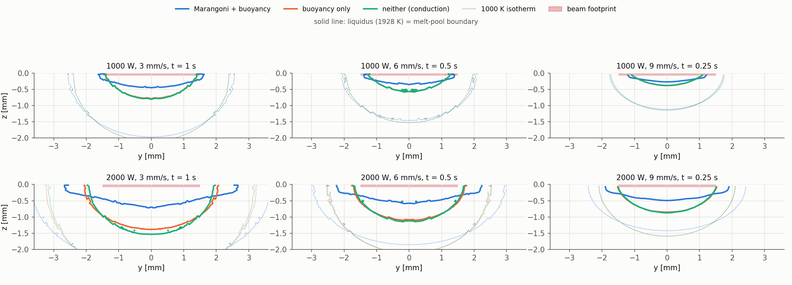

# Transient Laser Melt-Pool Simulation with Marangoni Flow

**ME323 course project.** This is a 3D, transient thermo-fluid simulation of a
moving laser melting the surface of a **Ti-6Al-4V** block. It is built on the
open-source finite-volume solver
[AdditiveFOAM](https://github.com/ORNL/AdditiveFOAM) 2.0.0, running on
OpenFOAM-14.

The model covers the whole thermal cycle of a laser track:

**solid heating → melting → Marangoni-driven melt flow → solidification**

It includes:
- heat conduction with temperature-dependent properties;
- latent heat;
- buoyancy;
- surface-tension (Marangoni) shear;
- convection and radiation to room temperature.

**Main study.** It follows the teaching assistant's specification and asks
how Marangoni convection affects the pool:

- a **3 mm uniform (top-hat) beam**;
- **1000 and 2000 W**;
- **3, 6 and 9 mm/s**;
- every setting run three times: **Marangoni + buoyancy**, **buoyancy only**
  and **neither**, giving 18 runs;
- outputs: pool geometry, temperature, and the solidification parameters
  **G and R**.

**Earlier exploratory work** used Gaussian beams: a 15-run parameter study, a
12-run 3 mm validation set and a beam-shape test. It is kept as appendices of
the report.

📄 **Full report: [docs/REPORT.md](docs/REPORT.md)** · ▶️ **[Run it yourself](#running-it-yourself)**



## Key results

**Uniform 3 mm beam, 18 runs.** Values are quasi-steady. The ranges cover the
six power–speed settings; [docs/REPORT.md](docs/REPORT.md) has every run.

| | Marangoni + buoyancy | Buoyancy only | Neither (conduction) |
|---|---|---|---|
| Pool depth | **0.31–0.70 mm** | 0.52–1.42 mm | 0.52–1.62 mm |
| Pool width | **2.6–5.4 mm** | 2.4–4.2 mm | 2.4–4.0 mm |
| Width / depth | **7.0–8.3** (pan) | 3.0–4.6 | 2.4–4.6 (bowl) |
| Peak temperature | **2251–2674 K** | 2609–3798 K | 2614–4046 K (above boiling, 3533 K, at 2000 W) |
| Peak melt speed | 0.19–0.41 m/s | 0.001–0.021 m/s | 0 |
| Median G | 727–1135 K/mm | 710–1153 K/mm | 707–1153 K/mm |
| Median R | **0.57–3.30 mm/s** | 1.39–4.79 mm/s | 1.53–4.79 mm/s |
| G/R | **354–1157 K·s/mm²** | 240–620 K·s/mm² | 236–608 K·s/mm² |

**How Marangoni flow changes the pool:**

- **Depth:** about halved (×0.43–0.61).
- **Width:** 10–36 % larger.
- **Peak temperature:** 360–1370 K lower. Superheat ≈ 0.76·Pe^−0.16 of its
  conduction value.
- **G:** unchanged (±7 %).
- **R:** 14–63 % lower.
- **G/R:** 1.3–2.5 times higher.
- **Melted area:** 26–46 % less.

**Buoyancy alone** changes the pool by under 3.5 % at 1000 W and by up to
12.5 % at 2000 W.





**Earlier Gaussian-beam study** (report Appendix A). With Marangoni flow the
pools were 0.37–0.60 mm deep and 6.6–8.8 times wider than deep. Without it
they were 2.3–2.4 times deeper and 2000–2500 K hotter: the same mechanism,
with a different beam.

## Model summary

| Item | Choice |
|---|---|
| Domain | 24 × 20 × 8 mm block. Half model (y ≥ 0) with a symmetry plane on the track centreline |
| Mesh | Fixed 100 µm hexahedral cells in the 12 × 4 × 2 mm fine region, graded to 1 mm outside; 288,750 cells |
| Laser | Gaussian (1/e² radius r), absorbed power ηP, moving along x from 8 to 12 mm, then off. 1.5 s simulated per run |
| Phase change | Enthalpy method. Solid fraction from a cosine-smoothed step between solidus 1878 K and liquidus 1928 K |
| Flow | Incompressible laminar Navier–Stokes, Boussinesq buoyancy, Carman–Kozeny mushy-zone damping (A_mush = 10⁸) |
| Marangoni | Top-surface shear μ ∂u/∂n = f_L (dσ/dT) ∇ₛT, applied only where molten. dσ/dT = −2.6 × 10⁻⁴ N/m·K |
| Heat losses | All surfaces: convection h = 25 W/m²K to 293 K. Top and sides also radiate (ε = 0.54) |
| Material data | Ti-6Al-4V, every value from a cited source: [materials/Ti6Al4V_sources.md](materials/Ti6Al4V_sources.md) |

The equations, boundary conditions, solver changes and verification checks are
in the [report](docs/REPORT.md). How each item maps onto AdditiveFOAM's source
code is in [docs/SIMULATION_PLAN.md](docs/SIMULATION_PLAN.md).

## Run matrix

**Main study (uniform beam).** Beam radius 1.5 mm (3 mm diameter), absorptivity
0.35, super-Gaussian exponent k = 20.

| Runs | Laser power (W) | Absorbed (W) | Speed (mm/s) | Force sets |
|---|---|---|---|---|
| U1000_v3_*, U1000_v6_*, U1000_v9_* | 1000 | 350 | 3, 6, 9 | `MaB`, `B`, `none` |
| U2000_v3_*, U2000_v6_*, U2000_v9_* | 2000 | 700 | 3, 6, 9 | `MaB`, `B`, `none` |

The three force sets differ only in these settings:

| Force set | dσ/dT (N/m·K) | β (1/K) | Flow solved |
|---|---|---|---|
| `MaB` | −2.6e-4 | 1.6e-4 | yes |
| `B` | 0 | 1.6e-4 | yes |
| `none` | 0 | 0 | no (conduction only) |

**Earlier Gaussian runs.**

| Runs | What they are |
|---|---|
| R01–R12 | Speed 4–10 mm/s, 300–800 W absorbed, r = 0.5–1.0 mm |
| R02_noMa, R06_noMa, R11_noMa | Without Marangoni flow |
| V1000/V1400_v6/v9/v12 (with and without `_noMa`) | 3 mm Gaussian validation set |
| V1400_v6_flat | Flat-top test, k = 10 |

The full table is in [config/baseline.json](config/baseline.json) and the
report.

## Data

All 15 runs are collected in **`results/melt_pool_dataset.xlsx`**, laid out as
machine-learning tables: every row carries the run name and its inputs.

| Sheet | Rows | Content |
|---|---|---|
| `runs` | 15 | One row per run: inputs, quasi-steady pool size, temperatures, speeds, solidification statistics, Marangoni quantities, Ma / Gr / Pe / Re |
| `timeseries` | 2,265 | Every run every 0.01 s |
| `marangoni` | 90 | Surface Marangoni shear, temperature gradient, surface speed and flow direction, every 0.25 s |
| `solidification` | 69,811 | Every solidification event: position, time, cooling rate, G, R, G/R |
| `columns` | 80 | Description and unit of every column |

Each run also has a folder `results/<run>/` holding:
- `summary.json`;
- a time-history plot;
- 2D temperature and velocity sections, isotherm and velocity contours, and
  velocity profiles, every 0.25 s;
- 3D cut-away, 3D isotherm and 3D velocity images;
- `marangoni_snapshots.csv`.

The section [What you get for each run](#what-you-get-for-each-run) lists every
file.

## Repository layout

```
config/baseline.json       all physical and numerical inputs, each tagged CONFIRMED / CHOSEN / SOURCED / DERIVED
materials/                 Ti6Al4V.cfg and its cited sources
templates/case/            static OpenFOAM case files (fields, numerics, resumable Allrun)
setup/                     install script, per-terminal environment, solver patches
external/AdditiveFOAM      solver source (git submodule, v2.0.0)
scripts/
  make_cases.py            builds cases/<run> from config/baseline.json (mesh, smoothed step, laser path)
  run_all.sh               runs, analyses and exports every case, skipping finished ones
  analyze_case.py          pool size, time series, solidification statistics, 2D sections
  export_3d.py             full-width 3D fields (ParaView .vtu), 3D images, surface Marangoni metrics
  export_excel.py          results/melt_pool_dataset.xlsx
  report_figures.py        summary figures for the report (docs/figures/)
  ta_figures.py            uniform-beam study: comparison figures (docs/figures/ta/), results/ta_summary.csv, ta_fits.csv
  estimate_pool.py         Rosenthal pool-size and time-step estimates
docs/
  REPORT.md                project report (uniform-beam study, Gaussian work in appendices)
  SIMULATION_PLAN.md       physics-to-solver mapping, design history
  SETUP.md                 installation
papers/                    reference papers (Gao 2021, Farzadi 2008, Pariona 2018, Fuhrich 2001)
results/                   per-run outputs and the dataset workbook
```

## Running it yourself

This section takes you from an empty machine to your own results. Steps 1–3
are done once. Steps 4–6 are the normal cycle: change the inputs, build the
cases, run them.

### What you need

| | |
|---|---|
| OS | Ubuntu 22.04 or 24.04 (tested natively on 22.04) |
| CPU / RAM | 8 cores and 8 GB RAM for the default cases. Fewer cores work: set `numerics.n_procs` (step 4) |
| Disk | About 3 GB for OpenFOAM and the build, plus about 0.45 GB per finished case |
| Access | `sudo`, once, to install OpenFOAM-14 from its apt repository |
| Time | About 30 min to install. Each case takes 15–35 min on 8 cores (6–8 min without Marangoni flow) |

### 1. Clone the repository with its solver

The solver, AdditiveFOAM, is a git submodule pinned to commit `8314d3c`. Clone
with `--recurse-submodules` so you get exactly that version:

```bash
git clone --recurse-submodules https://github.com/VatshVan/ME323-Multiphysics-melt-pool-Simulation.git
```

```bash
cd ME323-Multiphysics-melt-pool-Simulation
```

If you already cloned without it, fetch the submodule afterwards:

```bash
git submodule update --init
```

The submodule is the unmodified ORNL source. Our two solver fixes are not
committed inside it; they are kept as patch files in `setup/patches/`, and the
install script in step 2 applies them before building.

### 2. Install OpenFOAM-14, build the patched solver, create the Python environment

```bash
bash setup/install_stack.sh
```

The script asks for your `sudo` password once and then does everything:

1. installs `openfoam14` from `dl.openfoam.org` into `/opt/openfoam14`;
2. applies `setup/patches/*.patch` to `external/AdditiveFOAM`. It skips
   patches that are already applied, so re-running the script is safe;
3. builds `additiveFoam` (log in `setup/build.log`);
4. creates `.venv/` with the Python packages for case generation and
   post-processing (`requirements.txt`).

Then, **in every new terminal**, load the environment from the project root:

```bash
source setup/env.sh
```

It should print a line like
`OpenFOAM-14 | AdditiveFOAM 2.0.0 | project /path/to/ME323-...`.

### 3. Check the installation (optional, 1 minute)

```bash
mkdir -p ~/run && cp -r $ADDITIVEFOAM_TUTORIALS/AMB2018-02-B ~/run/
```

```bash
cd ~/run/AMB2018-02-B && ./Allrun
```

It should finish in seconds, and `log.additiveFoam` should end with
`Finalising parallel run`. Details are in [docs/SETUP.md](docs/SETUP.md).

### 4. Decide what to simulate: `config/baseline.json`

**Every input of the experiment lives in one file, `config/baseline.json`.**
The scripts contain no physical values of their own. You change the
experiment by editing this file, never the generated case files. Every entry
has a `value`, a `status` (CONFIRMED, CHOSEN, SOURCED or DERIVED) and usually a
`note` explaining why it has that value. SI units throughout: m, s, W, K.

#### The run table: what you will change most

`runs.value` is a list. **Each entry becomes one simulation** in `cases/<name>`:

```json
{"name": "R02", "speed": 0.004, "laser_power": 1428.57, "absorptivity": 0.35, "radius": 0.00075}
```

| Key | Meaning | Unit | Notes |
|---|---|---|---|
| `name` | Case and result folder name | – | Must be unique; becomes `cases/<name>` and `results/<name>` |
| `speed` | Laser scan speed | m/s | 0.004 = 4 mm/s |
| `laser_power` | Laser (machine) power | W | Power from the laser, before absorption |
| `absorptivity` | Fraction of the power absorbed by the metal | – | Absorbed power = `laser_power` × `absorptivity` |
| `radius` | Beam radius at 1/e² intensity (D4σ / 2) | m | **Half the spot diameter**: a 3 mm spot is `0.0015` |
| `dSigmadT` | *(optional)* Surface-tension coefficient for this run only | N/(m·K) | `0.0` switches the Marangoni force off. If omitted, the material value (−2.6e-4) is used |
| `cell_size` | *(optional)* Fine-region cell size for this run only | m | For grid studies, e.g. `5e-05` for 50 µm. If omitted, `mesh.cell_size` (100 µm) is used. 50 µm gives 1.57 M cells and runs about 10× longer |

Do not halve the power for the half model. The solver gives the half domain
exactly half of the beam automatically.

**Example: validation runs with a 3 mm spot at 1000 W and 1400 W.** The speed
(4 mm/s) and absorptivity (0.35) below are placeholders; use the experiment's
values. Add these lines to the `runs` list:

```json
{"name": "V1000", "speed": 0.004, "laser_power": 1000.0, "absorptivity": 0.35, "radius": 0.0015},
{"name": "V1400", "speed": 0.004, "laser_power": 1400.0, "absorptivity": 0.35, "radius": 0.0015}
```

Use a new `name` for every new setting, so the existing results stay
untouched.

#### The other sections

| Section | Keys | What it controls | Check before changing |
|---|---|---|---|
| `laser` | `x_start`, `x_end` | Start and end of the track (m). The laser switches off at `x_end` | Must lie inside the fine region `geometry.fine_x_start` … `fine_x_end` |
| | `depth` | Absorption depth of the volumetric source (m), 50 µm | Keep at least half a cell |
| | `k` | Beam profile exponent: 2 = Gaussian, larger = flatter top | |
| | `absorptivity` | Reference value only; each run sets its own | |
| `numerics` | `end_time` | Simulated time per run (s), including cooling after the laser stops | Laser-on time = (x_end − x_start) / speed. Keep `end_time` longer than that, plus about 0.2 s for solidification |
| | `write_interval` | How often fields are saved (s); each save gives one set of 2D/3D plots | Smaller = more plots and more disk |
| | `n_procs` | Number of parallel processes | At most your number of physical cores |
| | `maxCo` | Courant limit for the adaptive time step | 0.9 was tested stable; lower is safer and slower |
| `mesh` | `cell_size` | Cell size in the fine region (m), 100 µm | Halving it costs roughly 16× the run time. Every fine-region length must be a near-whole number of cells (`make_cases.py` stops with a message if not) |
| `geometry` | `length_x`, `half_width_y`, `depth_z` | Block size; y is the half width (symmetry plane at y = 0) | |
| | `roi_y`, `roi_z`, `fine_x_start`, `fine_x_end` | The uniformly fine region around the track | The whole pool must stay inside it (half width < `roi_y`, depth < `roi_z`) |
| | `outer_cell` | Largest cell size near the far walls | |
| `thermal_bc` | `T_initial`, `T_ambient` | Initial and surroundings temperature (K) | |
| | `h_top`, `h_sides`, `h_bottom` | Convection coefficients (W/m²K) | |
| | `emissivity_top`, `emissivity_sides` | Radiation (the bottom does not radiate) | |
| `mushy_zone` | `A_mush`, `B` | Carman–Kozeny damping constants; converted to AdditiveFOAM's DAS automatically | |
| `material` | `file` | Material property file | See below |

#### Material properties

The material file named in `material.file` (default
[materials/Ti6Al4V.cfg](materials/Ti6Al4V.cfg)) holds the thermophysical
properties. It contains `kappa` and `Cp` as polynomials in T for solid and
liquid, plus `rho`, `mu`, `beta`, `Lf`, `dSigmadT` and the solidus/liquidus in
`thermoPath`. (Radiation uses the emissivities in `thermal_bc`.) To change a property for every run, edit it
there and record its source in
[materials/Ti6Al4V_sources.md](materials/Ti6Al4V_sources.md). For another
alloy, copy the file, change the values, and point `material.file` at the copy.
`make_cases.py` builds the smoothed solid fraction from the solidus and
liquidus in `thermoPath`, so you only give its two end points.

#### Estimate before you run

```bash
python scripts/estimate_pool.py --only V1000 V1400
```

For each run, this prints a quick conduction (Rosenthal) estimate of the pool
size, the peak beam intensity and the laser-on time. It warns if a setting will
not melt, if the pool may leave the fine region, or if `end_time` is shorter
than the track. For runs that were already simulated it also prints the
simulated width and depth. The comparison shows how much the Marangoni flow
changes the shape: for R02 the estimate is 3.2 mm wide and 1.6 mm deep, while
the simulation gives 4.0 mm wide and 0.5 mm deep.

### 5. Build the cases

```bash
python scripts/make_cases.py --only V1000 V1400
```

Without `--only`, every run in the table is (re)built. For each case the script
writes `cases/<name>/` with:
- the graded mesh (`blockMeshDict`);
- the laser path and beam (`scanPath`, `heatSourceDict`);
- the material with the smoothed solid fraction (`transportProperties`);
- the boundary conditions (`0/T`);
- the solver settings (`controlDict`, `decomposeParDict`);
- `case_info.json`, recording exactly which inputs it used.

It prints the cell count for each case. Building a case again overwrites it.

### 6. Run, analyse and export

```bash
nohup bash scripts/run_all.sh V1000 V1400 > run_all.log 2>&1 &
```

With no names, it runs every case in `cases/`. For each case it:
1. meshes and decomposes it, and runs the solver in parallel (`cases/<name>/Allrun`);
2. analyses it with `scripts/analyze_case.py` and `scripts/export_3d.py` →
   `results/<name>/`;
3. rebuilds `results/melt_pool_dataset.xlsx` with all analysed runs.

`nohup … &` keeps it running after you close the terminal. Follow progress
with:

```bash
tail -f run_all.log
```

Watch the solver itself with:

```bash
tail -f cases/V1000/log.additiveFoam
```

**Two rules of `run_all.sh`:**
- **It skips any case that already has `results/<name>/summary.json`.** The 15
  runs in this repository are already analysed, so they are skipped. To repeat
  one with new inputs, give it a new name (recommended), or delete its result
  folder first (`rm -r results/R02`) and rebuild it with `make_cases.py`.
- **It resumes interrupted cases.** If the PC restarts, run the same command
  again: an unfinished case continues from its last saved time.

After all runs finish, refresh the report figures:

```bash
python scripts/ta_figures.py               # uniform-beam study (U* runs), docs/figures/ta/
python scripts/report_figures.py --areas   # Gaussian exploratory study (R* runs), docs/figures/
```

### What you get for each run

`results/<name>/`:

| File | Content |
|---|---|
| `summary.json` | Inputs, melting time, quasi-steady pool size, peak temperature and speed, solidification statistics |
| `history.png` | Peak temperature, peak speed and pool length/width/depth against time |
| `sections_<t>s.png` | Temperature field on the symmetry plane and the cross-section through the beam, heated zone and pool close-up with velocity arrows |
| `contours_<t>s.png` | Pool close-up: **10 labelled isotherms with velocity vectors**, and **velocity-magnitude contours** in the melt |
| `velocity_profiles_<t>s.png` | **Velocity profiles**: surface velocity along and across the pool, horizontal velocity against depth, vertical velocity under the beam |
| `3d_<t>s.png` | 3D cut-away of the full (mirrored) block, coloured by temperature |
| `3d_isotherms_<t>s.png` | **3D view of 10 nested isotherm surfaces** |
| `3d_velocity_<t>s.png` | **3D melt pool coloured by speed, with 3D velocity arrows** |
| `marangoni_snapshots.csv` | Marangoni shear stress, surface temperature gradient, surface speed and flow direction at every saved time |

`<t>` is every `write_interval` (0.25 s by default). The pool plots appear
only for times when there is a pool.

`cases/<name>/VTK_full/*.vtu` holds the full 3D fields for ParaView, and
`cases/<name>/case.foam` opens the raw OpenFOAM case in ParaView.

Any step can be repeated on its own for one case, for example after changing a
plot:

```bash
python scripts/analyze_case.py cases/V1000                    # everything for one case
```

```bash
python scripts/analyze_case.py cases/V1000 --sections-only    # only the 2D plots
```

```bash
python scripts/export_3d.py cases/V1000 --no-vtu              # only the 3D images
```

```bash
python scripts/export_excel.py                                # rebuild the workbook
```

### Troubleshooting

| Problem | Cause and fix |
|---|---|
| `additiveFoam: command not found` | The environment is not loaded: `source setup/env.sh` from the project root |
| `ERROR: cannot apply ... .patch` during install | The submodule is not at commit `8314d3c`: `git submodule update --init`, then re-run the install |
| `make_cases.py` stops with "more than 5% off the target" | A fine-region length is not a near-whole number of `cell_size`; adjust the length or the cell size |
| A run is skipped by `run_all.sh` | `results/<name>/summary.json` exists; use a new name or delete that folder |
| `solver did not finish` in `run_all.log` | Read the last lines of `cases/<name>/log.additiveFoam` for the error. Run `estimate_pool.py` to check the pool fits in the fine region; if the time step became very small, try a lower `maxCo` |
| 3D images fail with an OpenGL error | Install the off-screen libraries: `sudo apt install libgl1 libxrender1` |
| Line-ending errors in OpenFOAM files after a Windows checkout | `git add --renormalize .` (the repository forces LF) |

## Solver modifications

AdditiveFOAM's tutorials solve heat conduction only. To run the full melt flow,
three changes were made:
- the flow solve is switched on (`nOuterCorrectors 1`);
- two small patches in [setup/patches/](setup/patches/), applied automatically
  by the install script:
  - **`marangoni-assignable`:** stops the pressure step from pushing mass
    through the closed top surface;
  - **`marangoni-liquid-fraction`:** scales the Marangoni shear by the liquid
    fraction, so it acts only on molten surface.

## Limitations

- The top surface is flat and fixed: there is no evaporation, recoil pressure
  or keyhole. This is fine below the boiling point, as in all Marangoni runs.
- The grid is fixed at 100 µm, with no mesh-independence study. Pools are 4–6
  cells deep, so trends between runs are more reliable than absolute values.
- The track is short (4 mm). Depth and peak temperature reach steady state,
  but width and length still grow 3–4 %.

## References

- S. Gao et al., *Optics & Laser Technology* 142 (2021) 107215.
- A. Farzadi et al., *Int. J. Adv. Manuf. Technol.* 38 (2008) 258–267.
- M. M. Pariona et al., *Int. J. Heat Mass Transfer* 119 (2018) 10–19.
- T. Fuhrich et al., *J. Laser Appl.* 13 (2001) 178–186.

Material data sources are listed in
[materials/Ti6Al4V_sources.md](materials/Ti6Al4V_sources.md).
