# Effect of Marangoni Convection on Melt-Pool Geometry, Temperature and Solidification under a 3 mm Uniform Laser Beam on Ti-6Al-4V

**ME323 course project: final report**

Solver: AdditiveFOAM 2.0.0 on OpenFOAM-14 · Material: Ti-6Al-4V ·
Main study: 18 simulations with a 3 mm uniform (top-hat) beam, 1000 and
2000 W, 3, 6 and 9 mm/s, each run with Marangoni + buoyancy, buoyancy only and
neither · Appendices: 30 further runs with Gaussian beams (exploratory study,
Gaussian validation set, beam-shape test, driving-force check)

---

## Abstract

This report studies one question in depth: **how does Marangoni
(thermocapillary) convection change the melt pool that a moving laser creates
on Ti-6Al-4V?** The pool's geometry, temperature, temperature gradient G and
solidification rate R are compared with and without that convection.

A three-dimensional, transient thermal-fluid model was built with the
open-source finite-volume code AdditiveFOAM. The model includes:

- heat conduction with temperature-dependent properties and latent heat;
- a smoothed solid–liquid transition;
- incompressible melt flow, damped in the mushy zone by a Carman–Kozeny term;
- Boussinesq buoyancy;
- the Marangoni shear stress on the molten top surface;
- convection and radiation from every outer surface.

The laser is a uniform (top-hat) beam, 3 mm in diameter, moving 4 mm along the
centreline of a 24 × 20 × 8 mm block.

The design follows the teaching assistant's specification:

- laser power 1000 W and 2000 W (absorbed 350 W and 700 W at an absorptivity of
  0.35);
- scan speed 3, 6 and 9 mm/s;
- every power–speed combination run three times, with the driving forces
  switched on and off one at a time: **Marangoni + buoyancy (MaB)**, **buoyancy
  only (B)**, and **neither (pure conduction)**.

This gives 18 runs on a fixed 100 µm grid. Every run conserves mass to 10⁻¹⁰,
absorbs exactly the intended power and finishes without numerical failure.

**Main findings.**

1. **Marangoni flow reshapes the pool from a bowl into a shallow pan.** With
   the flow, the pool is:
   - 40–57 % shallower (0.31–0.70 mm instead of 0.52–1.62 mm);
   - 10–36 % wider (2.6–5.4 mm instead of 2.4–4.0 mm);
   - 7.0–8.3 times wider than deep instead of 2.4–4.6.

   At 2000 W the Marangoni pool is almost twice as wide as the 3 mm beam.
   The conduction pool is never wider than 1.33 beam diameters.
2. **Marangoni flow is a thermostat.** The peak temperature falls by 360–1370 K
   and the superheat above the liquidus is cut to 35–47 % of its conduction
   value. Without the flow, every 2000 W pool exceeds the boiling point of the
   alloy (3533 K). With it, every pool stays more than 850 K below boiling.
   - The reduction follows a single law in the flow Péclet number Pe:
     ΔT_Ma/ΔT_cond ≈ 0.76·Pe^−0.16 (R² = 0.99).
   - The depth ratio follows d_Ma/d_cond ≈ 1.12·Pe^−0.20 (R² = 0.99).
3. **Marangoni flow melts less metal.** The fusion-zone cross-section is
   26–46 % smaller and the melting efficiency falls from 11–26 % to 7–16 %. The
   outward flow spreads the heat over a wide surface, where most of it is
   conducted into solid metal without melting it.
4. **Marangoni flow changes the solidification conditions.**
   - The temperature gradient G is almost unchanged (±7 %).
   - The median solidification rate R falls by 14–63 %, because the flat pan
     has a fusion boundary that faces upward rather than backward.
   - G/R therefore rises by a factor of 1.3–2.5, favouring columnar growth.
   - The median cooling rate G·R falls by 18–62 %.
   - Along the fusion boundary, R near the bottom of the Marangoni pool is
     3–10 times lower than at the same place in the conduction pool.
5. **Buoyancy alone is a minor force.** At 1000 W it changes nothing by more
   than 3.5 % (buoyancy Péclet number below 1). At 2000 W it makes the pool up
   to 12.5 % shallower and 250 K cooler (Péclet 1.3–4.8). The surface tension
   force exceeds buoyancy by a factor of 330–1400 (Ma/Gr).
6. **Scaling laws.** In the Marangoni runs:
   - depth ∝ P^0.65·v^−0.32;
   - width ∝ P^0.70·v^−0.22;
   - superheat ∝ P^0.98·v^−0.14;
   - R ∝ P^−1.10·v^1.02.

   In conduction the depth scales almost linearly with power (P^1.00·v^−0.40)
   and the width only weakly (P^0.44). **Marangoni flow converts extra power
   into width rather than depth.**

The same mechanisms are confirmed by 30 Gaussian-beam runs in the appendices:

- an exploratory parameter study;
- a Gaussian validation set at the same 3 mm diameter;
- a beam-shape test;
- a driving-force check showing that the melt stays at rest to round-off
  (10⁻¹⁶ m/s) when both forces are removed.

Section 11 is left ready for the laboratory validation.

---

## Summary of the requested outputs

The teaching assistant asked for **geometry and temperature, and G and R**.
This table gives them for all 18 runs.

- **Pool values** are the quasi-steady liquidus pool: depth d, full width w,
  peak temperature T_max.
- **G and R** are medians over the track.
- **Full detail:** Section 8 and Appendix G.

| Power, speed | Force set | d (mm) | w (mm) | T_max (K) | G (K/mm) | R (mm/s) | G/R (K·s/mm²) | G·R (K/s) |
|---|---|---|---|---|---|---|---|---|
| 1000 W, 3 mm/s | **Marangoni + buoyancy** | 0.46 | 3.24 | 2328 | 984 | 1.07 | 1123 | 1185 |
|  | buoyancy only | 0.82 | 2.88 | 2866 | 1005 | 1.70 | 620 | 1753 |
|  | neither | 0.85 | 2.87 | 2900 | 1000 | 1.73 | 608 | 1767 |
| 1000 W, 6 mm/s | **Marangoni + buoyancy** | 0.37 | 2.83 | 2286 | 1135 | 2.89 | 436 | 3103 |
|  | buoyancy only | 0.64 | 2.59 | 2727 | 1098 | 3.32 | 337 | 3782 |
|  | neither | 0.64 | 2.58 | 2739 | 1097 | 3.35 | 335 | 3782 |
| 1000 W, 9 mm/s | **Marangoni + buoyancy** | 0.31 | 2.61 | 2251 | 1083 | 3.30 | 354 | 3534 |
|  | buoyancy only | 0.52 | 2.37 | 2609 | 1153 | 4.79 | 240 | 5574 |
|  | neither | 0.52 | 2.37 | 2614 | 1153 | 4.79 | 237 | 5585 |
| 2000 W, 3 mm/s | **Marangoni + buoyancy** | 0.70 | 5.39 | 2674 | 727 | 0.57 | 1157 | 421 |
|  | buoyancy only | 1.42 | 4.23 | 3798 | 710 | 1.39 | 531 | 1027 |
|  | neither | 1.62 | 3.97 | 4046 | 707 | 1.53 | 482 | 1095 |
| 2000 W, 6 mm/s | **Marangoni + buoyancy** | 0.58 | 4.58 | 2633 | 807 | 1.09 | 765 | 1040 |
|  | buoyancy only | 1.19 | 3.57 | 3729 | 814 | 2.67 | 320 | 2158 |
|  | neither | 1.29 | 3.46 | 3856 | 816 | 2.86 | 302 | 2179 |
| 2000 W, 9 mm/s | **Marangoni + buoyancy** | 0.50 | 4.16 | 2609 | 824 | 1.64 | 547 | 2007 |
|  | buoyancy only | 1.04 | 3.24 | 3641 | 886 | 3.83 | 245 | 3131 |
|  | neither | 1.09 | 3.19 | 3709 | 886 | 4.02 | 236 | 3125 |

**How Marangoni flow changes these outputs (in one line each):**

- **Depth:** about halved.
- **Width:** 10–36 % larger.
- **Peak temperature:** 360–1370 K lower.
- **G:** unchanged.
- **R:** 14–63 % lower.
- **G/R:** 1.3–2.5 times higher.
- **Cooling rate G·R:** 18–62 % lower.

Buoyancy alone changes them by less than 3.5 % at 1000 W and by up to
12.5 % at 2000 W.

---
## Contents

- [Summary of the requested outputs](#summary-of-the-requested-outputs)
- [Nomenclature](#nomenclature)
- [1. Introduction](#1-introduction)
- [2. Literature review and observed relationships](#2-literature-review-and-observed-relationships)
- [3. Objectives and scope](#3-objectives-and-scope)
- [4. Problem definition and design of experiments](#4-problem-definition-and-design-of-experiments)
- [5. Mathematical model](#5-mathematical-model)
- [6. Numerical method and verification](#6-numerical-method-and-verification)
- [7. Post-processing: how every output is defined](#7-post-processing-how-every-output-is-defined)
- [8. Results](#8-results)
- [9. How Marangoni convection affects everything](#9-how-marangoni-convection-affects-everything)
- [10. Run-by-run observations (all 18 runs)](#10-run-by-run-observations-all-18-runs)
- [11. Experimental validation (to be completed)](#11-experimental-validation-to-be-completed)
- [12. Comparison with the literature](#12-comparison-with-the-literature)
- [13. Limitations](#13-limitations)
- [14. Conclusions](#14-conclusions)
- [References](#references)
- [Appendix A: Exploratory Gaussian-beam parameter study (R runs)](#appendix-a-exploratory-gaussian-beam-parameter-study-r-runs)
- [Appendix B: Gaussian 3 mm validation set (V runs)](#appendix-b-gaussian-3-mm-validation-set-v-runs)
- [Appendix C: Beam shape, uniform against Gaussian](#appendix-c-beam-shape-uniform-against-gaussian)
- [Appendix D: Driving-force check](#appendix-d-driving-force-check)
- [Appendix E: Grid study](#appendix-e-grid-study)
- [Appendix F: Data files and reproduction](#appendix-f-data-files-and-reproduction)
- [Appendix G: Full output tables of the uniform-beam study](#appendix-g-full-output-tables-of-the-uniform-beam-study)
- [Appendix H: Case set-up of the uniform-beam runs](#appendix-h-case-set-up-of-the-uniform-beam-runs)
- [Appendix I: Questions and answers](#appendix-i-questions-and-answers)

---

## Nomenclature

| Symbol | Meaning | Unit |
|---|---|---|
| P | Laser (nominal) power | W |
| η | Absorptivity (fraction of P absorbed) | – |
| P_abs = ηP | Absorbed power | W |
| v | Scan speed | m/s (mm/s in tables) |
| r | Beam radius (1.5 mm in the main study) | m |
| q₀ | Peak absorbed surface intensity | W/m² |
| E = P_abs/v | Line energy (absorbed) | J/mm |
| T, T_s, T_l | Temperature, solidus (1878 K), liquidus (1928 K) | K |
| T_b | Boiling temperature of Ti-6Al-4V (3533 K) | K |
| T_max | Quasi-steady peak temperature | K |
| ΔT_sh = T_max − T_l | Superheat | K |
| f_s, f_L | Solid and liquid volume fraction (f_L = 1 − f_s) | – |
| **u**, U | Velocity vector, speed | m/s |
| u_s | Mean surface speed of the melt | m/s |
| σ, dσ/dT | Surface tension and its temperature coefficient | N/m, N/m·K |
| τ_M | Marangoni shear stress, \|dσ/dT\|·\|∇ₛT\| | Pa |
| β | Volumetric thermal expansion coefficient | 1/K |
| μ, ρ, k, c_p | Viscosity, density, conductivity, specific heat | SI |
| L_f | Latent heat of fusion | J/kg |
| λ | Dendrite arm spacing in the Darcy term (79 µm) | m |
| d, w, L | Pool depth, full width and length (liquidus surface) | mm |
| A_fz | Fusion-zone (melted track) cross-section | mm² |
| η_m | Melting efficiency ρ v A_fz H_m / P_abs | – |
| G | Temperature gradient at the solidification front | K/mm |
| R | Solidification (front) rate | mm/s |
| G·R | Cooling rate | K/s |
| G/R | Morphology parameter | K·s/mm² |
| Ma | Marangoni number ρ L_R ΔT \|dσ/dT\| / μ² | – |
| Gr | Grashof number g β L_B³ ΔT ρ² / μ² | – |
| Pe | Flow Péclet number u_s ρ c_p L_R / k | – |
| Re | Reynolds number ρ u_s L_R / μ | – |
| MaB, B, none | Force sets: Marangoni + buoyancy, buoyancy only, neither | – |

Run names are `U<power>_v<speed>_<force set>`, for example `U2000_v6_MaB` is
2000 W nominal power, 6 mm/s, Marangoni + buoyancy.

---

## 1. Introduction

### 1.1 Laser melt pools in manufacturing

Many laser processes create a small, moving pool of molten metal:

- **laser surface melting and remelting**, used to refine the surface
  microstructure;
- **laser welding** in conduction mode;
- **directed energy deposition (DED) and laser cladding**, where powder or wire
  is added into the pool;
- **laser powder-bed fusion**, where the pool is much smaller but the physics
  is the same.

In all of them, three things decide the quality of the result:

- the **shape and size** of the pool: penetration depth, bead width and
  dilution;
- its **temperature**: overheating causes evaporation, spatter, loss of
  alloying elements and keyholing;
- the **way it solidifies**: the temperature gradient G and the solidification
  rate R at the moving solid–liquid front set the grain shape and size, and
  through them the strength, ductility and anisotropy of the part.

Ti-6Al-4V is the most widely used titanium alloy in aerospace, biomedical and
energy applications, and the most widely studied alloy in additive
manufacturing. Its low thermal conductivity, about 7 W/m·K at room temperature
and 28 W/m·K near the melting point, makes its pools sensitive to how heat is
moved inside the liquid. Its prior-β grains tend to grow as long columns along
the build direction, so G and R are of direct practical interest.

### 1.2 Why the flow in the pool matters

A pool of molten metal is not still. Three forces can drive flow in a laser
pool without a free-surface deformation:

1. **Surface tension gradient (Marangoni or thermocapillary force).** For most
   pure metals and alloys, including Ti-6Al-4V, surface tension falls as
   temperature rises (dσ/dT < 0).
   - The hot centre of the pool, under the beam, therefore has a lower surface
     tension than the cooler rim.
   - The surface liquid is pulled from the centre towards the rim, at speeds of
     tenths of a metre per second.
   - The surface flow carries heat with it and returns along the bottom of the
     pool.
2. **Buoyancy.** Hot liquid is lighter than cold liquid. Under the beam it
   rises and spreads; near the cooler boundary it sinks. The force scales with
   the volume of the pool, while the Marangoni force scales with its surface,
   so buoyancy matters more in large pools.
3. **Electromagnetic (Lorentz) force.** Present in arc welding, where current
   flows through the pool. In laser processing there is no current, so it is
   absent.

The relative importance of these forces decides whether heat inside the pool
is carried mainly by **conduction** or mainly by **convection**. The ratio is
measured by the Péclet number Pe:

- **Pe ≪ 1:** conduction dominates. The pool shape follows the shape of the
  heat source, like a bowl under a spot.
- **Pe ≫ 1:** the flow sets the shape. The direction of the surface flow then
  decides whether the pool becomes wide and shallow (outward flow) or narrow
  and deep (inward flow).

### 1.3 The question set by the teaching assistant

The teaching assistant asked for one focused study. The main question is
**how the Marangoni effect affects everything**:

- the geometry of the pool;
- its temperature;
- the solidification parameters G and R.

The specification is:

- laser powers 1000 W and 2000 W;
- scan speeds 3, 6 and 9 mm/s;
- three cases at every setting: **with Marangoni and buoyancy, with buoyancy
  only, and without both**;
- outputs: pool geometry and temperature, and G and R;
- a **uniform heat source, 3 mm in diameter**.

The answer requires running the same pool three times with the physics switched
on and off. A laboratory can never do this, because a real alloy always has its
surface tension gradient and its buoyancy. Only a simulation can switch a force
off and measure what changes. This is the main value of the present study.

### 1.4 Structure of this report

- **Sections 2–3:** literature review and objectives.
- **Sections 4–7:** the problem, the model, the numerical method and the
  definitions of every output.
- **Section 8:** the results of the 18 uniform-beam runs, quantity by quantity.
- **Section 9:** a synthesis that answers the main question directly. It traces
  the chain of cause and effect from the surface tension gradient to the
  microstructure and lists every quantified effect.
- **Section 10:** each of the 18 runs described individually, with its contour
  plots, velocity profiles and sections. This follows the style of the
  reference papers, which describe the pattern observed in every run.
- **Section 11:** reserved for the experimental validation.
- **Sections 12–14:** comparison with the literature, limitations and
  conclusions.
- **Appendices:** the earlier Gaussian-beam work in full, which was
  exploratory but provides independent confirmation.

A reading guide for different questions follows in §1.5.

### 1.5 How to read this report

The report is long because it records every run. Different readers will need
different parts.

| Reader's question | Where to look |
|---|---|
| What are the answers, in short? | The **Summary of the requested outputs** after the abstract: depth, width, peak temperature, G and R for every run, and how Marangoni flow changes each |
| How does Marangoni flow change the pool, and why? | **Section 9.** It traces the chain of cause and effect step by step and lists every quantified effect in one table (§9.2) |
| What does a particular run look like? | **Section 10.** It has the run's data table, its contour plots with 10 isotherms and velocity vectors, velocity profiles, sections, 3D view and history, and the observations made from them |
| Which laser settings give a required depth or width? | **§9.6**, with the fitted design equations and worked examples |
| How will the model be validated? | **Section 11**, with the tables ready to fill in |
| How was the model built, and can it be trusted? | **Sections 5–7** for the model and outputs, **§6.4** for verification, **§8.12** for the analytical cross-check, **§8.13** for uncertainty, **Appendix D** for the driving-force check |
| How do I repeat the study? | **Appendices F and H**, and the README |
| What was done before the uniform-beam study? | **Appendices A–C**: the Gaussian exploratory study, the Gaussian validation set and the beam-shape comparison, which confirm the same conclusions independently |

Figures referred to as "Figure n" are in the main text. Figures in the
appendices are numbered A.n, B.n and so on. Per-run figures in Section 10 are
captioned with the run name.

---

## 2. Literature review and observed relationships

Four papers were provided as the reference set for this project. They model or
measure melt pools in different processes and alloys. Each reports a set of
observations, run by run, and a set of relationships between the process inputs
and the pool. This section summarises what each paper does and finds, because
the later sections compare our results with these findings point by point
(Section 12).

### 2.1 Fuhrich, Berger and Hügel (2001): Marangoni effect in laser deep-penetration welding of steel

**What they did.** Fuhrich et al. modelled the melt flow around a fixed,
cylindrical keyhole in laser welding of steel. The keyhole wall was held at the
evaporation temperature and the pool surface was flat and fixed. They varied
the sign of dσ/dT:

- **negative**, as for pure iron;
- **positive**, as for steel with surface-active elements such as sulphur.

**What they observed.**

- **Negative dσ/dT** (the case relevant to Ti-6Al-4V):
  - The surface tension is lower at the hot keyhole than at the cool outer
    boundary, so a thin surface layer of liquid is accelerated outward.
  - The maximum surface velocity, 114 m/min, occurs just behind the keyhole and
    is **57 times the welding speed**.
  - The isotherms on the surface are **almost equally spaced**, so the radial
    temperature gradient is nearly constant across most of the pool. They
    explain this as a self-regulating effect: steep gradients near the keyhole
    drive fast outward flow, which carries heat outward and flattens the
    gradient.
  - Most of the flow activity is confined to the top layer of the pool (about
    1 mm). Underneath, the isotherms look like pure conduction.
- **Positive dσ/dT:**
  - The flow reverses and runs towards the keyhole.
  - The isotherms crowd together behind the keyhole, the surface gradients
    become very large, and the surface speed reaches 156 m/min (78 times the
    welding speed).
  - The flow turns downward along the keyhole wall and carries hot liquid
    deep into the pool.

**Relationships reported.**

- **Direction:** the sign of dσ/dT sets the direction of the surface flow and,
  through it, whether heat is spread sideways (wide, shallow pool) or driven
  downward (narrow, deep pool).
- **Speed:** the flow speed is tens of times the process speed.
- **Self-regulation:** the surface gradient regulates itself, because
  convection acts in the same direction as conduction when dσ/dT < 0.

### 2.2 Farzadi, Serajzadeh and Kokabi (2008): heat transfer and fluid flow in GTA welding of pure aluminium

**What they did.** Farzadi et al. solved the steady three-dimensional energy
and momentum equations, in a frame moving with the arc, for gas-tungsten-arc
welding of commercially pure aluminium. They included three driving forces:
surface tension, the electromagnetic force and buoyancy. They varied the
welding current, voltage and speed for two plate thicknesses and compared
predicted weld cross-sections with experiments.

**What they observed.**

- **Effect of heat input:**
  - The weld pool width and depth both increase with the net heat input.
  - The peak temperature and the maximum velocity both increase with heat
    input.
- **Flow pattern:** dγ/dT is negative, so the surface flow is outward, from
  the centre to the periphery.
- **Thermal cycles:**
  - Slower welding gives a higher peak temperature and lower heating and
    cooling rates.
  - Heating rates are higher than cooling rates.
  - The thermal cycles show an **inflection at the liquidus temperature**,
    caused by the enthalpy difference between solid and liquid.
- **Asymmetry of the field:** at equal distance from the source, the
  temperature is higher sideways (y) than downward (z). They attribute this to
  the wide, shallow pool produced by the outward surface-tension-driven flow.
- **Dimensionless numbers:**
  - The Péclet number is much larger than one, so heat in the pool is carried
    mainly by convection.
  - Pe increases with heat input and with lower welding speed.
  - They estimate the importance of each driving force from the Grashof
    number, the magnetic Reynolds number and the surface tension Reynolds
    number (Ma). The surface tension and electromagnetic forces dominate and
    buoyancy is the least important.
- **Solidification:**
  - G/R decreases from the fusion line towards the weld centreline.
  - The structure changes from cellular near the fusion line to dendritic
    towards the centre.
  - G·R, the cooling rate, rises with welding speed.
  - Higher heat input lowers G·R and raises G/R.

**Relationships reported.**

- **Pool size:** width and depth both increase with heat input.
- **Thermal cycle:** the peak temperature increases, and the heating and
  cooling rates decrease, as the welding speed decreases.
- **Pe:** increases with heat input, with Pe ≫ 1.
- **Solidification:** the front rate is R = v·cos θ along the pool boundary,
  where θ is the angle between the front normal and the welding direction. So
  R is close to zero at the bottom and close to v at the tail.
- **Velocity scale:** the maximum surface velocity can be estimated from a
  boundary-layer balance of the Marangoni shear (their Eq. 20).

### 2.3 Pariona, Taques and Woiciechowski (2018): Marangoni effect in laser surface treatment of Al-Fe, varying the scan speed

**What they did.** Pariona et al. modelled a single laser track on an
Al-1.5 wt% Fe alloy with the finite element method (COMSOL), including the
Marangoni boundary condition. They varied the laser beam velocity and compared
the predictions with micrographs, SEM and atomic-force microscopy of real
tracks.

**What they observed.**

- **Flow structure:** the flow in the cross-section forms **two symmetric
  vortices** about the track centreline, one rotating clockwise and one
  counterclockwise.
- **Location of the largest values:** the highest velocities and the highest
  thermal gradients occur at the surface of the workpiece. The smallest occur
  at the pool–substrate interface.
- **Effect of scan speed on the flow:** the Marangoni effect is **stronger at
  lower scan speeds**. At low speed the pool is larger and lives longer, so the
  flow has more time and space to develop.
- **Effect of scan speed on the track:**
  - The track surface shows more defects and a rougher morphology at low speed
    than at high speed.
  - The measured depth fell from 257 µm to 189 µm over a threefold increase in
    speed, while the width hardly changed.
  - The surface temperature gradients reach 5–8.5 × 10⁶ K/m.

**Relationships reported.**

- **Depth and speed:** the pool depth decreases with speed, but weakly.
- **Flow strength and speed:** the Marangoni flow becomes weaker as the speed
  increases.
- **Gradients:** the steepest gradients are at the surface and the smallest at
  the bottom of the pool.

### 2.4 Gao et al. (2021): molten-pool characteristics of a NiTi shape-memory alloy in DED

**What they did.** Gao et al. built a coupled thermal–fluid model, in COMSOL
with a moving mesh, of directed energy deposition of NiTi powder on a titanium
substrate. They validated it against single-track cross-sections at several
laser powers, scan speeds and powder feed rates.

**What they observed.**

- **Validation accuracy:** the simulated height, width and depth of the clad
  agreed with experiment to within 7.5–11 % for the reference case. Across all
  parameters the maximum deviations were 9.8 % (width), 13 % (height) and
  13.6 % (depth).
- **Effect of laser power:** as the power increases, **the width increases
  rapidly while the depth and height change only slightly**. They attribute
  this to the negative thermocapillary coefficient: the outward flow broadens
  the clad and weakens the increase in depth.
- **Effect of scan speed:** a higher speed reduces the height strongly, but the
  width and depth only slowly, because the convection also weakens.
- **Flow and mixing:**
  - The velocity field is better developed at higher power and lower speed.
  - A well-developed flow gives uniform mixing of elements.
  - A weak flow leaves chemical stratification and segregated phases.
- **G and R along the boundary:**
  - They computed G and R at three points on the solidification front, at the
    top, the middle and the bottom of the bead.
  - **R is smallest at the bottom**, where the front normal is almost
    vertical, and largest at the top.
  - G is largest at the bottom in their case.
  - G/R therefore falls from the bottom to the top. The grains change
    accordingly, from **planar at the bottom through cellular and columnar to
    equiaxed at the top**.

**Relationships reported.**

- **Width:** mainly determined by the laser power.
- **Depth:** set jointly by power, speed and feed rate.
- **Mixing:** improves with flow strength.
- **Solidification:** G/R decreases and G·R increases from the bottom to the
  top of the bead. Grain morphology follows G/R and grain size follows G·R.

### 2.5 What the literature establishes and what it leaves open

The four papers agree on the following:

1. With dσ/dT < 0 the surface flow is outward and the pool becomes wide and
   shallow (all four).
2. The flow is much faster than the process speed and confined to a surface
   layer (Fuhrich, Pariona).
3. Convection dominates heat transport in the pool, with Pe ≫ 1, and buoyancy
   is the weakest force (Farzadi).
4. Width grows faster with power than depth does (Gao).
5. Depth falls weakly with speed (Gao, Pariona). Higher speed raises the cooling
   rate and lowers G/R (Farzadi).
6. R is small at the bottom and close to v at the tail, so the structure
   changes from planar or cellular at the fusion line to columnar or equiaxed
   higher up (Farzadi, Gao).

What none of them does is **remove the driving forces one at a time** from the
same pool and measure every output: geometry, temperature, G and R. Fuhrich et
al. come closest by changing the sign of dσ/dT, but in a keyhole with a fixed
geometry. The present study fills this gap for a conduction-mode pool under a
uniform beam on Ti-6Al-4V.

### 2.6 Theoretical background: scales that govern a laser melt pool

Before the simulations, a few classical estimates show what to expect and which
dimensionless groups matter. They are used later to interpret the results.

**Conduction pool: the Rosenthal solution.**

- **The solution.** For a point source of power P moving at speed v over a
  thick plate with constant properties, the steady temperature field in a frame
  moving with the source is

  $$T - T_0 = \frac{P}{2\pi k\,\rho_r}\exp\!\left[-\frac{v(\rho_r + \xi)}{2\alpha}\right]$$

  where ρ_r is the distance from the source, ξ the coordinate along the scan
  direction and α = k/(ρc_p).
- **The scan Péclet number** vL/(2α) measures how far the beam moves while
  heat diffuses over the pool size L.
  - At high Péclet number, the isotherms are compressed ahead of the beam and
    trail behind it.
  - The maximum width of an isotherm at temperature T_m then becomes
    w ≈ [8P/(πe ρc_p v (T_m − T_0))]^½, which scales as (P/v)^½.
- **Pool shape.** A point source gives a hemispherical pool, d = w/2. A
  source spread over a disc of radius r gives a shallower pool, the shallower
  the larger r is compared with the pool size.
- **Use in this report.** §8.12 compares the conduction runs with this
  solution.

**Marangoni flow: the velocity scale.**

- **Balance at the surface.** On a liquid surface with temperature difference
  ΔT over a length L, the thermocapillary shear |dσ/dT|·ΔT/L must be balanced
  by viscous stress μU/δ, where δ is the thickness of the moving layer.
- **Boundary-layer scaling.** For a laminar boundary layer, δ ~ (μL/(ρU))^½,
  which gives the classical estimate

  $$U \sim \left(\frac{(|d\sigma/dT|\,\Delta T)^2}{\rho\,\mu\,L}\right)^{1/3}$$

  This is the form behind Farzadi et al.'s Eq. 20.
- **The estimate here.** With ΔT = 400–750 K, L = 1.3–2.7 mm and the Ti-6Al-4V
  properties of §5.7, it gives U ≈ 0.8–1.0 m/s.
- **What to expect in practice.** In a pool only a few tenths of a millimetre
  deep, the layer cannot grow freely: the return flow and the mushy boundary
  slow it down. Speeds of a few tenths of a metre per second are expected.

**Which force dominates.** Three dimensionless groups compare the forces
(Farzadi et al. 2008):

| Group | Definition | Compares |
|---|---|---|
| Ma | ρL ΔT \|dσ/dT\|/μ² | Surface tension with viscosity |
| Gr | gβL³ΔT ρ²/μ² | Buoyancy with viscosity |
| Ma/Gr | – | Surface tension with buoyancy |

- **How Ma/Gr scales.** Since Ma ∝ L and Gr ∝ L³, the ratio Ma/Gr scales as
  L⁻². Surface tension dominates small pools and buoyancy large ones.
- **Estimate for Ti-6Al-4V.** For L of the order of 1 mm, Ma/Gr is expected
  to be in the hundreds to thousands.

**Whether the flow matters for heat transport.** The flow Péclet number
Pe = UL/α compares heat carried by the flow with heat conducted.

- With U ~ 0.3 m/s, L ~ 2 mm and α ≈ 5.6 × 10⁻⁶ m²/s for the liquid, Pe is of
  the order of 100.
- Convection should therefore dominate heat transport inside the pool and
  control its shape.
- For a buoyancy flow of a few mm/s, Pe is of the order of 1, and buoyancy
  should matter only marginally.

**Solidification at a moving pool.**

- **The front speed.** In a steady pool moving at v, the solidification front
  at any point moves with the pool. Its speed normal to itself is R = v·cos θ,
  where θ is the angle between the scan direction and the front normal.
- **Consequence.** R therefore depends only on the shape of the pool, not on
  how hot it is. A flat pool, whose boundary faces upward over most of its
  length, has a low R. A deep, steep-tailed pool has a higher R.
- **Use in this report.** This is why a flow that changes the shape of the
  pool changes R, even if it does not change G.

**The heating time before melting.**

- **The solution.** A semi-infinite solid under a uniform surface flux q₀
  has a surface temperature that rises as

  $$T_s - T_0 = 2q_0\sqrt{t/(\pi k\rho c_p)}$$

- **Consequence.** The time to melt then scales as q₀⁻². A broad uniform
  beam, which is wide compared with the diffusion length √(αt), should follow
  this law closely (§8.1).

---

## 3. Objectives and scope

| Objective | How it is met |
|---|---|
| Transient 3D heat transfer with a moving **uniform 3 mm** laser source | AdditiveFOAM energy equation with a moving volumetric super-Gaussian source of exponent k = 20, which approximates a top-hat (§5.6) |
| Melting and solidification with latent heat | Enthalpy method with a cosine-smoothed solid fraction (§5.3) |
| Melt flow damped in solid and mushy material | Incompressible Navier–Stokes with Darcy damping (§5.2) |
| **Marangoni + buoyancy / buoyancy only / neither** | Three force sets by switching dσ/dT, β and the flow solver (§4.3) |
| Laser powers 1000, 2000 W; scan speeds 3, 6, 9 mm/s | 2 × 3 × 3 = 18 runs, fixed 100 µm grid (§4.3, §6.2) |
| Outputs: geometry and temperature | Pool depth, width, length, aspect ratio, fusion-zone area, peak temperature, superheat, surface temperature profiles, isotherms (§8.2–8.5) |
| Outputs: G and R | All solidification events: G, R, G·R, G/R, distribution along the fusion boundary (§8.7) |
| How Marangoni affects everything | Section 9, with ratios, scaling laws and the cause–effect chain |
| Contours and velocity fields for every run | Section 10: 10 isotherms with velocity vectors, velocity-magnitude contours, velocity profiles, 3D views for all 18 runs |
| Relationships from the observed patterns | Power laws, dimensionless correlations, analytical checks (§8.10, §9.4) |
| Space for experimental validation | Section 11 |

**Out of scope:**

- **Free-surface deformation, evaporation, recoil pressure and keyholing.**
  The top surface is flat and fixed. This matters for the conduction-only
  runs, whose temperatures exceed the boiling point (§13).
- **Powder or wire addition.** This is a remelting (surface treatment) track.
- **Solid-state phase transformations (β → α/α′) and residual stresses.**
  G and R are reported as solidification indicators, not as a full
  microstructure prediction.

---

## 4. Problem definition and design of experiments

### 4.1 Geometry


*Figure 1. Run U2000_v6_MaB at t = 0.5 s. The half model is mirrored to the full
width and the front quadrant is cut away. The colour is temperature, and the
cyan line is the melt-pool edge (liquidus). The heated zone is small compared
with the block, as in a real single-track process on a thick plate.*

| Item | Value |
|---|---|
| Workpiece | Ti-6Al-4V block, 24 mm long (x) × 20 mm wide (y) × 8 mm deep (z) |
| Modelled domain | Half block, y = 0 to 10 mm, with a symmetry plane on the track centreline (y = 0) |
| Laser path | Along x on the centreline, from x = 8 mm to x = 12 mm (4 mm track), then switched off |
| Laser-on time | 4 mm ÷ v: 1.333 s at 3 mm/s, 0.667 s at 6 mm/s, 0.444 s at 9 mm/s |
| Simulated time | 1.8 s at 3 mm/s, 1.5 s at 6 and 9 mm/s (laser-on time plus cooling) |
| Initial state | Whole block at 293.15 K |
| Surroundings | Air at 293.15 K (convection) and a room-temperature enclosure (radiation) |

The block is large compared with the heated zone. In the hottest run
(U2000_v3, 3 mm/s, 2000 W), the 1000 K isotherm reaches 3.7 mm sideways from the
centreline and 2.8 mm below the surface. That is less than 40 % of the block's
half-width (10 mm) and depth (8 mm). The pool therefore behaves as if on a
semi-infinite plate, which is the situation the reference papers model.

### 4.2 The uniform laser source

The teaching assistant specified a **uniform heat source with a 3 mm
diameter**. A truly uniform (top-hat) disc has a discontinuous edge, which a
finite-volume source cannot represent exactly on a grid and which would put an
artificial jump into the heat flux. We therefore use the super-Gaussian
profile built into AdditiveFOAM with a high exponent, k = 20. It is flat across
the centre and falls from 90 % to 10 % of its plateau over only 0.23 mm at the
edge (§5.6).

- The beam radius is r = 1.5 mm. For this profile r is the D4σ (second-moment)
  radius, which for a uniform disc equals its physical radius, so the diameter
  is 3.0 mm in both senses.
- The source is absorbed in a 50 µm surface layer.
- The absorptivity is 0.35, the same value used throughout the project. The
  teaching assistant did not specify one, and 0.35 lies in the range reported
  for Ti-6Al-4V at near-infrared wavelengths. Section 11 explains how the
  measured value from the experiment would enter.

| Nominal power P (W) | Absorbed power P_abs (W) | Peak absorbed intensity q₀ = P_abs/(πr²) (W/mm²) |
|---|---|---|
| 1000 | 350 | 49.5 |
| 2000 | 700 | 99.0 |

For comparison, a Gaussian beam of the same diameter and power has twice this
peak intensity at its centre, 2P_abs/(πr²). Appendix C compares the two
directly.

### 4.3 Run matrix

| Factor | Levels |
|---|---|
| Laser power P | 1000 W, 2000 W (absorbed 350, 700 W) |
| Scan speed v | 3, 6, 9 mm/s |
| Force set | **MaB:** dσ/dT = −2.6 × 10⁻⁴ N/m·K, β = 1.6 × 10⁻⁴ 1/K, flow solved |
|  | **B:** dσ/dT = 0, β = 1.6 × 10⁻⁴ 1/K, flow solved |
|  | **none:** dσ/dT = 0, β = 0, flow equations not solved (conduction only) |

| Run | P (W) | P_abs (W) | v (mm/s) | Line energy P_abs/v (J/mm) | Laser on (s) | End time (s) |
|---|---|---|---|---|---|---|
| U1000_v3_{MaB, B, none} | 1000 | 350 | 3 | 116.7 | 1.333 | 1.8 |
| U1000_v6_{MaB, B, none} | 1000 | 350 | 6 | 58.3 | 0.667 | 1.5 |
| U1000_v9_{MaB, B, none} | 1000 | 350 | 9 | 38.9 | 0.444 | 1.5 |
| U2000_v3_{MaB, B, none} | 2000 | 700 | 3 | 233.3 | 1.333 | 1.8 |
| U2000_v6_{MaB, B, none} | 2000 | 700 | 6 | 116.7 | 0.667 | 1.5 |
| U2000_v9_{MaB, B, none} | 2000 | 700 | 9 | 77.8 | 0.444 | 1.5 |

**Two runs share a line energy:** U1000_v3 and U2000_v6 both deposit
116.7 J/mm. Comparing them shows whether the pool depends only on the energy
per unit length or on power and speed separately (§8.10).

**Why the conduction runs do not solve the flow.** With both driving forces
removed, nothing can set the melt in motion. The momentum equation then has
the exact solution **u** = 0, and solving it only adds round-off noise. This was
checked explicitly (Appendix D): with dσ/dT = 0 and β = 0, the full flow
solver kept the peak velocity at about 3 × 10⁻¹⁶ m/s for 50 ms. The temperature
field was identical to a conduction-only solution. Switching the flow solver
off (`nOuterCorrectors 0`) gives the same answer about ten times faster.

**Why buoyancy alone is solved with full flow.** With β ≠ 0 the buoyancy force
is real and drives a weak flow, which is what case B is meant to measure.

### 4.4 Quantities recorded

For every run, the solver and post-processing record:

- **every time step:** peak temperature, peak velocity, and the pool length,
  width and depth at the liquidus and solidus;
- **every 0.25 s:** the full 3D fields of temperature, velocity and solid
  fraction, with surface Marangoni quantities and dimensionless numbers
  computed from them;
- **every cell that solidifies:** its position, time, cooling rate, G and R;
- **after the run:** 2D sections, 10-isotherm contour plots with velocity
  vectors, velocity-magnitude contours, velocity profiles, 3D views, and a
  summary of the quasi-steady values.

Section 7 defines each of these quantities precisely.

---

## 5. Mathematical model

### 5.1 Assumptions

1. **Newtonian, incompressible, laminar liquid.** The largest Reynolds number
   in the study, based on the mean surface speed and the pool half-width, is
   about 960 (U2000_v3_MaB), well within the laminar range.
2. **Constant density**, except in the buoyancy term (Boussinesq
   approximation). The validity of this approximation is checked in §13.
3. **Flat, fixed top surface.** There is no evaporation, recoil pressure or
   keyhole.
4. **Absorption in a thin surface layer**, 50 µm deep, with a constant
   absorptivity η. Only the absorbed power ηP enters the model.
5. **Melting over the solidus–liquidus interval** (1878–1928 K), through a
   smoothly varying solid fraction.
6. **Symmetry** of the process about the track centreline (y = 0).

### 5.2 Governing equations

**Mass:**

$$\nabla\cdot\mathbf{u} = 0$$

**Momentum** (Boussinesq buoyancy and Darcy damping in the mushy zone):

$$\rho\left(\frac{\partial \mathbf{u}}{\partial t} + \mathbf{u}\cdot\nabla\mathbf{u}\right)
= -\nabla p + \mu\nabla^2\mathbf{u}
+ \rho\left[1 - \beta(T - T_l)\right]\mathbf{g}
- \mu\,\frac{180}{\lambda^2}\,\frac{f_s^2}{(1-f_s)^3}\,\mathbf{u}$$

- **Buoyancy (third term).** In the solver it is written as ρ_k = 1 − β(T − T_l)
  multiplying the gravity term in the pressure equation, with **g** =
  (0, 0, −9.81) m/s². Liquid hotter than the liquidus is lighter and is pushed
  upward. Setting β = 0 removes the force exactly.
- **Carman–Kozeny resistance of the dendritic mush (last term).** It drives the
  velocity to zero as the solid fraction f_s → 1, so solid metal does not flow.
  AdditiveFOAM writes it with a dendrite arm spacing λ instead of the mushy-zone
  constant A_mush used by Farzadi et al. (2008, Eq. 2). Matching the two forms
  gives

$$\lambda = \sqrt{180\,\mu / A_\mathrm{mush}} = \sqrt{180 \times 3.5\times10^{-3} / 10^{8}} \approx 79\ \mu\mathrm{m}$$

  for the course values A_mush = 10⁸ kg/m³s and B = 10⁻⁴. AdditiveFOAM caps f_s
  at 0.95 in this term to avoid division by zero, which plays the same role as
  Farzadi's constant B.

**Energy** (enthalpy form with latent heat):

$$\rho c_p\left(\frac{\partial T}{\partial t} + \mathbf{u}\cdot\nabla T\right)
= \nabla\cdot(k\nabla T) + \rho L_f\frac{\partial f_s}{\partial t} + Q_\mathrm{laser}$$

- The latent heat term releases L_f as metal solidifies (f_s increases) and
  absorbs it as metal melts.
- Temperature and solid fraction are solved together by an inner iteration of
  up to 20 sweeps per time step, until they agree to 10⁻⁸.
- The convection term **u**·∇T is what the Marangoni and buoyancy flows act
  through. In the conduction-only runs it is identically zero.

### 5.3 Smoothed solid–liquid transition

A sharp step in properties at the melting point is numerically harsh. Following
the smoothed-step form of Gao et al. (2021, Eq. 8), a cosine ramp is used:

$$H(x) = \tfrac12\left(1 + \sin \pi x\right),\quad |x|\le\tfrac12;
\qquad x = \frac{T - T_m}{T_l - T_s},\quad T_m = \frac{T_s + T_l}{2}$$

The solid fraction is f_s = 1 − H. It is tabulated at 21 points and has a
continuous slope at both ends. This one function controls:

- the release and absorption of latent heat;
- the mixing of solid and liquid conductivity and specific heat;
- the Darcy flow damping (§5.2);
- the scaling of the Marangoni shear by the liquid fraction (§5.4).

### 5.4 Marangoni boundary condition on the top surface

Surface tension varies linearly with temperature,
σ(T) = σ₀ + (dσ/dT)(T − T_ref). On a flat surface only its gradient matters. The
tangential stress balance is (Farzadi et al. 2008, Eq. 6):

$$\mu\frac{\partial \mathbf{u}_t}{\partial n} = f_L\,\frac{d\sigma}{dT}\,\nabla_s T,
\qquad u_n = 0$$

- ∇ₛT is the temperature gradient along the surface.
- The liquid fraction f_L switches the stress off on solid surface.
- With dσ/dT = −2.6 × 10⁻⁴ N/m·K, the stress points from hot to cold, so the
  surface flows outward from under the beam.
- In the B and none runs, dσ/dT = 0. The condition then becomes a free-slip,
  zero-shear surface.

### 5.5 Thermal boundary conditions

| Surface | Velocity | Heat flux |
|---|---|---|
| Top, z = 0 | Marangoni shear, no penetration | Laser source (volumetric, in the top 50 µm) + h(T − T∞) + εσ_SB(T⁴ − T∞⁴) |
| Symmetry plane, y = 0 | Symmetry | Zero flux |
| Side walls (y = 10 mm, x = 0, x = 24 mm) | No slip | h(T − T∞) + εσ_SB(T⁴ − T∞⁴) |
| Bottom, z = −8 mm | No slip | h(T − T∞), resting on a workbench |

T∞ = 293.15 K, h = 25 W/m²K (Gao et al. 2021), ε = 0.54 (Jelinek et al. 2020).

### 5.6 The uniform (top-hat) heat source

AdditiveFOAM's super-Gaussian source distributes the absorbed power over a
thin surface volume with the weight

$$w(\rho, z) = \exp\!\left[-\left(C\,\frac{\rho^2}{r^2} + 2^{2/k}\frac{z^2}{d^2}\right)^{k/2}\right],
\qquad C = \frac{2\,\Gamma(4/k)}{\Gamma(2/k)}$$

normalised so that its volume integral equals P_abs:

- ρ is the distance from the beam axis;
- d = 50 µm is the absorption depth;
- k is the shape exponent.

The constant C makes r the second-moment (D4σ) radius for every k:

- **k = 2** gives a Gaussian with C = 2, i.e. exp(−2ρ²/r²);
- **k → ∞** gives a uniform disc of radius r.

For **k = 20**, C = 2Γ(0.2)/Γ(0.1) = 2 × 4.591/9.514 = 0.965. On the surface
(z = 0) the profile is exp[−0.70(ρ/r)²⁰]:

- **Plateau:** it stays above 90 % of its peak for ρ < 0.91 r = 1.37 mm.
- **Edge:** it falls to 50 % at ρ = r = 1.50 mm and to 10 % at
  ρ = 1.06 r = 1.59 mm.
- **Edge width:** 90 % to 10 % in 0.23 mm, about two cells of the fine grid.

This is as close to a top-hat as the 100 µm grid can represent.

**Power check.** The solver prints the integrated source power every step.
The half model received 174.99 W and 349.99 W, against the intended 175 W and
350 W (ηP/2) in every run (§6.4).

### 5.7 Material properties (Ti-6Al-4V)

Every value comes from a cited open-access source. The full references and the
alternatives considered are in `materials/Ti6Al4V_sources.md`.

| Property | Value | Source |
|---|---|---|
| Solidus / liquidus temperature | 1878 / 1928 K | Yan et al. 2022 |
| Boiling temperature (check only) | 3533 K | Yan et al. 2022 |
| Density ρ | 4428 kg/m³ | Ghosh et al. 2018 |
| Thermal conductivity, solid | 3.32 + 0.01294 T W/m·K | Linear fit to Ghosh et al. 2018, Table 1 |
| Thermal conductivity, liquid | −6.74 + 0.01812 T W/m·K | Linear fit to Ghosh et al. 2018, Table 1 |
| Specific heat, solid | 427.9 + 0.399 T J/kg·K | Linear fit to Ghosh et al. 2018, Table 3 |
| Specific heat, liquid | 1130 J/kg·K | Much et al. 2024 (after Boivineau 2006) |
| Latent heat of fusion | 2.90 × 10⁵ J/kg | Yan et al. 2022 |
| Dynamic viscosity μ | 3.5 × 10⁻³ Pa·s | Much et al. 2024 (after Mohr 2020) |
| dσ/dT | −2.6 × 10⁻⁴ N/m·K | Yan et al. 2022 |
| Thermal expansion β | 1.6 × 10⁻⁴ 1/K | MSAM 2025 |
| Emissivity ε | 0.54 | Jelinek et al. 2020 |
| Convection coefficient h | 25 W/m²·K | Gao et al. 2021 |
| Mushy-zone constants A_mush, B | 10⁸, 10⁻⁴ | Course specification (Farzadi Eq. 2 form) |

Derived values used in the analysis:

- **Liquid conductivity at the liquidus:** k_l = −6.74 + 0.01812 × 1928 =
  28.2 W/m·K.
- **Liquid thermal diffusivity:** α_l = k_l/(ρc_p) = 5.6 × 10⁻⁶ m²/s.
- **Prandtl number of the liquid:** μc_p/k_l = 0.14.
- **Enthalpy to melt one kilogram from room temperature:** H_m = 1.71 MJ/kg.
  This comprises sensible heat to the solidus, the latent heat, and the
  50 K mushy interval.

---

## 6. Numerical method and verification

### 6.1 Solver and discretisation

| Item | Setting |
|---|---|
| Code | AdditiveFOAM 2.0.0 (Oak Ridge National Laboratory), on OpenFOAM-14 (openfoam.org); 8 MPI processes |
| Method | Finite volume, collocated grid, PIMPLE pressure–velocity coupling with one outer corrector (zero in the conduction runs) |
| Time integration | First-order implicit (Euler) |
| Time step | Adaptive, from a Courant number ≤ 0.9, a diffusion number ≤ 10 and a melt-front Courant number ≤ 1 |
| Convection terms | First-order upwind (robust in the steep thermal and velocity layers) |
| Diffusion terms | Second order; harmonic interpolation of k across cells |
| Linear solvers | GAMG for pressure, PBiCGStab for temperature |
| Hardware | Intel i5-12450H (8 cores), 15 GB RAM, Ubuntu 22.04 |

### 6.2 Mesh

The block-structured hexahedral mesh has **288,750 cells**:

- **Fine region:** uniform 100 µm cells over x = 6–18 mm, y = 0–4 mm and
  z = 0 to −2 mm.
- **Outer region:** cells graded smoothly to 1 mm towards the far walls.

The fine region contains every pool in this study with margin:

- the largest half-width is 2.7 mm (U2000_v3_MaB), against 4 mm available;
- the largest depth is 1.62 mm (U2000_v3_none), against 2 mm available.

Across the study, a pool is 3–16 cells deep and 24–54 cells wide (full width).
The grid is the same in every run, so differences between runs come only from
the physics.

### 6.3 Changes to the solver

AdditiveFOAM's tutorials are conduction-only. Three changes were needed to
solve the Marangoni flow correctly. They are kept as patch files in
`setup/patches/` and applied by the install script.

1. **Flow switched on:** `nOuterCorrectors 1` in `fvSolution`. The tutorial
   value 0 skips the momentum and pressure equations, which is used
   deliberately for the conduction runs here.
2. **`marangoni-assignable.patch`:** marks the Marangoni boundary as not
   assignable by the pressure step. Without it, the pressure correction
   pushed mass through the closed top surface and the run aborted with a
   continuity error.
3. **`marangoni-liquid-fraction.patch`:** multiplies the Marangoni shear by the
   liquid fraction (Farzadi Eq. 6), so the stress does not act on solid surface.

### 6.4 Verification of all 18 runs

The solver log of every run was checked after the run:

| Check | Result (all 18 runs) |
|---|---|
| Fatal errors or crashes | None |
| End time reached | 1.80 s (3 mm/s) or 1.50 s (6, 9 mm/s), every run |
| Absorbed power in the half model | 174.99 W (1000 W runs) and 349.99 W (2000 W runs); intended 175.00 and 350.00 W |
| Local continuity error per step | ≤ 2.1 × 10⁻¹⁰ (MaB), ≤ 2.6 × 10⁻¹¹ (B), not applicable (none) |
| Maximum Courant number | 0.99–1.14 in the MaB runs, a few isolated steps after a jump in velocity (the limit 0.9 applies when the step is chosen); 0.03–0.43 in the B runs |
| Number of time steps | 1,390–8,290 (MaB), 720–1,587 (B), 720–1,624 (none) |
| Wall-clock time per run | 6–37 min (MaB), 3–9 min (B), 2–5 min (none) |
| Peak temperature vs boiling point | All MaB runs at least 849 K below 3533 K (highest peak 2684 K). All 2000 W B and none runs exceed it (§8.4) |

The cost difference is itself a result. While the pool is molten, the time step
is limited by the Courant number u·Δt/Δx ≤ 0.9. The Marangoni flow is 20–40
times faster than the buoyancy flow and forces proportionally smaller steps.
Resolving the Marangoni flow is the dominant cost of this kind of simulation.

---

## 7. Post-processing: how every output is defined

**Pool dimensions.** The pool is the region above the **liquidus** (1928 K).
Its dimensions are evaluated by AdditiveFOAM every time step on the 3D field:

- **length L:** along x;
- **full width w:** twice the half-width measured from the symmetry plane;
- **depth d:** from the top surface.

The same dimensions at the solidus are recorded too.

**Quasi-steady values.** All quasi-steady values are averages over the **last
40 % of the laser-on time**:

| Speed | Window |
|---|---|
| 3 mm/s | 0.80–1.33 s |
| 6 mm/s | 0.40–0.67 s |
| 9 mm/s | 0.27–0.44 s |

The MaB pools are steady in depth and temperature within this window. The
conduction pools are still growing slowly (§8.1), which is reported where it
matters.

**Fusion zone.** AdditiveFOAM records every cell that solidifies. The
fusion-zone cross-section is taken from the cells in the layer x = 10.0–10.1 mm
(the middle of the track) that melted and re-solidified. It is what a polished
and etched transverse cut of the track would show:

- A_fz is the number of those cells × (0.1 mm)² × 2 (both halves);
- the fusion-zone depth and width are its extremes.

**Melting efficiency.** The share of the absorbed power that ends up as heat in
the melted metal:

$$\eta_m = \frac{\rho\, v\, A_{fz}\, H_m}{P_{abs}}, \qquad H_m = 1.71\ \mathrm{MJ/kg}$$

**Solidification parameters.** For every cell, at the moment it cools through
the liquidus, AdditiveFOAM records:

- the **cooling rate** Ṫ = |∂T/∂t|;
- the **temperature gradient** G = |∇T|;
- the **front speed** R = Ṫ/G.

By construction, G·R equals the cooling rate. Statistics are reported as
medians, with the 10th and 90th percentiles, over the events that solidify
**while the laser is on** (the track). The events after switch-off form the
end crater and are reported separately, because the crater freezes from all
sides at once and has very different values.

**Values along the fusion boundary.** To see how G and R vary from the bottom
of the pool to its surface edge, events in the middle of the track
(x = 9–11 mm) are sorted by their elliptic angle in the cross-section:

$$\phi = \arctan\frac{y/w_{fz}}{-z/d_{fz}}$$

- φ = 0° is the bottom of the pool on the centreline;
- φ = 90° is the edge on the surface.

Medians are taken in 10° bins.

**Surface quantities.** At each 0.25 s field write, on the molten top surface:

- the maximum and mean surface temperature gradient |∇ₛT|;
- the maximum and mean Marangoni stress f_L|dσ/dT||∇ₛT|;
- the maximum and mean surface speed;
- the molten surface area.

The value reported for a run is the last snapshot with the laser on: 1.25 s at
3 mm/s, 0.5 s at 6 mm/s and 0.25 s at 9 mm/s.

**Dimensionless numbers** (Farzadi et al. 2008, Eqs. 14, 15 and 17):

| Number | Definition | Characteristic values used |
|---|---|---|
| Marangoni number | Ma = ρ L_R ΔT \|dσ/dT\| / μ² | L_R = w/2; ΔT = T_max − T_s |
| Grashof number | Gr = g β L_B³ ΔT ρ² / μ² | L_B = w/8 (Farzadi) |
| Ratio | Ma/Gr | Surface tension against buoyancy |
| Péclet number | Pe = u_s ρ c_p L_R / k | u_s = mean surface speed |
| Reynolds number | Re = ρ u_s L_R / μ | – |

Ma and Gr are also listed for the B and none runs. There they measure the
driving force **that would act** if the surface tension gradient were present,
for the same pool.

**Sections and contour plots.** At every 0.25 s field write while a pool
exists, two planes are cut:

- the symmetry plane (y = 0);
- the cross-section through the beam centre (x = beam position).

Each produces:

- a heated-zone view and a pool close-up with velocity arrows (`sections_<t>s.png`);
- a contour plot with **10 labelled isotherms and velocity vectors**, and
  **velocity-magnitude contours** inside the melt (`contours_<t>s.png`);
- **velocity profiles** (`velocity_profiles_<t>s.png`): the surface velocity
  along the centreline and across the pool, the horizontal velocity against
  depth at 25, 50 and 75 % of the half-width, and the vertical velocity on the
  centreline under the beam;
- **3D views**: a cut-away, nested isotherm surfaces, and the melt coloured by
  speed with velocity glyphs (`3d_*.png`).

A velocity below 10⁻⁶ m/s is labelled "no flow", so round-off noise is never
drawn as a flow pattern.

**Comparison time.** For side-by-side comparisons of the three force sets, the
section time is the last field write with the laser on and the pool steady:

| Speed | Time | Beam position |
|---|---|---|
| 3 mm/s | 1.0 s | x = 11.0 mm |
| 6 mm/s | 0.5 s | x = 11.0 mm |
| 9 mm/s | 0.25 s | x = 10.25 mm |

---

## 8. Results

The results are presented quantity by quantity:

| Section | Topic |
|---|---|
| 8.1 | How the pool forms and disappears in time |
| 8.2 | The temperature field and isotherms |
| 8.3 | The flow field |
| 8.4 | Peak temperature |
| 8.5 | Pool geometry |
| 8.6 | Surface temperature profile and Marangoni quantities |
| 8.7 | Solidification parameters G and R |
| 8.8 | Energy: melting efficiency |
| 8.9 | Dimensionless numbers |
| 8.10 | Scaling relationships |
| 8.11 | Transient evolution of the pool |
| 8.12 | Analytical cross-check of the conduction runs |
| 8.13 | Uncertainty of the reported values |
| 8.14 | Implications for the Ti-6Al-4V microstructure |
| 8.15 | Three-dimensional view of the temperature field |

Each subsection states what the simulations show, explains the physics behind
it and connects it to the reference papers. The full numbers are in Appendix
G. The main quasi-steady values are:

| Run | Depth d (mm) | Width w (mm) | Length L (mm) | w/d | A_fz (mm²) | T_max (K) | U_max (m/s) |
|---|---|---|---|---|---|---|---|
| U1000_v3_MaB | **0.46** | **3.24** | 3.37 | 7.0 | 1.08 | **2328** | 0.238 |
| U1000_v3_B | 0.82 | 2.88 | 2.98 | 3.5 | 1.68 | 2866 | 0.0047 |
| U1000_v3_none | 0.85 | 2.87 | 2.97 | 3.4 | 1.72 | 2900 | 0 |
| U1000_v6_MaB | **0.37** | **2.83** | 3.03 | 7.6 | 0.80 | **2286** | 0.205 |
| U1000_v6_B | 0.64 | 2.59 | 2.72 | 4.1 | 1.16 | 2727 | 0.0024 |
| U1000_v6_none | 0.64 | 2.58 | 2.71 | 4.0 | 1.16 | 2739 | 0 |
| U1000_v9_MaB | **0.31** | **2.61** | 2.76 | 8.3 | 0.64 | **2251** | 0.194 |
| U1000_v9_B | 0.52 | 2.37 | 2.52 | 4.6 | 0.86 | 2609 | 0.0013 |
| U1000_v9_none | 0.52 | 2.37 | 2.51 | 4.6 | 0.86 | 2614 | 0 |
| U2000_v3_MaB | **0.70** | **5.39** | 5.60 | 7.7 | 2.58 | **2674** | 0.408 |
| U2000_v3_B | 1.42 | 4.23 | 4.48 | 3.0 | 4.52 | 3798 | 0.0206 |
| U2000_v3_none | 1.62 | 3.97 | 4.30 | 2.4 | 4.80 | 4046 | 0 |
| U2000_v6_MaB | **0.58** | **4.58** | 4.87 | 7.9 | 1.92 | **2633** | 0.378 |
| U2000_v6_B | 1.19 | 3.57 | 4.09 | 3.0 | 3.24 | 3729 | 0.0150 |
| U2000_v6_none | 1.29 | 3.46 | 4.02 | 2.7 | 3.36 | 3856 | 0 |
| U2000_v9_MaB | **0.50** | **4.16** | 4.46 | 8.3 | 1.64 | **2609** | 0.378 |
| U2000_v9_B | 1.04 | 3.24 | 3.91 | 3.1 | 2.54 | 3641 | 0.0113 |
| U2000_v9_none | 1.09 | 3.19 | 3.87 | 2.9 | 2.62 | 3709 | 0 |

### 8.1 Thermal history: heating, melting, quasi-steady pool and solidification

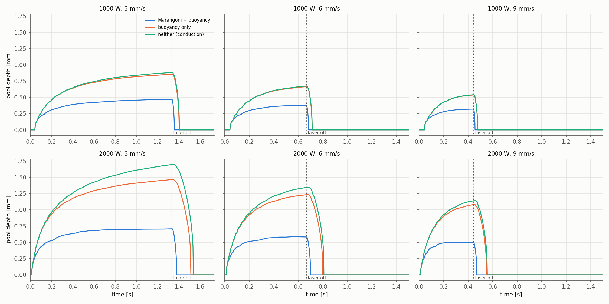

*Figure 2. Pool depth (liquidus) against time for the six power–speed
combinations, each with the three force sets. The dotted line marks the laser
switching off.*

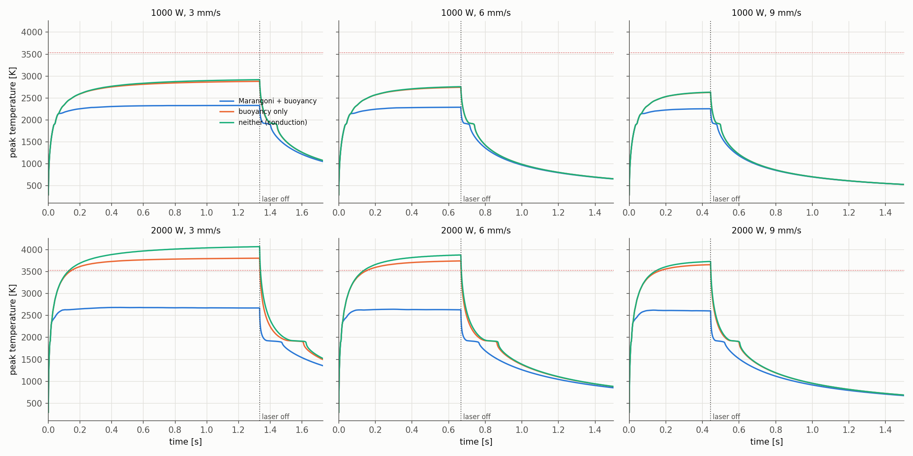

*Figure 3. Peak temperature against time. The red dotted line is the boiling
point of Ti-6Al-4V (3533 K).*

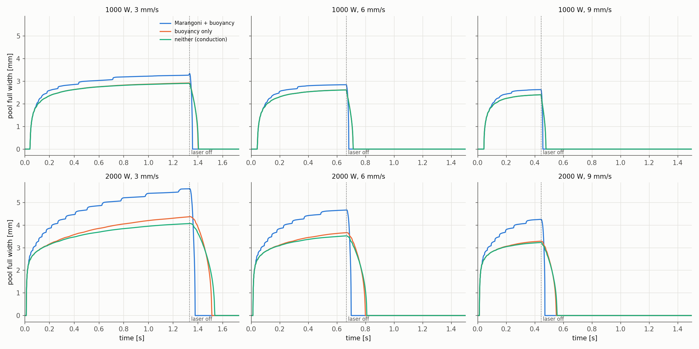

*Figure 4. Pool full width against time.*

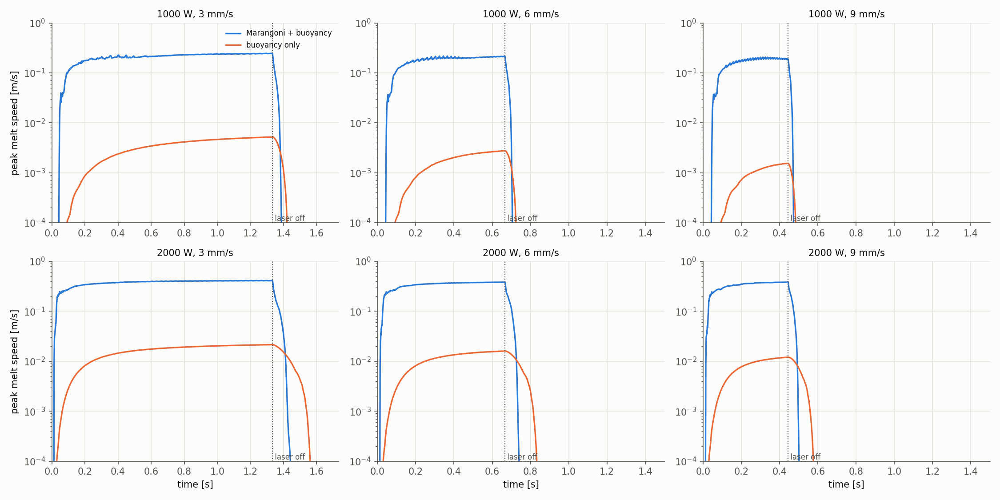

*Figure 5. Peak melt speed against time (log scale), for the two force sets
that have flow. The conduction runs have no velocity.*

Every run passes through the same four stages as in the Gaussian study
(Appendix A.2): solid heating, melting and growth, a travelling quasi-steady
pool, and solidification after switch-off. The uniform beam and the
switching of the forces change how long each stage lasts and what the pool
looks like in it.

**Stage 1: solid heating.**

- The first metal reaches the solidus after **34.6–34.9 ms at 1000 W** and
  **9.3 ms at 2000 W**. The value is identical, to within 0.1 ms, for all three
  force sets at a given power and speed. That is expected: no flow can exist
  before there is liquid, so the three runs are the same problem until the
  first cell melts. It is also a useful check that the three runs of each
  triplet were set up identically.
- The onset hardly depends on scan speed. In 35 ms the beam moves only
  0.1–0.3 mm, a fraction of its 3 mm diameter, so the surface under the beam
  centre sees an almost stationary source.

This onset time follows a clean relationship. For a semi-infinite solid under
a uniform surface flux q₀, the surface temperature rises as

$$T_s - T_0 = \frac{2 q_0}{\sqrt{\pi}}\sqrt{\frac{t}{k\rho c_p}}
\quad\Rightarrow\quad
t_{melt} = \frac{\pi\,k\rho c_p\,(T_s - T_0)^2}{4\,q_0^{2}}$$

so the onset time should scale as **q₀⁻²**. Doubling the power from 1000 W to
2000 W doubles q₀ (49.5 → 99.0 W/mm²) and should cut the onset time by a
factor of 4. The simulations give a factor of 34.8/9.32 = **3.74**, an exponent
of −1.90. With the solid properties at the mean temperature of the heating
range (k ≈ 17.4 W/m·K, ρc_p ≈ 3.8 MJ/m³K), the formula gives 54 ms and 13 ms.
The simulated times are about 30 % shorter, because the conductivity of
Ti-6Al-4V is much lower at low temperature (k = 7 W/m·K at 300 K), which slows
the escape of heat in the early stage.

The same relationship explains a difference from the Gaussian exploratory
study, where the onset scaled as q₀^−1.14 (Appendix A.2):

- In the Gaussian runs the intensity was 3–10 times higher and melting began
  after only 0.6–1.9 ms. The heat had diffused only about 0.1 mm, comparable
  with the 50 µm absorption layer, so the layer heated like a thin slab
  (t ∝ 1/q₀).
- Here, after 9–35 ms, heat has diffused 0.2–0.4 mm, much deeper than the
  absorption layer. The surface-flux limit (t ∝ 1/q₀²) applies.

**Stage 2: melting and growth.**

- **Start-up of the flow.**
  - In the MaB runs the peak melt speed jumps within a few milliseconds of
    melting to a few centimetres per second. It passes 0.1 m/s after about
    0.1 s at 1000 W (0.02 s at 2000 W), and approaches its steady value of
    0.19–0.41 m/s after 0.3–0.4 s (Figure 5).
  - In the B runs the flow appears too, but it builds up slowly over the whole
    laser-on time and stays 20–150 times slower: about 1–20 mm/s.
  - After switch-off the Marangoni flow dies within 50–100 ms, together with
    the pool. The buoyancy flow persists a little longer, because the
    buoyancy pool takes longer to freeze.
  - The small regular ripple on the MaB curves at 1000 W is the beam crossing
    one cell of the grid (frequency v/Δx), as in the Gaussian study (Appendix
    A.10).
- **Growth of the depth** (Figure 2). It reaches 90 % of its value at
  switch-off after:

  | Force set | 1000 W | 2000 W |
  |---|---|---|
  | MaB | 0.22–0.60 s | 0.14–0.40 s |
  | none | 0.28–0.76 s | 0.27–0.79 s |

  The MaB pools also stop growing much sooner in an absolute sense:
  - The Marangoni pool reaches a plateau. In the last 40 % of the laser-on time
    its depth changes by only −0.3 to +6 %.
  - The conduction pool keeps deepening throughout, by 10–12 % over the same
    window, and is still deepening when the laser switches off.
- **Why the conduction pool keeps growing.** The conduction pool is limited by
  how fast heat can diffuse down into the plate. The plate under the track
  keeps warming as long as the laser is on, so the isotherms keep moving down.
  The Marangoni pool is limited instead by the balance between the outward
  surface flow and conduction at the rim. That balance establishes itself
  within a few circulations of the melt, typically 0.1–0.3 s.
- **What this means for the averages.** Strictly, the conduction pools never
  reach a steady depth on a 4 mm track. Their quasi-steady values are averages
  of a slowly growing pool and slightly underestimate the depth a much longer
  track would reach.
- **Growth of the width** (Figure 4). The width has the opposite tendency at
  2000 W: the MaB pool still grows by 5.5–7.7 % in the last window, because the
  outward flow keeps carrying heat to a rim surrounded by progressively warmer
  metal.

**Stage 3: the quasi-steady pool.**

- **MaB.** The peak temperature changes by less than 15 K over the window
  (Figure 3). At 2000 W it even falls slightly, by 4–9 K, as the pool widens.
- **B and none.** It still rises by 20–60 K over the window. This is the same
  contrast as for the depth.
- **A thermostat.** The temperature of a Marangoni pool is set by a balance
  within the pool, not by the slow warming of the plate.

**Start-up overshoot.** In the Gaussian runs the peak temperature overshot
its later steady value by up to 440 K in the first milliseconds, before the
flow had developed (Appendix A.4). Under the uniform beam the overshoot is only
**2–14 K in the MaB runs**. The uniform beam has a lower peak intensity and no
sharp central hot spot. The temperature at the centre rises slowly enough for
the surface flow to build up before a large superheat can form. In the B and
none runs the "overshoot" (8–24 K) is simply the difference between the
temperature just before switch-off and the window average, not a real
overshoot.

**Stage 4: solidification after switch-off.**

| Force set | 1000 W | 2000 W |
|---|---|---|
| MaB | 37–70 ms | 78–142 ms |
| B and none | 56–111 ms | 157–295 ms |

*Time from switch-off until the last liquid freezes.*

- **Why the conduction pool takes longer.** It contains 1.3–1.9 times as much
  molten metal, and that metal is superheated by up to 2100 K rather than up
  to 750 K. All of that heat has to leave by conduction through the cold plate.
- **Normalised by pool size.** Divided by the fusion-zone area, the
  solidification time is similar in all runs: **48–65 ms per mm²** for MaB and
  **61–65 ms per mm²** for B and none. The difference between the force sets is
  therefore mainly in the amount of heat to remove, not in how fast it
  leaves.
- **Comparison with the Gaussian study.** The same 44–62 ms per mm² was found
  there (Appendix A.2), which suggests that this is a property of Ti-6Al-4V on
  a cold, thick plate rather than of the beam shape.
- **Inflection at the liquidus.** The peak temperature in Figure 3 shows the
  same inflection at the liquidus after switch-off that Farzadi et al. (2008)
  report in their weld thermal cycles. The last liquid cannot cool below the
  melting range until its latent heat has been conducted away.

### 8.2 Temperature field and isotherms

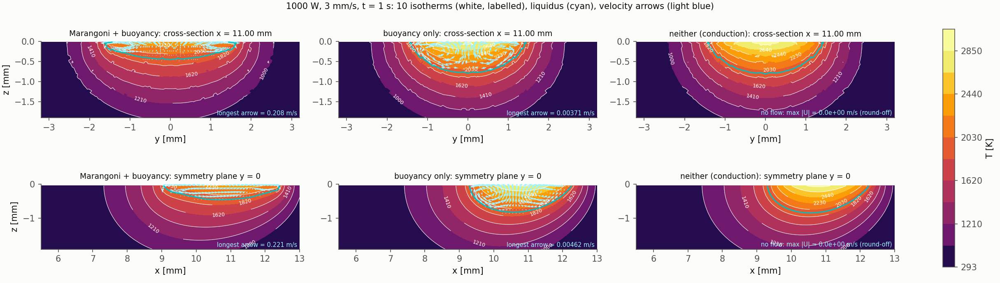

*Figure 6. 1000 W, 3 mm/s, t = 1.0 s. Ten labelled isotherms (white), the liquidus
(cyan) and velocity arrows (light blue) in the cross-section through the
beam (top) and the symmetry plane (bottom), for the three force sets side by
side. The colour levels are the same in all six panels.*

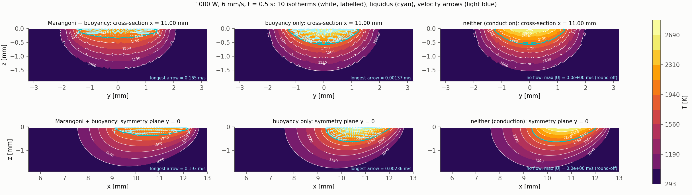

*Figure 7. 1000 W, 6 mm/s, t = 0.5 s.*

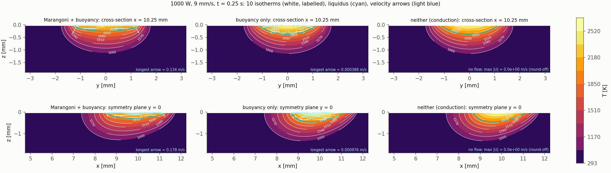

*Figure 8. 1000 W, 9 mm/s, t = 0.25 s.*

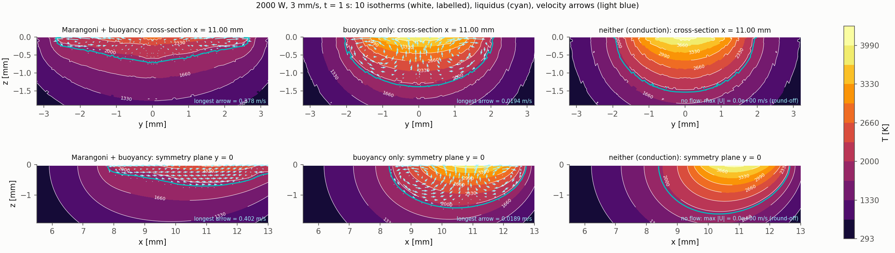

*Figure 9. 2000 W, 3 mm/s, t = 1.0 s.*

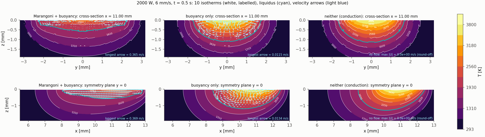

*Figure 10. 2000 W, 6 mm/s, t = 0.5 s.*

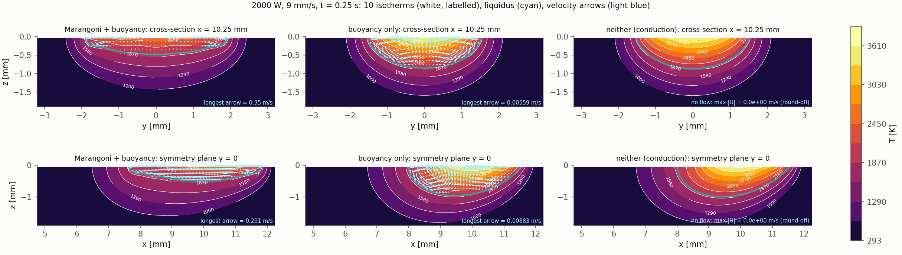

*Figure 11. 2000 W, 9 mm/s, t = 0.25 s.*

Figures 6–11 are the central visual result of the study. Each shows one
power–speed combination with the three force sets side by side, using the same
ten isotherm levels and colours in every panel.

**Conduction (right column).** The isotherms form a family of nested,
smooth bowls centred under the beam.

- **Shape of the isotherms.**
  - Near the surface, under the flat part of the beam, they are slightly
    flattened. This is the signature of the uniform source, which heats the
    whole 3 mm disc equally rather than a central spot.
  - Deeper down they become circular arcs, as heat spreads equally in all
    directions from a buried source.
- **Spacing.** The isotherms are closest together near the surface under the
  beam and spread out with depth.
- **Hot core.** The hottest isotherm (above 3500 K at 2000 W) is a small cap
  at the surface just behind the beam centre.
- **Longitudinal section.** Here the isotherms show the classic moving-source
  asymmetry: compressed ahead of the beam (+x) and stretched behind it, more
  strongly at 9 mm/s than at 3 mm/s.

**Buoyancy only (middle column).**

- **At 1000 W** the isotherms are indistinguishable from conduction. The
  buoyancy flow (2–5 mm/s) is too slow to move heat.
- **At 2000 W** the inner isotherms are slightly flattened and pushed outward
  near the surface. The hottest cap is smaller, and the deepest isotherm is
  raised by about 0.1–0.2 mm. This is the effect of the hot liquid rising under
  the beam and spreading outward along the surface, with a flow of 10–20 mm/s.

**Marangoni + buoyancy (left column).** The isotherms inside the pool are
completely different.

- **Inside the pool** the isotherms are **flattened into thin horizontal
  layers parallel to the surface** and pushed outward to the rim.
  - The pool interior is nearly isothermal in the horizontal direction.
  - The temperature varies mainly with depth, from the peak at the surface to
    the liquidus at the bottom.
- **At the rim** the isotherms crowd together. The outward surface flow brings
  hot liquid to the rim, where it meets the cold solid, so the rim is where
  the steepest gradients are.
- **Below the pool** the solid isotherms are again conduction-like bowls, but
  they are wider and shallower than in the conduction run, because the heat
  now enters the solid over a wider area.

This is the pattern described by Fuhrich et al. (2001): "the isotherm
distribution looks similar to one of mere heat conduction" beneath the
recirculating surface layer, with the convective layer on top. It is also what
Farzadi et al. (2008) found for their aluminium welds: at equal distance from
the source the temperature is higher sideways than downward, because the
outward flow carries heat sideways.

**Quantified effect on the field.** The 1000 K isotherm, which marks the
heat-affected zone, behaves differently from the pool:

| Change caused by Marangoni flow | 1000 W | 2000 W |
|---|---|---|
| 1000 K isotherm, extent sideways | **+3 to +9 %** wider (half-width 1.75–2.55 mm instead of 1.65–2.35 mm) | **+15 to +20 %** wider (2.35–3.68 mm instead of 2.05–3.15 mm) |
| 1000 K isotherm, extent downward | Within 6 % | **11–13 % shallower** |

The heat-affected zone is therefore much less affected than the melt pool.
The plate below the pool sees about the same heat input in every case, only
redistributed by the flow. The strongest changes are inside the liquid.

### 8.3 Flow field

The flow is seen in three kinds of figure:

- the arrows in Figures 6–11;
- the velocity-magnitude contours of each run (`contours_<t>s.png`,
  Section 10);
- the velocity profiles (`velocity_profiles_<t>s.png`, Section 10).

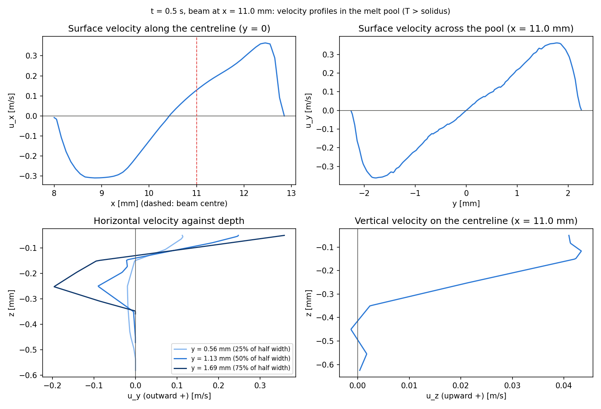

*Figure 12. U2000_v6_MaB at t = 0.5 s. Top left: surface velocity u_x along the
centreline (the dashed line is the beam centre). Top right: surface velocity
u_y across the pool through the beam. Bottom left: horizontal velocity against
depth at 25, 50 and 75 % of the half-width. Bottom right: vertical velocity on
the centreline under the beam.*

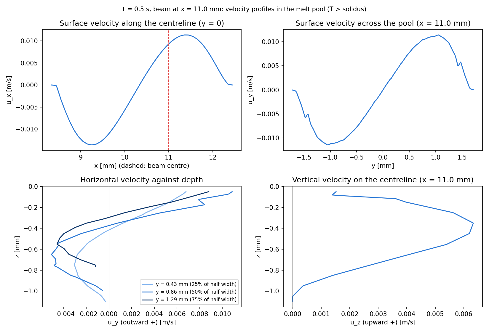

*Figure 13. The same profiles for U2000_v6_B (buoyancy only). Note the
velocity scale, about 30 times smaller than in Figure 12.*

**Marangoni + buoyancy: a thin, fast, outward surface jet with a slow return
flow.** In every MaB run the flow has the same structure (Figure 12).

**1. Surface speed grows from the stagnation point to the rim.**

- **Stagnation point.** On the surface the liquid moves radially outward
  from a stagnation point. It sits about 0.6 mm **behind** the beam centre, at
  x − x_beam ≈ −0.6 mm in Figure 12, where the surface is hottest.
- **Speed profile.** Across the pool the outward surface speed u_y grows
  almost **linearly with the distance from the centreline**, from zero on the
  centreline to a maximum at about 80 % of the half-width. It then drops
  sharply to zero at the rim. Along the centreline the same happens forward
  and backward.
- **Why it is linear.** A linear velocity profile is what a uniform shear
  stress over a spreading layer produces. It shows that the surface
  temperature gradient, and with it the Marangoni stress, is nearly constant
  over most of the pool (§8.6).

**2. The flow lives in a thin surface layer, with a return flow under it.**

- The horizontal velocity against depth (bottom left of Figure 12) is outward
  only in the **top 0.10–0.13 mm** of the 0.58 mm deep pool.
- Below that it reverses: a return flow, inward, about half as fast, peaking
  at about 0.25 mm depth.
- The bottom 0.2–0.3 mm of the pool is almost stagnant (below 10 mm/s).
- This is the "thin fluid layer" accelerated by the surface tension that
  Fuhrich et al. (2001) describe, with "the weld pool underneath the
  recirculating fluid layer" showing little convection.

**3. Upwelling under the beam.**

- On the centreline the liquid rises at up to 0.04 m/s, an order of magnitude
  slower than the surface jet, feeding the outward surface flow from below.
- In the cross-section this closes into **two counter-rotating vortices**,
  one on each side of the centreline. This is exactly the pattern Pariona et
  al. (2018) report for Al-Fe.

**4. Surface speed is 20–130 times the scan speed.**

| Speed ratio | 3 mm/s | 9 mm/s |
|---|---|---|
| Peak melt speed ÷ scan speed | 80–136 | 22–42 |
| Mean surface speed ÷ scan speed | 51–94 | 11–25 |

Fuhrich et al. found 57 times for steel welding. The flow therefore turns the
liquid over many times while the beam moves one pool length, which is why the
Marangoni pools are nearly round in plan (§8.5).

**5. Strongest flow.**

- The peak melt speed is 0.19–0.24 m/s at 1000 W and 0.38–0.41 m/s at 2000 W.
- It decreases weakly with scan speed (v^−0.13) and increases strongly with
  power (P^0.87).

**Buoyancy only: a slow, deep convection cell.** In the B runs the flow
direction at the surface is still outward, but its structure and strength are
different (Figure 13).

- **Speed.** The peak melt speed is 1.3–4.7 mm/s at 1000 W and 11–21 mm/s at
  2000 W, 20–150 times slower than with Marangoni.
- **Driving region.** The flow is driven in the **bulk** of the pool, not at the
  surface. Hot liquid under the beam is lighter and rises (u_z up to 6 mm/s at
  0.4 mm depth), spreads outward along the surface, cools and sinks along the
  boundary.
- **Shape of the profiles.**
  - The surface velocity profile is sinusoidal rather than linear. Its maximum
    is at about 60 % of the half-width rather than at the rim.
  - The horizontal velocity changes sign at about 0.35 mm depth, roughly the
    middle of the 1.2 mm deep pool, so the cell fills the whole pool rather
    than a thin surface layer.
- **Origin of the shape.** This is the classic Rayleigh–Bénard-type cell of a
  liquid heated from above at its centre. Because the surface is a free-slip
  boundary, the cell can spread outward along it.
- **Strength of the cell.** The cell is so slow that the flow Péclet number is
  only 0.1–0.7 at 1000 W and 1.3–4.8 at 2000 W. Heat is still carried mainly by
  conduction, which is why the B pools resemble the conduction pools so
  closely.

**No flow without a driving force.** In the conduction runs the velocity is
zero by construction. The earlier driving-force check (Appendix D) showed that,
with the full flow solver active and both forces removed, the velocity stays at
round-off level (about 3 × 10⁻¹⁶ m/s). The solver therefore creates no
spurious flow, and every velocity in the MaB and B runs is caused by a physical
force.

### 8.4 Peak temperature: the Marangoni thermostat

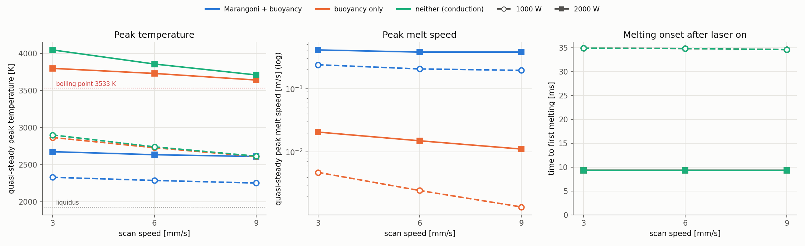

*Figure 14. Left: quasi-steady peak temperature, with the liquidus and the
boiling point. Middle: peak melt speed (log). Right: time to first melting.*

| Power, speed | T_max MaB (K) | T_max B (K) | T_max none (K) | Reduction by Marangoni (K) | Superheat ratio ΔT_MaB/ΔT_none |
|---|---|---|---|---|---|
| 1000 W, 3 mm/s | 2328 | 2866 | 2900 | 571 | 0.41 |
| 1000 W, 6 mm/s | 2286 | 2727 | 2739 | 453 | 0.44 |
| 1000 W, 9 mm/s | 2251 | 2609 | 2614 | 363 | 0.47 |
| 2000 W, 3 mm/s | 2674 | 3798 | 4046 | 1373 | 0.35 |
| 2000 W, 6 mm/s | 2633 | 3729 | 3856 | 1223 | 0.37 |
| 2000 W, 9 mm/s | 2609 | 3641 | 3709 | 1100 | 0.38 |

**Observation.** The Marangoni flow removes most of the superheat.

| | MaB | none |
|---|---|---|
| Peak above the liquidus, 1000 W | 320–400 K | 690–970 K |
| Peak above the liquidus, 2000 W | 680–750 K | 1780–2120 K |

- **Boiling point.** All three conduction runs at 2000 W exceed the boiling
  point of 3533 K, by 180–510 K. So do all three buoyancy-only runs, by
  110–270 K. **None of the Marangoni runs comes within 850 K of it.**
- **Scan speed.** Speed has only a small effect on the MaB peak temperature:
  from 3 to 9 mm/s it drops by 77 K at 1000 W and 65 K at 2000 W. In the
  conduction runs it drops by 286 and 337 K.

**Explanation: a feedback loop.** The Marangoni flow is driven by the surface
temperature gradient and removes heat in proportion to its own speed.

1. A hotter spot means a steeper gradient.
2. A steeper gradient means a larger shear stress, τ_M = |dσ/dT|·|∇ₛT|.
3. A larger stress drives a faster outward flow.
4. A faster flow carries heat from the hot spot to the rim faster.
5. The hot spot cools again.

This negative feedback pins the peak temperature to a narrow band, much as a
thermostat would. Fuhrich et al. (2001) called it a "smoothing effect": with
dσ/dT < 0, convection acts in the same direction as conduction and flattens
the surface temperature profile.

**Quantitative law.** The strength of the thermostat is measured by the flow
Péclet number. Across the six MaB–none pairs, the superheat ratio follows

$$\frac{\Delta T_{sh,\,MaB}}{\Delta T_{sh,\,none}} \approx 0.76\,\mathrm{Pe}^{-0.16}
\qquad (R^2 = 0.99,\ 22 \le \mathrm{Pe} \le 135)$$

- **Pe = 22** (1000 W, 9 mm/s): the flow removes 53 % of the superheat.
- **Pe = 135** (2000 W, 3 mm/s): it removes 65 %.

The weak exponent is the signature of a feedback. Doubling the strength of the
convection only reduces the remaining superheat by about 10 %, because the
weaker superheat itself weakens the flow.

**Why the uniform beam is not a perfect thermostat.** Unlike the Gaussian runs,
where the MaB peak temperature was almost independent of power (Appendix
A.4), here doubling the power raises the MaB superheat almost proportionally,
from about 360 K to about 710 K (ΔT ∝ P^0.98). The uniform beam has no central
hot spot. Its flat top produces a surface temperature profile with a broad
plateau (§8.6), and on a plateau the gradient, and therefore the Marangoni
drive, is weak. The feedback acts mainly at the edge of the beam, while the
plateau temperature is set by the local balance between the absorbed flux and
the heat removed downward. Doubling the flux roughly doubles that plateau
superheat. The flow still removes 53–65 % of it.

**Buoyancy only.**

- **1000 W:** buoyancy lowers the peak temperature by only 5–34 K.
- **2000 W:** it lowers it by 68–248 K, with the largest effect at 3 mm/s,
  where the pool is largest and the buoyancy flow has the most room.

### 8.5 Pool geometry

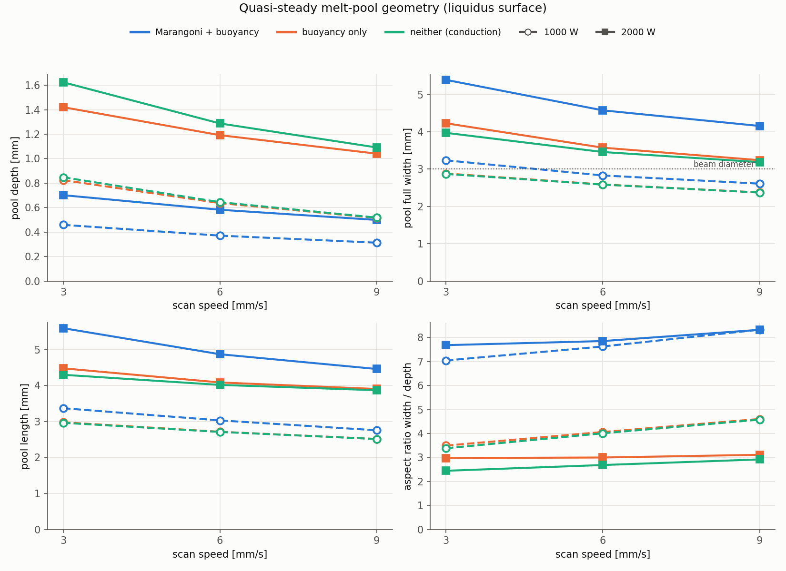

*Figure 15. Quasi-steady depth, full width, length and width-to-depth ratio of
the pool against scan speed. Open markers and dashed lines: 1000 W; filled
markers and solid lines: 2000 W.*


*Figure 16. Pool outline (liquidus) in the cross-section through the beam, three
force sets overlaid, with the 1000 K isotherm (dotted) and the beam footprint
(red bar).*

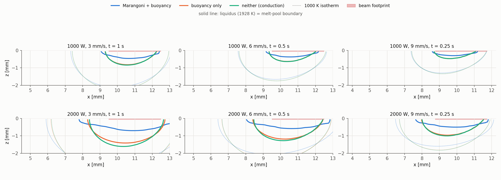

*Figure 17. Pool outline in the symmetry plane.*

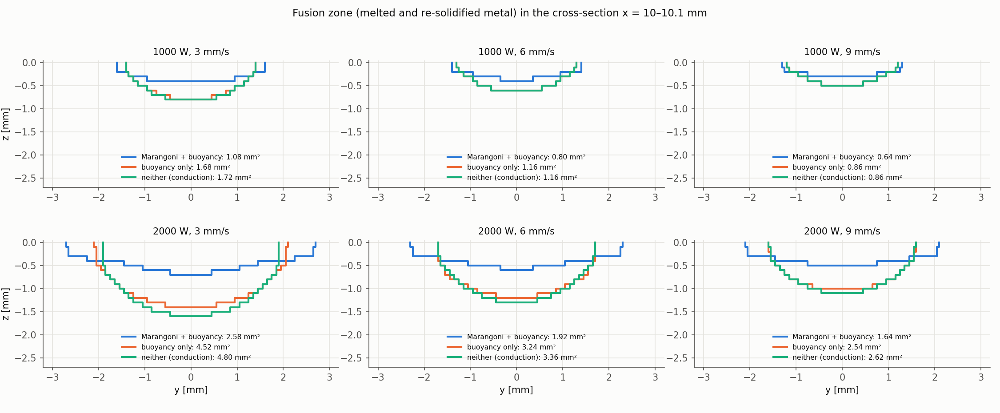

*Figure 18. Fusion zone in the middle of the track (x = 10.0–10.1 mm): the cells
that melted and re-solidified, i.e. the bead cross-section a metallographic cut
would show, with its area.*

**Depth.**

| Ratio of depths | 1000 W | 2000 W |
|---|---|---|
| MaB ÷ none | 0.54–0.61 | 0.43–0.46 |
| B ÷ none | 0.97–1.00 | 0.88–0.95 |

- **The Marangoni pool is roughly half as deep as the conduction pool.** The
  outward surface flow carries the heat sideways, away from the region under
  the beam, and the slow return flow along the bottom brings only cooled
  liquid down to the bottom of the pool.
- **Effect of power.** The reduction is larger at 2000 W, where the flow is
  faster (Pe 84–135 against 22–44).

**Width.**

| Ratio of widths | 1000 W | 2000 W |
|---|---|---|
| MaB ÷ none | 1.10–1.13 | 1.30–1.36 |
| B ÷ none | 1.00 | 1.02–1.07 |

- **The Marangoni pool is wider.** The heat the flow takes from the bottom
  is delivered to the rim, where it melts the solid sideways.
- **Width relative to the beam.**
  - At 2000 W the Marangoni pool is **1.4–1.8 times the beam diameter**: the
    flow pushes the melt well beyond the heated disc.
  - The conduction pool at 2000 W is only 1.06–1.32 times the beam diameter.
  - At 1000 W all pools are about 0.8–1.1 beam diameters wide.

**Width-to-depth ratio.** The ratio, the single best measure of pool shape,
separates the force sets cleanly:

| Force set | 1000 W | 2000 W |
|---|---|---|
| MaB | 7.0–8.3 | 7.7–8.3 |
| B | 3.5–4.6 | 3.0–3.1 |
| none | 3.4–4.6 | 2.4–2.9 |

- **The Marangoni ratio is almost the same at both powers** and rises only
  slightly with speed (v^0.11). It is a property of the flow, not of the laser
  settings.
- **The conduction ratio falls as the power rises.** The higher power drives
  the pool deeper but not much wider.
- **A shape law in the Gaussian study too.** The Gaussian study found 6.6–8.8
  for the Marangoni pools (Appendix A.3), the same range. The Marangoni pool
  shape is set by the balance of the flow and conduction, independently of the
  beam profile.

**Length.**

| Ratio of lengths | 1000 W | 2000 W |
|---|---|---|
| MaB ÷ none | 1.10–1.14 | 1.15–1.30 |

- **Length grows with the width.** The Marangoni pool is longer, by about the
  same factor as it is wider.
- **The length-to-width ratio shows how much the beam motion shapes the pool:**

  | Force set | L/w |
  |---|---|
  | MaB | 1.04–1.07 |
  | none, 1000 W | 1.03–1.06 |
  | none, 2000 W | 1.08–1.22 |

  The conduction pool develops the trailing teardrop shape typical of a moving
  source, most at 2000 W and 9 mm/s.
- **The Marangoni pool is almost round in plan.** Its surface flow, 20–130
  times faster than the beam, redistributes the heat symmetrically about the
  hot spot. The same was found in the Gaussian study (Appendix A.3).

**Pool outlines** (Figures 16 and 17).

- **MaB.** The liquidus in the cross-section is a flat-bottomed **pan**, with
  a nearly horizontal bottom across 60–70 % of the width and steep walls near
  the rim.
  - At 2000 W the pan extends 0.5–1.2 mm beyond each edge of the beam
    footprint.
  - The bottom has small steps of one cell (0.1 mm), a resolution effect
    discussed in §13.
- **None.** The conduction pool is a **bowl**: a circular arc in the middle and
  steeper walls near the surface, set by the edge of the uniform beam.
- **B.** At 1000 W the buoyancy pool is the same bowl. At 2000 W it is slightly
  flatter at the bottom and wider near the surface: the buoyancy cell
  transports some heat outward, the first sign of the same mechanism.
- **In the symmetry plane** (Figure 17), the MaB pool is a long, shallow lens
  whose rear end is steep. The conduction pool is a deeper bowl, tilted
  backward with a long tail.

**Fusion zone** (Figure 18). The bead cross-section after solidification is
what a metallographic cut would show, and therefore what the experiment will
measure (Section 11).

| Fusion-zone area | 1000 W | 2000 W |
|---|---|---|
| MaB | 0.64–1.08 mm² | 1.64–2.58 mm² |
| none | 0.86–1.72 mm² | 2.62–4.80 mm² |
| MaB ÷ none | 0.63–0.74 | 0.54–0.63 |

The **Marangoni flow melts 26–46 % less metal** per unit length of track,
although its pool is wider. Section 8.8 explains where the energy goes.

The fusion-zone width and depth agree with the quasi-steady pool dimensions to
within one cell. The pool at mid-track was steady, so the solidified bead
records the pool that passed over it.

### 8.6 Surface temperature profile and Marangoni quantities

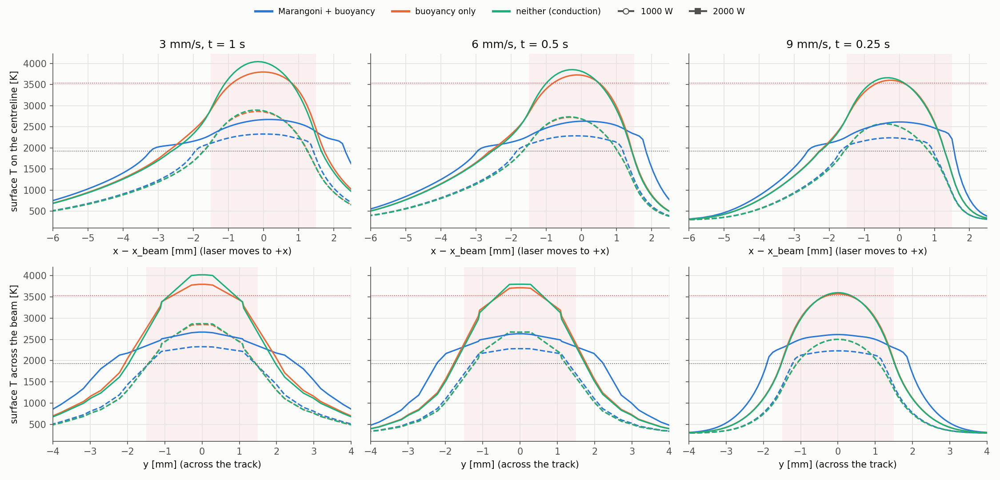

*Figure 19. Top-surface temperature along the centreline (top row, relative to
the beam centre) and across the track through the beam (bottom row). Red shading:
beam footprint. Dotted lines: liquidus (grey) and boiling point (red).*

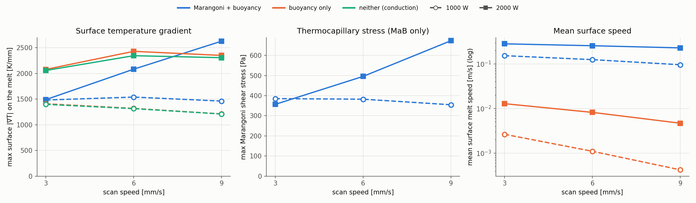

*Figure 20. Left: maximum surface temperature gradient on the molten surface.
Middle: maximum Marangoni shear stress (MaB only). Right: mean surface melt
speed.*

Figure 19 shows most directly what the Marangoni flow does.

**Conduction and buoyancy-only surface profiles** are dome-shaped.

- They rise smoothly from the edges to a maximum at the beam centre.
- In the cross-section, the uniform source shows itself as a nearly flat top
  between y = ±1.1 mm, with kinks where the source falls off at the beam
  edge.
- The peak is narrow and high: 3600–4050 K at 2000 W.

**The Marangoni surface profile is a plateau.**

- **Across the pool.** The temperature is nearly uniform over most of the pool
  surface, within about 300 K of the peak. It then drops sharply at the pool
  edge, where it meets the liquidus.
- **Along the centreline.**
  - The rear of the pool (x − x_beam ≈ −3 mm) ends with a step: the temperature
    falls by about 300 K over 0.3 mm, at the liquidus.
  - Ahead of the beam the pool front is also steep.
  - Behind the pool, the solid surface is hotter than in the conduction run. It
    has been heated by the wider pool that just passed.

This is exactly the "almost constant radial spacing between the isotherms" that
Fuhrich et al. (2001) noticed on the surface of their Marangoni pool. With the
flow, heat reaches the rim faster than conduction can carry it into the solid,
so the surface heats up evenly.

**The surface gradient is redistributed, not reduced.** The maximum surface
gradient on the molten surface is about the same with and without Marangoni:

| Maximum surface gradient | 1000 W | 2000 W |
|---|---|---|
| MaB | 1460–1540 K/mm | 1490–2630 K/mm |
| none | 1210–1400 K/mm | 2060–2350 K/mm |

The **mean** gradient on the molten surface, however, falls by a factor of
1.9–4.3:

| Mean surface gradient | 1000 W | 2000 W |
|---|---|---|
| MaB | 320–390 K/mm | 270–410 K/mm |
| none | 710–850 K/mm | 1140–1290 K/mm |

The Marangoni flow does not remove the steep gradient. It **concentrates** it
into a narrow band at the rim and flattens the rest of the surface. This
matches the observation of Pariona et al. (2018) that the largest gradients
occur at the surface of the pool.

**Marangoni stress.**

- **Maximum stress.** 355–385 Pa at 1000 W and 357–673 Pa at 2000 W.
  - At 2000 W it rises with scan speed, from 357 Pa at 3 mm/s to 673 Pa at
    9 mm/s. The faster scan produces a sharper front edge of the pool, where
    the gradient peaks.
  - The same trend was seen in the Gaussian study (Appendix A.8).
- **A Couette estimate of the surface speed.** Taking a stress of about 100 Pa
  (a typical mean) across a 0.1 mm thick moving layer gives

  $$u \approx \frac{\tau_M\,\delta}{\mu} = \frac{100 \times 10^{-4}}{3.5\times10^{-3}} \approx 3\ \mathrm{m/s}$$

  The simulated surface speeds are a few tenths of a metre per second. The
  return flow and the damping in the mushy rim take the difference.

**Molten surface area.** It is 19–76 % larger with Marangoni flow (5.3–9.1 mm²
at 1000 W, 13.1–25.5 mm² at 2000 W), because the pool is wider and longer.

### 8.7 Solidification parameters G and R

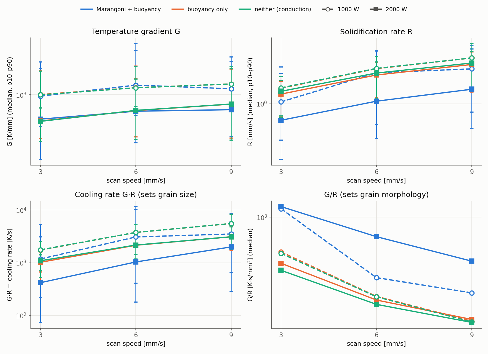

*Figure 21. Median temperature gradient G, solidification rate R, cooling rate
G·R and G/R over all solidification events while the laser is on, against scan
speed. Error bars: 10th–90th percentile.*

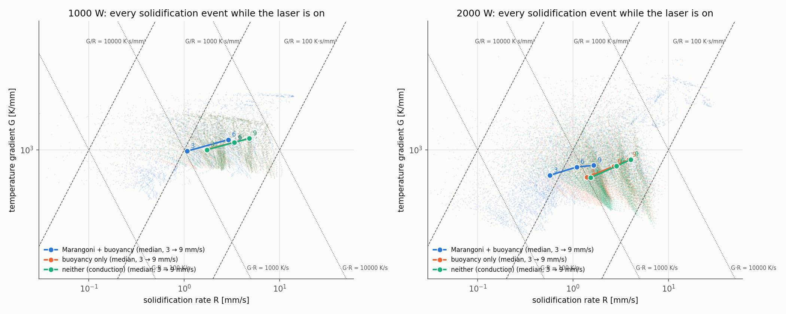

*Figure 22. Every solidification event in the G–R plane (small dots), with the
medians of each run (large markers, labelled by speed). Dashed lines: constant
G/R; dotted lines: constant cooling rate G·R.*

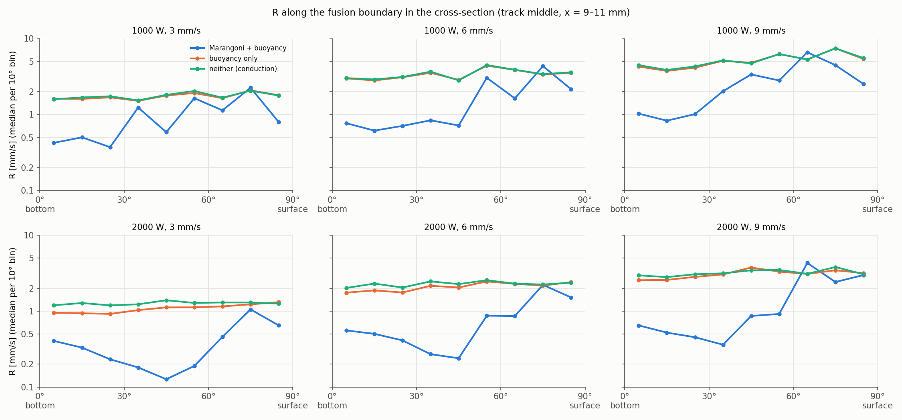

*Figure 23. Solidification rate R along the fusion boundary in the
cross-section, from the bottom of the pool (0°) to its surface edge (90°),
medians in 10° bins, middle of the track.*

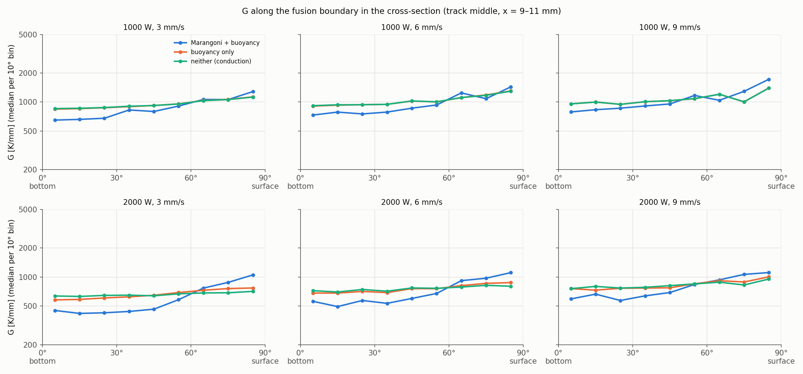

*Figure 24. Temperature gradient G along the fusion boundary.*

| Run | G median (K/mm) | R median (mm/s) | G·R median (K/s) | G/R median (K·s/mm²) | R at bottom (mm/s) | G at bottom (K/mm) |
|---|---|---|---|---|---|---|
| U1000_v3_MaB | 984 | **1.07** | 1185 | **1123** | 0.18 | 661 |
| U1000_v3_B | 1005 | 1.70 | 1753 | 620 | 0.63 | 871 |
| U1000_v3_none | 1000 | 1.73 | 1767 | 608 | 0.26 | 907 |
| U1000_v6_MaB | 1135 | **2.89** | 3103 | **436** | 0.46 | 759 |
| U1000_v6_B | 1098 | 3.32 | 3782 | 337 | 0.30 | 1048 |
| U1000_v6_none | 1097 | 3.35 | 3782 | 335 | 0.52 | 1041 |
| U1000_v9_MaB | 1083 | **3.30** | 3534 | **354** | 1.08 | 800 |
| U1000_v9_B | 1153 | 4.79 | 5574 | 240 | 1.92 | 1065 |
| U1000_v9_none | 1153 | 4.79 | 5585 | 237 | 2.03 | 1064 |
| U2000_v3_MaB | 727 | **0.57** | 421 | **1157** | 0.40 | 513 |
| U2000_v3_B | 710 | 1.39 | 1027 | 531 | 0.41 | 656 |
| U2000_v3_none | 707 | 1.53 | 1095 | 482 | 0.24 | 741 |
| U2000_v6_MaB | 807 | **1.09** | 1040 | **765** | 0.58 | 613 |
| U2000_v6_B | 814 | 2.67 | 2158 | 320 | 0.67 | 832 |
| U2000_v6_none | 816 | 2.86 | 2179 | 302 | 0.82 | 878 |
| U2000_v9_MaB | 824 | **1.64** | 2007 | **547** | 0.73 | 622 |
| U2000_v9_B | 886 | 3.83 | 3131 | 245 | 0.61 | 979 |
| U2000_v9_none | 887 | 4.02 | 3125 | 236 | 1.16 | 988 |

The "bottom" values are the mean over the deepest solidification events within
one cell of the centreline in the middle of the track. They come from only a
few cells and scatter more than the medians.

**What G and R control.** In solidification theory:

- **G/R controls the shape of the growth front.**
  - High G/R gives planar or cellular growth.
  - As G/R falls, growth becomes columnar dendritic and then equiaxed
    dendritic.
- **G·R controls the scale of the structure.** G·R is the cooling rate, and a
  higher cooling rate gives finer cells, dendrites and grains.

Gao et al. (2021) and Farzadi et al. (2008) both interpret their results in
this framework, and the same is done here. In Ti-6Al-4V the solidification
structure is the prior-β grain structure, and the room-temperature α/α′
microstructure forms inside it during cooling.

**Observation 1: G is set by the plate, not by the flow.**

- **The value.** The median gradient at the solidification front is
  980–1150 K/mm at 1000 W and 710–890 K/mm at 2000 W.
- **Effect of the forces.** It is within ±7 % for all three force sets at the
  same power and speed.
- **Why the flow does not change it.** At the moment of solidification the
  liquid is at the liquidus and the flow near the front has been damped by the
  mush. The gradient there is set by conduction into the plate below, which is
  similar in all three cases.
- **Why G is lower at 2000 W.** The plate around the larger pool is hotter,
  so the gradient into it is gentler. G ∝ P^−0.44 for all three force sets.

**Observation 2: R is lowered strongly by the Marangoni flow.**

- **The value.** The median R in the MaB runs is 14–63 % lower than in the
  conduction run at the same power and speed.
- **Effect of power.** The reduction is largest at 2000 W (R ratio
  0.37–0.41), where the pool is flattest.
- **Why: R depends on the direction the front faces.** In a steady moving
  pool, the front at any point moves with the beam. Its speed normal to itself
  is

  $$R = v\cos\theta$$

  where θ is the angle between the scan direction and the outward normal of
  the front (Farzadi et al. 2008).
  - Where the front faces backward, at the tail of the pool on the surface,
    θ ≈ 0 and R ≈ v.
  - Where it faces upward, at the bottom, θ ≈ 90° and R ≈ 0.
- **How the Marangoni pool differs.**
  - The flat Marangoni pan has a long, nearly horizontal bottom, and its rear
    is shallow and stretched out. Most of its fusion boundary faces upward,
    so most of it solidifies slowly.
  - The conduction bowl has a steeper, more backward-facing rear, and more of
    its boundary solidifies at speeds close to v.

**Observation 3: along the fusion boundary R rises from the bottom to the
surface edge** (Figure 23). This holds in every run, and is what Gao et al.
(2021) found for their NiTi track (R_z = 0.73 mm/s at the bottom and 6.15 mm/s
at the top).

- **In the conduction and buoyancy runs** R is nearly constant along the
  cross-section boundary, at 1–5 mm/s, rising only slightly towards the
  surface.
- **In the MaB runs** R is **3–10 times lower over the bottom half of the
  boundary** (0–50°), at 0.1–0.8 mm/s. It then rises steeply near the surface
  edge (60–90°), where it reaches the conduction values.
- **The sharpest contrast** is at 2000 W and 3 mm/s: R falls to about
  0.13 mm/s at 45° in the MaB pool against about 1.4 mm/s in the conduction
  pool.

**Observation 4: G is lowest at the bottom of the Marangoni pool** (Figure 24).

- **The value.** The gradient at the bottom of the MaB pool is 510–800 K/mm,
  about 25–37 % below the conduction value at the same point (740–1065 K/mm).
- **Why.** The outward flow takes the hottest liquid to the rim and the
  surface. The bottom receives only the slower, cooler return flow, so the
  temperature drop across the solid below it is smaller.
- **Comparison with Gao et al. (2021).** They found the highest G at the
  bottom of their DED track. The difference is the flow: a downward-directed
  flow would deliver hot liquid to the bottom, while the outward Marangoni
  flow here does the opposite. The Gaussian study shows the same (Appendix
  A.9).

**Observation 5: G/R is raised, and G·R lowered, by Marangoni flow.**

- **G/R.** The median rises by a factor of 1.30–1.85 at 1000 W and 2.32–2.54
  at 2000 W.
- **G·R.** The median cooling rate falls by 18–37 % at 1000 W and 52–62 % at
  2000 W.
- **What this means for the microstructure.** The Marangoni pool solidifies
  more slowly, with a front that is more stable. Both changes point to a
  **coarser and more columnar** structure along the bottom of the track.
  - In the G–R map (Figure 22), the MaB medians lie to the left of the
    conduction medians at the same G: lower R, higher G/R.
  - The MaB clouds extend further to low R, down to about 0.05 mm/s, at the
    bottom of the pool.
- **Implication for Ti-6Al-4V.** The prior-β grains already tend to grow as
  columns epitaxially from the fusion line. The Marangoni flow, by flattening
  the pool, reinforces that tendency.

**Observation 6: the spread of the solidification conditions is wider with
Marangoni flow.**

- **The spread.** The 10th–90th percentile range of the cooling rate covers a
  factor of 13–72 in the MaB runs, against a factor of 2.6–4.2 in the
  conduction runs.
- **The upper end.** The 90th-percentile cooling rate is actually higher in
  the MaB runs (3,100–11,700 K/s against 1,400–8,400 K/s). It occurs near the
  surface at the pool edge, where the steep rim gradient meets a fast-moving
  front.
- **The lower end.** The pan bottom solidifies very slowly.
- **What this means for the bead.** A Marangoni bead therefore has a more
  graded structure from bottom to top: coarse columnar grains at the bottom,
  fine grains near the surface edges. A conduction bead is more uniform.

**Effect of power and speed** (Figure 21), within each force set.

- **Speed.**
  - **R** increases almost proportionally with speed (v^0.91–1.02), as
    R = v·cos θ requires.
  - **G** is almost independent of speed (v^0.11–0.17).
  - **Cooling rate G·R** therefore rises with speed (v^1.0–1.2).
  - **G/R** falls with speed (v^−0.76 to v^−0.88).
- **Power.**
  - In the conduction and buoyancy runs, higher power lowers the cooling rate
    (P^−0.77 to −0.80) and raises G/R only slightly.
  - In the MaB runs, higher power lowers the cooling rate more strongly
    (P^−1.30) and raises G/R (P^0.49), because the larger pool is also flatter.

These are the trends Farzadi et al. (2008) report for aluminium welds: G·R
rises with welding speed, and G/R rises with heat input.

**End crater.** When the laser switches off, the remaining pool freezes from
all sides at once.

| End crater, median | 1000 W | 2000 W |
|---|---|---|
| Cooling rate | 3,650–9,440 K/s | 1,540–3,540 K/s |
| R | 14–42 mm/s | 7–23 mm/s |
| G | 180–380 K/mm | 110–360 K/mm |

- **Compared with the track.** The crater cooling rate is 1–4 times the
  track median, and the low G and high R give a G/R 7–150 times lower: a
  strong tendency to equiaxed growth.
- **Effect of Marangoni flow.** The MaB crater freezes faster than the
  conduction crater (R 18–42 mm/s against 7–23 mm/s), because it is shallower
  and holds less superheated liquid.
- **Practical relevance.** The crater is where shrinkage porosity and crater
  cracks form in practice, so it is reported separately in the dataset.

### 8.8 Energy: melting efficiency

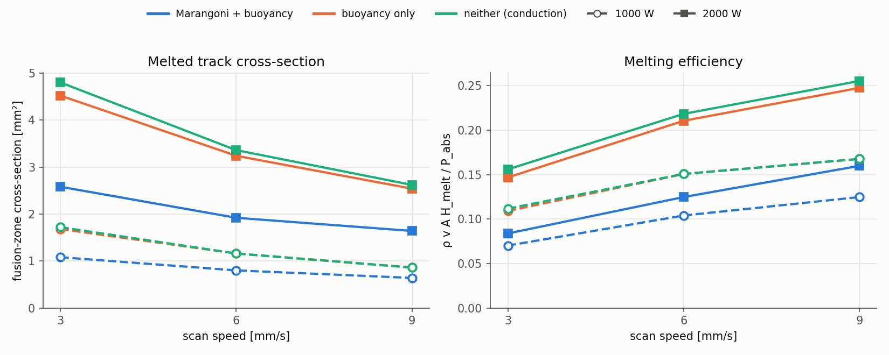

*Figure 25. Left: fusion-zone cross-section. Right: melting efficiency
η_m = ρ v A_fz H_m / P_abs.*

| Force set | η_m, 1000 W | η_m, 2000 W |
|---|---|---|
| MaB | 0.070 (3) – 0.104 (6) – 0.125 (9) | 0.084 (3) – 0.125 (6) – 0.160 (9) |
| B | 0.109 – 0.151 – 0.168 | 0.147 – 0.210 – 0.247 |
| none | 0.112 – 0.151 – 0.168 | 0.156 – 0.218 – 0.255 |

*Speeds in mm/s in brackets.*

**Observation.** Only 7–26 % of the absorbed power ends up as heat in the
metal that melts.

- **Speed.** The efficiency rises steadily with scan speed, by 50–90 % from 3
  to 9 mm/s for every force set and power (v^0.41–0.56).
- **Power.** It rises with power (P^0.29–0.54).
- **Marangoni flow.** It lowers the efficiency by 26–46 %.

**Where the energy goes.** The absorbed power has three destinations:

1. melting metal and superheating it;
2. heating the solid plate around the pool by conduction;
3. losses from the surface by convection and radiation (small, a few watts).

- **Effect of speed.** At a slow scan each point of the track is under the beam
  for longer (1 s at 3 mm/s against 0.33 s at 9 mm/s), and heat has time to
  diffuse into the plate ahead of and beside the pool. That heat raises the
  plate temperature without melting it. At a fast scan more of the energy is
  used where it is deposited. This is the well-known welding result that
  faster, more intense processes melt more efficiently.
- **Effect of Marangoni flow.** The flow spreads the heat over a wider surface
  and a long, thin rim. The rim is in contact with solid metal over a large
  area, and a large share of the heat is conducted into that solid without
  melting it. A deep, compact conduction pool has less surface in contact with
  solid per unit volume of melt, so it loses less heat to the surroundings for
  each kilogram it melts.
- **A caveat on the conduction runs.** Their extra melting comes at the price
  of superheats of up to 2100 K. In a real pool much of that superheat would be
  lost to evaporation (§13), so their efficiencies are upper bounds.

The Gaussian study gave 9–16 % for the Marangoni pools and 18–27 % without
Marangoni (Appendix A.6). These are the same ranges, so the result does not
depend on the beam shape.

### 8.9 Dimensionless analysis

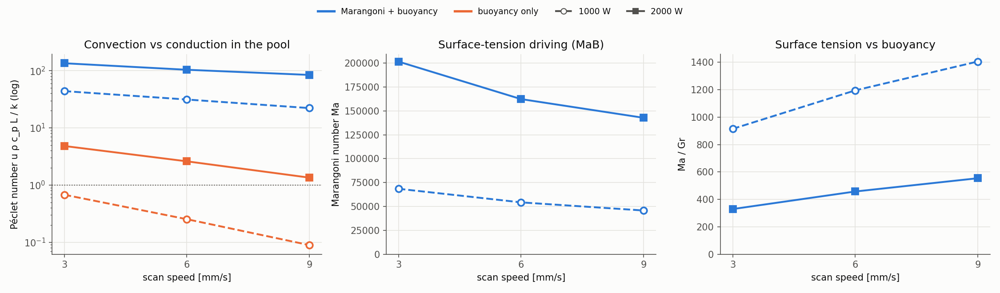

*Figure 26. Left: flow Péclet number (log scale), with Pe = 1 dotted. Middle:
Marangoni number. Right: Ma/Gr.*

| Run | Ma | Gr | Ma/Gr | Pe | Re |
|---|---|---|---|---|---|
| U1000_v3_MaB | 6.8 × 10⁴ | 75 | 915 | 43.9 | 313 |
| U1000_v6_MaB | 5.4 × 10⁴ | 45 | 1195 | 31.3 | 223 |
| U1000_v9_MaB | 4.6 × 10⁴ | 33 | 1406 | 22.2 | 158 |
| U2000_v3_MaB | 2.0 × 10⁵ | 612 | 329 | 134.9 | 962 |
| U2000_v6_MaB | 1.6 × 10⁵ | 355 | 457 | 103.8 | 740 |
| U2000_v9_MaB | 1.4 × 10⁵ | 258 | 554 | 84.3 | 601 |
| U1000_v3_B | – | 116 | – | 0.68 | 4.8 |
| U1000_v6_B | – | 72 | – | 0.25 | 1.8 |
| U1000_v9_B | – | 48 | – | 0.09 | 0.6 |
| U2000_v3_B | – | 712 | – | 4.82 | 34 |
| U2000_v6_B | – | 415 | – | 2.60 | 19 |
| U2000_v9_B | – | 294 | – | 1.35 | 9.6 |

**Marangoni against buoyancy.**

- **The ratio.** Ma/Gr is **330–1400**. The surface tension force exceeds the
  buoyancy force by two to three orders of magnitude in every Marangoni run.
- **Dependence on pool size.** The ratio falls with pool size, from about
  1400 for the smallest pool to 330 for the largest. Ma grows with the length
  scale L while Gr grows with L³, because buoyancy acts on a volume and the
  Marangoni force on a surface.
- **Extrapolation.** With Ma/Gr ∝ w⁻² as in the Gaussian study (Appendix A.8),
  buoyancy would become comparable to the Marangoni force only for pools about
  20–40 times wider, around 0.1 m, which is far outside laser processing.
- **Agreement with Farzadi.** This is consistent with Farzadi et al. (2008),
  who found buoyancy to be the least important driving force in their weld.

**Convection against conduction.**

- **MaB.** The flow Péclet number is 22–135. Pe ≫ 1, so heat inside the pool
  is carried by the flow. That is why the Marangoni pool shape is so
  different from the conduction shape.
- **B.** Pe is 0.09–0.68 at 1000 W, where conduction dominates and the pool
  is a conduction pool. At 2000 W it is 1.3–4.8, where the buoyancy flow
  starts to carry a measurable share of the heat.
- **A threshold at Pe_B ≈ 1.** The effect of buoyancy on the depth follows

  $$1 - \frac{d_B}{d_{none}} \approx 0.036\ \mathrm{Pe}_B^{\,0.8}$$

  - Pe_B = 0.09 gives 0.5 %.
  - Pe_B = 4.8 gives 12.5 %.

  This is a threshold-like behaviour. Buoyancy matters only once its own flow
  is fast enough to compete with conduction, which needs a large, hot pool.
- **Comparison with Farzadi.** Farzadi et al. (2008) found Pe increasing with
  heat input and decreasing with welding speed. The same holds here, for both
  force sets.

**Reynolds number.**

- MaB: 160–960. B: 0.6–34.
- The flow is laminar in every case, which justifies assumption 1 of §5.1.

**Marangoni number.** Ma is 4.6 × 10⁴ – 2.0 × 10⁵. It rises with power
(larger pool, higher ΔT) and falls with speed. Pariona et al. (2018)
concluded that the Marangoni effect is "more noticeable" at lower beam
velocities. Ma and Pe both confirm this: at 3 mm/s they are 1.4–2 times their
9 mm/s values.

### 8.10 Scaling relationships

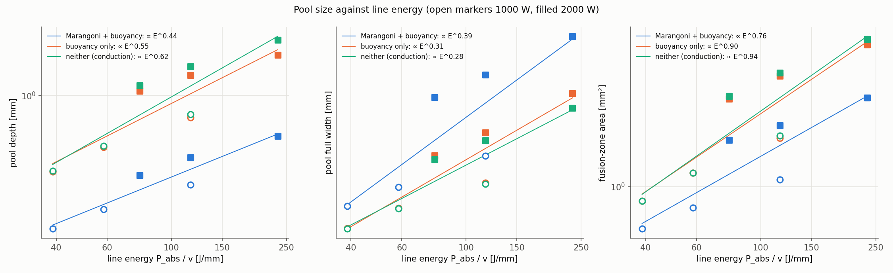

*Figure 27. Depth, width and fusion-zone area against line energy P_abs/v (log–log),
with a power-law fit for each force set. Open markers: 1000 W; filled: 2000 W.*

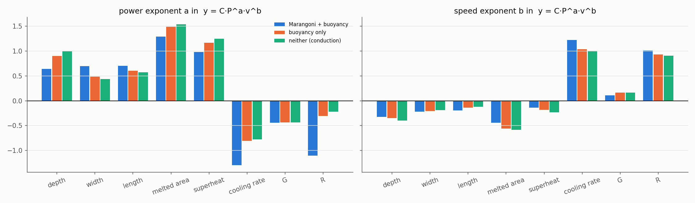

*Figure 28. Fitted exponents a (power) and b (speed) in y = C·P^a·v^b for each
output and each force set.*

**Power laws.** For each force set, a power law y = C·P_abs^a·v^b was fitted by
least squares to the six runs (P_abs in W, v in mm/s, two levels of P and three
of v). The fits are in `results/ta_fits.csv`.

| Output | MaB: a, b (R²) | B: a, b (R²) | none: a, b (R²) |
|---|---|---|---|
| Depth | 0.65, −0.32 (0.997) | 0.90, −0.35 (0.990) | **1.00, −0.40** (0.996) |
| Width | **0.70, −0.22** (0.999) | 0.49, −0.21 (0.993) | 0.44, −0.19 (0.998) |
| Length | 0.70, −0.19 (0.999) | 0.60, −0.14 (0.999) | 0.58, −0.12 (0.996) |
| Fusion-zone area | 1.29, −0.44 (0.999) | 1.49, −0.56 (0.998) | 1.54, −0.59 (0.998) |
| Superheat T_max − T_l | 0.98, −0.14 (0.994) | 1.17, −0.18 (0.986) | 1.25, −0.23 (0.993) |
| Peak melt speed | 0.87, −0.13 (0.992) | 2.59, −0.84 (0.980) | – |
| Cooling rate G·R | −1.30, 1.22 (0.970) | −0.80, 1.04 (0.999) | −0.77, 1.01 (0.998) |
| G | −0.44, 0.11 (0.969) | −0.44, 0.16 (0.990) | −0.44, 0.17 (0.990) |
| R | −1.10, 1.02 (0.975) | −0.31, 0.93 (1.000) | −0.22, 0.91 (0.999) |
| G/R | 0.49, −0.88 (0.930) | −0.09, −0.79 (0.989) | −0.17, −0.76 (0.982) |
| Melting efficiency | 0.29, 0.56 (0.996) | 0.49, 0.44 (0.989) | 0.54, 0.41 (0.992) |

With two power levels the power exponents are determined by a single ratio,
so they should be read as local slopes between 350 and 700 W absorbed.

**Relationship 1: Marangoni flow turns power into width; conduction turns it
into depth.**

| Exponent of power | Depth | Width |
|---|---|---|
| none | 1.00 | 0.44 |
| MaB | 0.65 | 0.70 |

- **In conduction**, doubling the power doubles the depth and widens the pool
  by only 36 %.
- **With Marangoni flow**, doubling the power deepens the pool by 57 % and
  widens it by 62 %.
- **The ranking reverses.** This is the clearest quantitative statement of what
  the outward Marangoni flow does: it redirects the extra energy from the
  bottom of the pool to its rim.
- **Agreement with Gao.** Gao et al. (2021) report the same for NiTi: "the
  width increases rapidly while the height and depth have a slight influence"
  as the power rises. They attribute it to the same outward thermocapillary
  flow.

**Relationship 2: speed shrinks every pool, weakly.**

| Speed exponent | Depth | Width |
|---|---|---|
| All force sets | −0.32 to −0.40 | −0.19 to −0.22 |

- From 3 to 9 mm/s, a threefold increase in speed, the depth falls by
  29–39 % and the width by 17–23 %.
- The Marangoni pool is slightly less sensitive to speed than the conduction
  pool, because its flow is much faster than the scan and its shape is set
  internally.
- For a moving point source on a thick plate (Rosenthal), the size would fall
  as v^−0.5. The broad 3 mm beam weakens the speed dependence further, because
  at these speeds the beam is wide compared with the thermal diffusion length
  α/v (0.6–1.9 mm).
- Pariona et al. (2018) measured the same weak dependence for Al-Fe: depth
  fell from 257 to 189 µm over a threefold increase in speed.

**Relationship 3: line energy is not a sufficient predictor.**

- **Equal line energy, different pools.** U1000_v3 and U2000_v6 have the same
  line energy (116.7 J/mm) but different pools.

  | Run | Depth (mm) | Width (mm) | Area (mm²) |
  |---|---|---|---|
  | U1000_v3_MaB | 0.46 | 3.24 | 1.08 |
  | U2000_v6_MaB | 0.58 | 4.58 | 1.92 |
  | U1000_v3_none | 0.85 | 2.87 | 1.72 |
  | U2000_v6_none | 1.29 | 3.46 | 3.36 |

- **Higher power with higher speed melts more.** The pool would depend only on
  P/v if a = −b. The fitted exponents are a ≈ 0.65–1.0 and |b| ≈ 0.2–0.4.
  The faster run leaks less of its energy into the plate (§8.8).
- **A practical rule.** Line energy is a useful single axis (Figure 27): every
  output rises monotonically along it within one power level. Power and speed
  must still be reported separately.

**Relationship 4: the Marangoni effect grows with the Péclet number.** All
Marangoni-to-conduction ratios collapse onto single power laws in Pe:

| Ratio MaB ÷ none | Fit | R² |
|---|---|---|
| Superheat | 0.76·Pe^−0.16 | 0.99 |
| Depth | 1.12·Pe^−0.20 | 0.99 |
| Width | 0.70·Pe^0.14 | 0.94 |
| Fusion-zone area | 1.20·Pe^−0.16 | 0.92 |

- **What the fits combine.** Pe combines the flow speed and the pool size, and
  therefore the power and the speed, into a single number.
- **Low Pe.** At Pe → 1 the ratios approach 0.76–1.2, i.e. roughly no effect,
  as they must when convection becomes comparable to conduction.
- **High Pe.** At the highest Pe of this study (135) the Marangoni pool has
  35 % of the conduction superheat and 43 % of its depth.
- **Practical use.** These correlations are a compact summary of how much
  Marangoni flow changes a pool, and can be used to correct a conduction
  estimate for the flow.

**Relationship 5: G·R and G/R follow the scan speed and the pool shape.**

- **Cooling rate.** In all force sets it rises about proportionally with speed
  (v^1.0–1.2), as expected for a front moving at R = v·cos θ through a gradient
  set by the plate.
- **Effect of the pool shape.** The Marangoni flow adds a strong power
  dependence (P^−1.30 against P^−0.77) because larger Marangoni pools are also
  flatter, with more upward-facing boundary.
- **Comparison with Rosenthal.** For a moving point source on a thick plate,
  the cooling rate scales as v/P. The conduction runs follow this closely
  (P^−0.77·v^1.01). The Marangoni runs deviate in the direction of a stronger
  power penalty.

**Relationship 6: the melting onset time scales as q₀⁻².** See §8.1:
t_melt ∝ q₀^−1.90 between the two powers, close to the semi-infinite
surface-flux law t ∝ q₀⁻².

### 8.11 Transient evolution of the pool

The quasi-steady values hide how differently the pools grow. The field writes
every 0.25 s follow each run through its life. The 3 mm/s runs are the
clearest, because their laser is on for 1.33 s and five writes fall inside it.

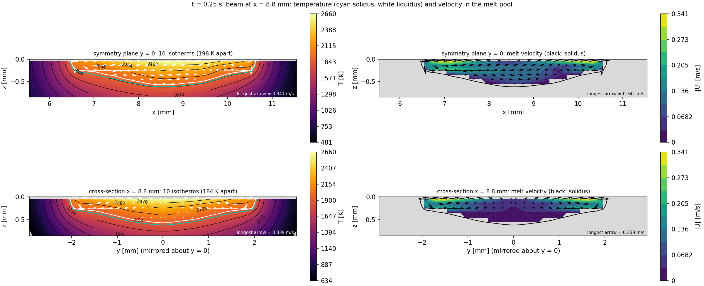

*Figure 30. U2000_v3_MaB at t = 0.25 s, only 0.75 mm after the start of the
track.*

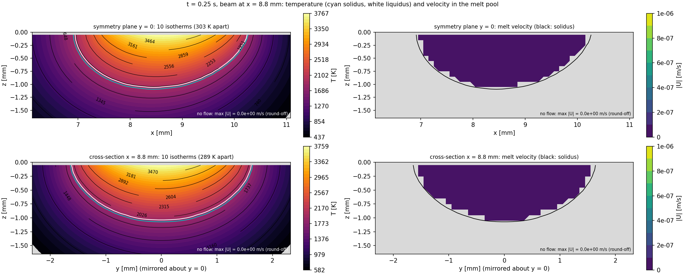

*Figure 31. U2000_v3_none at t = 0.25 s, for comparison.*

**Early pool (0.25 s).** After only 0.25 s, with the beam 0.75 mm along its
4 mm track, the two pools are already fundamentally different.

**The Marangoni pool (Figure 30)** is already a fully formed pan.

- **Size.** 4.1 mm wide and 0.57 mm deep, extending from x = 6.5 mm to
  10.6 mm.
- **It reaches behind the start of the track.** The laser started at x = 8 mm,
  yet the pool reaches 1.5 mm behind that point. The outward surface flow
  carries heat in every direction from the hot spot, including backward over
  metal the beam never touched.
- **Its shape is already the steady shape.** The isotherms inside are already
  flat layers, and the surface speed is already 0.34 m/s, 83 % of its final
  value. Its depth is already 81 % of its final 0.70 mm. Only the width will
  still grow, by about a third (4.1 → 5.5 mm), as the plate around it warms.

**The conduction pool at the same instant (Figure 31)** is a hemispherical
bowl.

- **Size.** 1.06 mm deep and 3.25 mm wide.
- **It has only reached 62 % of its depth at switch-off (1.70 mm).** Over the
  next second it sinks steadily into the plate.

**The difference in growth.** The Marangoni pool reaches its shape quickly
because the flow redistributes heat within a few circulation times: at 0.3 m/s
the melt crosses the 2 mm half-width in about 7 ms. The conduction pool can
only grow as fast as heat diffuses. The diffusion length √(αt) is about 1 mm
after 0.25 s and about 2 mm after 1 s, matching its continued deepening.

**Steady travel (0.5–1.25 s).** The writes at 0.5, 0.75, 1.0 and 1.25 s show
the pools travelling with the beam:

- **MaB pool.** It moves along the track almost unchanged in depth (0.67 →
  0.70 mm) and grows slowly in width (4.7 → 5.5 mm).
- **Conduction pool.** It moves and keeps deepening (1.35 → 1.68 mm), with a
  growing tail of hot metal behind it.

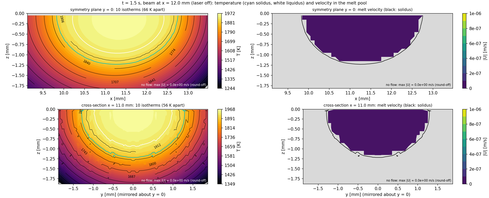

*Figure 32. U2000_v3_none at t = 1.5 s, 0.17 s after the laser switched off:
the last liquid freezing at the end of the track.*

**After switch-off.** The laser switches off at 1.333 s at x = 12 mm. What
remains is a pool with no heat input.

- **MaB.** The Marangoni pool at 2000 W freezes within 142 ms (Figure 2). Its
  flow decays as the liquid fraction falls, and the Marangoni stress vanishes
  with it.
- **Conduction pool.** At 1.5 s, 0.17 s after switch-off, the conduction pool
  still holds a 2.6 mm wide, 1.2 mm deep bowl of liquid (Figure 32).
- **Its temperature is almost uniform.** The ten isotherms are only 56–66 K
  apart, and the hottest liquid (1970 K) is only 40 K above the liquidus.
  - All the superheat of the 4000 K pool has been conducted away within the
    first 0.1 s.
  - What remains is the latent heat. The bowl now freezes from its boundary
    inward, at the liquidus, as a nearly isothermal pool.
  - This is the latent-heat plateau of Figure 3 seen in space.
  - The pool needs another 0.13 s to freeze completely.

**Size of the end crater.**

- **Conduction.** 0.17 s after switch-off, the conduction pool still holds
  liquid down to 1.2 mm below the surface.
- **Marangoni.** The whole Marangoni pool was never deeper than 0.7 mm, and it
  has frozen completely within 0.14 s.
- **Why it matters.** In a real part the last liquid to freeze is where
  shrinkage porosity collects. The shallower, faster-freezing Marangoni crater
  keeps that region close to the surface, where the next track remelts it.

### 8.12 Analytical cross-check of the conduction runs

The conduction-only runs can be checked against the classical moving
point-source solution of Rosenthal. For a point source of power P moving at
speed v over a thick plate, at high scan Péclet number, the maximum width of
the isotherm at temperature T_m is

$$w_{R} = \sqrt{\frac{8\,P}{\pi e\,\rho c_p\,v\,(T_m - T_0)}}$$

The table uses T_m = T_s = 1878 K, ρc_p = 3.81 MJ/m³K (solid at the mean
temperature of the heating range) and the absorbed power.

| Run | Rosenthal width (mm) | Simulated width (mm) | Ratio sim/Rosenthal | Scan Péclet v·w/(4α) |
|---|---|---|---|---|
| U1000_v3_none | 4.25 | 2.87 | 0.67 | 0.47 |
| U1000_v6_none | 3.01 | 2.58 | 0.86 | 0.85 |
| U1000_v9_none | 2.46 | 2.37 | **0.97** | 1.17 |
| U2000_v3_none | 6.02 | 3.97 | 0.66 | 0.65 |
| U2000_v6_none | 4.25 | 3.46 | 0.81 | 1.14 |
| U2000_v9_none | 3.47 | 3.19 | **0.92** | 1.57 |

**Observations.**

1. **Agreement at the fastest scans.** At 9 mm/s the simulated widths are
   within 3–8 % of Rosenthal's formula. Under exactly the condition where the
   formula is valid, a scan Péclet number above 1, the conduction runs
   reproduce classical theory without any fitting. This is an independent
   verification of the energy balance and thermal solution of the model.
2. **Overprediction at slow scans.** At lower Péclet numbers the formula
   overpredicts the width, by up to 50 % at 3 mm/s. This is expected, for three
   reasons:
   - The high-speed form assumes heat flows mainly sideways from the moving
     source. At low speed it also flows ahead of the beam and down.
   - Rosenthal ignores the latent heat, which absorbs 290 kJ/kg on melting.
   - The conductivity of Ti-6Al-4V doubles between 300 K and 1878 K, so the
     constant-property solution is only an approximation.
3. **Exponents.** Rosenthal's width scales as (P/v)^0.5. The fitted conduction
   width scales as P^0.44·v^−0.19 (§8.10). The power exponent is close to 0.5.
   The speed exponent is weaker, consistent with the low-Péclet deviation
   above.
4. **Pool depth.** A point source gives a hemispherical pool (d/w = 0.5). The
   conduction pools here have d/w = 0.22–0.41, because the 3 mm uniform source
   spreads the heat over a disc. The deeper, more hemispherical pools are those
   whose size is largest compared with the beam (2000 W, 3 mm/s: d/w = 0.41).
   There the source looks most like a point.

The Marangoni runs cannot be compared with Rosenthal's solution, because their
shape is set by convection. That is the point of this study. Their widths
exceed Rosenthal's prediction at 2000 W and 6–9 mm/s (4.58 against 4.25 mm,
4.16 against 3.47 mm). No conduction model can produce a pool that wide at that
power.

### 8.13 Uncertainty of the reported values

Three sources of uncertainty affect the numbers in this section. They are
quantified here so that the differences between runs can be judged against
them.

**1. Fluctuation within the averaging window.** The standard deviations of
depth and width over the quasi-steady window are:

| Force set | Depth s.d. | Width s.d. |
|---|---|---|
| MaB | 0.001–0.007 mm (0.2–1.5 %) | 0.013–0.126 mm (0.5–2.3 %) |
| B and none | 0.016–0.047 mm (2.0–3.3 %) | 0.023–0.092 mm (0.8–2.2 %) |

- The larger depth scatter in the conduction runs reflects their continued
  growth (§8.1), not noise.
- All differences between force sets reported in this study are at least 10
  times these standard deviations.

**2. Grid resolution.**

- **What the solver resolves.** The pool dimensions are interpolated between
  cell centres by AdditiveFOAM's melt-pool function, so they vary smoothly in
  time. The underlying temperature field is resolved to 100 µm.
- **The fusion zone.** It is counted in whole cells, so its depth and width are
  resolved to 0.1 mm and its area to about one cell row (±0.1 mm² for the
  2000 W pools).
- **Profiles.** The thin surface layer of the Marangoni flow is about one cell
  thick, so its velocity and the surface gradients are the quantities most
  sensitive to the grid.
- **Robustness of the comparisons.** Since all runs share one grid, ratios
  between force sets are expected to be much less sensitive than absolute
  values. Appendix E describes the 50 µm check.

**3. Statistics of the solidification events.**

- **Sample size.** Each run has 695–4,251 track events.
- **Precision of the medians.** For a sample of this size, the median is
  estimated to within a few percent: the 95 % confidence interval of the median
  of n samples spans roughly ±1.96·√n/2 ranks, i.e. ±1.5–3.7 % of the sample.
- **Bottom and along-boundary values.** These come from far fewer events
  (5–40 per bin or point) and scatter by 20–50 %. Figures 23 and 24 should be
  read for their trends (bottom versus edge, MaB versus none), which are a
  factor of 3–10, not for individual bin values.

**4. Input data.**

- **Material properties.** Every property is cited (§5.7). Where several
  sources disagreed, the alternatives are listed in
  `materials/Ti6Al4V_sources.md`.
- **The two most influential inputs** for the Marangoni effect are dσ/dT and
  the viscosity μ.
  - The Marangoni number scales as |dσ/dT|/μ².
  - A ±20 % change in dσ/dT would change Ma by ±20 % and, through the Pe
    correlation of §8.10, the superheat ratio by about ±3 %.
  - The conclusions of Section 9 are therefore robust to plausible property
    uncertainty.

### 8.14 Implications for the Ti-6Al-4V microstructure

The solidification parameters G and R do not by themselves predict a
microstructure. They do indicate the tendencies a metallurgist would expect in
the cross-section of each bead.

**Prior-β grain shape (from G/R).**

- **The values.** G/R in the track lies between about 240 and 1160
  K·s/mm² (medians). At the bottom of the Marangoni pools it reaches up to
  about 3700 K·s/mm² (U1000_v3_MaB: G = 661 K/mm, R = 0.18 mm/s).
- **What these values mean.** In the framework used by Gao et al. (2021) and
  Farzadi et al. (2008), the highest G/R favours planar and cellular growth at
  the fusion line, and lower values favour columnar and then equiaxed
  dendritic growth. In laser-melted Ti-6Al-4V the prior-β grains grow
  epitaxially from the partially melted substrate grains and follow the heat
  flow.
- **Effect of Marangoni flow.** The flow raises G/R by a factor of 1.3–2.5
  (§8.7). It therefore **favours columnar prior-β grains** that grow upward
  from the flat pan bottom. Because the pan bottom is nearly horizontal, these
  columns would be oriented nearly vertically, along the build direction in a
  multi-layer part.
- **The conduction bowl.** Its boundary is curved, so its grains would grow
  inward from all sides, towards the centreline, with a lower G/R.

**Scale of the structure (from G·R).**

- **The values.** The median cooling rate at solidification is
  420–5600 K/s.
- **Effect of Marangoni flow.** It lowers the median cooling rate by 18–62 %,
  which points to a coarser solidification structure. The local cooling rate
  near the surface edge is, however, higher with Marangoni flow (§8.7, the
  90th percentile). The Marangoni bead is therefore expected to be more
  **graded**: coarse at the bottom, finer at the surface edges.

**Solid-state transformation.**

- **What controls it.** The room-temperature α/α′ microstructure forms
  during cooling through the β-transus, well below the solidification range,
  and is not resolved by these events.
- **What the simulation does show.** The cooling of the plate after
  solidification is governed by conduction into the block. The heat-affected
  zone around the bead is similar for all force sets (the 1000 K isotherm
  differs by at most 20 %, §8.2).
- **Expected consequence.** The solid-state transformation products should
  therefore differ less between the force sets than the solidification
  structure does.

**Process implication.** A faster scan raises R and G·R and lowers G/R. It
counteracts the columnar tendency that Marangoni flow produces. At 9 mm/s
the Marangoni pools have G/R of 350–550 K·s/mm², against 1120–1160 K·s/mm² at
3 mm/s. If a finer, less columnar bead is wanted, a higher speed with
proportionally higher power is the lever the simulations identify.

### 8.15 Three-dimensional view of the temperature field

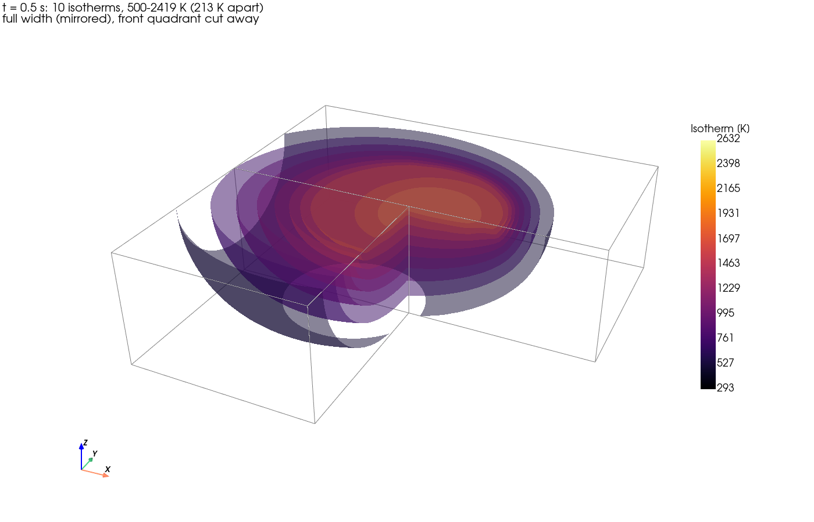

*Figure 33. U2000_v6_MaB at t = 0.5 s: ten nested isotherm surfaces from 500 K
to 2419 K (213 K apart), full width, front quadrant cut away.*

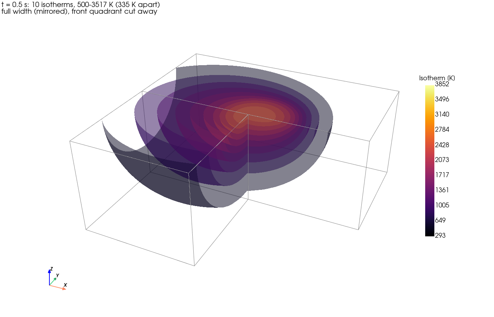

*Figure 34. U2000_v6_none at t = 0.5 s: ten isotherm surfaces from 500 K to
3517 K (335 K apart).*

The 3D isotherm surfaces show the whole heated zone at once.

**Marangoni + buoyancy (Figure 33).**

- **The hot isotherms** (above about 1700 K) are wide, flat **discs** lying
  just under the surface. They are stretched out to 4.5 mm across and only a
  few tenths of a millimetre thick.
- **The cooler isotherms** below them form wide, shallow shells.
- **The hottest surface** is a broad, low dome that covers most of the pool.
- **What this shows.** The heat input is spread sideways over the whole pool
  surface before it penetrates downward.

**Conduction (Figure 34).**

- **The isotherms** are nested **hemispherical shells**, almost concentric
  around a small hot core under the beam.
- **The hottest surfaces** are small caps.
- **Spacing.** The shells are nearly evenly spaced, as for heat diffusing
  outward from a compact source.
- **The outermost isotherm** (500 K) has a similar extent to the Marangoni
  case. The heat-affected zone is set by the total heat input, while the flow
  rearranges the heat only inside the hot core (§8.2).

**Front–rear asymmetry.** In both pictures, the cut-away front quadrant shows
that the isotherms ahead of the beam (towards +x) are compressed and those
behind are stretched along the track. This is the signature of the moving
source in the solid. The 3D velocity views of Section 10 complete the picture
for the Marangoni runs: the melt fans out radially from a point just behind the
beam centre, fastest near the rim.

---

## 9. How Marangoni convection affects everything

This section answers the teaching assistant's main question directly. It
collects the evidence of Section 8 into one picture:

| Section | Content |
|---|---|
| 9.1 | The chain of cause and effect |
| 9.2 | The effect on every output, in one table |
| 9.3 | The separate role of buoyancy |
| 9.4 | How the effect depends on power and speed |
| 9.5 | What it means for a real process |
| 9.6 | A process-design guide with worked examples |


*Figure 29. Every output of the Marangoni + buoyancy runs (left) and of the
buoyancy-only runs (right), divided by the same output of the conduction-only run
at the same power and speed (log scale). A bar at 1 means no effect.*

### 9.1 The chain of cause and effect

Marangoni convection is not one effect but a chain. Every link was observed
directly in the simulations.

1. **The beam heats the surface unevenly.** Even a uniform beam produces a
   surface temperature that is highest at the centre (behind it, in a moving
   pool) and falls to the liquidus at the pool rim, because heat escapes
   sideways and downward from the edge of the heated disc (§8.6).
2. **The surface tension follows the temperature.** With dσ/dT = −2.6 × 10⁻⁴
   N/m·K, the surface tension at the hot centre is about 0.1–0.2 N/m lower than
   at the rim (ΔT = 400–750 K above the liquidus).
3. **The difference pulls the surface outward.**
   - The shear stress on the liquid surface is |dσ/dT|·|∇ₛT|, up to 360–670 Pa
     (§8.6).
   - It accelerates a thin surface layer, 0.10–0.13 mm thick, outward at
     0.2–0.4 m/s: 20–130 times the scan speed (§8.3).
4. **The flow closes into a loop.**
   - The surface jet is turned down at the rim.
   - It returns inward along a deeper layer at about half the speed.
   - It rises again under the beam.
   - The cross-section shows two counter-rotating vortices (§8.3).
5. **The loop carries heat from the centre to the rim.** With Pe = 22–135,
   convection carries 20–135 times more heat than conduction inside the pool
   (§8.9).
6. **The surface temperature flattens.**
   - The centre cools and the rim heats.
   - The surface becomes a plateau with a steep edge.
   - The mean surface gradient falls by a factor of 1.9–4.3, while the maximum
     gradient moves to the rim (§8.6).
7. **The peak temperature is capped.** A feedback loop holds the superheat at
   35–47 % of its conduction value (§8.4). Every Marangoni pool stays more than
   850 K below boiling, while the conduction pools at 2000 W exceed it.
8. **The rim melts sideways; the bottom does not.**
   - Hot liquid arrives at the rim and melts the solid there.
   - The bottom receives only the cooled return flow.
   - The pool becomes a **pan**: 40–57 % shallower, 10–36 % wider, 7–8 times
     wider than deep (§8.5).
9. **Less metal melts overall.**
   - The heat is spread over a wide, thin rim, through which much of it leaks
     into the solid plate.
   - The fusion zone is 26–46 % smaller and the melting efficiency drops from
     11–26 % to 7–16 % (§8.8).
10. **The fusion boundary faces upward.**
    - The flat pan has a long horizontal bottom and a stretched-out rear.
    - The solidification front speed R = v·cos θ is therefore low over most of
      it: the median R is 14–63 % lower (§8.7).
11. **The gradient G at the front is almost unchanged.** G is set by
    conduction into the plate, which is similar in all cases (±7 %).
12. **The structure is coarser and more columnar.**
    - G/R rises by a factor of 1.3–2.5 and G·R falls by 18–62 %.
    - Both point to a coarser, more columnar solidification structure along
      the bottom of the bead.
    - The spread of conditions from bottom to top is much larger (§8.7).
13. **The pool becomes steady sooner and is nearly round.**
    - The fast circulation makes the depth and temperature steady within
      0.1–0.4 s, while the conduction pool keeps deepening (§8.1).
    - The pool is nearly round in plan (L/w = 1.04–1.07) rather than
      teardrop-shaped (§8.5).
14. **It costs computing time.** The Marangoni flow forces 2–5 times more time
    steps and 3–7 times longer runs (§6.4).

### 9.2 Effect on every output

| Output | Effect of Marangoni flow (MaB ÷ none) | 1000 W | 2000 W | Mechanism |
|---|---|---|---|---|
| Pool depth | **Strongly reduced** | ×0.54–0.61 | ×0.43–0.46 | Heat carried to the rim, not the bottom |
| Pool width | Increased | ×1.10–1.13 | ×1.30–1.36 | Hot liquid melts the rim sideways |
| Pool length | Increased | ×1.10–1.14 | ×1.15–1.30 | Same, along the track |
| Width/depth | **Doubled to tripled** | 7.0–8.3 vs 3.4–4.6 | 7.7–8.3 vs 2.4–2.9 | Pan instead of bowl |
| Length/width | Rounder | 1.04–1.07 vs 1.03–1.06 | 1.04–1.07 vs 1.08–1.22 | Flow faster than the beam |
| Fusion-zone area | Reduced | ×0.63–0.74 | ×0.54–0.63 | More heat lost to the solid through the wide rim |
| Melting efficiency | Reduced | 0.07–0.13 vs 0.11–0.17 | 0.08–0.16 vs 0.16–0.26 | Same |
| Peak temperature | **Strongly reduced** | −360 to −570 K | −1100 to −1370 K | Thermostat feedback |
| Superheat | Reduced | ×0.41–0.47 | ×0.35–0.38 | Same, ≈ 0.76·Pe^−0.16 |
| Above boiling? | Prevented | No vs no | No vs **yes** (by 180–510 K) | Same |
| Peak melt speed | Created | 0.19–0.24 m/s | 0.38–0.41 m/s | Thermocapillary shear |
| Mean surface ∇T | Reduced | ×0.38–0.54 | ×0.23–0.32 | Surface plateau |
| Max surface ∇T | Concentrated at the rim | ×1.1–1.2 | ×0.7–1.1 | Steep rim |
| 1000 K isotherm, sideways | Slightly wider | +3 to +9 % | +15 to +20 % | Heat entering the solid over a wider area |
| 1000 K isotherm, depth | Shallower | Within 6 % | −11 to −13 % | Same |
| Time to steady depth | Shorter, and truly steady | Plateau vs +10–12 % growth | Same | Fast circulation |
| G (median) | **Almost unchanged** | ×0.94–1.04 | ×0.93–1.03 | Set by conduction into the plate |
| G at pool bottom | Reduced | ×0.73–0.75 | ×0.63–0.70 | Cool return flow at the bottom |
| R (median) | **Strongly reduced** | ×0.62–0.86 | ×0.37–0.41 | Upward-facing pan boundary, R = v cos θ |
| R along the bottom half | Very strongly reduced | 3–5× lower | 4–10× lower | Same |
| Cooling rate G·R | Reduced | ×0.63–0.82 | ×0.38–0.64 | Low R |
| G/R | **Increased** | ×1.30–1.85 | ×2.32–2.54 | Low R at similar G |
| Spread of G·R (p90/p10) | Much wider | 13–25 vs 3.6–4.2 | 22–72 vs 2.6–2.7 | Slow pan bottom, fast steep rim |
| Time to solidify after switch-off | Shorter | ×0.63–0.68 | ×0.48–0.49 | Less molten metal, less superheat |
| Melting onset | No effect | Identical | Identical | No liquid, no flow |
| Run time | Longer | 3–6× | 5–7× | Courant limit on a fast flow |

### 9.3 The separate role of buoyancy

The buoyancy-only runs answer a second question: how much of the effect comes
from buoyancy? The answer depends on the size and temperature of the pool.

**At 1000 W buoyancy is negligible.**

- Every output of the B runs is within 3.5 % of the conduction run (Figure 29,
  right).
- The buoyancy flow reaches 1.3–4.7 mm/s, a Péclet number of only 0.1–0.7, so
  conduction carries almost all the heat.
- The Marangoni + buoyancy runs are therefore, at this power, effectively
  Marangoni-only runs.

**At 2000 W buoyancy has a small but measurable effect, in the same direction
as Marangoni.**

| Effect of buoyancy at 2000 W (B ÷ none) | Range |
|---|---|
| Depth | 5–12.5 % shallower |
| Width | 2–6.5 % wider |
| Peak temperature | 68–248 K lower |
| Cooling rate | Within 6 % |
| R | 5–9 % lower |

The buoyancy cell, with hot liquid rising under the beam and spreading
outward, is a weak version of the Marangoni loop. Its Péclet number of 1.3–4.8
means it carries a share of the heat comparable to conduction.

**Buoyancy is always tiny compared with Marangoni.** The surface tension force
exceeds buoyancy by a factor of 330–1400 in the Marangoni runs (§8.9). Even at
2000 W the buoyancy-only flow is 20–33 times slower than the Marangoni flow. It
removes 4–12 % of the superheat, where the Marangoni flow removes 62–65 %.

**The effect of buoyancy follows the same law as Marangoni, at much lower
Péclet numbers:**

$$1 - \frac{d_B}{d_{none}} \approx 0.036\ \mathrm{Pe}_B^{0.8}$$

A buoyancy-driven change of more than 10 % in depth requires Pe_B ≳ 4. That
happened only in the largest, hottest pool (2000 W, 3 mm/s).

**What this means for modelling.** A model of these laser pools could omit
buoyancy at 1000 W without any noticeable change. At 2000 W, omitting it would
overestimate the depth of a pool without Marangoni flow by up to 13 %, but
would change a Marangoni pool very little, because there the Marangoni flow
dominates.

### 9.4 How the Marangoni effect depends on power and speed

The strength of the Marangoni effect is not fixed. It grows with the flow
Péclet number, which grows with power and falls with speed (Figure 26):

| | Pe | Superheat ratio | Depth ratio | Width ratio | G/R ratio |
|---|---|---|---|---|---|
| 1000 W, 9 mm/s (weakest) | 22 | 0.47 | 0.61 | 1.10 | 1.49 |
| 1000 W, 6 mm/s | 31 | 0.44 | 0.58 | 1.10 | 1.30 |
| 1000 W, 3 mm/s | 44 | 0.41 | 0.54 | 1.13 | 1.85 |
| 2000 W, 9 mm/s | 84 | 0.38 | 0.46 | 1.30 | 2.32 |
| 2000 W, 6 mm/s | 104 | 0.37 | 0.45 | 1.32 | 2.54 |
| 2000 W, 3 mm/s (strongest) | 135 | 0.35 | 0.43 | 1.36 | 2.40 |

**Power is the stronger lever.**

- Doubling the power roughly triples Pe.
- It changes every ratio more than a threefold change of speed does.
- A larger, hotter pool has a longer surface over which the shear acts, and a
  larger temperature difference driving it.

**Speed matters less.**

- Slower scans give a larger pool and a higher Pe, so the effect is stronger
  at 3 mm/s than at 9 mm/s.
- This agrees with Pariona et al. (2018), who found the Marangoni effect "more
  noticeable" at low beam velocities.

**The ratios saturate.** The superheat ratio changes only from 0.47 to 0.35
over a sixfold change of Pe (Pe^−0.16). This is again the feedback: a stronger
flow removes more superheat, which weakens the flow.

### 9.5 What this means for a real process

1. **Penetration depth.** A real Ti-6Al-4V pool, with its negative dσ/dT, will
   be about half as deep as a conduction estimate suggests. Rosenthal-type
   formulas, or any model without Marangoni flow, overestimate the penetration
   by a factor of 1.6–2.3 at these settings.
2. **Bead width.** The bead will be wider than the beam at high power, here up
   to 1.8 beam diameters. Track spacing for overlapping tracks must be based on
   the Marangoni width, not on the beam size.
3. **Overheating.** Marangoni flow is what keeps the pool below the boiling
   point at 2000 W. In practice, anything that weakens it would push the pool
   towards evaporation and keyholing:
   - surface-active impurities such as oxygen or sulphur, which can make dσ/dT
     positive at high temperature (Fuhrich et al. 2001);
   - a shallower temperature gradient.
4. **Microstructure.** The flat Marangoni pool solidifies with a low R and a
   high G/R along most of its boundary. That favours columnar growth from the
   fusion line, which in Ti-6Al-4V means long prior-β grains. Faster scanning
   counteracts this, because R and G·R grow with v.
5. **Measuring Marangoni in an experiment.** The width-to-depth ratio of the
   bead is the simplest fingerprint. A ratio of 7–8 means strong Marangoni
   flow, and 2.5–4.5 means a conduction-dominated pool. Section 11 uses this to
   design the comparison with the laboratory tracks.

### 9.6 Using the results: a process-design guide

The power laws of §8.10 turn the 18 runs into a tool for choosing laser
settings. They are valid within the tested range: absorbed power 350–700 W
(nominal 1000–2000 W at η = 0.35), 3–9 mm/s, 3 mm uniform beam, Ti-6Al-4V.

For the real (Marangoni) pool, with P_abs in W and v in mm/s:

$$d\ [\mathrm{mm}] = 0.01493\,P_{abs}^{0.645}\,v^{-0.325}$$

$$w\ [\mathrm{mm}] = 0.06871\,P_{abs}^{0.700}\,v^{-0.216}$$

$$T_{max} - T_l\ [\mathrm{K}] = 1.422\,P_{abs}^{0.984}\,v^{-0.137}$$

$$R\ [\mathrm{mm/s}] = 247\,P_{abs}^{-1.103}\,v^{1.016}, \qquad
G\cdot R\ [\mathrm{K/s}] = 5.85\times10^{5}\,P_{abs}^{-1.296}\,v^{1.223}$$

**Worked example 1: a target depth.** Which power gives a 0.5 mm deep bead at
6 mm/s?

- Inverting the depth law gives P_abs ≈ 570 W, i.e. about **1630 W nominal**
  at η = 0.35.
- The same setting gives a width of about 4.0 mm and a superheat of about
  570 K.
- A conduction estimate (none-set laws) would have predicted 0.5 mm depth at
  only about 280 W absorbed, i.e. **half the power**. Designing with a
  conduction model would give a bead about half as deep as intended.

**Worked example 2: an intermediate setting.** What would 1500 W (525 W
absorbed) at 6 mm/s give?

| Quantity | Marangoni (real) | Conduction estimate | Ratio |
|---|---|---|---|
| Depth | 0.47 mm | 0.95 mm | 0.50 |
| Width | 3.75 mm | 3.05 mm | 1.23 |
| Superheat | 530 K | 1320 K | 0.40 |
| Median R | 1.53 mm/s | 3.02 mm/s | 0.51 |
| Median cooling rate | 1560 K/s | 2690 K/s | 0.58 |

This is a prediction for a run that was not simulated. It lies inside the
tested range, and the fits have R² ≥ 0.97 for geometry and temperature. It
would make a good additional validation point for the experiment
(Section 11).

**Worked example 3: track spacing.** For overlapping tracks with, say, 30 %
overlap, the hatch spacing is 0.7 × the bead width.

| Setting | Bead width | Hatch spacing | Beam diameter |
|---|---|---|---|
| 1000 W, 6 mm/s | 2.8 mm | 2.0 mm | 3 mm |
| 2000 W, 6 mm/s | 4.6 mm | 3.2 mm | 3 mm |

A spacing based on the beam diameter would be wrong in both cases: too wide at
1000 W and too narrow at 2000 W.

**Rules of thumb from the study:**

1. To deepen a Marangoni pool by 50 %, multiply the power by about 1.9
   (1.5^(1/0.645)). The width will grow by about 55 % at the same time.
2. To change the width without changing the depth much, change the power. To
   change the depth relative to the width, change the speed: speed affects the
   depth (v^−0.33) more than the width (v^−0.22).
3. The peak temperature of a Marangoni pool rises almost linearly with power
   but hardly with speed (v^−0.14). Speed is therefore not a useful lever
   against overheating, while power is.
4. Faster scanning raises the cooling rate almost proportionally (v^1.2) and
   lowers G/R (v^−0.88). It is the main lever for a finer, less columnar
   structure.

---

## 10. Run-by-run observations (all 18 runs)

Each run is described individually below, in the style of the reference papers.

**What each subsection contains.**

- **A data table** of the run's quasi-steady values.
- **The contour figure** at the comparison time: 10 labelled isotherms with velocity
  vectors (left), and velocity-magnitude contours in the melt (right), in the symmetry
  plane (top) and the cross-section through the beam (bottom).
- **The velocity profiles** at the same time.
- **The full sections:** heated zone and pool close-up.
- **The 3D velocity view.**
- **The time history.**
- **Written observations.**

**Other files in each run folder.** Contours, sections and 3D views at the other
field-write times are in `results/<run>/`. They show the pool at 0.25 s intervals,
including its growth at the start and its freezing after switch-off.

**Where to find a run.** The runs are grouped by power and speed, so the three force
sets of one setting follow each other:

| Setting | MaB | B | none |
|---|---|---|---|
| 1000 W, 3 mm/s | §10.1 | §10.2 | §10.3 |
| 1000 W, 6 mm/s | §10.4 | §10.5 | §10.6 |
| 1000 W, 9 mm/s | §10.7 | §10.8 | §10.9 |
| 2000 W, 3 mm/s | §10.10 | §10.11 | §10.12 |
| 2000 W, 6 mm/s | §10.13 | §10.14 | §10.15 |
| 2000 W, 9 mm/s | §10.16 | §10.17 | §10.18 |

### 1000 W, 3 mm/s (line energy 116.7 J/mm)

#### 10.1 U1000_v3_MaB: Marangoni + buoyancy

| Quantity | Value | Quantity | Value |
|---|---|---|---|
| Absorbed power | 350 W | Scan speed | 3 mm/s |
| Depth | 0.46 mm | Full width | 3.24 mm |
| Length | 3.37 mm | Width / depth | 7.0 |
| Peak temperature | 2328 K | Superheat | 400 K |
| Peak melt speed | 0.238 m/s | Péclet number | 43.9 |
| Fusion-zone area | 1.08 mm² | Melting efficiency | 0.070 |
| G (median) | 984 K/mm | R (median) | 1.07 mm/s |
| Cooling rate (median) | 1185 K/s | G/R (median) | 1123 K·s/mm² |
| First melting | 34.9 ms | Solid again after switch-off | 70 ms |

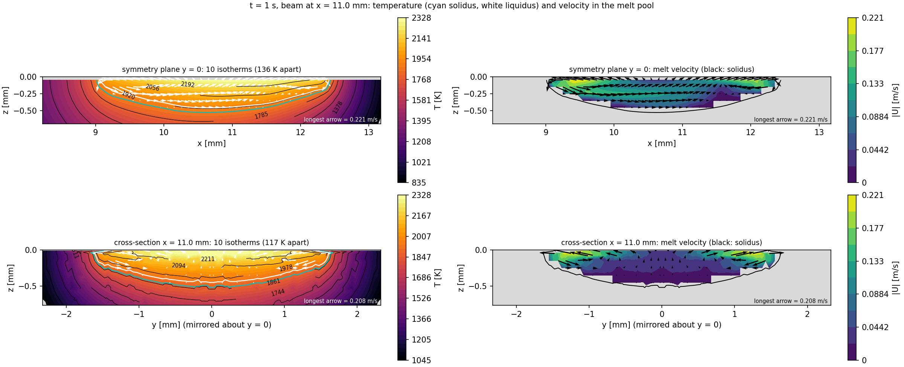

*U1000_v3_MaB at t = 1 s: isotherms with velocity vectors (left) and velocity magnitude in the melt (right).*

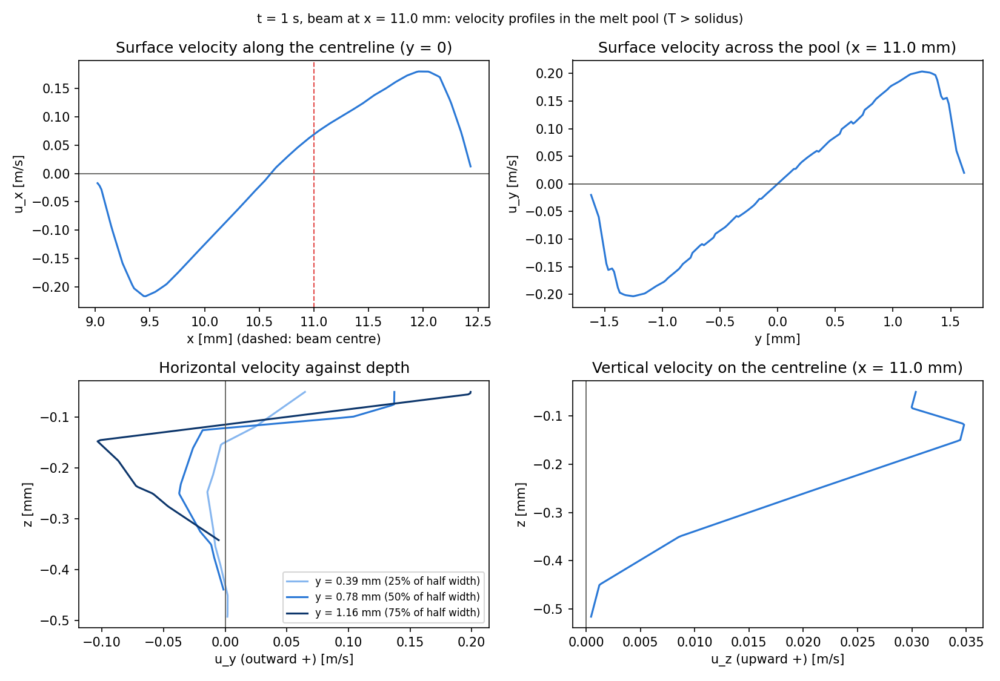

*U1000_v3_MaB at t = 1 s: velocity profiles.*

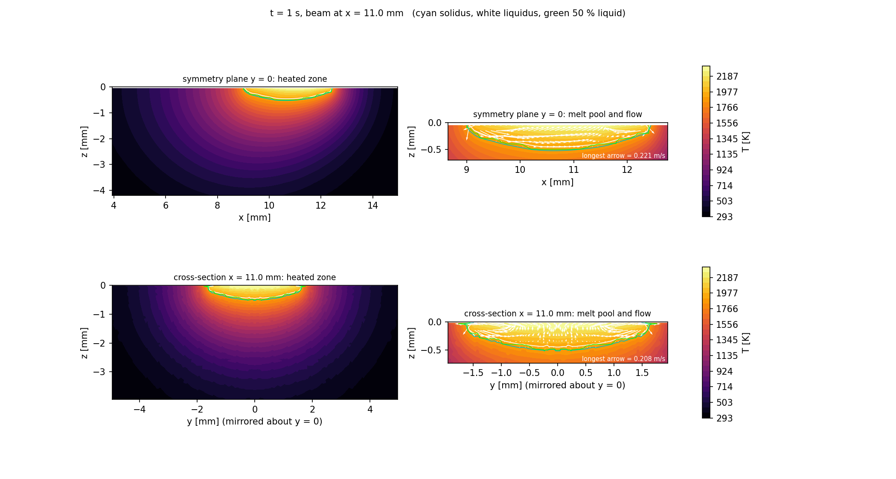

*U1000_v3_MaB at t = 1 s: heated zone (left) and pool close-up (right), symmetry plane (top) and cross-section (bottom).*

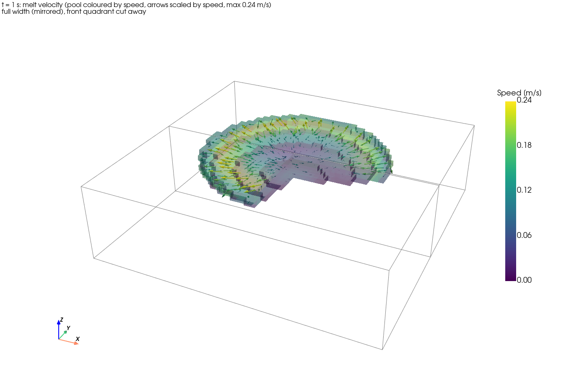

*U1000_v3_MaB at t = 1 s: 3D view of the melt, coloured by speed, with velocity glyphs.*

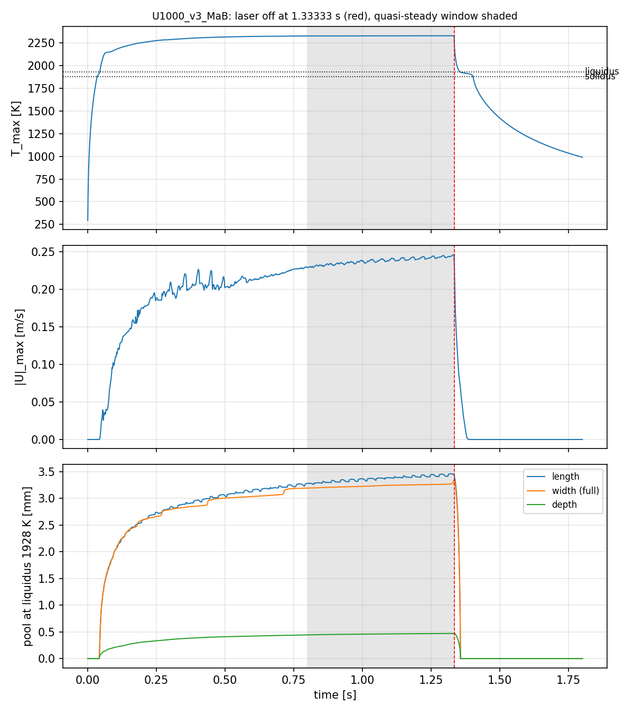

*U1000_v3_MaB: time history of peak temperature, peak melt speed and pool size.*

**Observations.**

**Pool shape.**

- **Cross-section.** In the contour plot the pool is a shallow, flat-bottomed
  pan, 3.24 mm wide and 0.46 mm deep. Its bottom is horizontal across the
  central 2 mm and its walls rise steeply over the last 0.3 mm to the rim.
- **Isotherms.** Inside the pool the ten isotherms lie in thin horizontal
  layers parallel to the surface. Below the pool they open into wide, flat
  bowls.
- **Width compared with the beam.** The pool is slightly wider than the 3 mm
  beam: the surface flow carries heat past the edge of the beam footprint and
  melts 0.1 mm beyond it on each side.
- **Symmetry plane.** The pool is a 3.4 mm long lens, almost symmetric about
  the hottest point. The scan speed is only 3 mm/s, while the surface melt
  moves at up to 0.24 m/s, 80 times faster, so the beam motion leaves little
  trace on the pool.

**Flow.**

- **Pattern.** The velocity-magnitude map shows the fastest liquid in a thin
  band along the surface near the rim, at 0.2–0.24 m/s, and nearly stagnant
  liquid in the lower half of the pool.
- **Profiles.**
  - The surface speed rises linearly from the centreline to a maximum at
    about 80 % of the half-width.
  - The horizontal velocity reverses at about 0.1 mm depth.
  - A weak upwelling of a few cm/s feeds the surface jet under the beam.
- **3D view.** The surface flow spreads radially from a point just behind the
  beam centre, like a fountain viewed from above.

**History and solidification.**

- **History.** The depth grows slowly, reaching 90 % of its final value only
  after 0.6 s, because the plate under a slow scan keeps warming. The peak
  temperature settles at 2328 K within 0.3 s and then hardly moves.
- **Solidification.**
  - The median R is only 1.07 mm/s, a third of the scan speed, and falls to
    0.18 mm/s at the bottom of the pool.
  - G/R is 1123 K·s/mm², the highest of all 1000 W runs, and the median
    cooling rate is the lowest of them, 1185 K/s.
  - This is the run most prone to coarse columnar growth at 1000 W: slowest
    scan, flattest pool.

#### 10.2 U1000_v3_B: buoyancy only

| Quantity | Value | Quantity | Value |
|---|---|---|---|
| Absorbed power | 350 W | Scan speed | 3 mm/s |
| Depth | 0.82 mm | Full width | 2.88 mm |
| Length | 2.98 mm | Width / depth | 3.5 |
| Peak temperature | 2866 K | Superheat | 938 K |
| Peak melt speed | 0.00474 m/s | Péclet number | 0.676 |
| Fusion-zone area | 1.68 mm² | Melting efficiency | 0.109 |
| G (median) | 1005 K/mm | R (median) | 1.70 mm/s |
| Cooling rate (median) | 1753 K/s | G/R (median) | 620 K·s/mm² |
| First melting | 34.9 ms | Solid again after switch-off | 110 ms |

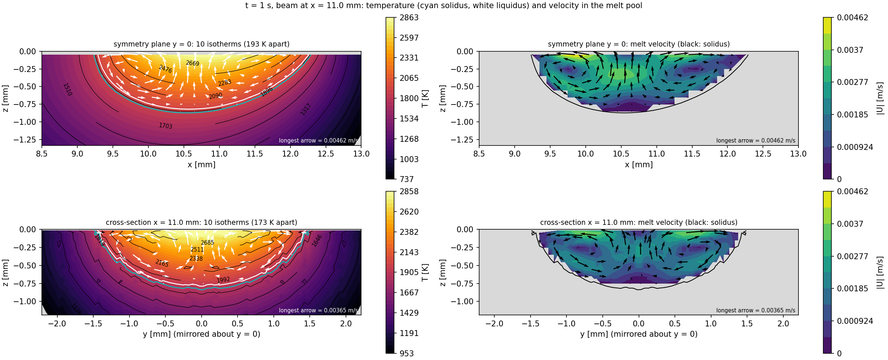

*U1000_v3_B at t = 1 s: isotherms with velocity vectors (left) and velocity magnitude in the melt (right).*

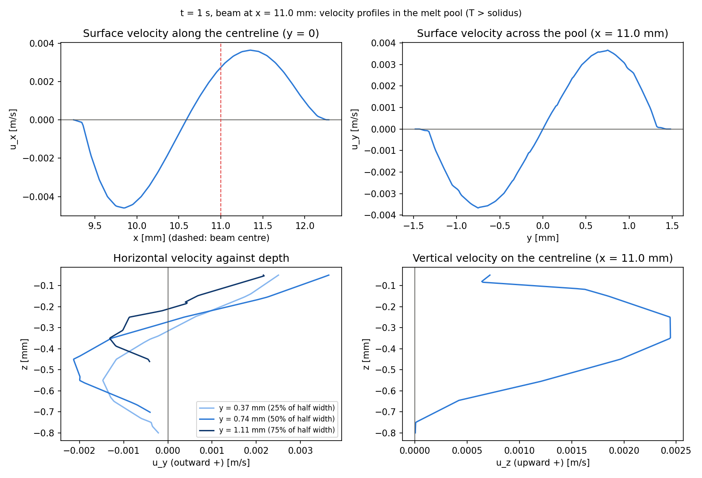

*U1000_v3_B at t = 1 s: velocity profiles.*

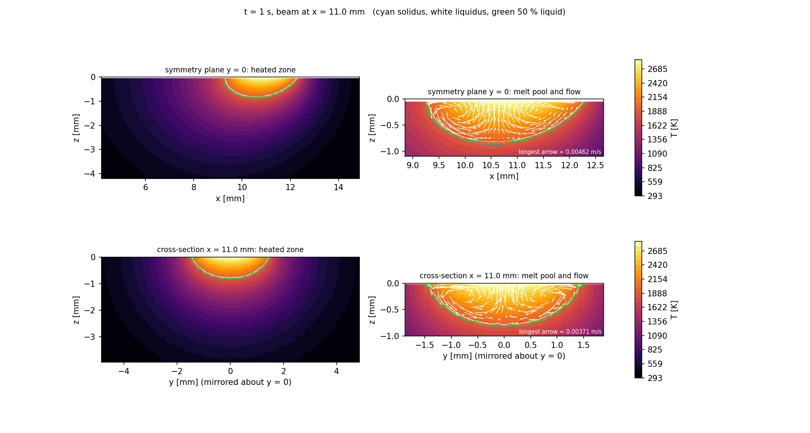

*U1000_v3_B at t = 1 s: heated zone (left) and pool close-up (right), symmetry plane (top) and cross-section (bottom).*

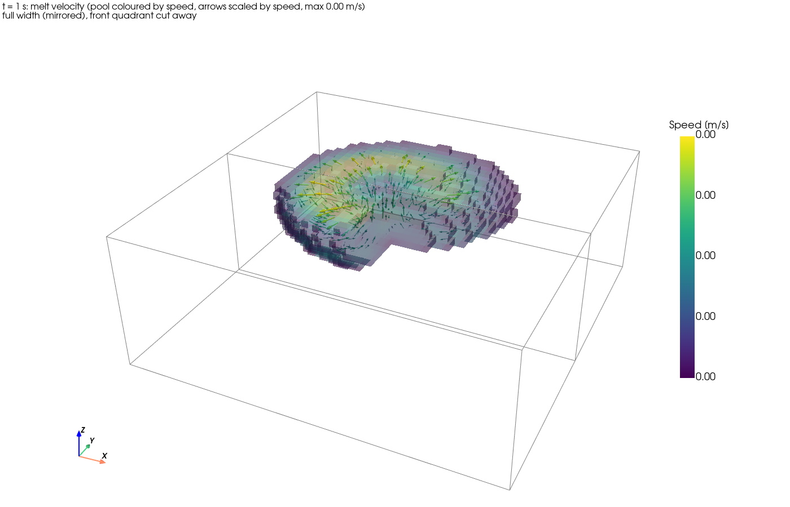

*U1000_v3_B at t = 1 s: 3D view of the melt, coloured by speed, with velocity glyphs.*

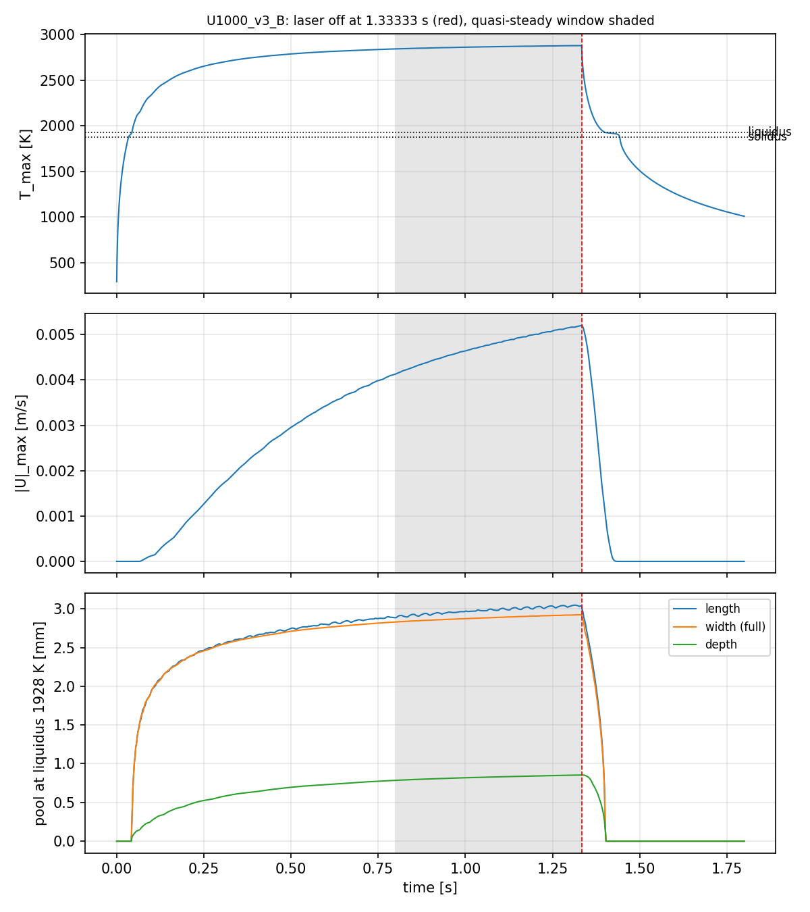

*U1000_v3_B: time history of peak temperature, peak melt speed and pool size.*

**Observations.**

**Pool shape and temperature.**

- **Cross-section.** Without the Marangoni stress the pool becomes a bowl,
  0.82 mm deep and 2.88 mm wide. That is 1.8 times deeper and 11 % narrower
  than its Marangoni counterpart.
- **Isotherms.** They are nested, smooth arcs centred under the beam. Near
  the surface they are slightly flattened by the uniform source; deeper down
  they are circular.
- **Peak temperature.** 2866 K, 538 K hotter than with Marangoni flow.

**Flow.**

- **Speed and shape of the cell.** The buoyancy flow is visible in the
  velocity map, but at most 4.7 mm/s. Hot liquid rises under the beam, spreads
  outward along the surface and sinks along the pool walls.
- **Profiles.** The surface speed has a sinusoidal profile across the pool,
  with its maximum at about 60 % of the half-width. The return flow fills the
  whole lower half of the bowl.
- **Effect on heat transport.** At a Péclet number of 0.68 this cell carries
  less heat than conduction does.

**Comparison with conduction and solidification.**

- **Against U1000_v3_none.**
  - The pool is 3 % shallower (0.82 against 0.85 mm) and 34 K cooler.
  - The fusion zone is 1.68 against 1.72 mm².
  - These are the largest differences buoyancy makes at 1000 W, because
    this is the largest and hottest 1000 W pool.
- **Solidification.**
  - The median R is 1.70 mm/s, close to the conduction value.
  - G/R is 620 K·s/mm², half the Marangoni value.
  - The bowl has a steeper rear, so more of its boundary faces the scan
    direction and solidifies faster.

#### 10.3 U1000_v3_none: neither (conduction only)

| Quantity | Value | Quantity | Value |
|---|---|---|---|
| Absorbed power | 350 W | Scan speed | 3 mm/s |
| Depth | 0.85 mm | Full width | 2.87 mm |
| Length | 2.97 mm | Width / depth | 3.4 |
| Peak temperature | 2900 K | Superheat | 972 K |
| Peak melt speed | 0 (no flow) | Péclet number | 0 |
| Fusion-zone area | 1.72 mm² | Melting efficiency | 0.112 |
| G (median) | 1000 K/mm | R (median) | 1.73 mm/s |
| Cooling rate (median) | 1767 K/s | G/R (median) | 608 K·s/mm² |
| First melting | 34.9 ms | Solid again after switch-off | 111 ms |

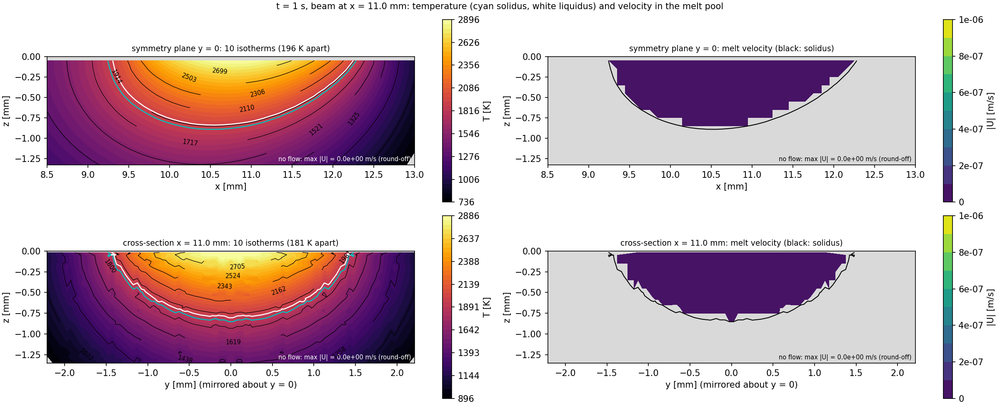

*U1000_v3_none at t = 1 s: isotherms with velocity vectors (left) and velocity magnitude in the melt (right).*

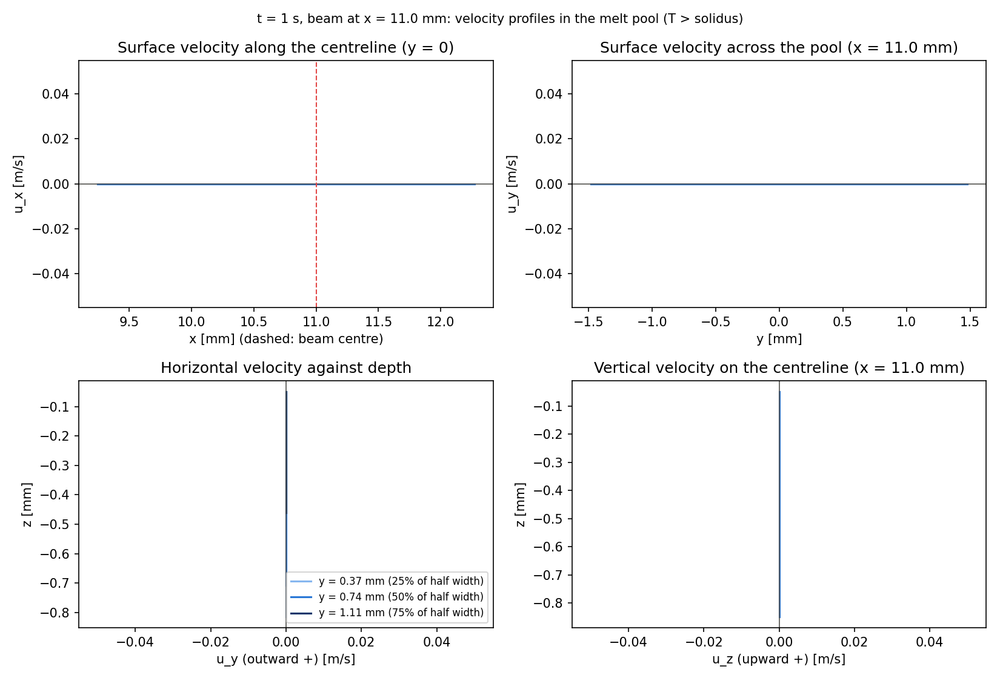

*U1000_v3_none at t = 1 s: velocity profiles.*

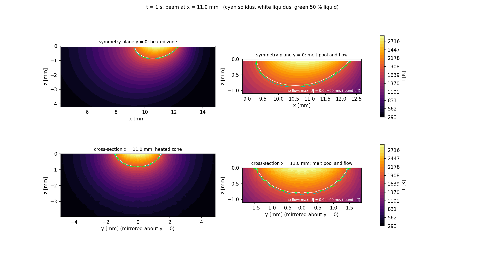

*U1000_v3_none at t = 1 s: heated zone (left) and pool close-up (right), symmetry plane (top) and cross-section (bottom).*

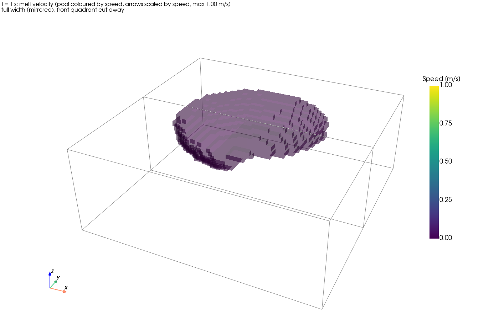

*U1000_v3_none at t = 1 s: 3D view of the melt, coloured by speed, with velocity glyphs.*

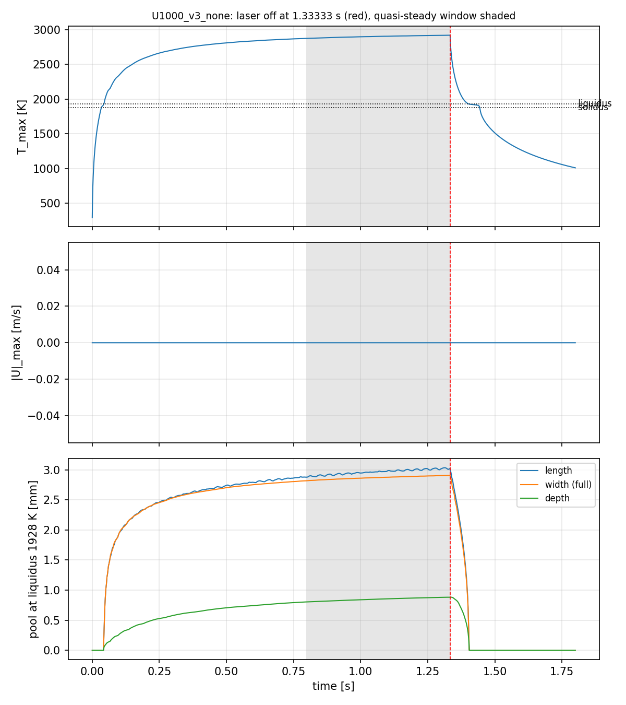

*U1000_v3_none: time history of peak temperature, peak melt speed and pool size.*

**Observations.**

**Pool shape and temperature.**

- **Reference case.** This run is the conduction-only reference for 1000 W
  and 3 mm/s.
- **Cross-section.** The pool is a bowl 0.85 mm deep and 2.87 mm wide: about
  one beam diameter wide and a quarter of it deep.
- **Isotherms.** They form a family of nested half-ellipses, slightly
  flattened near the surface where the uniform source heats the whole disc
  evenly.
- **Peak temperature.** 2900 K, at the surface just behind the beam centre.
  It is still rising slowly, by 45 K over the averaging window, when the laser
  switches off.

**Velocity plots.** The velocity maps and profiles show "no flow". With neither
driving force present the melt is at rest, so the plots carry no velocity
information. They are kept for completeness and to show that no spurious
velocity is drawn.

**History.**

- **Depth.** It keeps growing during the whole laser-on time and has not
  levelled off by switch-off: 9.7 % growth in the last 40 % of the laser-on
  time. Heat accumulates under the slow beam and the bowl keeps sinking into
  the plate.
- **Pool length.** It is only 3 % longer than wide (L/w = 1.03). At 3 mm/s
  the thermal diffusion length α/v ≈ 1.5 mm is comparable with the beam
  radius, so even without flow the pool is nearly round.

**Solidification.**

- **Freezing time.** The pool freezes 111 ms after switch-off, 1.6 times
  longer than the Marangoni pool, because it holds 1.6 times more molten metal
  at a much higher superheat.
- **Cooling rate.** The median is 1767 K/s.
- **R along the fusion boundary.** It is nearly uniform at about 1.5–2 mm/s,
  rising only slightly towards the surface edge. This is the steady
  solidification of a bowl swept along by a slow beam.

**Comparison of the three force sets at 1000 W, 3 mm/s.**

- **Shape.** The slowest scan at the lower power gives the clearest
  difference between a pan and a bowl. The Marangoni pool is 46 % shallower,
  13 % wider and 571 K cooler than the conduction pool.
- **Buoyancy.** It changes the conduction pool by only 3 %.
- **Solidification.** The Marangoni pool's R is 38 % lower and its G/R 85 %
  higher.
- **Time to steady state.** The slow scan gives every pool the most time to
  develop. Even here, the conduction pool is still deepening at switch-off,
  while the Marangoni pool has levelled off.

### 1000 W, 6 mm/s (line energy 58.3 J/mm)

#### 10.4 U1000_v6_MaB: Marangoni + buoyancy

| Quantity | Value | Quantity | Value |
|---|---|---|---|
| Absorbed power | 350 W | Scan speed | 6 mm/s |
| Depth | 0.37 mm | Full width | 2.83 mm |
| Length | 3.03 mm | Width / depth | 7.6 |
| Peak temperature | 2286 K | Superheat | 358 K |
| Peak melt speed | 0.205 m/s | Péclet number | 31.3 |
| Fusion-zone area | 0.80 mm² | Melting efficiency | 0.104 |
| G (median) | 1135 K/mm | R (median) | 2.89 mm/s |
| Cooling rate (median) | 3103 K/s | G/R (median) | 436 K·s/mm² |
| First melting | 34.8 ms | Solid again after switch-off | 51 ms |

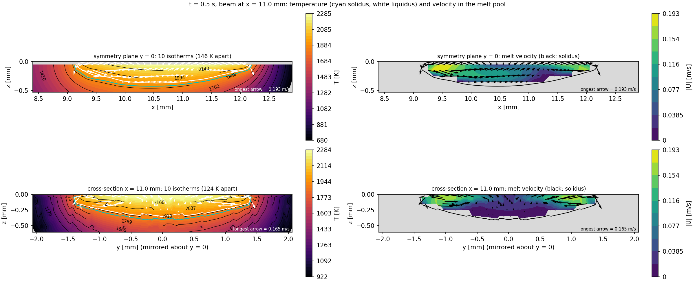

*U1000_v6_MaB at t = 0.5 s: isotherms with velocity vectors (left) and velocity magnitude in the melt (right).*

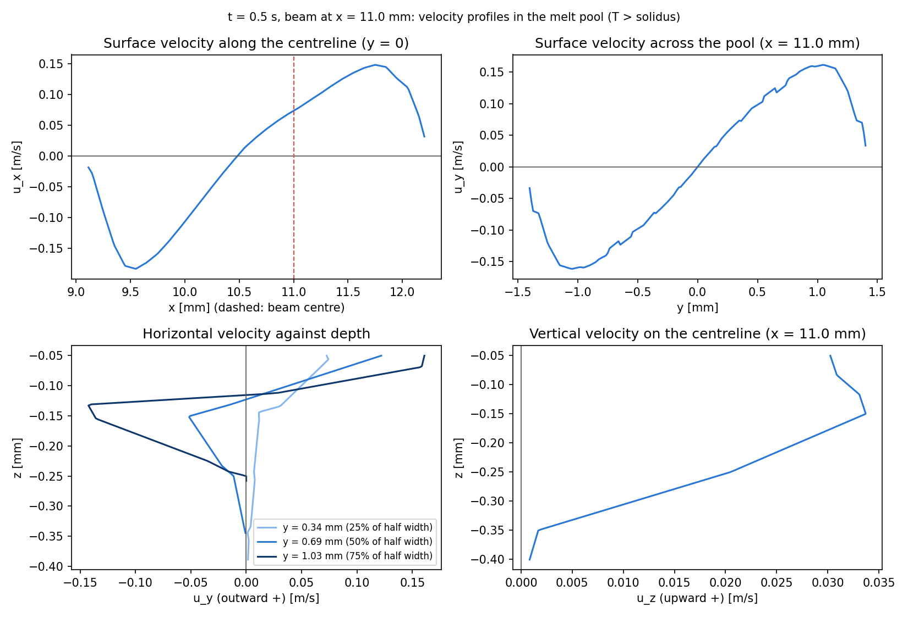

*U1000_v6_MaB at t = 0.5 s: velocity profiles.*

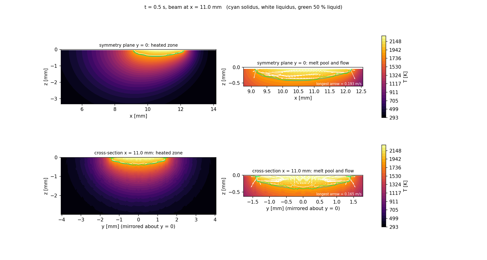

*U1000_v6_MaB at t = 0.5 s: heated zone (left) and pool close-up (right), symmetry plane (top) and cross-section (bottom).*

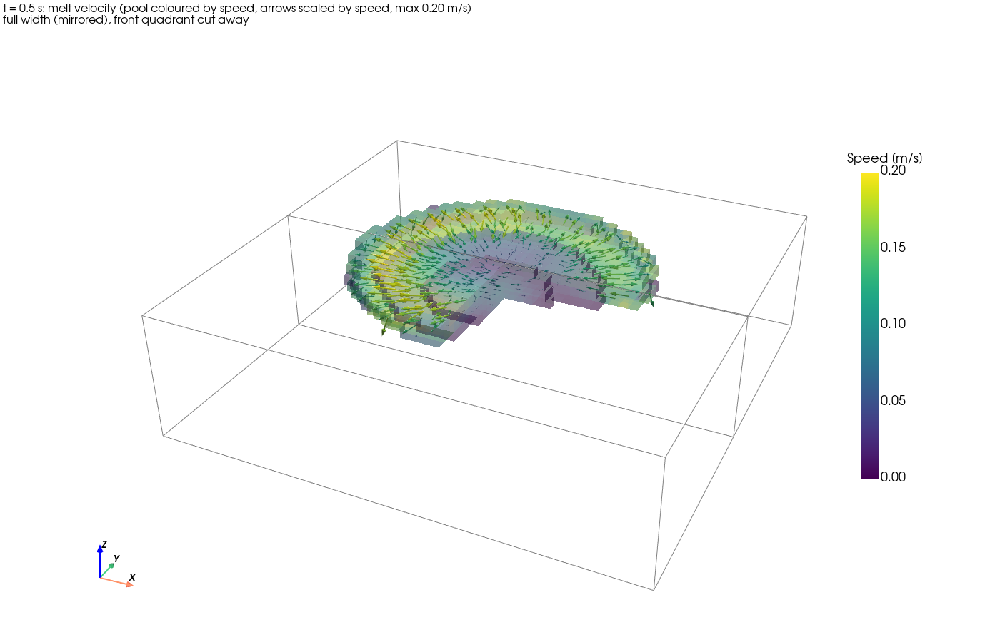

*U1000_v6_MaB at t = 0.5 s: 3D view of the melt, coloured by speed, with velocity glyphs.*


*U1000_v6_MaB: time history of peak temperature, peak melt speed and pool size.*

**Observations.**

**Pool shape.**

- **Cross-section.** At twice the speed the Marangoni pool shrinks to
  0.37 mm deep and 2.83 mm wide: still a flat pan, but now slightly narrower
  than the beam.
- **Isotherms.** The contour plot shows the same flattened isotherms inside
  the pool and the same crowding of isotherms at the rim as at 3 mm/s. The
  ten levels span a smaller range (peak 2286 K).
- **Symmetry plane.** The pan is 3.0 mm long and still nearly symmetric
  (L/w = 1.07), with a slightly longer tail than at 3 mm/s.

**Flow.**

- **Peak speed.** 0.21 m/s, 15 % lower than at 3 mm/s. This is still 34
  times the scan speed.
- **Profiles.** They have the same shape as at 3 mm/s: a linear rise of the
  surface speed towards the rim, a reversal at about 0.1 mm depth, and a weak
  return flow.
- **Ripple.** The 60 Hz ripple in the peak speed in the history plot is the
  beam crossing one 0.1 mm cell every 1/60 s, a small grid artefact (about
  1 % of the speed).

**Solidification.**

- **G and R.**
  - The median R doubles from 3 to 6 mm/s (1.07 → 2.89 mm/s), while G rises
    by only 15 %.
  - The cooling rate therefore rises 2.6 times to 3103 K/s, and G/R falls to
    436 K·s/mm².
  - At the bottom of the pan R is still only 0.46 mm/s, so planar or cellular
    growth at the fusion line is expected even at this speed.
- **Freezing time.** The pool freezes 51 ms after switch-off.

#### 10.5 U1000_v6_B: buoyancy only

| Quantity | Value | Quantity | Value |
|---|---|---|---|
| Absorbed power | 350 W | Scan speed | 6 mm/s |
| Depth | 0.64 mm | Full width | 2.59 mm |
| Length | 2.72 mm | Width / depth | 4.1 |
| Peak temperature | 2727 K | Superheat | 799 K |
| Peak melt speed | 0.00245 m/s | Péclet number | 0.252 |
| Fusion-zone area | 1.16 mm² | Melting efficiency | 0.151 |
| G (median) | 1098 K/mm | R (median) | 3.32 mm/s |
| Cooling rate (median) | 3782 K/s | G/R (median) | 337 K·s/mm² |
| First melting | 34.8 ms | Solid again after switch-off | 75 ms |


*U1000_v6_B at t = 0.5 s: isotherms with velocity vectors (left) and velocity magnitude in the melt (right).*


*U1000_v6_B at t = 0.5 s: velocity profiles.*


*U1000_v6_B at t = 0.5 s: heated zone (left) and pool close-up (right), symmetry plane (top) and cross-section (bottom).*


*U1000_v6_B at t = 0.5 s: 3D view of the melt, coloured by speed, with velocity glyphs.*


*U1000_v6_B: time history of peak temperature, peak melt speed and pool size.*

**Observations.**

**Pool shape and temperature.**

- **Cross-section.** The buoyancy-only pool is a bowl 0.64 mm deep and
  2.59 mm wide, almost identical to the conduction pool (0.64 mm, 2.58 mm).
- **Peak temperature.** 2727 K, 12 K below the conduction run.
- **Isotherms.** The contour plots of the B and none runs are
  indistinguishable by eye.

**Flow.**

- **Speed.** The buoyancy flow peaks at 2.4 mm/s, half its value at 3 mm/s.
  The pool is smaller and lives for a shorter time, so the buoyancy cell has
  less room and less time to develop.
- **Heat transport.** The Péclet number is 0.25, so the flow transports a
  quarter as much heat as conduction across the pool.
- **Shape of the cell.** The velocity profiles show a single slow cell per
  side, rising under the beam and sinking at the walls.

**What this run shows.** At 1000 W and 6 mm/s buoyancy is irrelevant to the
pool: every output is within 1.5 % of the conduction run. The difference
between this run and U1000_v6_MaB is therefore entirely the Marangoni effect:

| Effect of Marangoni (MaB vs B) | Value |
|---|---|
| Depth | 42 % less |
| Width | 9 % more |
| Peak temperature | 441 K lower |
| G/R | 1.3 times higher |

#### 10.6 U1000_v6_none: neither (conduction only)

| Quantity | Value | Quantity | Value |
|---|---|---|---|
| Absorbed power | 350 W | Scan speed | 6 mm/s |
| Depth | 0.64 mm | Full width | 2.58 mm |
| Length | 2.71 mm | Width / depth | 4.0 |
| Peak temperature | 2739 K | Superheat | 811 K |
| Peak melt speed | 0 (no flow) | Péclet number | 0 |
| Fusion-zone area | 1.16 mm² | Melting efficiency | 0.151 |
| G (median) | 1097 K/mm | R (median) | 3.35 mm/s |
| Cooling rate (median) | 3782 K/s | G/R (median) | 335 K·s/mm² |
| First melting | 34.8 ms | Solid again after switch-off | 75 ms |


*U1000_v6_none at t = 0.5 s: isotherms with velocity vectors (left) and velocity magnitude in the melt (right).*


*U1000_v6_none at t = 0.5 s: velocity profiles.*


*U1000_v6_none at t = 0.5 s: heated zone (left) and pool close-up (right), symmetry plane (top) and cross-section (bottom).*


*U1000_v6_none at t = 0.5 s: 3D view of the melt, coloured by speed, with velocity glyphs.*


*U1000_v6_none: time history of peak temperature, peak melt speed and pool size.*

**Observations.**

**Pool shape and temperature.**

- **Cross-section.** The conduction pool at 6 mm/s is a bowl 0.64 mm deep and
  2.58 mm wide, with a peak temperature of 2739 K.
- **Symmetry plane.** The isotherms are clearly asymmetric:
  - compressed ahead of the beam, where the cold metal has not yet been
    heated;
  - stretched behind it, where the track is still hot.
- **Trailing tail.** This is the classic moving-source pattern, stronger than
  at 3 mm/s because the beam now outruns the heat diffusion (α/v ≈ 0.8 mm).
  The pool is still nearly round in plan (L/w = 1.05), because the 3 mm beam
  is wide compared with that diffusion length.

**History.**

- **Depth.** It grows by 11 % over the averaging window, still not steady.
- **Peak temperature.** It rises by 49 K over the same window.

**Solidification.**

- **G, R and G/R.**
  - G is 1097 K/mm and R is 3.35 mm/s.
  - G/R is 335 K·s/mm², 23 % lower than in the Marangoni run.
  - The cooling rate is 3782 K/s, 22 % higher than with Marangoni.
- **Along the boundary.** R is 2.5–3.5 mm/s over the whole boundary, compared
  with 0.6–0.9 mm/s along the bottom half of the Marangoni pan.
- **Freezing time.** The pool freezes 75 ms after switch-off.

**Comparison of the three force sets at 1000 W, 6 mm/s.**

- **Effect of Marangoni.** It removes 42 % of the depth and 56 % of the
  superheat, and widens the pool by 10 %.
- **Buoyancy** is negligible (Pe = 0.25).
- **Solidification.**
  - The effect on R is the smallest of the study (−14 %).
  - G/R still rises by 30 %.

### 1000 W, 9 mm/s (line energy 38.9 J/mm)

#### 10.7 U1000_v9_MaB: Marangoni + buoyancy

| Quantity | Value | Quantity | Value |
|---|---|---|---|
| Absorbed power | 350 W | Scan speed | 9 mm/s |
| Depth | 0.31 mm | Full width | 2.61 mm |
| Length | 2.76 mm | Width / depth | 8.3 |
| Peak temperature | 2251 K | Superheat | 323 K |
| Peak melt speed | 0.194 m/s | Péclet number | 22.2 |
| Fusion-zone area | 0.64 mm² | Melting efficiency | 0.125 |
| G (median) | 1083 K/mm | R (median) | 3.30 mm/s |
| Cooling rate (median) | 3534 K/s | G/R (median) | 354 K·s/mm² |
| First melting | 34.6 ms | Solid again after switch-off | 37 ms |


*U1000_v9_MaB at t = 0.25 s: isotherms with velocity vectors (left) and velocity magnitude in the melt (right).*


*U1000_v9_MaB at t = 0.25 s: velocity profiles.*


*U1000_v9_MaB at t = 0.25 s: heated zone (left) and pool close-up (right), symmetry plane (top) and cross-section (bottom).*


*U1000_v9_MaB at t = 0.25 s: 3D view of the melt, coloured by speed, with velocity glyphs.*


*U1000_v9_MaB: time history of peak temperature, peak melt speed and pool size.*

**Observations.**

**Pool shape.**

- **Cross-section.** The smallest pool of the study is 0.31 mm deep (three
  cells) and 2.61 mm wide.
- **Width-to-depth ratio.** 8.3, the flattest pool, tied with
  U2000_v9_MaB.
- **Isotherms.** Even this small pool shows the Marangoni signature in the
  contour plot: horizontal isotherms inside the pool, crowding at the rim, and
  a peak temperature (2251 K) only 323 K above the liquidus.
- **Steadiness.** The laser is on for only 0.44 s. The pool becomes steady
  within 0.22 s, so the averaging window still sees a steady pool.

**Flow.**

- **Peak speed.** 0.19 m/s, 22 times the scan speed. It is lower than at
  slower scans, as Pariona et al. (2018) describe.
- **Strength of the effect.** The Péclet number is 22, the lowest of the
  Marangoni runs. It still means convection carries 22 times more heat than
  conduction, and the pool shape is entirely flow-controlled.
- **Profiles.** They show the same thin outward surface layer and return flow
  as the other MaB runs, compressed into a shallower pool. The return flow
  touches the bottom of the pool, so the bottom is less stagnant than at
  3 mm/s.

**Solidification.**

- **G, R and cooling rate.** R is 3.30 mm/s and G is 1083 K/mm, giving a
  cooling rate of 3534 K/s.
- **Along the boundary.** R rises from about 1 mm/s at the bottom to about
  5 mm/s near the surface edge, the largest range along the boundary of any
  1000 W run.
- **Freezing time.** The pool freezes only 37 ms after switch-off.

#### 10.8 U1000_v9_B: buoyancy only

| Quantity | Value | Quantity | Value |
|---|---|---|---|
| Absorbed power | 350 W | Scan speed | 9 mm/s |
| Depth | 0.52 mm | Full width | 2.37 mm |
| Length | 2.52 mm | Width / depth | 4.6 |
| Peak temperature | 2609 K | Superheat | 681 K |
| Peak melt speed | 0.00135 m/s | Péclet number | 0.089 |
| Fusion-zone area | 0.86 mm² | Melting efficiency | 0.168 |
| G (median) | 1153 K/mm | R (median) | 4.79 mm/s |
| Cooling rate (median) | 5574 K/s | G/R (median) | 240 K·s/mm² |
| First melting | 34.6 ms | Solid again after switch-off | 56 ms |


*U1000_v9_B at t = 0.25 s: isotherms with velocity vectors (left) and velocity magnitude in the melt (right).*


*U1000_v9_B at t = 0.25 s: velocity profiles.*


*U1000_v9_B at t = 0.25 s: heated zone (left) and pool close-up (right), symmetry plane (top) and cross-section (bottom).*


*U1000_v9_B at t = 0.25 s: 3D view of the melt, coloured by speed, with velocity glyphs.*


*U1000_v9_B: time history of peak temperature, peak melt speed and pool size.*

**Observations.**

**Pool shape and temperature.**

- **Cross-section.** The buoyancy-only pool at 9 mm/s is 0.52 mm deep and
  2.37 mm wide, with a peak of 2609 K. It is identical to the conduction pool
  to within 0.6 %.

**Flow.**

- **Speed and Péclet number.** The flow is the weakest of all runs with a
  driving force: 1.3 mm/s peak, Péclet number 0.09.
- **Why so weak.** The buoyancy cell has hardly started before the beam has
  passed: the local pool exists for only about 0.3 s at any point of the track.

**What this run shows.**

- **Buoyancy is negligible here.** This run is the clearest demonstration that
  buoyancy alone does not matter in a small, short-lived laser pool. Comparing
  it with U1000_v9_MaB isolates the Marangoni effect at its weakest:

  | Effect of Marangoni (MaB vs B) | Value |
  |---|---|
  | Depth | 39 % less |
  | Width | 10 % more |
  | Peak temperature | 358 K lower |

- **Solidification.**
  - The median R is 4.79 mm/s, more than half the scan speed.
  - G/R is 240 K·s/mm², the lowest of all 1000 W runs.
  - The median cooling rate, 5574 K/s, is the second highest of the study,
    after the conduction run at the same setting.

#### 10.9 U1000_v9_none: neither (conduction only)

| Quantity | Value | Quantity | Value |
|---|---|---|---|
| Absorbed power | 350 W | Scan speed | 9 mm/s |
| Depth | 0.52 mm | Full width | 2.37 mm |
| Length | 2.51 mm | Width / depth | 4.6 |
| Peak temperature | 2614 K | Superheat | 686 K |
| Peak melt speed | 0 (no flow) | Péclet number | 0 |
| Fusion-zone area | 0.86 mm² | Melting efficiency | 0.168 |
| G (median) | 1153 K/mm | R (median) | 4.79 mm/s |
| Cooling rate (median) | 5585 K/s | G/R (median) | 237 K·s/mm² |
| First melting | 34.6 ms | Solid again after switch-off | 56 ms |


*U1000_v9_none at t = 0.25 s: isotherms with velocity vectors (left) and velocity magnitude in the melt (right).*


*U1000_v9_none at t = 0.25 s: velocity profiles.*


*U1000_v9_none at t = 0.25 s: heated zone (left) and pool close-up (right), symmetry plane (top) and cross-section (bottom).*


*U1000_v9_none at t = 0.25 s: 3D view of the melt, coloured by speed, with velocity glyphs.*


*U1000_v9_none: time history of peak temperature, peak melt speed and pool size.*

**Observations.**

**Pool shape and temperature.**

- **Cross-section.** The conduction pool at 1000 W and 9 mm/s is 0.52 mm deep
  and 2.37 mm wide, peaking at 2614 K.
- **Symmetry plane.** The contour plot shows the strongest front–rear
  asymmetry of the 1000 W runs: the isotherms ahead of the beam are packed
  tightly together, while behind it they trail out over several millimetres.
  The pool itself remains nearly round in plan (L/w = 1.06).

**Solidification.**

- **G and R.** With the highest R and similar G, this run has the highest
  cooling rate (5585 K/s) and the lowest G/R (237 K·s/mm²) of the 1000 W
  runs.
- **Along the boundary.** R is 4–6 mm/s over most of the boundary.
- **Expected structure.** The smallest and fastest-solidifying conduction
  pool would give the finest structure.

**Comparison across the three speeds of the conduction runs at 1000 W.**

- **Pool size.** The depth falls from 0.85 to 0.52 mm (v^−0.45) and the width
  from 2.87 to 2.37 mm.
- **Peak temperature.** It falls by 286 K.
- **Sensitivity to speed.** These changes are larger than in the Marangoni
  runs (depth 0.46 → 0.31 mm, peak temperature −77 K). The conduction pool is
  more sensitive to scan speed, because nothing inside it redistributes the
  heat.

**Comparison of the three force sets at 1000 W, 9 mm/s.**

- **Weakest Marangoni effect of the study** (Pe = 22).
- **Even so,** the Marangoni flow removes 39 % of the depth and 53 % of the
  superheat, widens the pool by 10 % and lowers R by 31 %.
- **Buoyancy** changes nothing (Pe_B = 0.09).
- **What this shows.** Marangoni convection is the controlling mechanism even
  in the smallest, fastest pool of the study.

### 2000 W, 3 mm/s (line energy 233.3 J/mm)

#### 10.10 U2000_v3_MaB: Marangoni + buoyancy

| Quantity | Value | Quantity | Value |
|---|---|---|---|
| Absorbed power | 700 W | Scan speed | 3 mm/s |
| Depth | 0.70 mm | Full width | 5.39 mm |
| Length | 5.60 mm | Width / depth | 7.7 |
| Peak temperature | 2674 K | Superheat | 746 K |
| Peak melt speed | 0.408 m/s | Péclet number | 135 |
| Fusion-zone area | 2.58 mm² | Melting efficiency | 0.084 |
| G (median) | 727 K/mm | R (median) | 0.57 mm/s |
| Cooling rate (median) | 421 K/s | G/R (median) | 1157 K·s/mm² |
| First melting | 9.3 ms | Solid again after switch-off | 142 ms |


*U2000_v3_MaB at t = 1 s: isotherms with velocity vectors (left) and velocity magnitude in the melt (right).*


*U2000_v3_MaB at t = 1 s: velocity profiles.*


*U2000_v3_MaB at t = 1 s: heated zone (left) and pool close-up (right), symmetry plane (top) and cross-section (bottom).*


*U2000_v3_MaB at t = 1 s: 3D view of the melt, coloured by speed, with velocity glyphs.*


*U2000_v3_MaB: time history of peak temperature, peak melt speed and pool size.*

**Observations.**

**The largest Marangoni pool of the study.**

- **Size.** 0.70 mm deep, 5.39 mm wide and 5.60 mm long: 1.8 times the beam
  diameter in both directions.
- **Isotherms.** The contour plot shows a very wide, flat pan whose rim
  extends 1.2 mm beyond each edge of the beam footprint. The ten isotherms
  inside the pool are almost horizontal over the central 4 mm.
- **Peak temperature.** 2674 K, 746 K above the liquidus but 860 K below
  boiling.

**Flow.**

- **Speed.** The fastest of the study: 0.41 m/s peak, 0.28 m/s mean surface
  speed, 136 times the scan speed.
- **3D velocity view.** It shows the surface jet fanning out radially over
  the whole pan, with the fastest arrows near the rim behind and beside the
  beam.
- **Dimensionless numbers.** The Péclet number is 135 and the Reynolds number
  960, the highest of the study but still laminar.
- **Ma/Gr.** 329, the lowest of the study, because the pool is the largest:
  buoyancy grows with the cube of the pool size. Buoyancy is still more than
  300 times weaker than the Marangoni force.

**History.**

- **Depth.** It reaches a plateau after 0.40 s.
- **Width.** It keeps growing (7.7 % over the averaging window). The outward
  flow keeps carrying heat to a rim that is surrounded by progressively warmer
  metal.
- **Peak temperature.** It actually falls by 4 K over the window as the pool
  widens: the thermostat at work.

**Solidification.**

- **The most extreme run.**
  - The median R is only 0.57 mm/s, a fifth of the scan speed.
  - The median cooling rate is only 421 K/s.
  - The median G/R is 1157 K·s/mm², the highest of the study.
- **Along the boundary.** R falls to about 0.13 mm/s at 45° and rises to about
  1 mm/s only at the surface edge.
- **Spread.** The 10th–90th percentile range of the cooling rate covers a
  factor of 72, from 74 to 5322 K/s.
- **Expected structure.** This pool would solidify with the coarsest and most
  columnar structure of all, graded towards finer grains at the edges.

#### 10.11 U2000_v3_B: buoyancy only

| Quantity | Value | Quantity | Value |
|---|---|---|---|
| Absorbed power | 700 W | Scan speed | 3 mm/s |
| Depth | 1.42 mm | Full width | 4.23 mm |
| Length | 4.48 mm | Width / depth | 3.0 |
| Peak temperature | 3798 K | Superheat | 1870 K |
| Peak melt speed | 0.0205 m/s | Péclet number | 4.82 |
| Fusion-zone area | 4.52 mm² | Melting efficiency | 0.147 |
| G (median) | 710 K/mm | R (median) | 1.39 mm/s |
| Cooling rate (median) | 1027 K/s | G/R (median) | 531 K·s/mm² |
| First melting | 9.3 ms | Solid again after switch-off | 278 ms |


*U2000_v3_B at t = 1 s: isotherms with velocity vectors (left) and velocity magnitude in the melt (right).*


*U2000_v3_B at t = 1 s: velocity profiles.*


*U2000_v3_B at t = 1 s: heated zone (left) and pool close-up (right), symmetry plane (top) and cross-section (bottom).*


*U2000_v3_B at t = 1 s: 3D view of the melt, coloured by speed, with velocity glyphs.*


*U2000_v3_B: time history of peak temperature, peak melt speed and pool size.*

**Observations.**

**Pool shape and temperature.**

- **Cross-section.** The pool is a deep bowl, 1.42 mm deep and 4.23 mm wide.
- **Peak temperature.** 3798 K, **265 K above the boiling point** of
  Ti-6Al-4V.
- **Meaning.** In reality this pool would evaporate vigorously from its
  centre, and the recoil pressure would push the surface down. The model has
  no evaporation, so these temperatures show what the absence of Marangoni
  flow would do, not what a real pool would reach.

**Flow: buoyancy at its strongest.**

- **Speed.** This run has the strongest buoyancy flow of the study: 21 mm/s
  peak, Péclet number 4.8.
- **Effect on the pool.** The buoyancy cell is now strong enough to change it:
  - 12.5 % shallower and 6.5 % wider than the conduction pool;
  - 248 K cooler.
- **Shape of the effect.** The contour plot shows the inner isotherms slightly
  flattened and pushed outward near the surface, compared with the conduction
  run. The velocity profiles show one deep cell per side, extending almost to
  the bottom of the bowl.

**Solidification.**

- **G, R and cooling rate.** The median R is 1.39 mm/s, G is 710 K/mm and the
  cooling rate is 1027 K/s.
- **Freezing time.** The large, superheated pool takes 278 ms to freeze after
  switch-off, almost twice as long as the Marangoni pool.

**Buoyancy against Marangoni.** Even at its strongest, buoyancy achieves only
a fraction of the Marangoni effect at the same setting:

| Effect | Buoyancy (B vs none) | Marangoni + buoyancy (MaB vs none) |
|---|---|---|
| Depth | 12.5 % less | 57 % less |
| Peak temperature | 248 K lower | 1373 K lower |

#### 10.12 U2000_v3_none: neither (conduction only)

| Quantity | Value | Quantity | Value |
|---|---|---|---|
| Absorbed power | 700 W | Scan speed | 3 mm/s |
| Depth | 1.62 mm | Full width | 3.97 mm |
| Length | 4.30 mm | Width / depth | 2.4 |
| Peak temperature | 4046 K | Superheat | 2118 K |
| Peak melt speed | 0 (no flow) | Péclet number | 0 |
| Fusion-zone area | 4.80 mm² | Melting efficiency | 0.156 |
| G (median) | 707 K/mm | R (median) | 1.53 mm/s |
| Cooling rate (median) | 1095 K/s | G/R (median) | 482 K·s/mm² |
| First melting | 9.3 ms | Solid again after switch-off | 295 ms |


*U2000_v3_none at t = 1 s: isotherms with velocity vectors (left) and velocity magnitude in the melt (right).*


*U2000_v3_none at t = 1 s: velocity profiles.*


*U2000_v3_none at t = 1 s: heated zone (left) and pool close-up (right), symmetry plane (top) and cross-section (bottom).*


*U2000_v3_none at t = 1 s: 3D view of the melt, coloured by speed, with velocity glyphs.*


*U2000_v3_none: time history of peak temperature, peak melt speed and pool size.*

**Observations.**

**The largest and hottest pool of the study.**

- **Size.** 1.62 mm deep, 3.97 mm wide and 4.30 mm long.
- **Peak temperature.** 4046 K, 513 K above the boiling point.
- **Isotherms.** The contour plot shows a nearly hemispherical bowl. Its depth
  is 41 % of its width, the deepest relative shape of the study
  (w/d = 2.4).
- **Field around the pool.** The ten isotherms are evenly nested arcs,
  321 K apart. The 1000 K isotherm reaches 2.8 mm below the surface.

**History.**

- **Depth.** It grows throughout the 1.33 s laser-on time and is still
  increasing (by 11 % over the window) at switch-off.
- **Peak temperature.** It rises by 55 K over the window.
- **Meaning.** This is the clearest example of a conduction pool that never
  becomes steady on a 4 mm track.

**Solidification.**

- **Freezing time.** 295 ms after switch-off, the longest of the study.
- **G, R and cooling rate.** The median R is 1.53 mm/s, G is 707 K/mm and the
  cooling rate is 1095 K/s.
- **G/R.** 482 K·s/mm², 2.4 times lower than in the Marangoni pool at the same
  setting.

**Comparison with U2000_v3_MaB.** This pair shows the strongest effect of
Marangoni convection in the study:

| Effect of Marangoni flow | Value |
|---|---|
| Depth | 57 % less |
| Width | 36 % more |
| Peak temperature | 1373 K lower |
| Melted area | 46 % less |
| Median R | 63 % less |
| G/R | 2.4 times higher |

**Comparison of the three force sets at 2000 W, 3 mm/s.**

- **Strongest Marangoni effect of the study** (Pe = 135):
  - depth −57 %;
  - width +36 %;
  - peak temperature −1373 K;
  - melted area −46 %;
  - R −63 %;
  - G/R ×2.4.
- **Buoyancy** is also at its strongest. It removes 12.5 % of the conduction
  depth and 248 K of the peak.
- **Boiling point.** Only the Marangoni pool stays below it. The other two
  exceed it by 265 and 513 K.

### 2000 W, 6 mm/s (line energy 116.7 J/mm)

#### 10.13 U2000_v6_MaB: Marangoni + buoyancy

| Quantity | Value | Quantity | Value |
|---|---|---|---|
| Absorbed power | 700 W | Scan speed | 6 mm/s |
| Depth | 0.58 mm | Full width | 4.58 mm |
| Length | 4.87 mm | Width / depth | 7.9 |
| Peak temperature | 2633 K | Superheat | 705 K |
| Peak melt speed | 0.378 m/s | Péclet number | 104 |
| Fusion-zone area | 1.92 mm² | Melting efficiency | 0.125 |
| G (median) | 807 K/mm | R (median) | 1.09 mm/s |
| Cooling rate (median) | 1040 K/s | G/R (median) | 765 K·s/mm² |
| First melting | 9.3 ms | Solid again after switch-off | 99 ms |


*U2000_v6_MaB at t = 0.5 s: isotherms with velocity vectors (left) and velocity magnitude in the melt (right).*


*U2000_v6_MaB at t = 0.5 s: velocity profiles.*


*U2000_v6_MaB at t = 0.5 s: heated zone (left) and pool close-up (right), symmetry plane (top) and cross-section (bottom).*


*U2000_v6_MaB at t = 0.5 s: 3D view of the melt, coloured by speed, with velocity glyphs.*


*U2000_v6_MaB: time history of peak temperature, peak melt speed and pool size.*

**Observations.**

**Pool shape and temperature.**

- **Cross-section.** The Marangoni pool at 2000 W and 6 mm/s is 0.58 mm deep
  and 4.58 mm wide (w/d = 7.9), peaking at 2633 K.
- **Isotherms.** The contour plot (Figure 12 shows its velocity profiles) is
  the textbook Marangoni pool:
  - isotherms 182–201 K apart, flattened into layers inside the pool;
  - the liquidus and solidus running almost horizontally along the bottom;
  - a steep rim 0.8 mm outside the beam edge on each side.

**Flow.**

- **Surface jet.** The surface velocity along the centreline goes from
  −0.31 m/s at the rear to +0.36 m/s at the front, crossing zero 0.6 mm behind
  the beam centre.
- **Across the pool.** It rises linearly to ±0.36 m/s at 1.8 mm from the
  centreline.
- **Return flow.** It peaks at −0.2 m/s at 0.25 mm depth near the rim.
- **Upwelling.** The vertical velocity under the beam reaches 0.04 m/s.

**History.**

- **Depth.** It reaches a plateau after 0.24 s.
- **Width.** It keeps growing slowly, as in the other 2000 W Marangoni runs.

**Solidification.**

- **G, R and G/R.**
  - The median R is 1.09 mm/s and the cooling rate is 1040 K/s.
  - G/R is 765 K·s/mm², 2.5 times the conduction value: the largest ratio of
    the study.
- **Along the boundary.** R is 0.2–0.5 mm/s over the bottom half of the
  boundary.

#### 10.14 U2000_v6_B: buoyancy only

| Quantity | Value | Quantity | Value |
|---|---|---|---|
| Absorbed power | 700 W | Scan speed | 6 mm/s |
| Depth | 1.19 mm | Full width | 3.57 mm |
| Length | 4.09 mm | Width / depth | 3.0 |
| Peak temperature | 3729 K | Superheat | 1801 K |
| Peak melt speed | 0.015 m/s | Péclet number | 2.6 |
| Fusion-zone area | 3.24 mm² | Melting efficiency | 0.210 |
| G (median) | 814 K/mm | R (median) | 2.67 mm/s |
| Cooling rate (median) | 2158 K/s | G/R (median) | 320 K·s/mm² |
| First melting | 9.3 ms | Solid again after switch-off | 197 ms |


*U2000_v6_B at t = 0.5 s: isotherms with velocity vectors (left) and velocity magnitude in the melt (right).*


*U2000_v6_B at t = 0.5 s: velocity profiles.*


*U2000_v6_B at t = 0.5 s: heated zone (left) and pool close-up (right), symmetry plane (top) and cross-section (bottom).*


*U2000_v6_B at t = 0.5 s: 3D view of the melt, coloured by speed, with velocity glyphs.*


*U2000_v6_B: time history of peak temperature, peak melt speed and pool size.*

**Observations.**

**Pool shape and temperature.**

- **Cross-section.** The buoyancy-only pool is 1.19 mm deep and 3.57 mm wide,
  peaking at 3729 K, **196 K above boiling**.
- **Isotherms.** Its isotherms (Figure 10, middle column) are very close to
  the conduction run, with a slightly cooler and flatter core.

**Flow.**

- **Speed.** The buoyancy flow peaks at 15 mm/s.
- **Profiles** (Figure 13).
  - The surface velocity has a sinusoidal profile, peaking at ±11 mm/s at
    about 60 % of the half-width.
  - The horizontal velocity reverses at 0.3–0.4 mm depth.
  - The upwelling peaks at 6 mm/s at 0.4 mm depth.
- **Interpretation.** This is a bulk convection cell, not a surface jet. It is
  30 times weaker than the Marangoni flow and reaches deep into the pool.

**Effect of buoyancy.**

| Effect (B vs none) | Value |
|---|---|
| Depth | 7.4 % less |
| Width | 3.4 % more |
| Peak temperature | 127 K lower |
| R | 7 % less |

The Péclet number of 2.6 puts this run in the range where buoyancy starts to
matter, but only modestly.

**After switch-off.** The pool takes 197 ms to freeze. The contour plots at
0.75 s show the shrinking pool after switch-off: a remnant bowl at the end of
the track with an isothermal core.

#### 10.15 U2000_v6_none: neither (conduction only)

| Quantity | Value | Quantity | Value |
|---|---|---|---|
| Absorbed power | 700 W | Scan speed | 6 mm/s |
| Depth | 1.29 mm | Full width | 3.46 mm |
| Length | 4.02 mm | Width / depth | 2.7 |
| Peak temperature | 3856 K | Superheat | 1928 K |
| Peak melt speed | 0 (no flow) | Péclet number | 0 |
| Fusion-zone area | 3.36 mm² | Melting efficiency | 0.218 |
| G (median) | 816 K/mm | R (median) | 2.86 mm/s |
| Cooling rate (median) | 2179 K/s | G/R (median) | 302 K·s/mm² |
| First melting | 9.3 ms | Solid again after switch-off | 205 ms |


*U2000_v6_none at t = 0.5 s: isotherms with velocity vectors (left) and velocity magnitude in the melt (right).*


*U2000_v6_none at t = 0.5 s: velocity profiles.*


*U2000_v6_none at t = 0.5 s: heated zone (left) and pool close-up (right), symmetry plane (top) and cross-section (bottom).*


*U2000_v6_none at t = 0.5 s: 3D view of the melt, coloured by speed, with velocity glyphs.*


*U2000_v6_none: time history of peak temperature, peak melt speed and pool size.*

**Observations.**

**Pool shape and temperature.**

- **Cross-section.** The conduction pool is 1.29 mm deep and 3.46 mm wide,
  with a peak of 3856 K, **323 K above boiling**.
- **Symmetry plane.** The isotherms show the moving-source asymmetry clearly:
  a compressed front and a tail extending 4 mm behind the beam.
- **Elongation.** L/w = 1.16, the conduction pool is starting to elongate.

**History.**

- **Depth.** It grows by 11 % over the averaging window.
- **Freezing time.** 205 ms after switch-off.
- **After switch-off.** The 0.75 s contour plot captures the end crater during
  freezing.

**Solidification.**

- **G, R and G/R.** The median R is 2.86 mm/s, G is 816 K/mm, the cooling rate
  is 2179 K/s and G/R is 302 K·s/mm².
- **Along the boundary.** R is 2–3 mm/s over the whole cross-section boundary.

**Shared line energy with U1000_v3.** This run and U1000_v3_none have the
same line energy, 116.7 J/mm. This pool is nevertheless:

- 1.5 times deeper;
- 1.2 times wider;
- 956 K hotter.

The extra power at higher speed leaks less into the plate, so the same energy
per millimetre produces a larger and hotter pool (§8.10).

**Comparison of the three force sets at 2000 W, 6 mm/s.**

- **The setting used for most of the illustrative figures** (Figures 1, 10,
  12, 13, 33, 34).
- **Effect of Marangoni.** The pool is 55 % shallower, 32 % wider and 1223 K
  cooler. R is 62 % lower and G/R 2.5 times higher.
- **Buoyancy** removes 7 % of the depth.
- **Boiling point.** The two pools without Marangoni flow both exceed it.

### 2000 W, 9 mm/s (line energy 77.8 J/mm)

#### 10.16 U2000_v9_MaB: Marangoni + buoyancy

| Quantity | Value | Quantity | Value |
|---|---|---|---|
| Absorbed power | 700 W | Scan speed | 9 mm/s |
| Depth | 0.50 mm | Full width | 4.16 mm |
| Length | 4.46 mm | Width / depth | 8.3 |
| Peak temperature | 2609 K | Superheat | 681 K |
| Peak melt speed | 0.378 m/s | Péclet number | 84.3 |
| Fusion-zone area | 1.64 mm² | Melting efficiency | 0.160 |
| G (median) | 824 K/mm | R (median) | 1.64 mm/s |
| Cooling rate (median) | 2007 K/s | G/R (median) | 547 K·s/mm² |
| First melting | 9.3 ms | Solid again after switch-off | 78 ms |


*U2000_v9_MaB at t = 0.25 s: isotherms with velocity vectors (left) and velocity magnitude in the melt (right).*


*U2000_v9_MaB at t = 0.25 s: velocity profiles.*


*U2000_v9_MaB at t = 0.25 s: heated zone (left) and pool close-up (right), symmetry plane (top) and cross-section (bottom).*


*U2000_v9_MaB at t = 0.25 s: 3D view of the melt, coloured by speed, with velocity glyphs.*


*U2000_v9_MaB: time history of peak temperature, peak melt speed and pool size.*

**Observations.**

**Pool shape and temperature.**

- **Cross-section.** The Marangoni pool at 2000 W and 9 mm/s is 0.50 mm deep
  and 4.16 mm wide (w/d = 8.3), peaking at 2609 K.
- **The pool becomes steady fastest of all runs.** The depth reaches 90 % of
  its final value after only 0.14 s and then stays constant (−0.3 % over the
  window).
- **Isotherms.** The contour plot at 0.25 s shows the pan with its rim
  0.6 mm outside the beam on each side.

**Flow and surface quantities.**

- **Speed.** The peak melt speed is 0.38 m/s, the same as at 6 mm/s: at
  2000 W the flow is hardly affected by the scan speed.
- **Marangoni stress.** The maximum is 673 Pa, the highest of the study, and
  the maximum surface gradient is 2630 K/mm. The fast scan sharpens the front
  edge of the pool, where the beam meets cold metal.

**Solidification.**

- **G, R and cooling rate.** The median R is 1.64 mm/s and the cooling rate is
  2007 K/s.
- **Along the boundary.** R rises from about 0.5 mm/s at the bottom to about
  3 mm/s at 65°.
- **Effect of Marangoni here.** G/R is 2.3 times the conduction value: the
  Marangoni effect on solidification remains strong even at the fastest
  scan.

#### 10.17 U2000_v9_B: buoyancy only

| Quantity | Value | Quantity | Value |
|---|---|---|---|
| Absorbed power | 700 W | Scan speed | 9 mm/s |
| Depth | 1.04 mm | Full width | 3.24 mm |
| Length | 3.91 mm | Width / depth | 3.1 |
| Peak temperature | 3641 K | Superheat | 1713 K |
| Peak melt speed | 0.0111 m/s | Péclet number | 1.35 |
| Fusion-zone area | 2.54 mm² | Melting efficiency | 0.247 |
| G (median) | 886 K/mm | R (median) | 3.83 mm/s |
| Cooling rate (median) | 3131 K/s | G/R (median) | 245 K·s/mm² |
| First melting | 9.3 ms | Solid again after switch-off | 157 ms |


*U2000_v9_B at t = 0.25 s: isotherms with velocity vectors (left) and velocity magnitude in the melt (right).*


*U2000_v9_B at t = 0.25 s: velocity profiles.*


*U2000_v9_B at t = 0.25 s: heated zone (left) and pool close-up (right), symmetry plane (top) and cross-section (bottom).*


*U2000_v9_B at t = 0.25 s: 3D view of the melt, coloured by speed, with velocity glyphs.*


*U2000_v9_B: time history of peak temperature, peak melt speed and pool size.*

**Observations.**

**Pool shape and temperature.**

- **Cross-section.** The buoyancy-only pool is 1.04 mm deep and 3.24 mm wide,
  peaking at 3641 K, **108 K above boiling**.
- **Flow.** The buoyancy flow peaks at 11 mm/s (Péclet number 1.35).

**Effect of buoyancy.**

| Effect (B vs none) | Value |
|---|---|
| Depth | 4.6 % less |
| Peak temperature | 68 K lower |
| R | 5 % less |

**The trend across the three 2000 W buoyancy-only runs.** The effect of
buoyancy grows as the scan slows:

| Speed | Depth reduction | Cooling of the peak | Péclet number |
|---|---|---|---|
| 9 mm/s | 4.6 % | 68 K | 1.35 |
| 6 mm/s | 7.4 % | 127 K | 2.6 |
| 3 mm/s | 12.5 % | 248 K | 4.8 |

The slower scan gives a larger, hotter pool and more time for the buoyancy
cell to develop. This is the threshold behaviour summarised by
1 − d_B/d_none ≈ 0.036·Pe_B^0.8 (§9.3).

**Solidification.** The median R is 3.83 mm/s, the cooling rate is 3131 K/s
and G/R is 245 K·s/mm².

#### 10.18 U2000_v9_none: neither (conduction only)

| Quantity | Value | Quantity | Value |
|---|---|---|---|
| Absorbed power | 700 W | Scan speed | 9 mm/s |
| Depth | 1.09 mm | Full width | 3.19 mm |
| Length | 3.87 mm | Width / depth | 2.9 |
| Peak temperature | 3709 K | Superheat | 1781 K |
| Peak melt speed | 0 (no flow) | Péclet number | 0 |
| Fusion-zone area | 2.62 mm² | Melting efficiency | 0.255 |
| G (median) | 886 K/mm | R (median) | 4.02 mm/s |
| Cooling rate (median) | 3125 K/s | G/R (median) | 236 K·s/mm² |
| First melting | 9.3 ms | Solid again after switch-off | 161 ms |


*U2000_v9_none at t = 0.25 s: isotherms with velocity vectors (left) and velocity magnitude in the melt (right).*


*U2000_v9_none at t = 0.25 s: velocity profiles.*


*U2000_v9_none at t = 0.25 s: heated zone (left) and pool close-up (right), symmetry plane (top) and cross-section (bottom).*


*U2000_v9_none at t = 0.25 s: 3D view of the melt, coloured by speed, with velocity glyphs.*


*U2000_v9_none: time history of peak temperature, peak melt speed and pool size.*

**Observations.**

**Pool shape and temperature.**

- **Cross-section.** The conduction pool is 1.09 mm deep and 3.19 mm wide,
  with a peak of 3709 K, **176 K above boiling**.
- **The most elongated pool of the study** (L/w = 1.22). At 9 mm/s the beam
  outruns the heat diffusion (α/v ≈ 0.5 mm, a third of the beam radius), and
  without any flow to redistribute the heat, the pool trails behind the beam.
- **Symmetry plane.** The contour plot shows a teardrop pool tilted backward,
  with the deepest point behind the beam centre.

**Solidification.**

- **G, R and G/R.** The median R is 4.02 mm/s, the highest at 2000 W. G is
  887 K/mm, the cooling rate is 3125 K/s and G/R is 236 K·s/mm².
- **Along the boundary.** R is 3–5 mm/s over most of the boundary.

**Comparison with U2000_v9_MaB.** The Marangoni effect at the fastest speed and
higher power:

| Effect of Marangoni flow | Value |
|---|---|
| Depth | 54 % less |
| Width | 30 % more |
| Peak temperature | 1100 K lower |
| Median R | 59 % less |
| G/R | 2.3 times higher |

The effect is only slightly weaker than at 3 mm/s, in line with the Péclet
correlation of §8.10.

**Comparison of the three force sets at 2000 W, 9 mm/s.**

- **Effect of Marangoni.** It removes 54 % of the depth, adds 30 % to the
  width and lowers the peak by 1100 K.
- **Shape in plan.** It turns the most elongated conduction pool of the study
  (L/w = 1.22) into a nearly round pan (L/w = 1.07).
- **Buoyancy** is weak (Pe_B = 1.35, −5 % depth).
- **Solidification.** R is 59 % lower with Marangoni flow. G/R is 2.3 times
  higher.

---

## 11. Experimental validation (to be completed)

> **This section is reserved for the laboratory validation**, in which
> single tracks will be laser-melted with the same settings as the
> simulations. The plan, the measurements and the comparison method are set
> out below so that the measured values can be entered directly. Every table
> cell marked "—" is to be filled in from the experiment.

### 11.1 Purpose

A simulation can switch the Marangoni force off. An experiment cannot, because
real Ti-6Al-4V always has a negative dσ/dT and buoyancy. The experiment
therefore validates the **Marangoni + buoyancy (MaB)** runs, which are the
physically real ones. If the MaB runs reproduce the measured beads, the
B and none runs can be trusted as numerical experiments that isolate each
force, because they use the same solver, grid, properties and heat source.

The measured bead is also the strongest single test of the main conclusion.
The model predicts:

- **width-to-depth ratios of 7–8.3** for the real (Marangoni) pool;
- **ratios of 2.4–4.6** if Marangoni flow were absent.

A measured ratio near 7–8 confirms that Marangoni flow controls the pool. A
ratio near 3 would mean the model overestimates the flow.

### 11.2 Experimental plan

| Item | Planned | Actual (to fill in) |
|---|---|---|
| Laser | Continuous-wave, near-infrared | — |
| Beam profile | Uniform (top-hat), 3 mm diameter | — (measured diameter and profile) |
| Powers | 1000 W, 2000 W | — |
| Scan speeds | 3, 6, 9 mm/s | — |
| Track length | ≥ 4 mm (longer is better for a steady section) | — |
| Substrate | Ti-6Al-4V plate, thickness ≥ 8 mm, room temperature | — |
| Shielding gas | Argon | — (flow rate) |
| Surface condition | Ground and degreased | — |
| Number of tracks per setting | ≥ 2 (repeatability) | — |

### 11.3 Measurements and how they map onto the simulation

| Measurement | Method | Compared with | Simulation file |
|---|---|---|---|
| Bead width w | Top-view optical micrograph, or cross-section | Fusion-zone width, quasi-steady pool width | `results/ta_summary.csv`: `fz_width_mm`, `width_mm` |
| Bead depth d | Polished and etched transverse cross-section at mid-track | Fusion-zone depth, pool depth | `fz_depth_mm`, `depth_mm` |
| Fused area A | Image analysis of the cross-section | Fusion-zone area | `fz_area_mm2` |
| Width/depth | From the above | Shape fingerprint of Marangoni flow (§9.5) | `aspect_w_d` |
| Pool length (optional) | High-speed camera, or the ripple pattern on the bead surface | Pool length | `length_mm` |
| Surface temperature (optional) | Two-colour pyrometer or thermal camera | Peak surface temperature, surface profile | Figure 19, `T_max_K` |
| Microstructure (optional) | Optical or SEM micrograph of the cross-section | G/R, G·R along the fusion boundary | Figures 21–24 |
| Absorptivity (optional) | Calorimetry of the plate | η = 0.35 assumed | `config/baseline.json` |

The fusion-zone values in the simulation are measured exactly as a
metallographer would measure the bead. They come from the cells that melted and
re-solidified in the middle of the track (§7). The comparison is therefore
like for like.

### 11.4 Results table (to fill in)

| Power (W) | Speed (mm/s) | Simulated width (mm) | Measured width (mm) | Error (%) | Simulated depth (mm) | Measured depth (mm) | Error (%) | Simulated w/d | Measured w/d |
|---|---|---|---|---|---|---|---|---|---|
| 1000 | 3 | 3.2 | — | — | 0.40 | — | — | 8.0 | — |
| 1000 | 6 | 2.8 | — | — | 0.40 | — | — | 7.0 | — |
| 1000 | 9 | 2.6 | — | — | 0.30 | — | — | 8.7 | — |
| 2000 | 3 | 5.4 | — | — | 0.70 | — | — | 7.7 | — |
| 2000 | 6 | 4.6 | — | — | 0.60 | — | — | 7.7 | — |
| 2000 | 9 | 4.2 | — | — | 0.50 | — | — | 8.4 | — |

The simulated values are the fusion-zone dimensions of the MaB runs, which are
resolved to one cell (0.1 mm). The quasi-steady pool depths of §8.5
(0.31–0.70 mm) are averaged over time and are the better estimate of the true
depth when the measured depth falls between two cells.

**Fusion-zone area (to fill in):**

| Power (W) | Speed (mm/s) | Simulated A (mm²) | Measured A (mm²) | Error (%) |
|---|---|---|---|---|
| 1000 | 3 | 1.08 | — | — |
| 1000 | 6 | 0.80 | — | — |
| 1000 | 9 | 0.64 | — | — |
| 2000 | 3 | 2.58 | — | — |
| 2000 | 6 | 1.92 | — | — |
| 2000 | 9 | 1.64 | — | — |

### 11.5 Acceptance criteria

Gao et al. (2021) report deviations of up to 9.8 % (width), 13 % (height) and
13.6 % (depth) between their validated model and experiment. They regard this
as good agreement for a melt-pool model. The same level is used here:

| Agreement | Width and depth within | Interpretation |
|---|---|---|
| Good | ±15 % | Model validated; the force-switching results of Section 9 apply to the real process |
| Acceptable | ±25 % | Trends validated; absolute values should be corrected (see §11.6) |
| Poor | > 25 % | Check absorptivity, beam profile and surface condition before drawing conclusions |

Independently of the absolute agreement, the **trends** should match:

- width and depth falling with speed;
- width rising faster than depth with power;
- w/d close to 7–8 at every setting.

### 11.6 Likely sources of discrepancy, and how to correct for them

1. **Absorptivity.** The model assumes η = 0.35. Every simulated output scales
   with the absorbed power, so a different η shifts all results along the
   power axis.
   - The power laws of §8.10 give the correction directly. For example, the
     depth scales as P^0.65: if the true η were 0.30, the depth would be
     (0.30/0.35)^0.65 = 0.90 times the simulated value.
   - A measured η from calorimetry removes this uncertainty.
2. **Beam profile.** The real beam may be closer to a Gaussian or have a soft
   edge. Appendix C shows that, at equal diameter and power, a Gaussian beam
   gives a pool about 2–6 % shallower and 3–10 % narrower than the uniform beam.
   The profile should be measured and reported.
3. **Surface-active elements.** Oxygen picked up from a poor shield, or other
   surface-active impurities, can reduce |dσ/dT| or even reverse its sign at
   high temperature (Fuhrich et al. 2001). That would make the real pool deeper
   and narrower than the MaB prediction, moving it towards the B prediction. A
   measured w/d well below 7 would point to this.
4. **Evaporation and surface deformation** are absent from the model. They are
   expected to matter little for the MaB pools, which stay at least 850 K below
   boiling.
5. **Grid resolution.** Depths are resolved to one 0.1 mm cell. The 50 µm grid
   study (Appendix E) will quantify this.

### 11.7 Measurement procedure for the bead cross-section

To make the measured cross-section directly comparable with the simulated
fusion zone (Figure 18), the following procedure is suggested.

1. **Where to cut.** Cut each track transversely at its middle, 2 mm from the
   start of a 4 mm track, or further for longer tracks. The simulated fusion
   zone is taken at x = 10.0–10.1 mm, 2 mm after the start, where the pool was
   steady. Avoid the first millimetre, where the pool is still growing (§8.11),
   and the end crater.
2. **Mounting and polishing.** Mount, grind and polish the section to a
   scratch-free finish. Then etch it so that the fusion boundary is visible.
   The boundary is where the epitaxial prior-β grains of the bead meet the
   unmelted substrate grains.
3. **Measuring the bead.** Image the section at a magnification where the
   0.3–0.7 mm deep bead spans at least a few hundred pixels. Measure:
   - the depth on the centreline;
   - the width at the surface;
   - the area of the fused region, with image-analysis software.
4. **Repeats.** Measure each track at two or three sections, and each setting
   on two tracks. Report the mean and scatter. The simulated values have a
   resolution of one 0.1 mm cell (§8.13), so differences below about 0.05 mm
   in depth are within the resolution of the comparison.
5. **Optional microstructure.** Note the orientation of the prior-β columnar
   grains:
   - near-vertical columns from a flat bead bottom are what the Marangoni
     simulation predicts (§8.14);
   - grains converging on the centreline from a curved boundary would point
     to a more conduction-like pool.

### 11.8 An additional prediction to test

The power laws of §9.6 predict a setting that was not simulated:
**1500 W at 6 mm/s** (525 W absorbed at η = 0.35).

| Quantity | Prediction (Marangoni) | Measured |
|---|---|---|
| Depth | 0.47 mm | — |
| Width | 3.75 mm | — |
| Width/depth | 8.0 | — |
| Peak surface temperature | about 2460 K (superheat 530 K) | — (pyrometer, optional) |

A conduction-only model would predict 0.95 mm depth and 3.05 mm width at
this setting. If the experiment includes this track, it tests the scaling laws
themselves, not just the 18 simulated points.

### 11.9 Results and discussion (to be written after the experiment)

*Reserved: measured cross-sections next to the simulated fusion zones of
Figure 18, the completed tables of §11.4, the error analysis against the
criteria of §11.5, and the discussion of any discrepancy using §11.6.*

---

## 12. Comparison with the literature

This section compares the observations of Sections 8–10 with the findings of
the four reference papers summarised in Section 2. It covers the points where
they agree, the points where they differ, and why.

### 12.1 Agreement

| Finding in the literature | Paper | This study | Section |
|---|---|---|---|
| With dσ/dT < 0 the surface flow is outward and the pool is wide and shallow | Fuhrich 2001; Farzadi 2008; Pariona 2018; Gao 2021 | Outward flow in every MaB run; w/d = 7–8.3 against 2.4–4.6 without Marangoni | §8.3, §8.5 |
| Surface flow is many times faster than the process speed | Fuhrich 2001 (57×) | 20–136× (peak), 11–94× (mean surface) | §8.3 |
| Flow is concentrated in a thin surface layer; below it the pool looks like conduction | Fuhrich 2001 | Outward layer 0.10–0.13 mm thick; near-stagnant lower pool; conduction-like isotherms below the pool | §8.2, §8.3 |
| The radial spacing of surface isotherms becomes nearly uniform (self-regulation) | Fuhrich 2001 | Surface temperature plateau with a steep edge; mean surface gradient reduced 1.9–4.3× | §8.6 |
| Two symmetric counter-rotating vortices in the cross-section | Pariona 2018 | Seen in every MaB run | §8.3, §10 |
| Largest velocities and gradients at the surface, smallest at the pool–substrate interface | Pariona 2018 | Yes; G at the bottom 25–37 % lower than in conduction; flow near zero at the bottom | §8.3, §8.7 |
| Marangoni effect stronger at lower scan speed | Pariona 2018 | Ma and Pe 1.4–2× higher at 3 mm/s than at 9 mm/s; effect ratios larger | §8.9, §9.4 |
| Depth falls only weakly with scan speed | Pariona 2018; Gao 2021 | depth ∝ v^−0.32 (MaB) | §8.10 |
| Width grows faster with power than depth | Gao 2021 | width ∝ P^0.70, depth ∝ P^0.65 (MaB); the reverse in conduction (P^0.44, P^1.00) | §8.10 |
| Pool size, peak temperature and maximum velocity increase with heat input | Farzadi 2008 | Yes, for all three force sets | §8.4, §8.5 |
| Higher temperature sideways than downward at equal distance, because of the outward flow | Farzadi 2008 | The 1000 K isotherm is wider and shallower with Marangoni flow | §8.2 |
| Pe ≫ 1; Pe rises with heat input | Farzadi 2008 | Pe = 22–135 (MaB), rising with power and falling with speed | §8.9 |
| Buoyancy is the least important driving force | Farzadi 2008 | Ma/Gr = 330–1400; buoyancy alone changes the pool by < 3.5 % at 1000 W | §8.9, §9.3 |
| Inflection of the thermal cycle at the liquidus during cooling | Farzadi 2008 | Yes, the latent-heat plateau after switch-off | §8.1 |
| R small at the bottom and close to v at the top (R = v cos θ) | Farzadi 2008; Gao 2021 | R rises from bottom to surface edge in every run, strongly in the MaB runs | §8.7 |
| G·R rises with speed; G/R rises with heat input | Farzadi 2008 | Cooling rate ∝ v^1.0–1.2; G/R ∝ P^0.49 (MaB) | §8.7, §8.10 |
| Structure from planar/cellular at the fusion line to columnar/equiaxed at the top | Gao 2021; Farzadi 2008 | G/R falls from bottom to top in every run; implied sequence the same | §8.7 |

### 12.2 Differences and their explanation

**G at the bottom of the pool.**

- **The difference.** Gao et al. (2021) found the highest G at the bottom of
  their NiTi bead. Here G at the bottom of the MaB pool is lower than elsewhere
  and 25–37 % lower than in the conduction pool.
- **Explanation.** Their DED pool sits on a titanium substrate and is fed by
  powder. Its bottom is in direct contact with a large, cold, highly
  conductive substrate. Here the outward Marangoni flow brings the hottest
  liquid to the rim and only the cooled return flow to the bottom. Without the
  flow (B, none) the bottom G is in fact the highest, as in Gao et al.

**The peak temperature does not saturate with power.**

- **The difference.** In the Gaussian exploratory study (Appendix A.4) the
  Marangoni peak temperature was almost independent of power. Under the uniform
  beam it rises nearly proportionally with power (superheat ∝ P^0.98).
- **Explanation.** Fuhrich et al. describe a self-regulating surface
  gradient, which applies where the gradient is steep. The uniform beam has a
  flat-topped heat input. Over its plateau the gradient is weak, and the local
  temperature is set by the balance of flux in and heat conducted down.
  - Doubling the power doubles the flux.
  - The Marangoni feedback still removes 53–65 % of the superheat, but it acts
    at the beam edge rather than at its centre.

**Velocity scale.**

- **The difference.** Farzadi's boundary-layer estimate gave surface speeds
  close to their simulated values. In the Gaussian study the same estimate
  overpredicted our speeds by about 4 times (Appendix A.8).
- **Explanation.** The same applies here. The Marangoni pools are only 3–7
  cells deep, the return flow fills most of the pool depth, and the mushy rim
  damps the flow over a large part of the small pool.

**Evaporation and keyholing.**

- **The difference.** Fuhrich et al. model a keyhole, where the wall is at the
  evaporation temperature.
- **Explanation.** Our MaB pools are in conduction mode, more than 850 K below
  boiling, so the flat-surface assumption holds. The B and none runs at
  2000 W exceed the boiling point and are numerical experiments only.

### 12.3 What this study adds

1. **A one-at-a-time removal of the driving forces.** It separates the
   Marangoni effect from buoyancy at every setting, for every output. None of
   the reference papers does this.
2. **A quantified answer to "how much does Marangoni change the pool?"** It
   takes the form of single power laws in the Péclet number:
   - superheat ratio ≈ 0.76·Pe^−0.16;
   - depth ratio ≈ 1.12·Pe^−0.20.
3. **A threshold for buoyancy.** It changes the pool by more than 10 % only
   when its own Péclet number exceeds about 4: 1 − d_B/d_none ≈ 0.036·Pe_B^0.8.
4. **The effect of Marangoni flow on G and R.** G is almost unchanged, R and
   the cooling rate are strongly reduced, and G/R is raised 1.3–2.5 times.
   This predicts a coarser, more columnar structure in a real Ti-6Al-4V bead
   than a conduction model would suggest.
5. **A complete dataset.** All 18 runs, with time histories, surface Marangoni
   quantities and every solidification event, are in one Excel workbook
   (Appendix F).

---

## 13. Limitations

1. **Flat, fixed surface; no evaporation.**
   - **MaB runs.** These assumptions hold well: the peak temperature stays
     more than 850 K below boiling.
   - **B and none runs at 2000 W.** They exceed the boiling point by
     110–510 K. A real pool at those temperatures would lose heat by
     evaporation and would be depressed by recoil pressure, possibly starting a
     keyhole.
   - **How to read them.** They are numerical experiments that switch a force
     off, not predictions of a real process. Their superheats, depths and
     melting efficiencies are upper bounds.
2. **Boussinesq approximation.**
   - **The condition.** The buoyancy term uses a linear density change
     β(T − T_l). The approximation is formally valid while β·ΔT ≪ 1.
   - **MaB runs.** β·ΔT is at most 1.6 × 10⁻⁴ × 750 = 0.12.
   - **2000 W B runs.** It reaches 0.30, so the density variation is not small
     there. The buoyancy force in those runs is therefore approximate.
   - **Why this does not change the conclusion.** Buoyancy is weak in every
     case, so its effect on the conclusions is minor. An error of even 30 % in
     the buoyancy force would change the B-run depths by at most 4 %.
3. **Fixed 100 µm grid.**
   - **Resolution.** The MaB pools are 3–7 cells deep, so their depths are
     resolved to about ±0.05 mm. The pool boundary moves in whole-cell steps,
     which is visible as one-cell steps on the liquidus in the contour plots.
   - **Velocities.** The thin outward surface layer (0.10–0.13 mm) is only
     about one cell thick. Peak velocities and surface gradients would
     probably rise somewhat on a finer grid.
   - **Grid study.** The 50 µm study (Appendix E) will quantify this. Until
     then, the trends between runs and the ratios between force sets, which
     share the same grid, are more reliable than the absolute values.
4. **Short track (4 mm).**
   - **MaB.** The pools reach a steady depth and temperature.
   - **Conduction pools.** They are still deepening by 10–12 % over the
     averaging window, so their quasi-steady values slightly underestimate
     what a long track would give. The Marangoni effect on depth is therefore,
     if anything, underestimated.
5. **Absorptivity is assumed (0.35).** Only the absorbed power enters the
   model. All results shift along the power axis if the real absorptivity
   differs. The power laws of §8.10 allow a direct correction (§11.6).
6. **Uniform beam approximated by a super-Gaussian of exponent 20.** Its edge
   falls from 90 % to 10 % in 0.23 mm, about two cells. A perfectly sharp edge
   cannot be represented on this grid. Appendix C shows that even the much
   larger change to a Gaussian profile alters the pool by only a few percent.
7. **Linear dσ/dT, constant over temperature.** Surface-active elements can
   change dσ/dT and even its sign at high temperature. That is not modelled.
8. **Mushy-zone damping.** AdditiveFOAM's form, with λ = 79 µm and f_s capped at
   0.95, is equivalent in practice but not identical to Farzadi's
   A_mush/(f_L³ + B) form.
9. **G and R are taken at the liquidus crossing of each cell.** Cells near the
   pool edge can melt and re-solidify more than once as the pool fluctuates by
   a cell. The median is robust to this, but individual events at the edge
   scatter.

---

## 14. Conclusions

A three-dimensional transient thermal-fluid model of laser melting of
Ti-6Al-4V was built with open-source AdditiveFOAM. It was used to answer the
teaching assistant's question of how Marangoni convection affects the melt
pool under a 3 mm uniform beam.

- **Settings:** 1000 W and 2000 W, at 3, 6 and 9 mm/s.
- **Force sets:** each setting was run with Marangoni + buoyancy, buoyancy
  only, and neither.
- **Verification:** all 18 runs absorbed exactly the intended power, conserved
  mass to 10⁻¹⁰ and finished without numerical failure.

The main conclusions are as follows.

1. **Marangoni flow controls the pool shape.**
   - It makes the pool 40–57 % shallower and 10–36 % wider, turning a bowl
     (w/d = 2.4–4.6) into a pan (w/d = 7.0–8.3).
   - At 2000 W the Marangoni pool is 1.4–1.8 beam diameters wide.
   - Power goes into width with Marangoni flow (w ∝ P^0.70) and into depth
     without it (d ∝ P^1.00).
2. **Marangoni flow is a thermostat.**
   - It lowers the peak temperature by 360–1370 K and the superheat to 35–47 %
     of its conduction value.
   - The reduction follows ΔT_MaB/ΔT_none ≈ 0.76·Pe^−0.16.
   - Without it, every 2000 W pool would boil. With it, every pool stays more
     than 850 K below boiling.
3. **Marangoni flow melts less metal.**
   - The fusion zone is 26–46 % smaller.
   - The melting efficiency drops from 11–26 % to 7–16 %, because the heat
     spread to the wide rim leaks into the solid plate.
   - In all cases the efficiency rises with scan speed.
4. **Marangoni flow changes the solidification conditions.**
   - G is almost unchanged (±7 %).
   - The median R falls by 14–63 %, and by 3–10 times along the bottom half of
     the fusion boundary.
   - G·R falls by 18–62 % and G/R rises by a factor of 1.3–2.5.
   - The flat pan therefore solidifies with a coarser, more columnar
     structure, graded from bottom to top more strongly than a conduction pool.
5. **Buoyancy is a minor force.**
   - It changes nothing by more than 3.5 % at 1000 W.
   - At 2000 W it makes the pool up to 12.5 % shallower and 250 K cooler.
   - It matters only once its own Péclet number exceeds about 1
     (1 − d_B/d_none ≈ 0.036·Pe_B^0.8).
   - The Marangoni force exceeds it by a factor of 330–1400.
6. **The strength of the Marangoni effect grows with the flow Péclet number.**
   - Pe rises strongly with power and moderately as the scan slows.
   - The effect is strongest at 2000 W and 3 mm/s (Pe = 135) and weakest at
     1000 W and 9 mm/s (Pe = 22). Even there it halves the superheat and
     removes 40 % of the depth.
7. **Scaling laws for the real (MaB) pool:**
   - depth ∝ P^0.65·v^−0.32;
   - width ∝ P^0.70·v^−0.22;
   - superheat ∝ P^0.98·v^−0.14;
   - R ∝ P^−1.10·v^1.02;
   - cooling rate ∝ P^−1.30·v^1.22.

   Line energy alone is not a sufficient predictor: at equal P/v, the higher
   power and faster scan give a larger pool.
8. **The results agree with the four reference papers on every qualitative
   point.** They differ only where the process differs (G at the bottom, beam
   shape), and those differences are explained by the flow pattern.
9. **The Gaussian-beam work in the appendices confirms the same mechanisms
   independently.** It used 30 runs with different beams, powers and speeds.
   The Marangoni pools there had the same w/d of 6.6–8.8, the same 2–2.4×
   deepening without Marangoni, and the same melting efficiency range.

**Future work:**

- complete the laboratory validation (Section 11);
- complete the 50 µm grid study (Appendix E);
- add evaporation and free-surface deformation, so that the no-Marangoni runs
  at 2000 W become physical predictions;
- run longer tracks for fully steady conduction pools;
- use the dataset for the planned Bayesian-optimisation / machine-learning
  study.

---

## References

1. T. Fuhrich, P. Berger, H. Hügel, "Marangoni effect in laser deep
   penetration welding of steel", *Journal of Laser Applications* 13 (2001)
   178–186. [doi:10.2351/1.1404412](https://doi.org/10.2351/1.1404412)
2. A. Farzadi, S. Serajzadeh, A. H. Kokabi, "Modeling of heat transfer and
   fluid flow during gas tungsten arc welding of commercial pure aluminum",
   *International Journal of Advanced Manufacturing Technology* 38 (2008)
   258–267. [doi:10.1007/s00170-007-1106-9](https://doi.org/10.1007/s00170-007-1106-9)
3. M. M. Pariona, A. F. Taques, L. A. Woiciechowski, "The Marangoni effect on
   microstructure properties and morphology of laser-treated Al-Fe alloy with
   single track by FEM: varying the laser beam velocity", *International
   Journal of Heat and Mass Transfer* 119 (2018) 10–19.
   [doi:10.1016/j.ijheatmasstransfer.2017.11.097](https://doi.org/10.1016/j.ijheatmasstransfer.2017.11.097)
4. S. Gao, Y. Feng, J. Wang, M. Qin, O. P. Bodunde, W. H. Liao, P. Guo, "Molten
   pool characteristics of a nickel-titanium shape memory alloy for directed
   energy deposition", *Optics & Laser Technology* 142 (2021) 107215.
5. J. Wang, E. S. Kim, H. S. Kim, B.-J. Lee, "A machine learning approach for
   predicting evaporation-induced composition variability in directed energy
   deposition in-situ alloying", *Additive Manufacturing* 92 (2024) 104384.
6. S. Ghosh et al., "Simulation of temperature, stress and microstructure
   fields during laser deposition of Ti-6Al-4V" (2018),
   [arXiv:1809.01056](https://arxiv.org/abs/1809.01056).
7. J. Yan, Q. Zhu, Z. Zhao, "Computational thermal multi-phase flow for metal
   additive manufacturing" (2022),
   [arXiv:2206.04799](https://arxiv.org/abs/2206.04799).
8. N. Much et al., "Improved accuracy of continuum surface flux models for
   metal additive manufacturing melt pool simulations" (2024),
   [arXiv:2401.12114](https://arxiv.org/abs/2401.12114).
9. "In situ electromagnetic field manipulation during LMD", *Materials Science
   in Additive Manufacturing* 4(1) (2025),
   [doi:10.36922/msam.8332](https://doi.org/10.36922/msam.8332).
10. B. Jelinek et al., "Two-dimensional thermal finite element model of
    directed energy deposition: matching melt pool temperature profile with
    pyrometer measurement" (2020),
    [arXiv:2007.01433](https://arxiv.org/abs/2007.01433).
11. AdditiveFOAM 2.0.0, Oak Ridge National Laboratory,
    <https://github.com/ORNL/AdditiveFOAM>.
12. OpenFOAM-14, The OpenFOAM Foundation, <https://openfoam.org>.

---

## Appendix A: Exploratory Gaussian-beam parameter study (R runs)

This appendix reproduces, in full, the exploratory study carried out before
the teaching assistant specified the uniform-beam design. Its numbering has
been changed to A.x, and its figures to Figure A.x.

**How it differs from the main study.** The model, mesh, material data and
post-processing are exactly those of Sections 5–7. Only the laser source and
the run matrix differ:

- **Laser source.** A Gaussian beam (super-Gaussian exponent k = 2) with peak
  absorbed intensity q₀ = 2P_abs/(πr²):

  $$q(x,y,z,t) \propto \eta P\,\exp\!\left(-2\,\frac{(x - x_0 - vt)^2 + y^2}{r^2}\right)$$

  The beam radius r is 0.5–1.0 mm, much smaller than the 1.5 mm of the
  uniform beam.
- **Run matrix.** Twelve laser settings: scan speed 4–10 mm/s, absorbed power
  300–800 W, absorptivity 0.30–0.40.
- **Marangoni comparison.** Three repeats with dσ/dT = 0. These keep
  buoyancy and correspond to the "B" (buoyancy only) set of the main study.

**Why it is included.** These 15 runs independently confirm the mechanisms of
Section 9 with a very different heat source, a concentrated spot instead of
a broad flat top:

- the thermostat effect;
- the pan-shaped pool;
- power going into width;
- the drop in melting efficiency;
- the effect on R and G/R.


### A.1 Design of experiments

#### A.1.1 Laser-parameter study

Four scan speeds, each with three combinations of power, absorptivity and beam
radius. The ranges follow the reference papers: a small beam and moderate power
give a pool that is small compared with the part.

| Run | Speed (mm/s) | Laser power (W) | Absorptivity | Absorbed power (W) | Beam radius (mm) | Line energy (J/mm) |
|---|---|---|---|---|---|---|
| R01 | 4 | 1000 | 0.30 | 300 | 0.50 | 75 |
| R02 | 4 | 1429 | 0.35 | 500 | 0.75 | 125 |
| R03 | 4 | 1750 | 0.40 | 700 | 1.00 | 175 |
| R04 | 6 | 1000 | 0.40 | 400 | 0.50 | 67 |
| R05 | 6 | 2000 | 0.30 | 600 | 0.75 | 100 |
| R06 | 6 | 2286 | 0.35 | 800 | 1.00 | 133 |
| R07 | 8 | 1000 | 0.35 | 350 | 0.60 | 44 |
| R08 | 8 | 1375 | 0.40 | 550 | 0.75 | 69 |
| R09 | 8 | 2500 | 0.30 | 750 | 1.00 | 94 |
| R10 | 10 | 1500 | 0.30 | 450 | 0.50 | 45 |
| R11 | 10 | 1857 | 0.35 | 650 | 0.75 | 65 |
| R12 | 10 | 2000 | 0.40 | 800 | 0.90 | 80 |

#### A.1.2 Marangoni comparison

**R02_noMa, R06_noMa and R11_noMa** repeat R02, R06 and R11 (one per speed
group, spanning low to high power) with dσ/dT = 0. Everything else is
identical, including buoyancy. Each pair isolates the effect of Marangoni flow.

#### A.1.3 An earlier design that was rejected

A first design aimed for a pool at least 2.5 mm deep, using 2–3.5 kW absorbed,
a 2.5 mm beam radius and 1–5 mm/s. It reached 3.4 mm depth, but only by heating
most of the block:

- 78–93 % of the volume ended more than 100 K above ambient;
- the side walls reached up to 2030 K.

This does not match a real process, where a small pool sits in cool material.
It also confirmed the Marangoni physics: with dσ/dT < 0, extra power mostly
widens the pool rather than deepening it. Those results are archived in
`results/archive_overheated/` and are not part of the dataset.


All "quasi-steady" values are averages over the last 40 % of the laser-on time,
once the pool has stopped growing. Widths are full widths (both halves of the
symmetric pool). Each subsection first states what the simulations show, then
explains the physics behind it and compares it with the reference papers.

### A.2 Thermal cycle of a single track (R02)


*Figure A.2. R02 (4 mm/s, 500 W absorbed, r = 0.75 mm): peak temperature, peak
melt speed and pool size. The laser switches off at 1 s (red line); the shaded
band is the quasi-steady window.*

Every run passes through the same four stages: solid heating, melting and
growth, a quasi-steady travelling pool, and solidification after switch-off.
Figure A.2 shows them for R02. The stages differ in length from run to run, but
not in character, so R02 serves as the reference case for the description
below.

**Solid heating and first melting.** For the first one to two milliseconds the
metal is solid, and the absorbed energy is carried away only by conduction into
the block and by surface convection and radiation. The surface reaches the
solidus after 0.65 ms (R10) to 1.89 ms (R03). This onset time depends almost
entirely on the peak beam intensity q₀ = 2P_abs/(πr²): across the twelve runs,
t_melt ∝ q₀^−1.14, with a correlation coefficient of −0.998. A semi-infinite
solid under a uniform surface flux would give t ∝ q₀^−2. The exponent is close
to −1 here because the laser energy is deposited in a 50 µm layer, and in 1–2
ms heat diffuses only about 80–100 µm, comparable with that layer. The early
heating therefore behaves like heating a thin slab, whose temperature rises
linearly with time at a rate set by q₀. Power and radius matter at this stage
only through their ratio, the intensity.

**Melting, flow start-up and pool growth.** Once a molten layer exists, the
Marangoni shear sets it moving. The peak velocity jumps to about 0.3 m/s within
20 ms, reaches about 0.4 m/s after 0.1 s, and then creeps up to its steady
value of about 0.45 m/s. The
depth grows quickly and reaches 90 % of its final value after 0.07–0.26 s.
The width is slower and needs 0.15–0.43 s. Measured as distance travelled by
the beam, the pool needs only about 1.2–1.9 mm of track to become steady,
roughly half a pool length. This is a direct consequence of the high flow
velocity: the melt circulates around the pool many times during that interval,
so the pool forgets its start-up much faster than a conduction-only pool would.
In the no-Marangoni runs the depth needs 1.6–1.8 times as long (0.16–0.37 s),
because conduction alone has to carry the heat down.

**Quasi-steady pool.** From about 0.4 s until switch-off the peak temperature
varies by only 2–5 K (standard deviation) and the depth stays constant to
within a cell. The width and length still creep up by 3–4 %. That slow
increase is not a property of the pool itself but of the block. The heat
conducted into the substrate builds up behind and beside the track, so the
metal ahead of the beam is slightly preheated as the track proceeds. Farzadi et
al. (2008) assume a true steady state in a moving frame. With our 4 mm track
the pool is steady in depth and temperature, and only approximately steady in
width.

**Solidification after switch-off.** When the laser stops, the peak
temperature falls by about 1000 K within about 10 ms. It then stalls just above
the liquidus. The plateau (Figure A.2, top) is the latent heat being released:
the last liquid cannot cool below the melting range until its latent heat has
been conducted away. Farzadi et al. (2008) observed the same inflection at the
liquidus in their weld thermal cycles and attributed it to the enthalpy
difference between liquid and solid. The flow decays with the pool, since the
Marangoni shear is scaled by the liquid fraction and the mush damps the
remaining motion. In R02 the velocity reaches zero about 55 ms after
switch-off.

The time from switch-off to full solidification is 43 ms (R07) to 118 ms
(R03). It scales almost linearly with the size of the melted cross-section:
every run solidifies at 44–56 ms per mm² of melted area. That is what one
expects when latent heat has to be removed by conduction into a cold substrate
of the same material: the heat to remove grows with the pool area, and the
contact area through which it leaves grows more slowly.

### A.3 Temperature and flow field inside the pool


*Figure A.3. R02 at t = 0.75 s: the symmetry plane (top) and the cross-section
through the beam (bottom). The left panels show the heated zone, which fades to
ambient inside the block. The right panels show close-ups of the pool with
velocity arrows.*


*Figure A.4. R10 (10 mm/s, 450 W absorbed, r = 0.5 mm) at t = 0.25 s, for
comparison with the slowest scan.*

**Flow pattern.** In every Marangoni run the flow has the same structure. The
surface melt moves radially outward from the hottest point under the beam
towards the pool rim. At the rim it is turned downward by the solid boundary,
returns inward along the pool bottom, and rises again under the beam. In the
cross-section this gives two counter-rotating vortices, one on each side of the
centreline (Figure A.3, bottom right). Pariona et al. (2018) describe exactly
this pattern for laser remelting of Al-Fe: a counterclockwise and a clockwise
vortex symmetric about the track centreline, with the highest velocity at the
surface and the lowest near the pool–substrate interface. The same holds here:
the surface speeds are 0.4–0.5 m/s, while the return flow along the bottom is
much slower (the short arrows in Figure A.3). The flow is driven entirely at the
surface, so its strength decays with depth.

The averaged direction of the surface velocity relative to the hottest point
is +0.91 to +0.95, where +1 would be perfectly radial outflow. The small
deficit most likely comes from the scan motion, which makes the pool slightly
asymmetric about the hottest point, so the flow is not perfectly radial.

**Pool shape.** The pools are shallow and flat-bottomed, with steep side walls
near the rim, a "pan" rather than a hemisphere (Figures A.3 and A.4). The
width-to-depth ratio is 6.6–8.8. This is the classic signature of negative
dσ/dT. The outward surface flow carries the hottest metal to the rim, where it
melts the solid sideways. The bottom of the pool is fed only by the slower,
cooler return flow, so it melts down slowly. Fuhrich et al. (2001) show
the same contrast for spot welding: a radially outward flow (dσ/dT < 0)
produces a wide, shallow pool, and an inward flow (dσ/dT > 0) a narrow, deep
one. Gao et al. (2021) also attribute their wide and shallow NiTi tracks to
outward Marangoni flow from the centre to the pool edge.

The bottom is not perfectly smooth. Small steps of one cell (100 µm) are
visible in the liquidus line of Figure A.4. They are a resolution effect: with a
pool only 4–6 cells deep, the melt boundary can only move in whole cells.
§A.10 discusses this further.

**Temperature field.** Isotherms are strongly compressed near the surface and
the pool rim, and widely spaced in the solid below. Two effects cause this.
First, the outward flow pushes hot liquid against the rim, so the temperature
drops steeply there. Second, below the pool the heat leaves only by conduction
through a cold, thick substrate, so the gradient there is much gentler. Farzadi
et al. (2008) make the same observation: points at equal distance from the
source were hotter sideways than downward, because the pool is wide and
shallow.

The surface temperature gradient on the molten surface reaches 1.7–2.8 K/µm
(1.7–2.8 × 10⁶ K/m). Pariona et al. (2018) report 5–8.5 × 10⁶ K/m at the
surface for a smaller, faster aluminium track. That is the same order of
magnitude; their higher values follow from scan speeds 2–15 times higher and a
much smaller pool.

**Elongation and asymmetry.** The pools are almost round: length/width is only
1.04–1.10, increasing slightly with scan speed. This is surprising at first,
because a moving source usually produces a teardrop-shaped pool trailing behind
the beam. The reason is the ratio of the flow speed to the scan speed. The mean
surface melt speed is 29–80 times the scan speed (the peak is 52–117 times),
so the melt circulates around the pool many times while the beam moves one
pool length. The flow redistributes the heat almost symmetrically about the
hottest point. In terms of dimensionless numbers, the scan Péclet number
v·(W/2)/α is only 0.9–3.9, while the flow Péclet number is 58–146 (§A.8).
Inside the pool, the flow, not the beam motion, controls the shape. Fuhrich et
al. (2001) report a similar ratio for laser welding of steel: a maximum surface
velocity 57 times the welding speed.

The heated zone around the pool is a different matter. Outside the pool there
is no flow, so the solid isotherms do show the classic moving-source asymmetry.
They are compressed ahead of the beam and stretched behind it. The effect is
much stronger at 10 mm/s (Figure A.4, left) than at 4 mm/s (Figure A.3, left),
because at higher speed the heat has less time to diffuse forward.

### A.4 Peak temperature: Marangoni flow as a thermostat

The peak temperature in the quasi-steady pool is 2814–3134 K in all twelve
runs, even though the absorbed power varies by a factor of 2.7 and the peak
intensity by a factor of 2.6. Every run is 890–1210 K above the liquidus and
400–720 K below the boiling point. The temperature is clearly being limited by
a mechanism that becomes stronger as the heating becomes stronger.

That mechanism is the Marangoni flow itself. A stronger beam raises the surface
temperature gradient. A steeper gradient increases the Marangoni shear (τ ∝
|dσ/dT| ∇ₛT), which drives a faster outward flow. The faster flow carries more
heat away from the hot spot, which lowers the gradient again. This negative
feedback holds the peak temperature in a narrow band. Fuhrich et al. (2001)
describe the same "smoothing effect": with dσ/dT < 0, convection acts in the
same direction as conduction and flattens the surface temperature profile.

The start of each run shows this feedback clearly. During the first 3–5 ms
the pool exists but its flow is still accelerating, with peak speeds of only
0.07–0.13 m/s. In that window the peak temperature overshoots its later steady
value by 40–440 K:

| Run | Peak intensity q₀ (W/mm²) | Transient peak (K) | Steady peak (K) | Overshoot (K) |
|---|---|---|---|---|
| R03 | 446 | 2992 | 2951 | 41 |
| R02 | 566 | 2992 | 2927 | 65 |
| R01 | 764 | 3136 | 2853 | 282 |
| R04 | 1019 | 3430 | 3052 | 378 |
| R10 | 1146 | 3571 | 3134 | 437 |

The overshoot grows with the peak intensity, and it disappears within 1–2 ms
once the surface flow reaches about half its final speed. In R10, with the
most concentrated beam, the surface briefly exceeds the boiling point (3533 K)
for about 0.2 ms. Physically, that would mean a short burst of evaporation at
the start of the track. The model does not include evaporation, but the
duration is so short that the effect on the rest of the run is negligible.

Without Marangoni flow (§A.7) there is no such feedback, and the peak
temperature keeps climbing towards 4940–5590 K. This comparison is the clearest
evidence that the flow, not conduction, sets the temperature of the pool.

### A.5 Effect of the laser parameters on pool size


*Figure A.5. Quasi-steady pool depth and width against line energy (absorbed
power ÷ scan speed).*


*Figure A.6. Peak temperature, maximum Marangoni shear stress and median cooling
rate against scan speed.*

| Run | Speed (mm/s) | Absorbed power (W) | Depth (mm) | Width (mm) | Length (mm) | Peak T (K) | Peak speed (m/s) | Width/depth |
|---|---|---|---|---|---|---|---|---|
| R01 | 4 | 300 | 0.40 | 2.65 | 2.78 | 2853 | 0.41 | 6.6 |
| R02 | 4 | 500 | 0.51 | 3.97 | 4.15 | 2927 | 0.46 | 7.8 |
| R03 | 4 | 700 | 0.60 | 5.06 | 5.30 | 2951 | 0.47 | 8.5 |
| R04 | 6 | 400 | 0.41 | 3.04 | 3.23 | 3052 | 0.49 | 7.4 |
| R05 | 6 | 600 | 0.50 | 4.12 | 4.37 | 3051 | 0.50 | 8.3 |
| R06 | 6 | 800 | 0.58 | 5.01 | 5.33 | 3033 | 0.50 | 8.7 |
| R07 | 8 | 350 | 0.37 | 2.59 | 2.79 | 2814 | 0.41 | 6.9 |
| R08 | 8 | 550 | 0.46 | 3.59 | 3.86 | 2965 | 0.48 | 7.9 |
| R09 | 8 | 750 | 0.51 | 4.46 | 4.78 | 2980 | 0.49 | 8.7 |
| R10 | 10 | 450 | 0.38 | 2.90 | 3.18 | 3134 | 0.53 | 7.6 |
| R11 | 10 | 650 | 0.46 | 3.79 | 4.12 | 3086 | 0.52 | 8.3 |
| R12 | 10 | 800 | 0.50 | 4.37 | 4.74 | 3110 | 0.53 | 8.8 |

To separate the influence of each input, a power law y = C·P^a·v^b·r^c was
fitted by least squares to each output over the twelve Marangoni runs (Figure
7). All fits are very good, with R² = 0.96–0.998.


*Figure A.7. Fitted exponents of absorbed power P, scan speed v and beam radius r
for each output. A bar of +0.5 means the output grows with the square root of
that input.*

One caution applies when reading Figure A.7. In this design the beam radius was
increased together with the power (their logarithms correlate at 0.90), so
the fit cannot fully separate the effects of P and r. The combined effect and
the effect of v (uncorrelated with both) are reliable. The split between P and
r is indicative only.

**Power widens far more than it deepens.** Width scales as P^0.72 but depth
only as P^0.39. At 4 mm/s, going from R01 to R03 (300 → 700 W, radius 0.5 →
1.0 mm) widens the pool by 91 % but deepens it by only 49 %. Extra energy
goes mostly where the surface flow takes it, which is sideways. Gao et al.
(2021) reach the same conclusion experimentally for NiTi tracks: the clad width
"is mainly determined by the laser power", while depth grows more slowly. This
also explains why the earlier high-power design (§A.1.3) could not deepen the
pool without heating the whole block. Doubling the depth would need roughly 6
times the power, and most of that power would go into a wider pool and hotter
surroundings.

**Speed shrinks the pool, but only weakly.** Depth and width both scale as
about v^−0.25. Raising the speed from 4 to 10 mm/s at constant power would
shrink the pool by only about 20 %. In a conduction-only pool the size falls
much faster with speed: in the Rosenthal solution for a thick plate, the width
scales as (P/v)^0.5. Two effects weaken the speed dependence here. First, the
melt speed is 30–120 times the scan speed (§A.3), so the internal heat transport
barely notices the beam motion. Second, the pool size is set mainly by the
balance between the surface flow and conduction at the rim, which does not
depend on v. Pariona et al. (2018) found the same weak dependence for Al-Fe:
over a threefold increase in scan speed, the measured depth fell from 257 to
189 µm while the width stayed at about 675 µm.

**Line energy is a good single predictor, but not a complete one.** Figure A.5
shows that depth and width both rise steadily with line energy P/v. At equal
line energy, however, faster scans give larger pools. For example, R11 (65
J/mm, 10 mm/s) is 3.79 mm wide, while R04 (67 J/mm, 6 mm/s) is only 3.04 mm
and R01 (75 J/mm, 4 mm/s) only 2.65 mm. The fitted exponents explain why: power
and speed do not enter as their ratio (that would need a = −b), because a ≈
0.72 while b ≈ −0.25. A fast scan with high power melts more than a slow scan
with proportionally lower power, because at higher speed less of the energy has
time to leak into the substrate (§A.6).

**Beam radius controls intensity, not size.** The radius has almost no effect
on depth or width (exponents 0.08 and 0.02), but a strong effect on peak
temperature (r^−0.26) and peak melt speed (r^−0.51). A larger beam spreads the
same power over more area, which lowers the surface temperature gradient, the
Marangoni shear and therefore the flow speed. The peak speed scales as
P^0.56·r^−0.51, close to (P/r)^0.5. The peak temperature scales as P^0.25·
r^−0.26 ≈ (P/r)^0.25. For a stationary Gaussian source in pure conduction, the
peak temperature rise is proportional to P/r, an exponent of 1. The measured
exponent of 0.25 is a quantitative measure of how strongly the Marangoni flow
suppresses the temperature (§A.4).

**Speed raises the peak temperature slightly.** Despite the shorter interaction
time, the 10 mm/s runs are about 150–200 K hotter at the peak than the 4 mm/s
runs. Their beams are also more intense, and the fitted speed exponent of the peak
temperature is essentially zero (v^−0.01). The difference therefore comes from
the power and radius combinations in the design, not from speed itself. This
differs from Farzadi et al. (2008), who found that the peak temperature rises
as the welding speed decreases. A likely reason is that in their GTA weld the
arc is wider and conduction plays a larger part, so a slower scan deposits more
energy at each point. In our pools the Marangoni thermostat (§A.4) removes
most of that sensitivity.

### A.6 Melting efficiency


*Figure A.8. Left: melted cross-section of the track. Right: the fraction of the
absorbed power that ends up as heat in the melted metal, η_m = ρ v A H / P_abs,
where H = 1.71 MJ/kg is the enthalpy needed to heat Ti-6Al-4V from 293 K to the
liquidus and melt it.*

The melted cross-section A was measured directly from the 3D fields: the
current pool was projected onto the y–z plane at a time when the laser was on
and the pool was steady (`results/melted_cross_section.csv`). The result fills
76–89 % of the width × depth rectangle, close to the 79 % of a half-ellipse,
consistent with the pan-shaped pools seen in §A.3.

**Only 9–16 % of the absorbed power melts metal.** The rest is conducted into
the solid block, which heats up around the track, or is lost from the surface
by convection and radiation. The efficiency rises steadily with scan speed,
from about 0.10 at 4 mm/s to 0.16 at 10 mm/s, and hardly depends on power at a
given speed. The reason is the time available for heat to leak away. At a slow
scan, each part of the track is exposed to the beam for longer, and heat has
time to diffuse a long way into the substrate ahead of and beside the pool
(compare the large heated zones of Figure A.3 with Figure A.4). At a high scan
speed, more of the energy is used where it is deposited. This is the
well-known trend in welding that faster, more powerful processes melt more
efficiently. For a production process, it favours high speed with high power
over slow scanning at low power, for the same line energy.

**Marangoni flow lowers the melting efficiency.** The three no-Marangoni runs
melt 1.7–1.8 times the cross-section of their Marangoni partners, reaching
efficiencies of 0.18–0.27. The outward flow spreads the heat over a wide
surface and a long, thin rim. A large share of it is conducted into the solid
around that rim without raising any metal above the liquidus. A deep,
compact conduction pool loses less heat to its surroundings per unit of molten
volume. This higher efficiency, however, comes with peak temperatures of about
5000 K. In reality much of that superheat would be lost to evaporation, so the
no-Marangoni efficiencies are upper bounds.

### A.7 Effect of Marangoni flow


*Figure A.9. Quasi-steady pool depth, width, peak temperature and peak speed,
with and without Marangoni flow.*


*Figure A.10. Time history of R02 with and without Marangoni flow.*


*Figure A.11. R02_noMa at t = 0.75 s, for comparison with Figure A.3. With
buoyancy alone the flow is about 20× weaker (≈ 0.02 m/s). The pool is a deep
hemisphere, set by conduction, with a hot core of nearly 5000 K.*

| Pair | Depth (mm) with → without | Width (mm) with → without | Width/depth with → without | Length/width with → without | Peak T (K) with → without | Peak speed (m/s) with → without | Melted area (mm²) with → without | Time to solidify (ms) with → without |
|---|---|---|---|---|---|---|---|---|
| R02 | 0.51 → **1.19** (×2.3) | 3.97 → 3.07 (−23 %) | 7.8 → 2.6 | 1.04 → 1.08 | 2927 → 4941 | 0.46 → 0.020 | 1.64 → 2.90 | 86 → 170 |
| R06 | 0.58 → **1.35** (×2.3) | 5.01 → 3.74 (−25 %) | 8.7 → 2.8 | 1.06 → 1.13 | 3033 → 5259 | 0.50 → 0.025 | 2.30 → 4.00 | 106 → 230 |
| R11 | 0.46 → **1.09** (×2.4) | 3.79 → 2.78 (−27 %) | 8.3 → 2.6 | 1.09 → 1.24 | 3086 → 5576 | 0.52 → 0.018 | 1.38 → 2.30 | 67 → 142 |

The comparison isolates a single cause, since the three pairs differ only in
dσ/dT. Every difference in the table is therefore caused by the Marangoni
flow.

**Pool shape.** Without Marangoni flow the pool becomes a hemisphere: depth
more than doubles, width falls by a quarter, and the width-to-depth ratio drops
from about 8 to about 2.7. A hemispherical pool is what pure conduction from a
concentrated surface source produces, because heat spreads equally in all
directions from the hot spot. The ratio of about 2.7 rather than 2 reflects the
Gaussian beam, which is itself wider than it is deep. The change is the same
in all three pairs, from 4 mm/s to 10 mm/s and from 500 W to 800 W, so it is a
property of the mechanism and not of a particular setting. This is the
comparison that Fuhrich et al. (2001) made qualitatively by changing the sign
of dσ/dT. Here, removing the force entirely gives a quantitative measure of
how much of the pool shape is due to Marangoni flow: about half of its width
and less than half of its depth.

**Peak temperature.** Without the flow the hot spot is no longer cooled by
convection, and the peak temperature rises by 2000–2500 K, to 4940–5590 K. It
also keeps rising slowly during the whole laser-on period (Figure A.10, top),
rather than levelling off after a few milliseconds. These temperatures are far
above the boiling point. A real pool without Marangoni flow would evaporate
strongly, and the recoil pressure would deform the surface and could start a
keyhole. Neither effect is in the model, so the no-Marangoni runs must be read
as a numerical experiment that switches one mechanism off, not as a prediction
of a real process. Real Ti-6Al-4V does have a negative dσ/dT, so the Marangoni
runs are the physically relevant ones.

**Flow.** With dσ/dT = 0 the only remaining driving force is buoyancy: hot,
lighter metal rises under the beam and spreads outward. The surface flow
therefore still points mostly outward (direction +0.81 to +0.87), but it is
about 20 times slower, 0.02 m/s instead of 0.46–0.52 m/s. This agrees with the
dimensionless analysis (§A.8), where buoyancy is 365–1384 times weaker than
the Marangoni force in the Marangoni runs. The flow Péclet number drops from
58–146 to 2–5, so heat in the pool moves mainly by conduction.

**Elongation.** Without the fast circulation that evens out the pool, the
moving source has more influence on the shape. Length/width rises from
1.04–1.09 to 1.08–1.24, most at the highest speed (R11). The pool begins to
develop the trailing teardrop shape typical of conduction pools. This confirms
the explanation in §A.3 for the almost round Marangoni pools.

**Solidification.** The pool without Marangoni flow takes twice as long to
solidify after switch-off. It holds more melted metal (1.7–1.8 times the
cross-section), much of it superheated by thousands of kelvin, and all of that
heat has to be conducted away before the last liquid freezes. Per unit of
melted area, it solidifies at the same rate as the Marangoni pools (58–62 ms
per mm², compared with 44–56 ms per mm²), so the difference is mainly in the
amount of heat, not in how fast it leaves.

**Computational cost.** The Marangoni runs took 15–33 minutes and the
no-Marangoni runs 6–8 minutes, 2.5–4 times less. While the pool is molten,
the time step is limited by the Courant number u·Δt/Δx ≤ 0.9, so a melt flowing
20 times faster forces much smaller steps (R02 needed about 7,000 steps and
R02_noMa about 1,400). The ratio in run time is smaller than 20 because other
limits on the time step (diffusion and melt-front speed) apply in both cases,
and the cooling phase costs the same. Resolving the Marangoni flow is still the
dominant cost of this type of simulation.

### A.8 Surface Marangoni quantities and dimensionless analysis

These numbers follow the definitions of Farzadi et al. (2008):

| Number | Definition | Range (Marangoni runs) | Meaning |
|---|---|---|---|
| Marangoni, Ma | ρ L_R ΔT \|dσ/dT\| / μ² (Eq. 17) | 1.2–2.7 × 10⁵ | Strong thermocapillary driving |
| Grashof, Gr | g β L_B³ ΔT ρ² / μ² (Eq. 15) | 83–717 | Weak buoyancy |
| Ma/Gr | Surface tension vs buoyancy (Eq. 18) | **365–1384** | Marangoni force dominates by 2–3 orders of magnitude |
| Péclet, Pe | u ρ c_p L_R / k (Eq. 14) | 58–146 | Convection carries ≫ conduction: flow sets the pool shape |
| Reynolds, Re | ρ u L_R / μ | 410–1040 | Laminar, as assumed |

Here L_R is the pool half-width, L_B = width/8, ΔT = T_max − T_solidus, and u
is the mean surface speed.

**Marangoni versus buoyancy.** The Marangoni force exceeds buoyancy by a factor
of 365–1384 in every run. Farzadi et al. (2008) reached the same conclusion for
GTA welding of aluminium, where buoyancy played a far smaller role than the
surface tension and electromagnetic forces. For the small laser pools studied
here the dominance is even clearer.


*Figure A.12. Ma/Gr against pool width. All twelve runs fall on one line with
slope −2.*

Figure A.12 shows that Ma/Gr depends on one thing only, the pool size: it falls
as width⁻², with all twelve runs on one line regardless of speed or power.
This follows from the definitions. Ma grows with the length scale L, but Gr
grows with L³, because buoyancy acts on a volume while Marangoni shear acts on
a surface. Since ΔT is nearly the same in all runs (the thermostat effect of
§A.4), the ratio reduces to L⁻². Extrapolating the line, buoyancy would become
comparable to the Marangoni force (Ma/Gr ≈ 1) only for pools 20–40 times
wider, around 100 mm, well beyond any laser process. For laser melt pools,
buoyancy can safely be treated as a minor correction.

**Convection versus conduction.** The flow Péclet number is 58–146 and grows
with pool size, as in Farzadi et al. (2008), where Pe increased with heat
input. Pe ≫ 1 means that heat in the pool is carried by the flow, not by
conduction. This is why switching Marangoni off changes the pool shape so much
(§A.7), and why the pool shape is almost independent of the scan direction
(§A.3).

**Marangoni stress.** The maximum Marangoni shear on the molten surface is
430–690 Pa. The mean over the molten surface is 78–147 Pa, about five times
lower. The maximum occurs where the surface gradient is steepest. The mean is pulled
down by the flat-topped temperature profile near the centre and by the rim,
where the liquid fraction, and with it the shear, falls to zero. The maximum stress
rises with scan speed, from about 435 Pa at 4 mm/s to about 680 Pa at 10 mm/s
(v^0.46), because faster scans produce sharper surface gradients. The mean
stress, by contrast, falls with pool size: the same temperature difference,
from about 3000 K at the centre to 1928 K at the rim, is spread over a longer
distance in a larger pool. Pariona et al. (2018) found that higher scan speeds gave smaller pools and a
weaker Marangoni effect. In our runs the maximum stress instead grows with
speed, but the peak surface speed rises only modestly, from 0.41–0.47 m/s at
4 mm/s to 0.52–0.53 m/s at 10 mm/s. The faster scans also have shallower
pools, so the stronger shear acts over a smaller region.

**Velocity scale.** Farzadi's boundary-layer estimate (their Eq. 20) predicts
surface speeds of 1.6–2.2 m/s. The simulated peak speeds are 0.41–0.53 m/s,
about 4 times lower. Farzadi et al. found good agreement between the estimate
and their simulation (1.433 against 1.445 m/s). The difference here has two
likely causes. First, the scaling assumes a boundary layer that develops freely
along the surface. Our pools are only 0.4–0.6 mm deep, so the boundary layer
fills most of the pool depth and the return flow along the bottom adds
friction. Second, the mushy zone damps the flow along the whole rim, a region
that is relatively large in a small pool. The estimate still gets the order of
magnitude and the trend right. A simple Couette estimate shows why the flow is
so fast: a mean shear of about 100 Pa acting across a 0.1 mm liquid layer with
a viscosity of 3.5 mPa·s gives u ≈ τδ/μ ≈ 3 m/s. Once the return flow and the
mushy-zone damping are included, speeds of a few tenths of a metre per second
are the natural result.

### A.9 Solidification conditions and microstructure


*Figure A.13. Temperature gradient G against solidification rate R at the
solidification front, median along the track while the laser is on. The lines
mark constant G/R.*

| Speed (mm/s) | Median cooling rate (K/s) | G (K/mm) | R (mm/s) | G/R (K·s/mm²) |
|---|---|---|---|---|
| 4 | 960–1790 | 790–1090 | 0.9–1.5 | 840–900 |
| 6 | 1470–2700 | 820–1000 | 1.5–2.3 | 530–630 |
| 8 | 2300–3760 | 860–1050 | 2.1–3.1 | 420–500 |
| 10 | 2830–4260 | 860–1020 | 2.4–3.8 | 370–480 |

The ranges in each row cover the three runs at that speed.

**What G and R control.** Solidification theory gives two combinations of the
temperature gradient G and the front speed R. The ratio G/R controls the shape
of the solidifying structure: high G/R gives planar or cellular growth, and as
G/R falls it changes to columnar dendritic and then equiaxed dendritic. The
product G·R, which is the cooling rate, controls its scale: higher cooling
rates give finer structures. Gao et al. (2021) and Farzadi et al. (2008) both
use this framework.

**R varies along the pool boundary.** In a steady pool the solidification
front moves at R = v·cos θ, where θ is the angle between the normal to the
front and the scan direction (Farzadi et al. 2008). At the bottom of the pool
on the centreline, the front faces almost straight up, θ ≈ 90°, so R is
nearly zero. The simulations give 0.04–0.09 times the scan speed there. At the
tail of the pool on the surface, the front faces the scan direction, θ ≈ 0°,
and R approaches v. The median over all solidification events is 0.24–0.38 v.
It is lower for larger, flatter pools, because a larger share of their boundary
is the bottom and sides, where R is small.

**G is lower at the bottom than elsewhere.** The temperature gradient at the
bottom of the pool is 550–830 K/mm, about 15–30 % lower than the median over
the track (790–1090 K/mm). Gao et al. (2021) found the opposite in their NiTi
DED track, with the highest G at the bottom. The difference is the flow
pattern: here the outward Marangoni flow brings the hottest metal to the rim
and the surface, so the steepest gradients are at the sides and top of the
pool. The bottom is fed only by the slower, cooler return flow, which also
explains why the pools are shallow.

**Morphology at the bottom.** With R so small, G/R at the bottom of the pool
is very high: 1240–2730 K·s/mm², 2–6 times the track median. The first metal
to solidify at the fusion boundary therefore grows with a planar or cellular
front, epitaxially on the solid substrate. As the front moves up and towards
the tail, G/R falls and the growth becomes columnar dendritic. Gao et al.
(2021) observed this sequence in their tracks: planar, cellular, columnar and
equiaxed grains from the bottom to the top. Farzadi et al. (2008) note the same
spatial variation: cellular solidification near the fusion line, dendritic
towards the centre. In Ti-6Al-4V the prior-β grains usually grow as long
columns through many layers. The numbers here show the trends that favour or
oppose that growth, not a full microstructure prediction.

**Effect of scan speed.** Faster scans raise the cooling rate, from about 1300
K/s at 4 mm/s to about 3500 K/s at 10 mm/s, and lower G/R, from about 870 to
about 420 K·s/mm². The fitted dependence is cooling rate ∝ v^1.26·P^−0.66
and G/R ∝ v^−0.85. For a moving point source on a thick plate, the Rosenthal
solution gives a cooling rate proportional to v/P. Our exponents differ from
±1 because the Marangoni flow changes the pool shape and the region where
solidification happens. The direction of the trend is the same, though. For
the microstructure, higher speed favours a finer structure (smaller grains,
finer α′/α laths after transformation) and a less columnar, more equiaxed
growth. Farzadi et al. (2008) found the same trend in aluminium: as the heat
input increases or the welding speed decreases, G/R rises and G·R falls.

**Effect of Marangoni flow.** Without Marangoni flow, the median R rises
(e.g. 1.21 → 2.05 mm/s in R02) and G/R falls by 40–50 %. The deep hemispherical
pool has a steeper boundary, so more of its boundary faces the scan direction
and solidifies at a speed closer to v. The no-Marangoni pool would therefore
grow a less columnar structure.

**End crater.** When the laser switches off, the remaining pool solidifies
from all sides at once. Its cooling rate is 1.3–3.1 times the track median in
the Marangoni runs (median 2,200–6,700 K/s). This end crater is recorded
separately in the dataset (`crater_*` columns) so that it does not bias the
track statistics. In a real part, the crater is where shrinkage porosity and
crater cracks typically form, which is why welding practice often ramps the
power down at the end of a track.

### A.10 Thermal footprint and numerical behaviour

**Heated zone.** At t = 1.5 s, 0.5–1.1 s after the laser switched off, every
outer wall of the block is at 324–335 K, within 42 K of ambient. The left
panels of Figures A.3 and A.4 show the temperature falling to room temperature
within about 4 mm of the track. The block is therefore large enough, and its
boundaries do not affect the pool. That was the problem with the rejected
high-power design (§A.1.3), where the walls reached 2030 K.

**Grid effects.** Two features of the results come from the 100 µm grid rather
than from the physics, and both should be kept in mind when the data are used:

1. **Velocity ripple at v/Δx.** The peak velocity in every Marangoni run
   oscillates slightly during the quasi-steady phase (Figure A.2, middle). The
   frequency is exactly the scan speed divided by the cell size: 40 Hz at 4
   mm/s, 60 Hz at 6 mm/s, 80 Hz at 8 mm/s and 100 Hz at 10 mm/s. Each
   oscillation is the beam crossing one cell. The amplitude is only 2–5 mm/s
   (about 1 % of the peak speed), and the peak temperature varies by just 2–5
   K. It is a small artefact of the discrete grid and does not affect the
   averaged values.
2. **Width in steps.** The width in Figure A.2 (bottom) increases in visible
   steps of 0.2 mm, one cell on each side of the symmetric pool. The
   reported widths are therefore resolved to about ±0.1 mm, and the depths
   (4–6 cells) to about ±0.05 mm. The trends across runs are much larger than
   these steps, but small differences between individual runs (below about
   5 %) should not be over-interpreted.

### A.11 Run-by-run notes (R runs)

Each Gaussian run of the exploratory study is summarised below with its contour plot at the latest field write while the pool is steady. The full set of sections, profiles and 3D views is in `results/<run>/`.

#### R01

Absorbed power 300 W, speed 4 mm/s, beam radius 0.5 mm, dσ/dT = -0.00026 N/m·K. Depth 0.40 mm, width 2.65 mm, peak T 2853 K, peak melt speed 0.41 m/s.


*R01 at t = 0.75 s: isotherms with velocity vectors and velocity magnitude.*

Smallest beam (r = 0.5 mm) at the slowest speed. A pan 0.40 mm deep and 2.65 mm wide (w/d = 6.6, the least flat of the set), because the small beam gives the smallest pool and so the weakest Marangoni loop (Pe = 62). Its peak temperature (2853 K) overshot to 3136 K in the first milliseconds before the flow developed. G/R is high (838 K·s/mm²), typical of the slow 4 mm/s scans.

#### R02

Absorbed power 500 W, speed 4 mm/s, beam radius 0.75 mm, dσ/dT = -0.00026 N/m·K. Depth 0.51 mm, width 3.97 mm, peak T 2927 K, peak melt speed 0.458 m/s.


*R02 at t = 0.75 s: isotherms with velocity vectors and velocity magnitude.*

The reference run of the exploratory study (Figures A.2 and A.3): 500 W, 4 mm/s, r = 0.75 mm. A pan 0.51 mm deep and 3.97 mm wide with two counter-rotating vortices in the cross-section and a surface speed of 0.46 m/s. The pool is steady in depth after about 0.25 s, and freezes in 86 ms after switch-off.

#### R02_noMa

Absorbed power 500 W, speed 4 mm/s, beam radius 0.75 mm, dσ/dT = 0 N/m·K. Depth 1.19 mm, width 3.07 mm, peak T 4941 K, peak melt speed 0.0204 m/s.


*R02_noMa at t = 0.75 s: isotherms with velocity vectors and velocity magnitude.*

R02 with dσ/dT = 0 (buoyancy only). The pool becomes a deep bowl, 1.19 mm deep and 3.07 mm wide (w/d = 2.6), and its peak temperature rises to 4941 K, far above boiling. The buoyancy flow (0.02 m/s) is too weak to carry the heat (Pe ≈ 3). R rises to 2.05 mm/s and G/R halves, as in the uniform-beam B runs.

#### R03

Absorbed power 700 W, speed 4 mm/s, beam radius 1 mm, dσ/dT = -0.00026 N/m·K. Depth 0.60 mm, width 5.06 mm, peak T 2951 K, peak melt speed 0.47 m/s.


*R03 at t = 0.75 s: isotherms with velocity vectors and velocity magnitude.*

Largest beam (r = 1.0 mm) and highest power at 4 mm/s: the widest pool of the set at that speed (5.06 mm) but only 0.60 mm deep (w/d = 8.5). The lowest cooling rate of the study (957 K/s) and the lowest median R (0.94 mm/s): a large, flat, slowly scanned pan solidifies slowly. Its start-up overshoot was only 41 K, because the broad beam has the lowest peak intensity.

#### R04

Absorbed power 400 W, speed 6 mm/s, beam radius 0.5 mm, dσ/dT = -0.00026 N/m·K. Depth 0.41 mm, width 3.04 mm, peak T 3052 K, peak melt speed 0.487 m/s.


*R04 at t = 0.5 s: isotherms with velocity vectors and velocity magnitude.*

Small beam, 400 W, 6 mm/s: a pan 0.41 mm deep and 3.04 mm wide, peaking at 3052 K. The high peak intensity (1019 W/mm²) gave a 378 K start-up overshoot. R (2.29 mm/s) and the cooling rate (2698 K/s) are about twice the 4 mm/s values.

#### R05

Absorbed power 600 W, speed 6 mm/s, beam radius 0.75 mm, dσ/dT = -0.00026 N/m·K. Depth 0.50 mm, width 4.12 mm, peak T 3051 K, peak melt speed 0.504 m/s.


*R05 at t = 0.5 s: isotherms with velocity vectors and velocity magnitude.*

600 W, r = 0.75 mm, 6 mm/s: a pan 0.50 mm deep and 4.12 mm wide (w/d = 8.3). Almost the same peak temperature as R04 (3051 K) despite 50 % more power, an example of the thermostat effect.

#### R06

Absorbed power 800 W, speed 6 mm/s, beam radius 1 mm, dσ/dT = -0.00026 N/m·K. Depth 0.57 mm, width 5.01 mm, peak T 3033 K, peak melt speed 0.503 m/s.


*R06 at t = 0.5 s: isotherms with velocity vectors and velocity magnitude.*

800 W, r = 1.0 mm, 6 mm/s: a pan 0.58 mm deep and 5.01 mm wide (w/d = 8.7), the flattest pool at 6 mm/s. Its peak temperature (3033 K) is again the same as R04 and R05, while its absorbed power is twice that of R04.

#### R06_noMa

Absorbed power 800 W, speed 6 mm/s, beam radius 1 mm, dσ/dT = 0 N/m·K. Depth 1.35 mm, width 3.74 mm, peak T 5259 K, peak melt speed 0.0254 m/s.


*R06_noMa at t = 0.75 s: isotherms with velocity vectors and velocity magnitude.*

R06 with dσ/dT = 0: depth 1.35 mm (×2.3), width 3.74 mm (−25 %), peak temperature 5259 K. G/R falls from 627 to 335 K·s/mm² as the bowl's steeper rear solidifies faster.

#### R07

Absorbed power 350 W, speed 8 mm/s, beam radius 0.6 mm, dσ/dT = -0.00026 N/m·K. Depth 0.37 mm, width 2.59 mm, peak T 2814 K, peak melt speed 0.413 m/s.


*R07 at t = 0.5 s: isotherms with velocity vectors and velocity magnitude.*

Smallest pool of the exploratory study: 350 W, r = 0.6 mm, 8 mm/s; 0.37 mm deep and 2.59 mm wide. The highest Ma/Gr (1384): the smaller the pool, the more surface tension dominates buoyancy. Freezes in only 43 ms after switch-off.

#### R08

Absorbed power 550 W, speed 8 mm/s, beam radius 0.75 mm, dσ/dT = -0.00026 N/m·K. Depth 0.46 mm, width 3.59 mm, peak T 2965 K, peak melt speed 0.482 m/s.


*R08 at t = 0.5 s: isotherms with velocity vectors and velocity magnitude.*

550 W, r = 0.75 mm, 8 mm/s: 0.46 mm deep, 3.59 mm wide, peak 2965 K. Its median cooling rate (3080 K/s) is more than twice that of R02 at 4 mm/s with similar power and the same beam.

#### R09

Absorbed power 750 W, speed 8 mm/s, beam radius 1 mm, dσ/dT = -0.00026 N/m·K. Depth 0.51 mm, width 4.45 mm, peak T 2980 K, peak melt speed 0.487 m/s.


*R09 at t = 0.5 s: isotherms with velocity vectors and velocity magnitude.*

750 W, r = 1.0 mm, 8 mm/s: 0.51 mm deep and 4.46 mm wide (w/d = 8.7). Same pattern as R03, R06 and R12: the large beam gives the flattest pools at each speed.

#### R10

Absorbed power 450 W, speed 10 mm/s, beam radius 0.5 mm, dσ/dT = -0.00026 N/m·K. Depth 0.38 mm, width 2.90 mm, peak T 3134 K, peak melt speed 0.526 m/s.


*R10 at t = 0.25 s: isotherms with velocity vectors and velocity magnitude.*

Most concentrated beam (r = 0.5 mm, 1146 W/mm² peak) at the highest speed: the peak temperature briefly exceeded the boiling point (3571 K for about 0.2 ms) at start-up before the flow developed, then settled at 3134 K. The highest cooling rate of the exploratory study (4256 K/s) and the highest median R (3.76 mm/s).

#### R11

Absorbed power 650 W, speed 10 mm/s, beam radius 0.75 mm, dσ/dT = -0.00026 N/m·K. Depth 0.46 mm, width 3.79 mm, peak T 3086 K, peak melt speed 0.523 m/s.


*R11 at t = 0.25 s: isotherms with velocity vectors and velocity magnitude.*

650 W, r = 0.75 mm, 10 mm/s: 0.46 mm deep and 3.79 mm wide, peak melt speed 0.52 m/s (52 times the scan speed). Compared at equal line energy, it is wider than R04 (3.04 mm) and R01 (2.65 mm): higher power at higher speed melts more.

#### R11_noMa

Absorbed power 650 W, speed 10 mm/s, beam radius 0.75 mm, dσ/dT = 0 N/m·K. Depth 1.09 mm, width 2.78 mm, peak T 5576 K, peak melt speed 0.0185 m/s.


*R11_noMa at t = 0.25 s: isotherms with velocity vectors and velocity magnitude.*

R11 with dσ/dT = 0: depth 1.09 mm (×2.4), width 2.78 mm (−27 %), peak 5576 K, the hottest pool of the whole project. The pool elongates (L/w from 1.09 to 1.24) because, without the fast circulation, the moving source shapes the pool. R at the bottom rises to 1.70 mm/s, against 0.37 mm/s with Marangoni flow.

#### R12

Absorbed power 800 W, speed 10 mm/s, beam radius 0.9 mm, dσ/dT = -0.00026 N/m·K. Depth 0.50 mm, width 4.36 mm, peak T 3110 K, peak melt speed 0.527 m/s.


*R12 at t = 0.25 s: isotherms with velocity vectors and velocity magnitude.*

800 W, r = 0.9 mm, 10 mm/s: 0.50 mm deep and 4.37 mm wide (w/d = 8.8, the flattest of the study). Its maximum Marangoni stress (678 Pa) is among the highest, because faster scans sharpen the surface gradient at the front of the pool.

## Appendix B: Gaussian 3 mm validation set (V runs)

**The set.** Before the uniform-beam specification, the teaching assistant
asked for a validation set with a **Gaussian** beam of 3 mm diameter:

- 1000 W and 1400 W (350 and 490 W absorbed);
- 6, 9 and 12 mm/s;
- with and without Marangoni flow;
- 12 runs in total.

The beam radius is 1.5 mm (D4σ, i.e. 1/e² radius for a Gaussian), the same
diameter as the uniform beam. The model and grid are those of the main study.
"Without Marangoni" (noMa) keeps buoyancy, so it corresponds to the B set of
the main study.


*Figure B.1. Quasi-steady depth, width, peak temperature and median cooling rate
of the 12 V runs.*

| Run | Depth (mm) | Width (mm) | w/d | Peak T (K) | Peak speed (m/s) | Cooling rate (K/s) | R (mm/s) | G/R (K·s/mm²) |
|---|---|---|---|---|---|---|---|---|

| V1000_v6 | 0.35 | 2.74 | 7.8 | 2301 | 0.195 | 2278 | 2.26 | 476 |
| V1000_v6_noMa | 0.62 | 2.41 | 3.9 | 2811 | 0.00249 | 2921 | 2.95 | 336 |
| V1000_v9 | 0.30 | 2.42 | 8.2 | 2264 | 0.184 | 2307 | 2.39 | 420 |
| V1000_v9_noMa | 0.50 | 2.15 | 4.3 | 2689 | 0.00139 | 3895 | 3.88 | 258 |
| V1000_v12 | 0.26 | 2.19 | 8.5 | 2228 | 0.177 | 2191 | 2.24 | 411 |
| V1000_v12_noMa | 0.42 | 1.95 | 4.7 | 2584 | 0.000811 | 4806 | 4.79 | 210 |
| V1400_v6 | 0.44 | 3.59 | 8.1 | 2460 | 0.276 | 2082 | 1.75 | 679 |
| V1400_v6_noMa | 0.89 | 3.00 | 3.4 | 3293 | 0.007 | 2578 | 2.89 | 314 |
| V1400_v9 | 0.39 | 3.20 | 8.3 | 2432 | 0.262 | 2986 | 3.00 | 420 |
| V1400_v9_noMa | 0.75 | 2.72 | 3.6 | 3175 | 0.00458 | 3647 | 4.10 | 230 |
| V1400_v12 | 0.35 | 2.94 | 8.3 | 2414 | 0.239 | 3486 | 3.63 | 324 |
| V1400_v12_noMa | 0.65 | 2.51 | 3.9 | 3066 | 0.00309 | 4545 | 5.00 | 190 |


**Observations.** The Gaussian 3 mm set shows every feature of the uniform
study.

1. **Marangoni flow makes the pool a pan.**
   - With it, w/d = 7.8–8.5.
   - Without it, the pool is 1.62–2.01 times deeper and 11–16 % narrower
     (w/d = 3.4–4.6).
   - The effect grows with pool size: it is strongest at 1400 W and 6 mm/s
     and weakest at 1000 W and 12 mm/s, following the Péclet number as in
     §9.4.
2. **The thermostat.**
   - With Marangoni flow, the peak temperature is 2228–2460 K.
   - Without it, the peak is 356–833 K higher (2584–3293 K).
   - No V run exceeds the boiling point. The 1400 W pools are smaller than
     the 2000 W pools of the main study.
3. **Speed shrinks the pool weakly.**
   - From 6 to 12 mm/s, a twofold increase in speed, the Marangoni depth falls
     by 20–27 % and the width by 18–20 %.
   - The peak temperature falls by only 46–73 K.
4. **Solidification.**
   - Without Marangoni flow, R rises by 30–115 % and G/R falls by 29–54 %.
   - The cooling rate rises with speed in every case.
   - The Marangoni pools at 1400 W and 6 mm/s have the highest G/R of the set
     (679 K·s/mm²), being the largest and flattest.
5. **Buoyancy-only flow is slow.** It is 1–7 mm/s, against 0.18–0.28 m/s with
   Marangoni flow.

**Comparison with the uniform beam.** Two settings are common to both studies:
1000 W at 6 and 9 mm/s. The two beam shapes give pools within 2–10 % of each
other in depth, width and peak temperature (Appendix C). The conclusions about
Marangoni flow therefore do not depend on whether the beam is Gaussian or
uniform.

### B.1 Run-by-run notes (V runs)

#### V1000_v6

Absorbed power 350 W, speed 6 mm/s, beam radius 1.5 mm, dσ/dT = -0.00026 N/m·K. Depth 0.35 mm, width 2.74 mm, peak T 2301 K, peak melt speed 0.195 m/s.


*V1000_v6 at t = 0.5 s: isotherms with velocity vectors and velocity magnitude.*

Gaussian 3 mm beam, 350 W absorbed, 6 mm/s, with Marangoni flow: a pan 0.35 mm deep and 2.74 mm wide (w/d = 7.8), peak 2301 K, peak melt speed 0.20 m/s. Almost the same pool as the uniform beam at the same power and speed (U1000_v6_MaB: 0.37 mm, 2.83 mm, 2286 K), see Appendix C.

#### V1000_v6_noMa

Absorbed power 350 W, speed 6 mm/s, beam radius 1.5 mm, dσ/dT = 0 N/m·K. Depth 0.62 mm, width 2.41 mm, peak T 2811 K, peak melt speed 0.00249 m/s.


*V1000_v6_noMa at t = 0.5 s: isotherms with velocity vectors and velocity magnitude.*

Without Marangoni flow (buoyancy only): a bowl 0.62 mm deep (×1.76) and 2.41 mm wide (−12 %), peaking at 2811 K (+510 K). The buoyancy flow is 2 mm/s. G/R falls from 476 to 336 K·s/mm².

#### V1000_v9

Absorbed power 350 W, speed 9 mm/s, beam radius 1.5 mm, dσ/dT = -0.00026 N/m·K. Depth 0.30 mm, width 2.42 mm, peak T 2264 K, peak melt speed 0.184 m/s.


*V1000_v9 at t = 0.25 s: isotherms with velocity vectors and velocity magnitude.*

9 mm/s with Marangoni flow: 0.30 mm deep, 2.42 mm wide, peak 2264 K. The pool depth is three cells; the w/d of 8.2 is the same as for the uniform beam at this setting.

#### V1000_v9_noMa

Absorbed power 350 W, speed 9 mm/s, beam radius 1.5 mm, dσ/dT = 0 N/m·K. Depth 0.50 mm, width 2.15 mm, peak T 2689 K, peak melt speed 0.00139 m/s.


*V1000_v9_noMa at t = 0.25 s: isotherms with velocity vectors and velocity magnitude.*

Without Marangoni flow: 0.51 mm deep (×1.71), 2.15 mm wide (−11 %), peak 2689 K (+425 K). Its median R (3.88 mm/s) is 62 % higher than with Marangoni flow.

#### V1000_v12

Absorbed power 350 W, speed 12 mm/s, beam radius 1.5 mm, dσ/dT = -0.00026 N/m·K. Depth 0.26 mm, width 2.19 mm, peak T 2228 K, peak melt speed 0.177 m/s.


*V1000_v12 at t = 0.25 s: isotherms with velocity vectors and velocity magnitude.*

The fastest scan of the project with Marangoni flow: a shallow pan 0.26 mm deep and 2.19 mm wide (w/d = 8.5), peaking at 2228 K. The laser is on for only 0.33 s, the shortest track time of the project.

#### V1000_v12_noMa

Absorbed power 350 W, speed 12 mm/s, beam radius 1.5 mm, dσ/dT = 0 N/m·K. Depth 0.42 mm, width 1.95 mm, peak T 2584 K, peak melt speed 0.000811 m/s.


*V1000_v12_noMa at t = 0.25 s: isotherms with velocity vectors and velocity magnitude.*

Without Marangoni flow: 0.42 mm deep (×1.62), 1.95 mm wide (−11 %), peak 2584 K (+356 K). The weakest Marangoni effect of the validation set, because this is the smallest, fastest pool (lowest Pe).

#### V1400_v6

Absorbed power 490 W, speed 6 mm/s, beam radius 1.5 mm, dσ/dT = -0.00026 N/m·K. Depth 0.44 mm, width 3.59 mm, peak T 2460 K, peak melt speed 0.276 m/s.


*V1400_v6 at t = 0.5 s: isotherms with velocity vectors and velocity magnitude.*

490 W absorbed, 6 mm/s, with Marangoni flow: 0.44 mm deep, 3.59 mm wide (w/d = 8.1), peak 2460 K, peak melt speed 0.28 m/s. The reference case for the beam-shape test (Appendix C).

#### V1400_v6_noMa

Absorbed power 490 W, speed 6 mm/s, beam radius 1.5 mm, dσ/dT = 0 N/m·K. Depth 0.89 mm, width 3.00 mm, peak T 3293 K, peak melt speed 0.007 m/s.


*V1400_v6_noMa at t = 0.5 s: isotherms with velocity vectors and velocity magnitude.*

Without Marangoni flow: 0.89 mm deep (×2.01), 3.01 mm wide (−16 %), peak 3293 K (+833 K): the strongest Marangoni effect of the validation set, because this is its largest pool. R rises from 1.75 to 2.89 mm/s and G/R halves.

#### V1400_v9

Absorbed power 490 W, speed 9 mm/s, beam radius 1.5 mm, dσ/dT = -0.00026 N/m·K. Depth 0.39 mm, width 3.20 mm, peak T 2432 K, peak melt speed 0.262 m/s.


*V1400_v9 at t = 0.25 s: isotherms with velocity vectors and velocity magnitude.*

490 W, 9 mm/s, with Marangoni flow: 0.39 mm deep, 3.20 mm wide, peak 2432 K. Cooling rate 2986 K/s, 43 % higher than at 6 mm/s.

#### V1400_v9_noMa

Absorbed power 490 W, speed 9 mm/s, beam radius 1.5 mm, dσ/dT = 0 N/m·K. Depth 0.75 mm, width 2.72 mm, peak T 3175 K, peak melt speed 0.00458 m/s.


*V1400_v9_noMa at t = 0.5 s: isotherms with velocity vectors and velocity magnitude.*

Without Marangoni flow: 0.75 mm deep (×1.94), 2.72 mm wide (−15 %), peak 3175 K (+743 K).

#### V1400_v12

Absorbed power 490 W, speed 12 mm/s, beam radius 1.5 mm, dσ/dT = -0.00026 N/m·K. Depth 0.35 mm, width 2.94 mm, peak T 2414 K, peak melt speed 0.239 m/s.


*V1400_v12 at t = 0.25 s: isotherms with velocity vectors and velocity magnitude.*

490 W, 12 mm/s, with Marangoni flow: 0.35 mm deep, 2.94 mm wide (w/d = 8.3), peak 2414 K. Cooling rate 3486 K/s, the highest of the Marangoni runs of the validation set.

#### V1400_v12_noMa

Absorbed power 490 W, speed 12 mm/s, beam radius 1.5 mm, dσ/dT = 0 N/m·K. Depth 0.65 mm, width 2.51 mm, peak T 3066 K, peak melt speed 0.00309 m/s.


*V1400_v12_noMa at t = 0.25 s: isotherms with velocity vectors and velocity magnitude.*

Without Marangoni flow: 0.65 mm deep (×1.84), 2.51 mm wide (−15 %), peak 3066 K (+652 K). The median cooling rate rises to 4545 K/s and G/R falls to 190 K·s/mm².

## Appendix C: Beam shape, uniform against Gaussian

Two tests show how much the beam profile matters at equal diameter and
absorbed power.

### C.1 Uniform (k = 20) against Gaussian (k = 2): 350 W absorbed, 3 mm, 6 and 9 mm/s


*Figure C.1. Ratio of uniform-beam to Gaussian-beam results at the same power,
diameter and speed, with Marangoni + buoyancy and with buoyancy only.*

| Output | MaB, 6 mm/s | MaB, 9 mm/s | B, 6 mm/s | B, 9 mm/s |
|---|---|---|---|---|
| Depth | +5.4 % | +6.0 % | +2.6 % | +2.0 % |
| Width | +3.2 % | +7.9 % | +7.4 % | +10.4 % |
| Peak temperature | −15 K | −13 K | −84 K | −80 K |
| Peak melt speed | +5 % | +6 % | – | – |
| Median cooling rate | +36 % | +53 % | +29 % | +43 % |
| Median G | +10 % | +7 % | +13 % | +14 % |
| Median R | +28 % | +38 % | +13 % | +24 % |
| First melting | 34.8 ms vs 24 ms | 34.6 ms vs 24 ms | same | same |

**Observations.**

1. **Pool size and peak temperature change by only a few percent.**
   - The Marangoni pools under the uniform beam are 5–6 % deeper and 3–8 %
     wider, and only 13–15 K cooler at the peak.
   - The buoyancy-only pools are 2–3 % deeper, 7–10 % wider and 80 K cooler at
     the peak.
   - The uniform beam, with half the peak intensity, gives a lower peak
     temperature. The difference is small with Marangoni flow, because the
     thermostat removes most of it, and larger without.
2. **Solidification changes more than geometry.** The uniform beam gives a
   29–53 % higher cooling rate and a 13–38 % higher R. The flat-topped source
   ends abruptly at the rear edge of the beam. Behind it the surface cools
   faster than behind the long Gaussian tail of heat input, so the rear of the
   pool solidifies faster.
3. **Melting starts later under the uniform beam.**
   - The surface reaches the solidus after 35 ms instead of 24 ms, because the
     peak intensity is half (49.5 against 99 W/mm²).
   - The delay is less than the factor of 4 that the semi-infinite law
     t ∝ q₀⁻² would predict (§8.1). The Gaussian peak intensity acts only over
     a small central spot. Within 24 ms heat diffuses about 0.3 mm, comparable
     with the radius over which the Gaussian stays above 90 % of its peak
     (0.35 mm). The centre of the Gaussian spot therefore loses heat sideways
     to its cooler surroundings, while the 3 mm uniform disc heats as a 1D
     slab.

### C.2 Flat-top (k = 10) against Gaussian: 490 W absorbed, 6 mm/s


| Output | Gaussian (k = 2) | Flat-top (k = 10) | Change |
|---|---|---|---|
| Depth (mm) | 0.444 | 0.476 | +7.3 % |
| Width (mm) | 3.59 | 3.6 | +0.1 % |
| Length (mm) | 3.81 | 3.84 | +0.8 % |
| Peak temperature (K) | 2460 | 2446 | -0.6 % |
| Peak melt speed (m/s) | 0.276 | 0.298 | +7.8 % |
| Median cooling rate (K/s) | 2082 | 1891 | -9.2 % |
| Median G (K/mm) | 855 | 864 | +1.1 % |
| Median R (mm/s) | 1.75 | 1.51 | -13.8 % |
| First melting (ms) | 12 | 18 | +46.3 % |


*Figure C.2. V1400_v6_flat (k = 10) at t = 0.5 s.*

**Observations.**

1. **The peak temperature changes by only 0.6 %.** Halving the peak
   intensity barely changes it, because the Marangoni thermostat regulates
   it.
2. **The flow gets stronger.** The melt speed is 8 % higher and the maximum
   Marangoni stress is 16 % higher (418 → 487 Pa). The flat-top beam creates
   a steep temperature drop at its edge, and the shear acts there.
3. **Pool size and solidification.** The pool is 7 % deeper but the same
   width. The cooling rate and R fall by 9 % and 14 %, while G is unchanged.
4. **Melting starts 46 % later** (18 ms against 12 ms), for the same reason as
   in C.1.

**Conclusion of Appendix C.** At equal diameter and power, the beam profile
changes the pool geometry and peak temperature by less than 10 %. It changes
the solidification rates by 10–50 %. The Marangoni conclusions of the main
study are therefore insensitive to the exact beam profile, but measured
solidification data should be compared with a simulation that uses the real
profile.

## Appendix D: Driving-force check

**Purpose.** The check asks whether all the melt flow comes from the two
physical driving forces, or whether the solver creates flow by itself.

**The test.** Three short runs of the R02 settings (500 W absorbed, 4 mm/s,
r = 0.75 mm) were run to t = 0.05 s, identical except for the forces:

| Case | dσ/dT (N/m·K) | β (1/K) |
|---|---|---|
| A: Marangoni + buoyancy | −2.6 × 10⁻⁴ | 1.6 × 10⁻⁴ |
| B: buoyancy only | 0 | 1.6 × 10⁻⁴ |
| C: neither | 0 | 0 |

The full flow solver was active in all three. Case C is the critical test:
with no driving force, the correct velocity is exactly zero.


*Figure D.1. Peak melt speed (log scale), peak temperature and pool depth for
the three cases.*

| Case | Peak melt speed at 0.05 s (m/s) | Peak T (K) | Depth (mm) | Width (mm) |
|---|---|---|---|---|
| A: Marangoni + buoyancy | 3.30 × 10⁻¹ | 2971 | 0.37 | 2.21 |
| B: buoyancy only | 4.66 × 10⁻³ | 4485 | 0.61 | 1.82 |
| C: no Marangoni, no buoyancy | 3.07 × 10⁻¹⁶ | 4530 | 0.61 | 1.81 |


*Figure D.2. Case B at 0.05 s: the buoyancy flow (about 5 mm/s) circulates in
the pool.*


*Figure D.3. Case C at 0.05 s: no flow; the velocity is at round-off level and
is labelled as such.*

**Observations.**

1. **The solver creates no flow by itself.** With neither force, the peak
   velocity is 3 × 10⁻¹⁶ m/s, the round-off level of double-precision
   arithmetic, 15 orders of magnitude below the Marangoni flow.
2. **Buoyancy alone gives a weak flow.** It is 70 times slower than with
   Marangoni flow, and it changes the pool by only 1–2 %.
3. **Marangoni flow is responsible for the pan shape and the thermostat.** It
   makes the pool 40 % shallower and 1560 K cooler already after 50 ms.
4. **Consequence for the main study.** The conduction-only "none" runs could
   be computed with the flow solver switched off, since the result is
   identical. Every velocity in the MaB and B runs is caused by a physical
   force.

The case folders (`results/buoyancy_check/`) also hold the sections and
velocity profiles of all three cases at 0.025 and 0.05 s.

## Appendix E: Grid study

**Planned study.** All results in this report use a 100 µm grid in the pool
region. To quantify the grid sensitivity, the Gaussian validation case
V1000_v6 (350 W absorbed, 6 mm/s, 3 mm beam, with Marangoni flow) is to be
repeated on a **50 µm grid**:

- 1,568,784 cells, 5.4 times as many;
- the pool would then be 7 cells deep instead of 3–4.

**Status.**

- The 50 µm run was started and reached t = 0.22 s of 1.5 s.
- It was then stopped deliberately, to give the computer to the uniform-beam
  study. It will be run separately and has not completed at the time of
  writing.
- The originally planned 9 and 12 mm/s repeats on the 50 µm grid were
  cancelled.

**How to read the results when available.** Compare `results/V1000_v6_50um`
with `results/V1000_v6`, quantity by quantity:

| Quantity | 100 µm grid | 50 µm grid | Change |
|---|---|---|---|
| Depth (mm) | 0.35 | — | — |
| Width (mm) | 2.74 | — | — |
| Peak temperature (K) | 2301 | — | — |
| Peak melt speed (m/s) | 0.195 | — | — |
| Median cooling rate (K/s) | 2278 | — | — |
| Median G (K/mm) | 1031 | — | — |
| Median R (mm/s) | 2.26 | — | — |

**Expected changes.**

- **Velocities and surface gradients** are expected to rise somewhat on the
  finer grid. The thin outward surface layer is only about one cell thick on
  the 100 µm grid (§13).
- **Depth and width** are expected to change by less than one 100 µm cell.
- **Ratios between force sets.** If the changes are small, the ratios of
  Section 9, which compare runs on the same grid, are robust.

## Appendix F: Data files and reproduction

**Data.** `results/melt_pool_dataset.xlsx` holds every run of the project:
uniform, Gaussian exploratory, Gaussian validation and flat-top test. All
sheets carry the case name and its inputs on every row.

| Sheet | Content |
|---|---|
| `runs` | One row per run: inputs, quasi-steady outputs, timings, solidification statistics, Marangoni quantities, dimensionless numbers |
| `timeseries` | Every run every 0.01 s: beam position, peak T, peak speed, pool length, width and depth at liquidus and solidus, Ma, Gr, Ma/Gr, Pe, Re |
| `marangoni` | Every 0.25 s snapshot: molten surface area, surface temperature gradient, Marangoni shear, surface speed, flow direction |
| `solidification` | Every solidification event in the fine region: position, time, cooling rate, G, R, G/R, G·R, laser on or off |
| `columns` | Description and unit of every column |

**Uniform-beam study files.**

| File | Content |
|---|---|
| `results/ta_summary.csv` | One row per uniform-beam run with every quantity used in Sections 8–10, including fusion-zone dimensions, melting efficiency, surface quantities and dimensionless numbers |
| `results/ta_fits.csv` | The power-law fits of §8.10 |
| `docs/figures/ta/*.png` | All comparison figures of Sections 8–9 and Appendices B–C |
| `results/<run>/` | Per-run sections, contours, velocity profiles, 3D views, history and summary |

**Reproducing the uniform-beam study:**

```bash
source setup/env.sh                                  # OpenFOAM-14 + AdditiveFOAM
python scripts/make_cases.py --only U1000_v3_MaB U1000_v3_B U1000_v3_none ...   # or all U* runs
nohup bash scripts/run_all.sh U1000_v3_MaB ... > run_ta_set.log 2>&1 &          # run, analyse, export
python scripts/ta_figures.py                         # figures of Sections 8-9 and Appendices B-C
```

The run table, including each run's force set (`dSigmadT`, `beta`, `flow`),
beam exponent `k` and end time, is in `config/baseline.json`. Installation is
described in `docs/SETUP.md` and in the README.

## Appendix G: Full output tables of the uniform-beam study

### G.1 Geometry, temperature, flow and energy

| Run | d (mm) | w (mm) | L (mm) | w/d | A_fz (mm²) | T_max (K) | T_peak (K) | U_max (m/s) | First melt (ms) | Solid after off (ms) | η_m |
|---|---|---|---|---|---|---|---|---|---|---|---|
| U1000_v3_MaB | 0.459 | 3.236 | 3.371 | 7.05 | 1.08 | 2328 | 2330 | 0.2381 | 34.9 | 70 | 0.070 |
| U1000_v3_B | 0.825 | 2.883 | 2.979 | 3.50 | 1.68 | 2866 | 2880 | 0.0047 | 34.9 | 110 | 0.109 |
| U1000_v3_none | 0.848 | 2.870 | 2.965 | 3.38 | 1.72 | 2900 | 2918 | 0.0000 | 34.9 | 111 | 0.112 |
| U1000_v6_MaB | 0.371 | 2.831 | 3.032 | 7.63 | 0.80 | 2286 | 2290 | 0.2046 | 34.8 | 51 | 0.104 |
| U1000_v6_B | 0.637 | 2.588 | 2.716 | 4.06 | 1.16 | 2727 | 2745 | 0.0024 | 34.8 | 75 | 0.151 |
| U1000_v6_none | 0.644 | 2.584 | 2.712 | 4.01 | 1.16 | 2739 | 2758 | 0.0000 | 34.8 | 75 | 0.151 |
| U1000_v9_MaB | 0.313 | 2.610 | 2.757 | 8.33 | 0.64 | 2251 | 2256 | 0.1943 | 34.6 | 37 | 0.125 |
| U1000_v9_B | 0.515 | 2.374 | 2.515 | 4.61 | 0.86 | 2609 | 2627 | 0.0013 | 34.6 | 56 | 0.168 |
| U1000_v9_none | 0.518 | 2.372 | 2.514 | 4.58 | 0.86 | 2614 | 2632 | 0.0000 | 34.6 | 56 | 0.168 |
| U2000_v3_MaB | 0.702 | 5.393 | 5.598 | 7.68 | 2.58 | 2674 | 2684 | 0.4082 | 9.3 | 142 | 0.084 |
| U2000_v3_B | 1.421 | 4.229 | 4.481 | 2.98 | 4.52 | 3798 | 3806 | 0.0205 | 9.3 | 278 | 0.147 |
| U2000_v3_none | 1.625 | 3.972 | 4.301 | 2.45 | 4.80 | 4046 | 4069 | 0.0000 | 9.3 | 295 | 0.156 |
| U2000_v6_MaB | 0.582 | 4.575 | 4.873 | 7.86 | 1.92 | 2633 | 2643 | 0.3778 | 9.3 | 99 | 0.125 |
| U2000_v6_B | 1.192 | 3.575 | 4.087 | 3.00 | 3.24 | 3729 | 3744 | 0.0150 | 9.3 | 197 | 0.210 |
| U2000_v6_none | 1.288 | 3.458 | 4.019 | 2.69 | 3.36 | 3856 | 3880 | 0.0000 | 9.3 | 205 | 0.218 |
| U2000_v9_MaB | 0.499 | 4.157 | 4.462 | 8.32 | 1.64 | 2609 | 2623 | 0.3778 | 9.3 | 78 | 0.160 |
| U2000_v9_B | 1.041 | 3.239 | 3.906 | 3.11 | 2.54 | 3641 | 3659 | 0.0111 | 9.3 | 157 | 0.247 |
| U2000_v9_none | 1.092 | 3.187 | 3.871 | 2.92 | 2.62 | 3709 | 3732 | 0.0000 | 9.3 | 161 | 0.255 |

### G.2 Solidification (track, laser on)

| Run | G p10 / median / p90 (K/mm) | R p10 / median / p90 (mm/s) | G·R p10 / median / p90 (K/s) | G/R median (K·s/mm²) | Bottom G (K/mm) | Bottom R (mm/s) | Crater G·R (K/s) | Crater R (mm/s) |
|---|---|---|---|---|---|---|---|---|
| U1000_v3_MaB | 663 / 984 / 1537 | 0.29 / 1.07 / 2.81 | 222 / 1185 / 3128 | 1123 | 661 | 0.18 | 3843 | 24.2 |
| U1000_v3_B | 841 / 1005 / 1372 | 0.63 / 1.70 / 2.52 | 670 / 1753 / 2577 | 620 | 871 | 0.63 | 3650 | 14.0 |
| U1000_v3_none | 842 / 1000 / 1364 | 0.66 / 1.73 / 2.53 | 711 / 1767 / 2572 | 608 | 907 | 0.26 | 3669 | 13.8 |
| U1000_v6_MaB | 764 / 1135 / 1956 | 0.50 / 2.89 / 6.09 | 409 / 3103 / 10335 | 436 | 759 | 0.46 | 5874 | 29.7 |
| U1000_v6_B | 860 / 1098 / 1455 | 1.23 / 3.32 / 5.04 | 1435 / 3782 / 5352 | 337 | 1048 | 0.30 | 5528 | 18.9 |
| U1000_v6_none | 860 / 1097 / 1454 | 1.21 / 3.35 / 5.04 | 1457 / 3782 / 5322 | 335 | 1041 | 0.52 | 5540 | 18.6 |
| U1000_v9_MaB | 820 / 1083 / 1551 | 0.75 / 3.30 / 7.25 | 663 / 3534 / 8758 | 354 | 800 | 1.08 | 9442 | 41.7 |
| U1000_v9_B | 852 / 1153 / 1448 | 1.56 / 4.79 / 7.79 | 1955 / 5574 / 8367 | 240 | 1065 | 1.92 | 7442 | 23.5 |
| U1000_v9_none | 853 / 1153 / 1447 | 1.57 / 4.79 / 7.82 | 2004 / 5585 / 8370 | 237 | 1064 | 2.03 | 7441 | 23.4 |
| U2000_v3_MaB | 430 / 727 / 1409 | 0.15 / 0.57 / 3.52 | 74 / 421 / 5322 | 1157 | 513 | 0.40 | 1770 | 18.0 |
| U2000_v3_B | 565 / 710 / 1004 | 0.54 / 1.39 / 2.14 | 440 / 1027 / 1437 | 531 | 656 | 0.41 | 1537 | 8.0 |
| U2000_v3_none | 545 / 707 / 990 | 0.62 / 1.53 / 2.22 | 532 / 1095 / 1417 | 482 | 741 | 0.24 | 1589 | 7.3 |
| U2000_v6_MaB | 534 / 807 / 1789 | 0.31 / 1.09 / 6.14 | 181 / 1040 / 11684 | 765 | 613 | 0.58 | 2679 | 21.1 |
| U2000_v6_B | 577 / 814 / 1235 | 1.03 / 2.67 / 4.10 | 1031 / 2158 / 3056 | 320 | 832 | 0.67 | 2328 | 9.4 |
| U2000_v6_none | 557 / 816 / 1231 | 1.13 / 2.86 / 4.18 | 1180 / 2179 / 3062 | 302 | 878 | 0.82 | 2376 | 9.0 |
| U2000_v9_MaB | 580 / 824 / 1641 | 0.43 / 1.64 / 6.48 | 286 / 2007 / 6187 | 547 | 622 | 0.73 | 3539 | 23.4 |
| U2000_v9_B | 568 / 886 / 1401 | 1.49 / 3.83 / 5.85 | 1706 / 3131 / 4796 | 245 | 979 | 0.61 | 3058 | 10.8 |
| U2000_v9_none | 553 / 886 / 1407 | 1.53 / 4.02 / 5.93 | 1792 / 3125 / 4854 | 236 | 988 | 1.16 | 3100 | 10.6 |

### G.3 Surface Marangoni quantities and dimensionless numbers

| Run | Max surface ∇T (K/mm) | Mean surface ∇T (K/mm) | Max stress (Pa) | Max / mean surface speed (m/s) | Molten surface (mm²) | Ma | Gr | Ma/Gr | Pe | Re |
|---|---|---|---|---|---|---|---|---|---|---|
| U1000_v3_MaB | 1482 | 323 | 385 | 0.239 / 0.153 | 9.1 | 6.85e+04 | 75 | 915 | 43.9 | 313 |
| U1000_v3_B | 1409 | 827 | 0 | 0.00507 / 0.00264 | 7.1 | – | 116 | – | 0.676 | 4.82 |
| U1000_v3_none | 1399 | 853 | 0 | 0 / 0 | 7.1 | – | 119 | – | 0 | 0 |
| U1000_v6_MaB | 1540 | 363 | 383 | 0.197 / 0.125 | 6.9 | 5.43e+04 | 45 | 1195 | 31.3 | 223 |
| U1000_v6_B | 1319 | 786 | 0 | 0.00237 / 0.0011 | 5.6 | – | 72 | – | 0.252 | 1.8 |
| U1000_v6_none | 1314 | 792 | 0 | 0 / 0 | 5.6 | – | 73 | – | 0 | 0 |
| U1000_v9_MaB | 1462 | 385 | 355 | 0.144 / 0.0958 | 5.3 | 4.57e+04 | 33 | 1406 | 22.2 | 158 |
| U1000_v9_B | 1212 | 711 | 0 | 0.000977 / 0.000422 | 4.4 | – | 48 | – | 0.089 | 0.634 |
| U1000_v9_none | 1210 | 714 | 0 | 0 / 0 | 4.4 | – | 48 | – | 0 | 0 |
| U2000_v3_MaB | 1491 | 267 | 357 | 0.406 / 0.282 | 25.5 | 2.02e+05 | 612 | 329 | 135 | 962 |
| U2000_v3_B | 2080 | 987 | 0 | 0.0213 / 0.0128 | 16.1 | – | 712 | – | 4.82 | 34.3 |
| U2000_v3_none | 2059 | 1144 | 0 | 0 / 0 | 14.4 | – | 667 | – | 0 | 0 |
| U2000_v6_MaB | 2084 | 338 | 496 | 0.373 / 0.256 | 17.8 | 1.62e+05 | 355 | 457 | 104 | 740 |
| U2000_v6_B | 2432 | 1163 | 0 | 0.0147 / 0.00819 | 11.5 | – | 415 | – | 2.6 | 18.5 |
| U2000_v6_none | 2346 | 1242 | 0 | 0 / 0 | 11.0 | – | 402 | – | 0 | 0 |
| U2000_v9_MaB | 2629 | 408 | 673 | 0.358 / 0.229 | 13.1 | 1.43e+05 | 258 | 554 | 84.3 | 601 |
| U2000_v9_B | 2352 | 1256 | 0 | 0.00921 / 0.00469 | 9.0 | – | 294 | – | 1.35 | 9.6 |
| U2000_v9_none | 2308 | 1295 | 0 | 0 / 0 | 8.8 | – | 291 | – | 0 | 0 |

Ma and Ma/Gr are given only for the runs with a surface tension gradient. Gr is the buoyancy that would act on the pool (zero in the "none" runs, which have β = 0).


## Appendix H: Case set-up of the uniform-beam runs

This appendix lists exactly how the 18 uniform-beam cases differ from each
other, so that the study can be checked and repeated.

**H.1 Run table.** All cases are generated by `scripts/make_cases.py` from the
run table in `config/baseline.json`. The three force sets of one setting
differ only in the keys `dSigmadT`, `beta` and `flow`:

```json
{"name": "U2000_v6_MaB",  "speed": 0.006, "laser_power": 2000.0, "absorptivity": 0.35, "radius": 0.0015, "k": 20.0}
{"name": "U2000_v6_B",    "speed": 0.006, "laser_power": 2000.0, "absorptivity": 0.35, "radius": 0.0015, "k": 20.0,
 "dSigmadT": 0.0}
{"name": "U2000_v6_none", "speed": 0.006, "laser_power": 2000.0, "absorptivity": 0.35, "radius": 0.0015, "k": 20.0,
 "dSigmadT": 0.0, "beta": 0.0, "flow": false}
```

The 3 mm/s runs add `"end_time": 1.8`, because their laser is on for 1.33 s.

**H.2 Heat source** (`constant/heatSourceDict`). It is identical in all 18
cases; the power and speed are set in the scan path:

```
heatSource
{
    model       superGaussian;
    radius      (0.0015 0.0015);     // D4sigma radius = 1.5 mm, i.e. 3 mm diameter
    definition  secondMoment;
    depth       5e-05;               // absorption depth 50 um
    k           20;                  // shape exponent: 2 = Gaussian, 20 = near top-hat
    nPoints     (10 10 10);
}
absorption { model constant; eta 0.35; }
```

**H.3 Scan path** (`constant/scanPath`, here for 2000 W at 6 mm/s):

```
Mode    X        Y     Z     Power   Param
1       0.008    0.0   0.0   0.0     0.0         // move to the start, laser off
0       0.012    0.0   0.0   2000    0.006       // line from x = 8 to 12 mm at 6 mm/s, 2000 W
1       0.012    0.0   0.0   0.0     0.833333    // laser off, dwell to the end of the run
```

**H.4 Driving forces** (`constant/transportProperties`). The two lines that
change between the force sets are:

| Line | MaB | B | none |
|---|---|---|---|
| `dSigmadT` | −2.6e-4 | 0 | 0 |
| `beta` | 1.6e-4 | 1.6e-4 | 0 |

**H.5 Flow solve** (`system/fvSolution`, PIMPLE dictionary):

| Line | MaB | B | none |
|---|---|---|---|
| `nOuterCorrectors` | 1 | 1 | **0** (flow equations not solved) |

**H.6 Time control** (`system/controlDict`). These settings are the same in
all cases:

- `adjustTimeStep yes`;
- `maxCo 0.9`, `maxDi 10`, `maxAlphaCo 1`;
- `writeInterval 0.25`;
- `endTime 1.5` (1.8 at 3 mm/s).

The function objects record the melt-pool dimensions at the liquidus and
solidus, the peak temperature and the peak velocity at every time step.

**H.7 Checks before running.** `scripts/estimate_pool.py --only <runs>` prints:

- the peak intensity of each run;
- a warning if a run would not melt, if the pool might leave the fine-mesh
  region, or if the end time is too short for solidification.

All 18 uniform runs passed these checks before they were started.

## Appendix I: Questions and answers

The following questions are the ones most likely to be asked when the study is
reviewed. Each answer points to the evidence in the report.

**Q1. Why does the conduction run not solve the flow at all? Would it not be
fairer to solve it with zero forces?**

With dσ/dT = 0 and β = 0 nothing can set the liquid in motion. The exact
solution of the momentum equation is then **u** = 0.

- **Tested explicitly** (Appendix D). With the full flow solver active and
  both forces removed, the velocity stays at 3 × 10⁻¹⁶ m/s, the round-off
  level. The temperature field is the same as for conduction.
- **What switching the solver off changes.** It gives the same answer about
  ten times faster. It also avoids a pressure solver iterating on a zero
  field.

**Q2. Why does buoyancy push the flow in the same direction as the Marangoni
force?**

- **Buoyancy.** Hot liquid under the beam is lighter, so it rises and must
  spread outward along the surface before sinking at the cooler walls.
- **Marangoni.** It pulls the surface outward because the surface tension
  is higher at the cooler rim.
- **The difference between them.** Both produce an outward surface flow, so
  both make the pool wider and shallower. They differ in strength (20–150
  times) and in where they act: the Marangoni force acts at the surface,
  buoyancy in the bulk (§8.3).

**Q3. If the Marangoni pool is wider, why does it melt less metal?**

- **Where the heat goes.** The outward flow delivers heat to a long, thin
  rim. The rim is in contact with solid metal over a large area, and much of
  the heat is conducted into the plate without melting anything.
- **The conduction pool.** It is compact: less boundary per unit of molten
  volume, so less heat leaks away per kilogram melted.
- **The numbers.** The Marangoni fusion zone is 26–46 % smaller, and the
  melting efficiency 7–16 % against 11–26 % (§8.8).

**Q4. Why is G almost the same with and without Marangoni flow, when the
temperature field is so different?**

- **Where G is measured.** At the solidification front, the liquid is at the
  liquidus by definition and the flow there has been damped by the mush.
- **What sets it.** The gradient across the front is set by conduction into
  the solid plate below. The plate is heated by the same absorbed power in all
  three cases, so the gradient into it is similar (±7 %).
- **Where the flow does change G.** At the pool bottom, where the cool return
  flow lowers G by 25–37 % (§8.7).

**Q5. Then why is R so different?**

- **R depends on direction.** R = v·cos θ depends only on the orientation of
  the front relative to the scan direction, not on temperature.
- **The Marangoni pan** has a long, nearly horizontal bottom and a stretched
  rear. Its front faces mostly upward, so cos θ is small and R is low.
- **The conduction bowl** has a steeper, backward-facing rear and solidifies
  faster on average (§8.7, §2.6).

**Q6. Why is the peak temperature of the uniform-beam Marangoni pool not
constant with power, as it was in the Gaussian study?**

- **Gaussian beam.** It has a sharp central peak. The Marangoni feedback acts
  there and caps the peak temperature.
- **Uniform beam.** It has a flat top. Over the plateau the surface gradient
  is weak, so the local temperature is set by the absorbed flux and conduction
  downward, and it rises with the flux.
- **The feedback still acts** at the beam edge and removes 53–65 % of the
  superheat (§8.4, §12.2).

**Q7. Are the 2000 W runs without Marangoni flow realistic, given that they
exceed the boiling point?**

- **No.** They are numerical experiments that show what the Marangoni flow
  prevents.
- **In reality,** a pool above 3533 K would evaporate, and the recoil pressure
  would depress the surface and could form a keyhole. The model has neither
  effect (§13).
- **The realistic runs** are the Marangoni runs, which stay at least 850 K
  below boiling.

**Q8. Why was the absorptivity taken as 0.35?**

- **The source.** The specification gave no value. 0.35 was used throughout
  the project and lies in the range reported for Ti-6Al-4V under
  near-infrared lasers.
- **How it enters.** Only the absorbed power ηP enters the model. A different
  η shifts every result along the power axis, and the power laws of §8.10
  convert the results directly (§11.6).
- **The best fix.** A calorimetric measurement in the experiment would remove
  the uncertainty.

**Q9. Is a super-Gaussian with k = 20 really "uniform"?**

- **The profile.** It is flat to within 10 % over 91 % of the radius, and
  falls from 90 % to 10 % over 0.23 mm at the edge, about two grid cells
  (§5.6). A sharper edge cannot be represented on a 100 µm grid.
- **Diameter.** Its D4σ diameter is exactly 3 mm, the same as a uniform disc
  of 3 mm.
- **Sensitivity.** Appendix C shows that even switching to a Gaussian changes
  the pool by only a few percent.

**Q10. How reliable are the results on a 100 µm grid?**

- **Ratios between force sets.** The pools are 3–16 cells deep. The ratios
  between force sets, which share the same grid, are robust: they exceed the
  run-to-run scatter by more than ten times.
- **Absolute values.** The surface flow layer is only about one cell thick,
  so peak velocities and surface gradients are the most grid-sensitive
  quantities.
- **Check under way.** The 50 µm grid study (Appendix E) will quantify this.
- **Independent check.** The conduction runs agree with Rosenthal's solution
  to within 3–8 % where it applies (§8.12).

**Q11. Why do the conduction pools not reach a steady state?**

- **What limits them.** A conduction pool grows only as fast as heat diffuses
  into the plate. The plate under the beam keeps warming during the 4 mm
  track, so the isotherms keep moving down (§8.1).
- **The Marangoni pool.** It is limited by the balance of its own flow and
  conduction at the rim, which settles within a few circulation times.
- **Consequence.** A longer track would deepen the conduction pools further,
  which would make the measured Marangoni effect on depth even larger.

**Q12. Which single measurement would best show the Marangoni effect in the
experiment?**

- **The width-to-depth ratio of the bead cross-section.** The simulations
  predict:
  - 7–8.3 with Marangoni flow;
  - 2.4–4.6 without it, at every setting.
- **Interpretation.** A measured value near 7–8 confirms that Marangoni
  convection controls the pool. A value near 3 would point to a weakened
  Marangoni effect, for example from surface contamination (§11, §9.5).
