# Transient Laser Melt-Pool Simulation of Ti-6Al-4V with Marangoni Flow

**ME323 course project: final report**

Solver: AdditiveFOAM 2.0.0 on OpenFOAM-14 · Material: Ti-6Al-4V ·
15 simulations (12 laser settings + 3 runs without Marangoni flow)

---

## Abstract

A moving Gaussian laser melting the surface of a Ti-6Al-4V block was simulated
in 3D, transient, with heat conduction, latent heat, melt flow driven by surface
tension (Marangoni) and buoyancy, and convective and radiative losses to room
temperature. The model uses the finite-volume solver AdditiveFOAM, extended with
two small source patches so that the Marangoni shear acts only on molten
surface. The solid-liquid transition uses a cosine-smoothed step. Twelve laser
settings were simulated on a fixed 100 µm grid:

- scan speed 4–10 mm/s;
- absorbed power 300–800 W;
- absorptivity 0.30–0.40;
- beam radius 0.5–1.0 mm.

In each run the laser moves 4 mm and then switches off, so every run captures
heating, melting, steady melt-pool flow and the final solidification.

The pools are 0.37–0.60 mm deep and 2.6–5.1 mm wide. Their quasi-steady peak
temperature stays at 2810–3130 K and the surface melt reaches 0.41–0.53 m/s.
Marangoni forces dominate buoyancy by a factor of 365–1384 (Ma/Gr).

The results show four main patterns:
- **Thermostat effect:** the peak temperature hardly depends on power, because
  stronger heating drives stronger convection. Before the flow develops, in the
  first 3–5 ms, it overshoots by up to 440 K.
- **Power widens rather than deepens:** the width grows as P^0.72 but the depth
  only as P^0.39.
- **Faster is more efficient:** only 9–16 % of the absorbed power melts metal,
  rising with scan speed.
- **Faster solidifies finer:** higher speed raises the cooling rate (about 1300
  to 3500 K/s) and lowers G/R.

Three repeat runs with the surface-tension gradient set to zero isolate the
Marangoni effect:

- **Shape:** without Marangoni flow the pool is 2.3–2.4× deeper and 23–27 %
  narrower.
- **Peak temperature:** it rises by about 2000–2500 K, well above the boiling
  point.

The outward surface flow is therefore the main mechanism that sets the pool
shape and limits its temperature.

All time histories, surface Marangoni quantities and about 70,000
solidification events are exported to one Excel workbook for later data-driven
modelling.

---

## 1. Introduction

Laser surface melting, laser welding and directed energy deposition (DED) all
create a small, moving pool of molten metal. Its size, temperature and the way
it solidifies set the bead geometry, the residual stresses and the
microstructure of the part.

Inside the pool, the strongest force is usually not gravity but the variation of
surface tension with temperature, the **Marangoni** or thermocapillary effect:

- For most alloys, including Ti-6Al-4V, surface tension falls as temperature
  rises (dσ/dT < 0).
- The hot centre under the beam therefore has lower surface tension than the
  cooler edge.
- The surface is pulled outward, from the beam towards the pool rim, at
  velocities of tenths of a metre per second.
- This carries heat sideways and produces a wide, shallow pool (Fuhrich et al.
  2001).

Experiments cannot easily measure these flows: the pool is millimetres in size,
over 2000 K and opaque. A coupled thermal-fluid simulation is the standard way
to study them.

This project builds such a model with open-source tools and uses it to answer
two engineering questions:

1. How do the laser process parameters (speed, power, absorptivity, beam
   radius) change the melt-pool size, peak temperature, flow and solidification
   conditions?
2. How much of the pool's behaviour is caused by Marangoni flow?

## 2. Objectives and scope

| Objective | How it was met |
|---|---|
| Transient 3D heat transfer with a moving Gaussian laser | AdditiveFOAM energy equation with a moving volumetric Gaussian source (§4) |
| Melting and solidification with latent heat | Enthalpy method with a cosine-smoothed solid fraction (§4.3) |
| Melt flow, damped in solid and mushy material | Incompressible Navier–Stokes with Darcy damping and Boussinesq buoyancy (§4.2) |
| Marangoni surface flow | Thermocapillary shear on the top surface, scaled by liquid fraction (§4.4) |
| Convection and radiation to the surroundings | Mixed boundary condition on every outer surface (§4.5) |
| Laser-parameter study on a fixed grid | 12 runs, 100 µm grid (§6.2, §7.1) |
| Marangoni as the main factor | Per-step Marangoni metrics plus 3 runs with dσ/dT = 0 (§7.2, §8.3, §8.6, §8.7) |
| Record every data point | Excel workbook with 5 sheets, about 72,000 rows (§9) |

**Out of scope:**
- Free-surface deformation, keyhole formation and evaporation. The top surface
  is flat and fixed.
- Powder addition.
- Solid-state phase transformations and residual stress.

## 3. Geometry and process

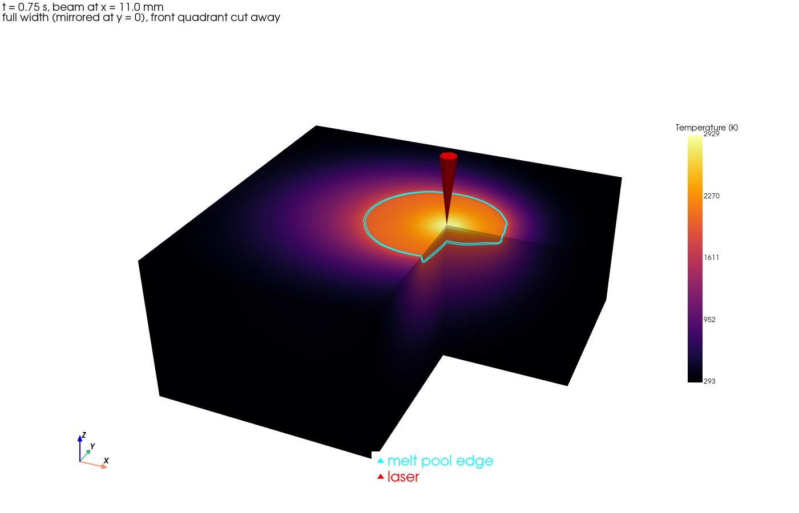

*Figure 1. R02 at t = 0.75 s, with the half model mirrored to the full width and
the front quadrant cut away. The cyan line is the melt-pool edge. The heated
zone is small compared with the block, as in the reference papers.*

| Item | Value |
|---|---|
| Workpiece | Ti-6Al-4V block, 24 mm long (x) × 20 mm wide (y) × 8 mm deep (z) |
| Modelled domain | Half block, y = 0 to 10 mm, with a symmetry plane on the track centreline (y = 0) |
| Laser path | Along x on the centreline, from x = 8 mm to x = 12 mm (4 mm track), then switched off |
| Simulated time | 1.5 s per run. The laser is on for 0.4–1.0 s, depending on speed; the rest is cooling |
| Initial state | Whole block at room temperature, 293.15 K |
| Surroundings | Air at 293.15 K (convection) and room-temperature enclosure (radiation) |

The original specification was a 50 mm long block. The scripts support it, but
the dataset uses a 24 mm block: the pools are only a few millimetres long and
the shorter block keeps each run near the 30 min budget. Section 8.9 confirms
that the outer walls stay within 31–42 K of room temperature, so the block is
large enough.

## 4. Mathematical model

### 4.1 Assumptions

1. The liquid metal is Newtonian, incompressible and laminar. At peak speeds of
   about 0.5 m/s in a pool under 1 mm deep, the Reynolds number is below about
   1000.
2. The density is constant, except in the buoyancy term (Boussinesq
   approximation).
3. The top surface stays flat and fixed. There is no evaporation, recoil
   pressure or keyhole.
4. The laser is absorbed in a thin surface layer, 50 µm deep. Absorptivity is a
   constant fraction η, so only the absorbed power ηP enters the model.
5. Melting happens over the solidus–liquidus interval, 1878–1928 K, through a
   smooth solid fraction.
6. The process is symmetric about the track centreline (y = 0).

### 4.2 Governing equations

**Mass (incompressible):**

$$\nabla\cdot\mathbf{u} = 0$$

**Momentum** (Boussinesq buoyancy and Darcy damping of flow in the mushy zone):

$$\rho\left(\frac{\partial \mathbf{u}}{\partial t} + \mathbf{u}\cdot\nabla\mathbf{u}\right)
= -\nabla p + \mu\nabla^2\mathbf{u}
- \rho\beta(T - T_\mathrm{ref})\,\mathbf{g}
- \mu\,\frac{180}{\lambda^2}\,\frac{f_s^2}{(1-f_s)^3}\,\mathbf{u}$$

The last term is the Carman–Kozeny resistance of the dendritic mush. It forces
the velocity to zero as the solid fraction f_s approaches 1, so solid metal does
not flow. AdditiveFOAM writes it with a dendrite arm spacing λ instead of the
mushy-zone constant A_mush of Farzadi et al. (2008, Eq. 2). Matching the two
forms gives

$$\lambda = \sqrt{180\,\mu / A_\mathrm{mush}} = \sqrt{180 \times 3.5\times10^{-3} / 10^{8}} \approx 79\ \mu\mathrm{m}$$

for the course values A_mush = 10⁸ kg/m³s and B = 10⁻⁴. The constant B only
prevents division by zero. AdditiveFOAM does the same by capping f_s at 0.95,
which gives the same order of damping.

**Energy** (enthalpy form with latent heat):

$$\rho c_p\left(\frac{\partial T}{\partial t} + \mathbf{u}\cdot\nabla T\right)
= \nabla\cdot(k\nabla T) + \rho L_f\frac{\partial f_s}{\partial t} + Q_\mathrm{laser}$$

The latent heat term releases L_f as the metal solidifies (f_s rises) and
absorbs it on melting. The solver iterates temperature and solid fraction up to
20 times per time step, until they agree to within 10⁻⁸.

### 4.3 Smoothed solid–liquid transition

A sharp step in properties at the melting point is numerically harsh. Following
the smoothed-step form of Gao et al. (2021, Eq. 8), we use a cosine ramp:

$$H(x) = \tfrac12\left(1 + \sin \pi x\right),\quad |x|\le\tfrac12;
\qquad x = \frac{T - T_m}{T_l - T_s},\quad T_m = \frac{T_s + T_l}{2}$$

The ramp is tabulated at 21 points as the solid fraction f_s = 1 − H. Its slope
is continuous at both ends. This single function drives every melting-related
change:

- **Latent heat** release and absorption.
- **Thermal properties:** k and c_p are mixed between the solid and liquid
  curves by f_s.
- **Flow damping:** the Darcy term above.
- **Marangoni shear:** scaled by the liquid fraction f_L = 1 − f_s (§4.4).

A solid region therefore sees only conduction, convection and radiation. Flow
and surface shear switch on smoothly as it melts and off again as it
solidifies.

### 4.4 Marangoni boundary condition (top surface)

The surface tension varies linearly with temperature,
σ = σ₀ + (dσ/dT)(T − T_ref). On a flat surface only the gradient matters, so σ₀
and T_ref drop out. The tangential force balance is (Farzadi et al. 2008,
Eq. 6):

$$\mu\frac{\partial \mathbf{u}_t}{\partial n} = f_L\,\frac{d\sigma}{dT}\,\nabla_s T,
\qquad u_n = 0$$

Here ∇ₛT is the temperature gradient along the surface, and the liquid fraction
f_L makes the shear vanish on solid surface. With dσ/dT = −2.6 × 10⁻⁴ N/m·K the
shear points from hot to cold, so the surface flows outward from under the beam.

### 4.5 Thermal boundary conditions

| Surface | Velocity | Heat flux |
|---|---|---|
| Top, z = 0 | Marangoni shear, no penetration | Laser + h(T − T∞) + εσ_SB(T⁴ − T∞⁴) |
| Symmetry plane, y = 0 | Symmetry | Symmetry (zero flux) |
| Side walls (y = 10 mm, x = 0, x = 24 mm) | No slip | h(T − T∞) + εσ_SB(T⁴ − T∞⁴) |
| Bottom, z = −8 mm | No slip | h(T − T∞), resting on a workbench, no radiation |

T∞ = 293.15 K, h = 25 W/m²K (Gao 2021), ε = 0.54 (Jelinek 2020).

### 4.6 Laser heat source

The source is a Gaussian (super-Gaussian with exponent k = 2), with 1/e²
radius r, deposited in a 50 µm surface layer, moving at constant speed v:

$$q(x,y,z,t) \propto \eta P\,\exp\!\left(-2\,\frac{(x - x_0 - vt)^2 + y^2}{r^2}\right)$$

The source is normalised so that its volume integral equals ηP. With the beam
centred on the symmetry plane, the half model automatically receives ηP/2. This
was checked from the solver output: 262.5 W out of 525 W.

## 5. Material properties (Ti-6Al-4V)

Every value comes from a cited open-access source. Full references and the
alternatives found are in `materials/Ti6Al4V_sources.md`.

| Property | Value | Source |
|---|---|---|
| Solidus / liquidus temperature | 1878 / 1928 K | Yan et al. 2022 |
| Boiling temperature (check only) | 3533 K | Yan et al. 2022 |
| Density ρ | 4428 kg/m³ | Ghosh et al. 2018 |
| Thermal conductivity, solid | 3.32 + 0.01294 T W/m·K | Linear fit to Ghosh et al. 2018, Table 1 |
| Thermal conductivity, liquid | −6.74 + 0.01812 T W/m·K | Linear fit to Ghosh et al. 2018, Table 1 |
| Specific heat, solid | 427.9 + 0.399 T J/kg·K | Linear fit to Ghosh et al. 2018, Table 3 |
| Specific heat, liquid | 1130 J/kg·K | Much et al. 2024 (after Boivineau 2006) |
| Latent heat of fusion | 2.90 × 10⁵ J/kg | Yan et al. 2022 |
| Dynamic viscosity μ | 3.5 × 10⁻³ Pa·s | Much et al. 2024 (after Mohr 2020) |
| dσ/dT | −2.6 × 10⁻⁴ N/m·K | Yan et al. 2022 |
| Thermal expansion β | 1.6 × 10⁻⁴ 1/K | MSAM 2025 |
| Emissivity ε | 0.54 | Jelinek et al. 2020 |
| Convection coefficient h | 25 W/m²·K | Gao et al. 2021 |
| Mushy-zone constants A_mush, B | 10⁸, 10⁻⁴ | Course specification (Farzadi Eq. 2 form) |

## 6. Numerical method

### 6.1 Solver and discretisation

| Item | Setting |
|---|---|
| Code | AdditiveFOAM 2.0.0 (ORNL), built on OpenFOAM-14 (openfoam.org); 8 MPI processes |
| Method | Finite volume, collocated grid, PIMPLE pressure–velocity coupling |
| Time | First-order implicit (Euler). Adaptive Δt from Courant ≤ 0.9, diffusion number ≤ 10 and melt-front Courant ≤ 1 |
| Convection terms | First-order upwind (robust for the steep thermal and velocity layers) |
| Diffusion terms | Second order; harmonic interpolation of k across cells |
| Linear solvers | GAMG for pressure, PBiCGStab for temperature |
| Hardware | Intel i5-12450H (8 cores), 15 GB RAM, Ubuntu 22.04 |

### 6.2 Mesh

The mesh is block-structured hexahedral with **288,750 cells**:

- **Fine region:** uniform 100 µm cells over x = 6–18 mm, y = 0–4 mm and
  z = 0 to −2 mm. This contains every pool (at most 0.6 mm deep and 2.5 mm half
  width) with margin.
- **Outer region:** cells graded smoothly up to 1 mm towards the far walls,
  where gradients are small.

With this grid a pool is 4–6 cells deep and 26–50 cells wide. The grid is the
same in every run, as the design of experiments requires; only the laser
settings change.

### 6.3 Changes to the solver

AdditiveFOAM's tutorials are conduction-only. Three changes were needed to
solve the flow correctly. All are kept as patch files in `setup/patches/` and
applied by the install script.

1. **Flow switched on:** `nOuterCorrectors 1` in `fvSolution`. The value 0 in
   the tutorials skips the momentum and pressure equations entirely.
2. **`marangoni-assignable.patch`:** marks the Marangoni boundary as not
   assignable by the pressure step. Without it, the pressure correction
   pushed mass through the closed top surface and the run aborted with a
   continuity error.
3. **`marangoni-liquid-fraction.patch`:** multiplies the Marangoni shear by the
   liquid fraction (Farzadi Eq. 6). Without it, the stress would also act on
   solid surface cells.

### 6.4 Verification checks (every run)

| Check | Result |
|---|---|
| Absorbed power in the half model | Exactly ηP/2 (from the solver's power output) |
| Maximum Courant number | 0.91 (limit 0.9 applies before the step) |
| Mass conservation per step | Local continuity error about 10⁻¹⁵ |
| Enthalpy–temperature loop | Converged every step (≤ 20 iterations, 10⁻⁸ tolerance) |
| Fatal errors or crashes | None in any of the 15 runs |
| Outer walls at the end of the run | 324–335 K, near ambient (§8.9) |
| Peak temperature vs boiling point | All Marangoni runs below 3533 K in the quasi-steady pool; R10 exceeds it for about 0.2 ms at start-up (§8.3) |

A mesh-independence study was not part of this design of experiments (the grid
is fixed). Sections 8.9 and 10 discuss what this means for the numbers.

## 7. Design of experiments

### 7.1 Laser-parameter study

Four scan speeds, each with three combinations of power, absorptivity and beam
radius. The ranges follow the reference papers: a small beam and moderate power
give a pool that is small compared with the part.

| Run | Speed (mm/s) | Laser power (W) | Absorptivity | Absorbed power (W) | Beam radius (mm) | Line energy (J/mm) |
|---|---|---|---|---|---|---|
| R01 | 4 | 1000 | 0.30 | 300 | 0.50 | 75 |
| R02 | 4 | 1429 | 0.35 | 500 | 0.75 | 125 |
| R03 | 4 | 1750 | 0.40 | 700 | 1.00 | 175 |
| R04 | 6 | 1000 | 0.40 | 400 | 0.50 | 67 |
| R05 | 6 | 2000 | 0.30 | 600 | 0.75 | 100 |
| R06 | 6 | 2286 | 0.35 | 800 | 1.00 | 133 |
| R07 | 8 | 1000 | 0.35 | 350 | 0.60 | 44 |
| R08 | 8 | 1375 | 0.40 | 550 | 0.75 | 69 |
| R09 | 8 | 2500 | 0.30 | 750 | 1.00 | 94 |
| R10 | 10 | 1500 | 0.30 | 450 | 0.50 | 45 |
| R11 | 10 | 1857 | 0.35 | 650 | 0.75 | 65 |
| R12 | 10 | 2000 | 0.40 | 800 | 0.90 | 80 |

### 7.2 Marangoni comparison

**R02_noMa, R06_noMa and R11_noMa** repeat R02, R06 and R11 (one per speed
group, spanning low to high power) with dσ/dT = 0. Everything else is
identical, including buoyancy. Each pair isolates the effect of Marangoni flow.

### 7.3 An earlier design that was rejected

A first design aimed for a pool at least 2.5 mm deep, using 2–3.5 kW absorbed,
a 2.5 mm beam radius and 1–5 mm/s. It reached 3.4 mm depth, but only by heating
most of the block:

- 78–93 % of the volume ended more than 100 K above ambient;
- the side walls reached up to 2030 K.

This does not match a real process, where a small pool sits in cool material.
It also confirmed the Marangoni physics: with dσ/dT < 0, extra power mostly
widens the pool rather than deepening it. Those results are archived in
`results/archive_overheated/` and are not part of the dataset.

## 8. Results and discussion

All "quasi-steady" values are averages over the last 40 % of the laser-on time,
once the pool has stopped growing. Widths are full widths (both halves of the
symmetric pool). Each subsection first states what the simulations show, then
explains the physics behind it and compares it with the reference papers.

### 8.1 Thermal cycle of a single track (R02)

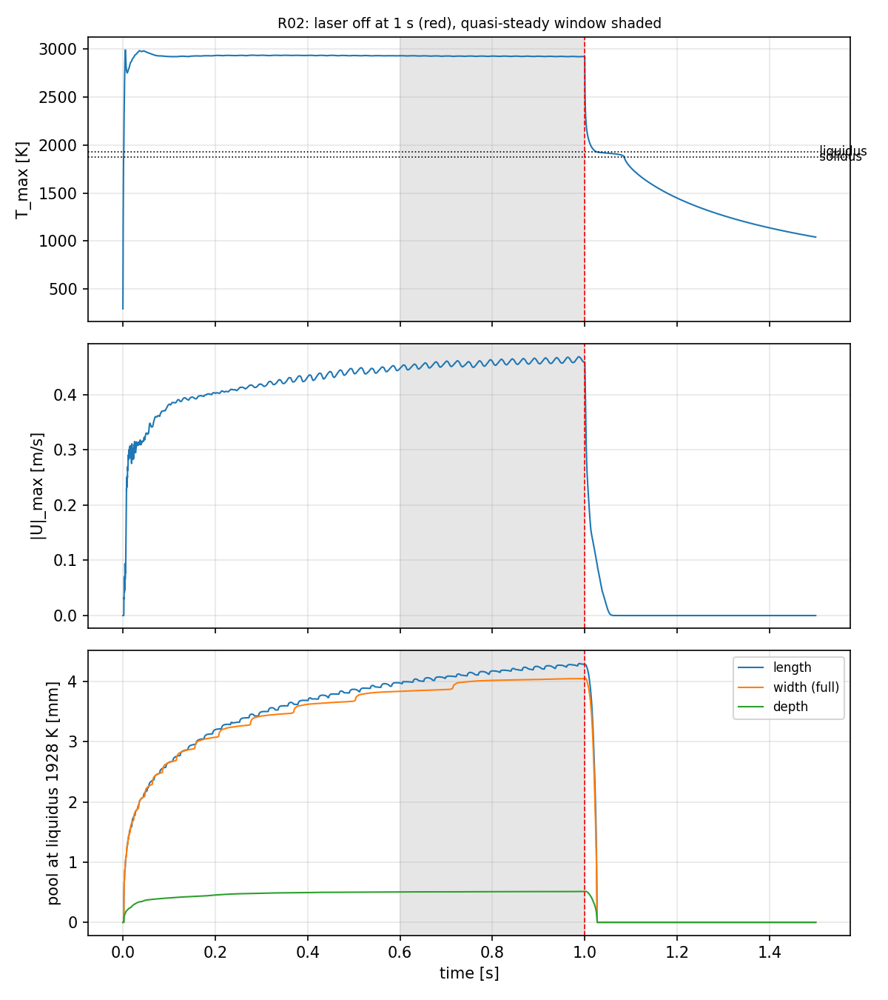

*Figure 2. R02 (4 mm/s, 500 W absorbed, r = 0.75 mm): peak temperature, peak
melt speed and pool size. The laser switches off at 1 s (red line); the shaded
band is the quasi-steady window.*

Every run passes through the same four stages: solid heating, melting and
growth, a quasi-steady travelling pool, and solidification after switch-off.
Figure 2 shows them for R02. The stages differ in length from run to run, but
not in character, so R02 serves as the reference case for the description
below.

**Solid heating and first melting.** For the first one to two milliseconds the
metal is solid, and the absorbed energy is carried away only by conduction into
the block and by surface convection and radiation. The surface reaches the
solidus after 0.65 ms (R10) to 1.89 ms (R03). This onset time depends almost
entirely on the peak beam intensity q₀ = 2P_abs/(πr²): across the twelve runs,
t_melt ∝ q₀^−1.14, with a correlation coefficient of −0.998. A semi-infinite
solid under a uniform surface flux would give t ∝ q₀^−2. The exponent is close
to −1 here because the laser energy is deposited in a 50 µm layer, and in 1–2
ms heat diffuses only about 80–100 µm, comparable with that layer. The early
heating therefore behaves like heating a thin slab, whose temperature rises
linearly with time at a rate set by q₀. Power and radius matter at this stage
only through their ratio, the intensity.

**Melting, flow start-up and pool growth.** Once a molten layer exists, the
Marangoni shear sets it moving. The peak velocity jumps to about 0.3 m/s within
20 ms, reaches about 0.4 m/s after 0.1 s, and then creeps up to its steady
value of about 0.45 m/s. The
depth grows quickly and reaches 90 % of its final value after 0.07–0.26 s.
The width is slower and needs 0.15–0.43 s. Measured as distance travelled by
the beam, the pool needs only about 1.2–1.9 mm of track to become steady,
roughly half a pool length. This is a direct consequence of the high flow
velocity: the melt circulates around the pool many times during that interval,
so the pool forgets its start-up much faster than a conduction-only pool would.
In the no-Marangoni runs the depth needs 1.6–1.8 times as long (0.16–0.37 s),
because conduction alone has to carry the heat down.

**Quasi-steady pool.** From about 0.4 s until switch-off the peak temperature
varies by only 2–5 K (standard deviation) and the depth stays constant to
within a cell. The width and length still creep up by 3–4 %. That slow
increase is not a property of the pool itself but of the block. The heat
conducted into the substrate builds up behind and beside the track, so the
metal ahead of the beam is slightly preheated as the track proceeds. Farzadi et
al. (2008) assume a true steady state in a moving frame. With our 4 mm track
the pool is steady in depth and temperature, and only approximately steady in
width.

**Solidification after switch-off.** When the laser stops, the peak
temperature falls by about 1000 K within about 10 ms. It then stalls just above
the liquidus. The plateau (Figure 2, top) is the latent heat being released:
the last liquid cannot cool below the melting range until its latent heat has
been conducted away. Farzadi et al. (2008) observed the same inflection at the
liquidus in their weld thermal cycles and attributed it to the enthalpy
difference between liquid and solid. The flow decays with the pool, since the
Marangoni shear is scaled by the liquid fraction and the mush damps the
remaining motion. In R02 the velocity reaches zero about 55 ms after
switch-off.

The time from switch-off to full solidification is 43 ms (R07) to 118 ms
(R03). It scales almost linearly with the size of the melted cross-section:
every run solidifies at 44–56 ms per mm² of melted area. That is what one
expects when latent heat has to be removed by conduction into a cold substrate
of the same material: the heat to remove grows with the pool area, and the
contact area through which it leaves grows more slowly.

### 8.2 Temperature and flow field inside the pool

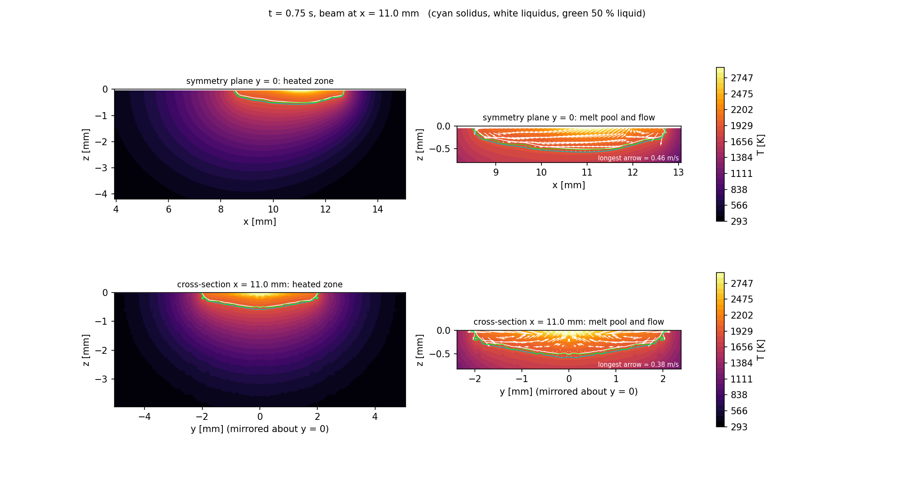

*Figure 3. R02 at t = 0.75 s: the symmetry plane (top) and the cross-section
through the beam (bottom). The left panels show the heated zone, which fades to
ambient inside the block. The right panels show close-ups of the pool with
velocity arrows.*

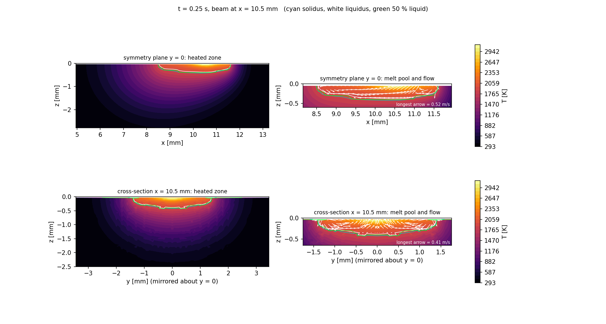

*Figure 4. R10 (10 mm/s, 450 W absorbed, r = 0.5 mm) at t = 0.25 s, for
comparison with the slowest scan.*

**Flow pattern.** In every Marangoni run the flow has the same structure. The
surface melt moves radially outward from the hottest point under the beam
towards the pool rim. At the rim it is turned downward by the solid boundary,
returns inward along the pool bottom, and rises again under the beam. In the
cross-section this gives two counter-rotating vortices, one on each side of the
centreline (Figure 3, bottom right). Pariona et al. (2018) describe exactly
this pattern for laser remelting of Al-Fe: a counterclockwise and a clockwise
vortex symmetric about the track centreline, with the highest velocity at the
surface and the lowest near the pool–substrate interface. The same holds here:
the surface speeds are 0.4–0.5 m/s, while the return flow along the bottom is
much slower (the short arrows in Figure 3). The flow is driven entirely at the
surface, so its strength decays with depth.

The averaged direction of the surface velocity relative to the hottest point
is +0.91 to +0.95, where +1 would be perfectly radial outflow. The small
deficit most likely comes from the scan motion, which makes the pool slightly
asymmetric about the hottest point, so the flow is not perfectly radial.

**Pool shape.** The pools are shallow and flat-bottomed, with steep side walls
near the rim, a "pan" rather than a hemisphere (Figures 3 and 4). The
width-to-depth ratio is 6.6–8.8. This is the classic signature of negative
dσ/dT. The outward surface flow carries the hottest metal to the rim, where it
melts the solid sideways. The bottom of the pool is fed only by the slower,
cooler return flow, so it melts down slowly. Fuhrich et al. (2001) show
the same contrast for spot welding: a radially outward flow (dσ/dT < 0)
produces a wide, shallow pool, and an inward flow (dσ/dT > 0) a narrow, deep
one. Gao et al. (2021) also attribute their wide and shallow NiTi tracks to
outward Marangoni flow from the centre to the pool edge.

The bottom is not perfectly smooth. Small steps of one cell (100 µm) are
visible in the liquidus line of Figure 4. They are a resolution effect: with a
pool only 4–6 cells deep, the melt boundary can only move in whole cells.
Section 8.9 discusses this further.

**Temperature field.** Isotherms are strongly compressed near the surface and
the pool rim, and widely spaced in the solid below. Two effects cause this.
First, the outward flow pushes hot liquid against the rim, so the temperature
drops steeply there. Second, below the pool the heat leaves only by conduction
through a cold, thick substrate, so the gradient there is much gentler. Farzadi
et al. (2008) make the same observation: points at equal distance from the
source were hotter sideways than downward, because the pool is wide and
shallow.

The surface temperature gradient on the molten surface reaches 1.7–2.8 K/µm
(1.7–2.8 × 10⁶ K/m). Pariona et al. (2018) report 5–8.5 × 10⁶ K/m at the
surface for a smaller, faster aluminium track. That is the same order of
magnitude; their higher values follow from scan speeds 2–15 times higher and a
much smaller pool.

**Elongation and asymmetry.** The pools are almost round: length/width is only
1.04–1.10, increasing slightly with scan speed. This is surprising at first,
because a moving source usually produces a teardrop-shaped pool trailing behind
the beam. The reason is the ratio of the flow speed to the scan speed. The mean
surface melt speed is 29–80 times the scan speed (the peak is 52–117 times),
so the melt circulates around the pool many times while the beam moves one
pool length. The flow redistributes the heat almost symmetrically about the
hottest point. In terms of dimensionless numbers, the scan Péclet number
v·(W/2)/α is only 0.9–3.9, while the flow Péclet number is 58–146 (§8.7).
Inside the pool, the flow, not the beam motion, controls the shape. Fuhrich et
al. (2001) report a similar ratio for laser welding of steel: a maximum surface
velocity 57 times the welding speed.

The heated zone around the pool is a different matter. Outside the pool there
is no flow, so the solid isotherms do show the classic moving-source asymmetry.
They are compressed ahead of the beam and stretched behind it. The effect is
much stronger at 10 mm/s (Figure 4, left) than at 4 mm/s (Figure 3, left),
because at higher speed the heat has less time to diffuse forward.

### 8.3 Peak temperature: Marangoni flow as a thermostat

The peak temperature in the quasi-steady pool is 2814–3134 K in all twelve
runs, even though the absorbed power varies by a factor of 2.7 and the peak
intensity by a factor of 2.6. Every run is 890–1210 K above the liquidus and
400–720 K below the boiling point. The temperature is clearly being limited by
a mechanism that becomes stronger as the heating becomes stronger.

That mechanism is the Marangoni flow itself. A stronger beam raises the surface
temperature gradient. A steeper gradient increases the Marangoni shear (τ ∝
|dσ/dT| ∇ₛT), which drives a faster outward flow. The faster flow carries more
heat away from the hot spot, which lowers the gradient again. This negative
feedback holds the peak temperature in a narrow band. Fuhrich et al. (2001)
describe the same "smoothing effect": with dσ/dT < 0, convection acts in the
same direction as conduction and flattens the surface temperature profile.

The start of each run shows this feedback clearly. During the first 3–5 ms
the pool exists but its flow is still accelerating, with peak speeds of only
0.07–0.13 m/s. In that window the peak temperature overshoots its later steady
value by 40–440 K:

| Run | Peak intensity q₀ (W/mm²) | Transient peak (K) | Steady peak (K) | Overshoot (K) |
|---|---|---|---|---|
| R03 | 446 | 2992 | 2951 | 41 |
| R02 | 566 | 2992 | 2927 | 65 |
| R01 | 764 | 3136 | 2853 | 282 |
| R04 | 1019 | 3430 | 3052 | 378 |
| R10 | 1146 | 3571 | 3134 | 437 |

The overshoot grows with the peak intensity, and it disappears within 1–2 ms
once the surface flow reaches about half its final speed. In R10, with the
most concentrated beam, the surface briefly exceeds the boiling point (3533 K)
for about 0.2 ms. Physically, that would mean a short burst of evaporation at
the start of the track. The model does not include evaporation, but the
duration is so short that the effect on the rest of the run is negligible.

Without Marangoni flow (§8.6) there is no such feedback, and the peak
temperature keeps climbing towards 4940–5590 K. This comparison is the clearest
evidence that the flow, not conduction, sets the temperature of the pool.

### 8.4 Effect of the laser parameters on pool size

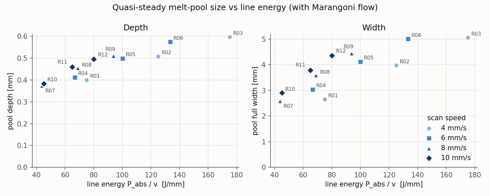

*Figure 5. Quasi-steady pool depth and width against line energy (absorbed
power ÷ scan speed).*

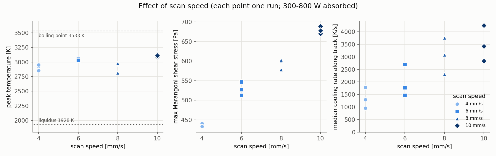

*Figure 6. Peak temperature, maximum Marangoni shear stress and median cooling
rate against scan speed.*

| Run | Speed (mm/s) | Absorbed power (W) | Depth (mm) | Width (mm) | Length (mm) | Peak T (K) | Peak speed (m/s) | Width/depth |
|---|---|---|---|---|---|---|---|---|
| R01 | 4 | 300 | 0.40 | 2.65 | 2.78 | 2853 | 0.41 | 6.6 |
| R02 | 4 | 500 | 0.51 | 3.97 | 4.15 | 2927 | 0.46 | 7.8 |
| R03 | 4 | 700 | 0.60 | 5.06 | 5.30 | 2951 | 0.47 | 8.5 |
| R04 | 6 | 400 | 0.41 | 3.04 | 3.23 | 3052 | 0.49 | 7.4 |
| R05 | 6 | 600 | 0.50 | 4.12 | 4.37 | 3051 | 0.50 | 8.3 |
| R06 | 6 | 800 | 0.58 | 5.01 | 5.33 | 3033 | 0.50 | 8.7 |
| R07 | 8 | 350 | 0.37 | 2.59 | 2.79 | 2814 | 0.41 | 6.9 |
| R08 | 8 | 550 | 0.46 | 3.59 | 3.86 | 2965 | 0.48 | 7.9 |
| R09 | 8 | 750 | 0.51 | 4.46 | 4.78 | 2980 | 0.49 | 8.7 |
| R10 | 10 | 450 | 0.38 | 2.90 | 3.18 | 3134 | 0.53 | 7.6 |
| R11 | 10 | 650 | 0.46 | 3.79 | 4.12 | 3086 | 0.52 | 8.3 |
| R12 | 10 | 800 | 0.50 | 4.37 | 4.74 | 3110 | 0.53 | 8.8 |

To separate the influence of each input, a power law y = C·P^a·v^b·r^c was
fitted by least squares to each output over the twelve Marangoni runs (Figure
7). All fits are very good, with R² = 0.96–0.998.

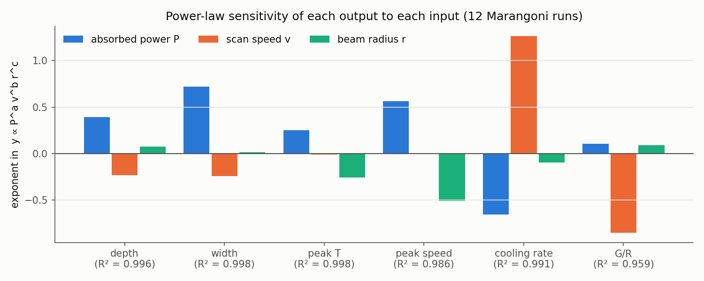

*Figure 7. Fitted exponents of absorbed power P, scan speed v and beam radius r
for each output. A bar of +0.5 means the output grows with the square root of
that input.*

One caution applies when reading Figure 7. In this design the beam radius was
increased together with the power (their logarithms correlate at 0.90), so
the fit cannot fully separate the effects of P and r. The combined effect and
the effect of v (uncorrelated with both) are reliable. The split between P and
r is indicative only.

**Power widens far more than it deepens.** Width scales as P^0.72 but depth
only as P^0.39. At 4 mm/s, going from R01 to R03 (300 → 700 W, radius 0.5 →
1.0 mm) widens the pool by 91 % but deepens it by only 49 %. Extra energy
goes mostly where the surface flow takes it, which is sideways. Gao et al.
(2021) reach the same conclusion experimentally for NiTi tracks: the clad width
"is mainly determined by the laser power", while depth grows more slowly. This
also explains why the earlier high-power design (§7.3) could not deepen the
pool without heating the whole block. Doubling the depth would need roughly 6
times the power, and most of that power would go into a wider pool and hotter
surroundings.

**Speed shrinks the pool, but only weakly.** Depth and width both scale as
about v^−0.25. Raising the speed from 4 to 10 mm/s at constant power would
shrink the pool by only about 20 %. In a conduction-only pool the size falls
much faster with speed: in the Rosenthal solution for a thick plate, the width
scales as (P/v)^0.5. Two effects weaken the speed dependence here. First, the
melt speed is 30–120 times the scan speed (§8.2), so the internal heat transport
barely notices the beam motion. Second, the pool size is set mainly by the
balance between the surface flow and conduction at the rim, which does not
depend on v. Pariona et al. (2018) found the same weak dependence for Al-Fe:
over a threefold increase in scan speed, the measured depth fell from 257 to
189 µm while the width stayed at about 675 µm.

**Line energy is a good single predictor, but not a complete one.** Figure 5
shows that depth and width both rise steadily with line energy P/v. At equal
line energy, however, faster scans give larger pools. For example, R11 (65
J/mm, 10 mm/s) is 3.79 mm wide, while R04 (67 J/mm, 6 mm/s) is only 3.04 mm
and R01 (75 J/mm, 4 mm/s) only 2.65 mm. The fitted exponents explain why: power
and speed do not enter as their ratio (that would need a = −b), because a ≈
0.72 while b ≈ −0.25. A fast scan with high power melts more than a slow scan
with proportionally lower power, because at higher speed less of the energy has
time to leak into the substrate (§8.5).

**Beam radius controls intensity, not size.** The radius has almost no effect
on depth or width (exponents 0.08 and 0.02), but a strong effect on peak
temperature (r^−0.26) and peak melt speed (r^−0.51). A larger beam spreads the
same power over more area, which lowers the surface temperature gradient, the
Marangoni shear and therefore the flow speed. The peak speed scales as
P^0.56·r^−0.51, close to (P/r)^0.5. The peak temperature scales as P^0.25·
r^−0.26 ≈ (P/r)^0.25. For a stationary Gaussian source in pure conduction, the
peak temperature rise is proportional to P/r, an exponent of 1. The measured
exponent of 0.25 is a quantitative measure of how strongly the Marangoni flow
suppresses the temperature (§8.3).

**Speed raises the peak temperature slightly.** Despite the shorter interaction
time, the 10 mm/s runs are about 150–200 K hotter at the peak than the 4 mm/s
runs. Their beams are also more intense, and the fitted speed exponent of the peak
temperature is essentially zero (v^−0.01). The difference therefore comes from
the power and radius combinations in the design, not from speed itself. This
differs from Farzadi et al. (2008), who found that the peak temperature rises
as the welding speed decreases. A likely reason is that in their GTA weld the
arc is wider and conduction plays a larger part, so a slower scan deposits more
energy at each point. In our pools the Marangoni thermostat (§8.3) removes
most of that sensitivity.

### 8.5 Melting efficiency

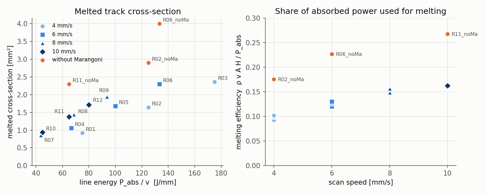

*Figure 8. Left: melted cross-section of the track. Right: the fraction of the
absorbed power that ends up as heat in the melted metal, η_m = ρ v A H / P_abs,
where H = 1.71 MJ/kg is the enthalpy needed to heat Ti-6Al-4V from 293 K to the
liquidus and melt it.*

The melted cross-section A was measured directly from the 3D fields: the
current pool was projected onto the y–z plane at a time when the laser was on
and the pool was steady (`results/melted_cross_section.csv`). The result fills
76–89 % of the width × depth rectangle, close to the 79 % of a half-ellipse,
consistent with the pan-shaped pools seen in §8.2.

**Only 9–16 % of the absorbed power melts metal.** The rest is conducted into
the solid block, which heats up around the track, or is lost from the surface
by convection and radiation. The efficiency rises steadily with scan speed,
from about 0.10 at 4 mm/s to 0.16 at 10 mm/s, and hardly depends on power at a
given speed. The reason is the time available for heat to leak away. At a slow
scan, each part of the track is exposed to the beam for longer, and heat has
time to diffuse a long way into the substrate ahead of and beside the pool
(compare the large heated zones of Figure 3 with Figure 4). At a high scan
speed, more of the energy is used where it is deposited. This is the
well-known trend in welding that faster, more powerful processes melt more
efficiently. For a production process, it favours high speed with high power
over slow scanning at low power, for the same line energy.

**Marangoni flow lowers the melting efficiency.** The three no-Marangoni runs
melt 1.7–1.8 times the cross-section of their Marangoni partners, reaching
efficiencies of 0.18–0.27. The outward flow spreads the heat over a wide
surface and a long, thin rim. A large share of it is conducted into the solid
around that rim without raising any metal above the liquidus. A deep,
compact conduction pool loses less heat to its surroundings per unit of molten
volume. This higher efficiency, however, comes with peak temperatures of about
5000 K. In reality much of that superheat would be lost to evaporation, so the
no-Marangoni efficiencies are upper bounds.

### 8.6 Effect of Marangoni flow

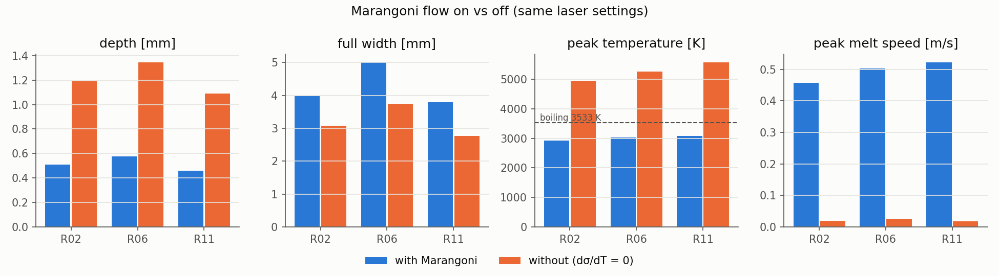

*Figure 9. Quasi-steady pool depth, width, peak temperature and peak speed,
with and without Marangoni flow.*

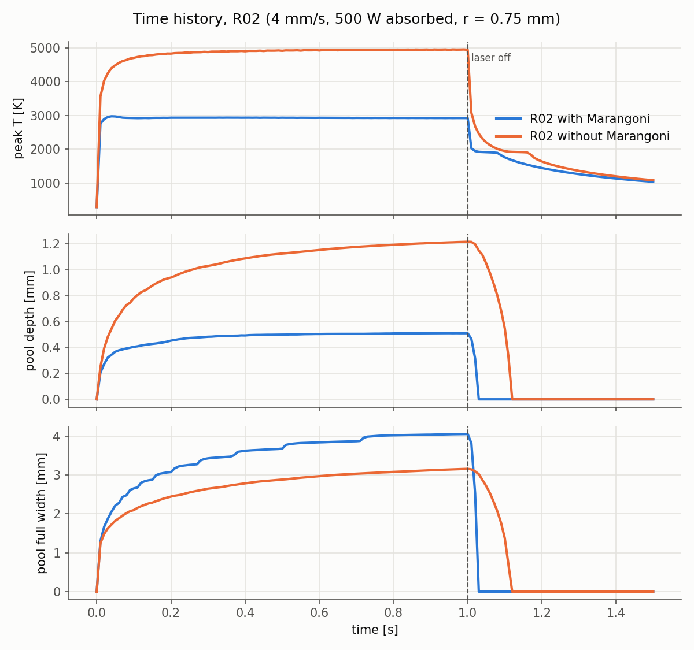

*Figure 10. Time history of R02 with and without Marangoni flow.*

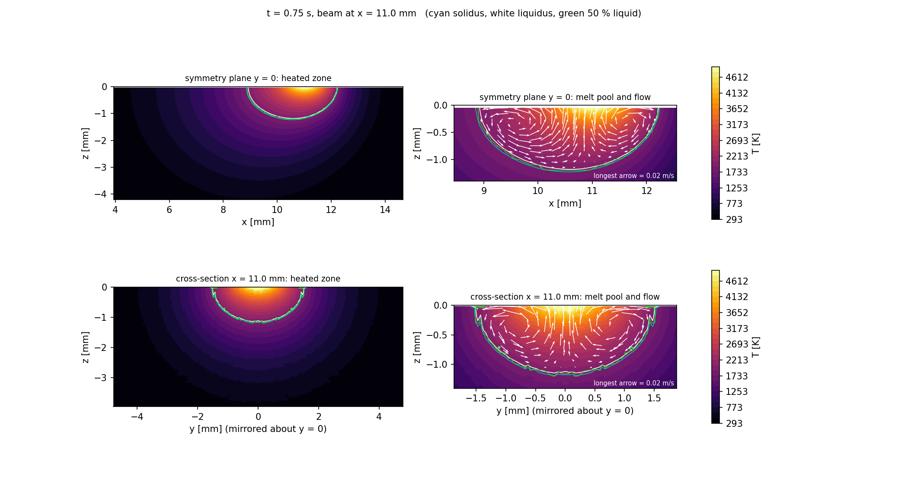

*Figure 11. R02_noMa at t = 0.75 s, for comparison with Figure 3. With
buoyancy alone the flow is about 20× weaker (≈ 0.02 m/s). The pool is a deep
hemisphere, set by conduction, with a hot core of nearly 5000 K.*

| Pair | Depth (mm) with → without | Width (mm) with → without | Width/depth with → without | Length/width with → without | Peak T (K) with → without | Peak speed (m/s) with → without | Melted area (mm²) with → without | Time to solidify (ms) with → without |
|---|---|---|---|---|---|---|---|---|
| R02 | 0.51 → **1.19** (×2.3) | 3.97 → 3.07 (−23 %) | 7.8 → 2.6 | 1.04 → 1.08 | 2927 → 4941 | 0.46 → 0.020 | 1.64 → 2.90 | 86 → 170 |
| R06 | 0.58 → **1.35** (×2.3) | 5.01 → 3.74 (−25 %) | 8.7 → 2.8 | 1.06 → 1.13 | 3033 → 5259 | 0.50 → 0.025 | 2.30 → 4.00 | 106 → 230 |
| R11 | 0.46 → **1.09** (×2.4) | 3.79 → 2.78 (−27 %) | 8.3 → 2.6 | 1.09 → 1.24 | 3086 → 5576 | 0.52 → 0.018 | 1.38 → 2.30 | 67 → 142 |

The comparison isolates a single cause, since the three pairs differ only in
dσ/dT. Every difference in the table is therefore caused by the Marangoni
flow.

**Pool shape.** Without Marangoni flow the pool becomes a hemisphere: depth
more than doubles, width falls by a quarter, and the width-to-depth ratio drops
from about 8 to about 2.7. A hemispherical pool is what pure conduction from a
concentrated surface source produces, because heat spreads equally in all
directions from the hot spot. The ratio of about 2.7 rather than 2 reflects the
Gaussian beam, which is itself wider than it is deep. The change is the same
in all three pairs, from 4 mm/s to 10 mm/s and from 500 W to 800 W, so it is a
property of the mechanism and not of a particular setting. This is the
comparison that Fuhrich et al. (2001) made qualitatively by changing the sign
of dσ/dT. Here, removing the force entirely gives a quantitative measure of
how much of the pool shape is due to Marangoni flow: about half of its width
and less than half of its depth.

**Peak temperature.** Without the flow the hot spot is no longer cooled by
convection, and the peak temperature rises by 2000–2500 K, to 4940–5590 K. It
also keeps rising slowly during the whole laser-on period (Figure 10, top),
rather than levelling off after a few milliseconds. These temperatures are far
above the boiling point. A real pool without Marangoni flow would evaporate
strongly, and the recoil pressure would deform the surface and could start a
keyhole. Neither effect is in the model, so the no-Marangoni runs must be read
as a numerical experiment that switches one mechanism off, not as a prediction
of a real process. Real Ti-6Al-4V does have a negative dσ/dT, so the Marangoni
runs are the physically relevant ones.

**Flow.** With dσ/dT = 0 the only remaining driving force is buoyancy: hot,
lighter metal rises under the beam and spreads outward. The surface flow
therefore still points mostly outward (direction +0.81 to +0.87), but it is
about 20 times slower, 0.02 m/s instead of 0.46–0.52 m/s. This agrees with the
dimensionless analysis (§8.7), where buoyancy is 365–1384 times weaker than
the Marangoni force in the Marangoni runs. The flow Péclet number drops from
58–146 to 2–5, so heat in the pool moves mainly by conduction.

**Elongation.** Without the fast circulation that evens out the pool, the
moving source has more influence on the shape. Length/width rises from
1.04–1.09 to 1.08–1.24, most at the highest speed (R11). The pool begins to
develop the trailing teardrop shape typical of conduction pools. This confirms
the explanation in §8.2 for the almost round Marangoni pools.

**Solidification.** The pool without Marangoni flow takes twice as long to
solidify after switch-off. It holds more melted metal (1.7–1.8 times the
cross-section), much of it superheated by thousands of kelvin, and all of that
heat has to be conducted away before the last liquid freezes. Per unit of
melted area, it solidifies at the same rate as the Marangoni pools (58–62 ms
per mm², compared with 44–56 ms per mm²), so the difference is mainly in the
amount of heat, not in how fast it leaves.

**Computational cost.** The Marangoni runs took 15–33 minutes and the
no-Marangoni runs 6–8 minutes, 2.5–4 times less. While the pool is molten,
the time step is limited by the Courant number u·Δt/Δx ≤ 0.9, so a melt flowing
20 times faster forces much smaller steps (R02 needed about 7,000 steps and
R02_noMa about 1,400). The ratio in run time is smaller than 20 because other
limits on the time step (diffusion and melt-front speed) apply in both cases,
and the cooling phase costs the same. Resolving the Marangoni flow is still the
dominant cost of this type of simulation.

### 8.7 Surface Marangoni quantities and dimensionless analysis

These numbers follow the definitions of Farzadi et al. (2008):

| Number | Definition | Range (Marangoni runs) | Meaning |
|---|---|---|---|
| Marangoni, Ma | ρ L_R ΔT \|dσ/dT\| / μ² (Eq. 17) | 1.2–2.7 × 10⁵ | Strong thermocapillary driving |
| Grashof, Gr | g β L_B³ ΔT ρ² / μ² (Eq. 15) | 83–717 | Weak buoyancy |
| Ma/Gr | Surface tension vs buoyancy (Eq. 18) | **365–1384** | Marangoni force dominates by 2–3 orders of magnitude |
| Péclet, Pe | u ρ c_p L_R / k (Eq. 14) | 58–146 | Convection carries ≫ conduction: flow sets the pool shape |
| Reynolds, Re | ρ u L_R / μ | 410–1040 | Laminar, as assumed |

Here L_R is the pool half-width, L_B = width/8, ΔT = T_max − T_solidus, and u
is the mean surface speed.

**Marangoni versus buoyancy.** The Marangoni force exceeds buoyancy by a factor
of 365–1384 in every run. Farzadi et al. (2008) reached the same conclusion for
GTA welding of aluminium, where buoyancy played a far smaller role than the
surface tension and electromagnetic forces. For the small laser pools studied
here the dominance is even clearer.

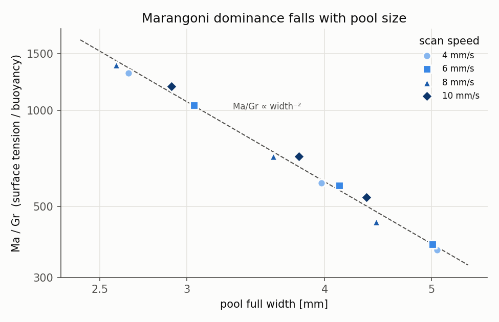

*Figure 12. Ma/Gr against pool width. All twelve runs fall on one line with
slope −2.*

Figure 12 shows that Ma/Gr depends on one thing only, the pool size: it falls
as width⁻², with all twelve runs on one line regardless of speed or power.
This follows from the definitions. Ma grows with the length scale L, but Gr
grows with L³, because buoyancy acts on a volume while Marangoni shear acts on
a surface. Since ΔT is nearly the same in all runs (the thermostat effect of
§8.3), the ratio reduces to L⁻². Extrapolating the line, buoyancy would become
comparable to the Marangoni force (Ma/Gr ≈ 1) only for pools 20–40 times
wider, around 100 mm, well beyond any laser process. For laser melt pools,
buoyancy can safely be treated as a minor correction.

**Convection versus conduction.** The flow Péclet number is 58–146 and grows
with pool size, as in Farzadi et al. (2008), where Pe increased with heat
input. Pe ≫ 1 means that heat in the pool is carried by the flow, not by
conduction. This is why switching Marangoni off changes the pool shape so much
(§8.6), and why the pool shape is almost independent of the scan direction
(§8.2).

**Marangoni stress.** The maximum Marangoni shear on the molten surface is
430–690 Pa. The mean over the molten surface is 78–147 Pa, about five times
lower. The maximum occurs where the surface gradient is steepest. The mean is pulled
down by the flat-topped temperature profile near the centre and by the rim,
where the liquid fraction, and with it the shear, falls to zero. The maximum stress
rises with scan speed, from about 435 Pa at 4 mm/s to about 680 Pa at 10 mm/s
(v^0.46), because faster scans produce sharper surface gradients. The mean
stress, by contrast, falls with pool size: the same temperature difference,
from about 3000 K at the centre to 1928 K at the rim, is spread over a longer
distance in a larger pool. Pariona et al. (2018) found that higher scan speeds gave smaller pools and a
weaker Marangoni effect. In our runs the maximum stress instead grows with
speed, but the peak surface speed rises only modestly, from 0.41–0.47 m/s at
4 mm/s to 0.52–0.53 m/s at 10 mm/s. The faster scans also have shallower
pools, so the stronger shear acts over a smaller region.

**Velocity scale.** Farzadi's boundary-layer estimate (their Eq. 20) predicts
surface speeds of 1.6–2.2 m/s. The simulated peak speeds are 0.41–0.53 m/s,
about 4 times lower. Farzadi et al. found good agreement between the estimate
and their simulation (1.433 against 1.445 m/s). The difference here has two
likely causes. First, the scaling assumes a boundary layer that develops freely
along the surface. Our pools are only 0.4–0.6 mm deep, so the boundary layer
fills most of the pool depth and the return flow along the bottom adds
friction. Second, the mushy zone damps the flow along the whole rim, a region
that is relatively large in a small pool. The estimate still gets the order of
magnitude and the trend right. A simple Couette estimate shows why the flow is
so fast: a mean shear of about 100 Pa acting across a 0.1 mm liquid layer with
a viscosity of 3.5 mPa·s gives u ≈ τδ/μ ≈ 3 m/s. Once the return flow and the
mushy-zone damping are included, speeds of a few tenths of a metre per second
are the natural result.

### 8.8 Solidification conditions and microstructure

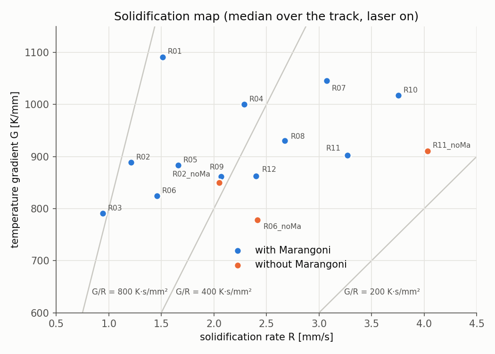

*Figure 13. Temperature gradient G against solidification rate R at the
solidification front, median along the track while the laser is on. The lines
mark constant G/R.*

| Speed (mm/s) | Median cooling rate (K/s) | G (K/mm) | R (mm/s) | G/R (K·s/mm²) |
|---|---|---|---|---|
| 4 | 960–1790 | 790–1090 | 0.9–1.5 | 840–900 |
| 6 | 1470–2700 | 820–1000 | 1.5–2.3 | 530–630 |
| 8 | 2300–3760 | 860–1050 | 2.1–3.1 | 420–500 |
| 10 | 2830–4260 | 860–1020 | 2.4–3.8 | 370–480 |

The ranges in each row cover the three runs at that speed.

**What G and R control.** Solidification theory gives two combinations of the
temperature gradient G and the front speed R. The ratio G/R controls the shape
of the solidifying structure: high G/R gives planar or cellular growth, and as
G/R falls it changes to columnar dendritic and then equiaxed dendritic. The
product G·R, which is the cooling rate, controls its scale: higher cooling
rates give finer structures. Gao et al. (2021) and Farzadi et al. (2008) both
use this framework.

**R varies along the pool boundary.** In a steady pool the solidification
front moves at R = v·cos θ, where θ is the angle between the normal to the
front and the scan direction (Farzadi et al. 2008). At the bottom of the pool
on the centreline, the front faces almost straight up, θ ≈ 90°, so R is
nearly zero. The simulations give 0.04–0.09 times the scan speed there. At the
tail of the pool on the surface, the front faces the scan direction, θ ≈ 0°,
and R approaches v. The median over all solidification events is 0.24–0.38 v.
It is lower for larger, flatter pools, because a larger share of their boundary
is the bottom and sides, where R is small.

**G is lower at the bottom than elsewhere.** The temperature gradient at the
bottom of the pool is 550–830 K/mm, about 15–30 % lower than the median over
the track (790–1090 K/mm). Gao et al. (2021) found the opposite in their NiTi
DED track, with the highest G at the bottom. The difference is the flow
pattern: here the outward Marangoni flow brings the hottest metal to the rim
and the surface, so the steepest gradients are at the sides and top of the
pool. The bottom is fed only by the slower, cooler return flow, which also
explains why the pools are shallow.

**Morphology at the bottom.** With R so small, G/R at the bottom of the pool
is very high: 1240–2730 K·s/mm², 2–6 times the track median. The first metal
to solidify at the fusion boundary therefore grows with a planar or cellular
front, epitaxially on the solid substrate. As the front moves up and towards
the tail, G/R falls and the growth becomes columnar dendritic. Gao et al.
(2021) observed this sequence in their tracks: planar, cellular, columnar and
equiaxed grains from the bottom to the top. Farzadi et al. (2008) note the same
spatial variation: cellular solidification near the fusion line, dendritic
towards the centre. In Ti-6Al-4V the prior-β grains usually grow as long
columns through many layers. The numbers here show the trends that favour or
oppose that growth, not a full microstructure prediction.

**Effect of scan speed.** Faster scans raise the cooling rate, from about 1300
K/s at 4 mm/s to about 3500 K/s at 10 mm/s, and lower G/R, from about 870 to
about 420 K·s/mm². The fitted dependence is cooling rate ∝ v^1.26·P^−0.66
and G/R ∝ v^−0.85. For a moving point source on a thick plate, the Rosenthal
solution gives a cooling rate proportional to v/P. Our exponents differ from
±1 because the Marangoni flow changes the pool shape and the region where
solidification happens. The direction of the trend is the same, though. For
the microstructure, higher speed favours a finer structure (smaller grains,
finer α′/α laths after transformation) and a less columnar, more equiaxed
growth. Farzadi et al. (2008) found the same trend in aluminium: as the heat
input increases or the welding speed decreases, G/R rises and G·R falls.

**Effect of Marangoni flow.** Without Marangoni flow, the median R rises
(e.g. 1.21 → 2.05 mm/s in R02) and G/R falls by 40–50 %. The deep hemispherical
pool has a steeper boundary, so more of its boundary faces the scan direction
and solidifies at a speed closer to v. The no-Marangoni pool would therefore
grow a less columnar structure.

**End crater.** When the laser switches off, the remaining pool solidifies
from all sides at once. Its cooling rate is 1.3–3.1 times the track median in
the Marangoni runs (median 2,200–6,700 K/s). This end crater is recorded
separately in the dataset (`crater_*` columns) so that it does not bias the
track statistics. In a real part, the crater is where shrinkage porosity and
crater cracks typically form, which is why welding practice often ramps the
power down at the end of a track.

### 8.9 Thermal footprint and numerical behaviour

**Heated zone.** At t = 1.5 s, 0.5–1.1 s after the laser switched off, every
outer wall of the block is at 324–335 K, within 42 K of ambient. The left
panels of Figures 3 and 4 show the temperature falling to room temperature
within about 4 mm of the track. The block is therefore large enough, and its
boundaries do not affect the pool. That was the problem with the rejected
high-power design (§7.3), where the walls reached 2030 K.

**Grid effects.** Two features of the results come from the 100 µm grid rather
than from the physics, and both should be kept in mind when the data are used:

1. **Velocity ripple at v/Δx.** The peak velocity in every Marangoni run
   oscillates slightly during the quasi-steady phase (Figure 2, middle). The
   frequency is exactly the scan speed divided by the cell size: 40 Hz at 4
   mm/s, 60 Hz at 6 mm/s, 80 Hz at 8 mm/s and 100 Hz at 10 mm/s. Each
   oscillation is the beam crossing one cell. The amplitude is only 2–5 mm/s
   (about 1 % of the peak speed), and the peak temperature varies by just 2–5
   K. It is a small artefact of the discrete grid and does not affect the
   averaged values.
2. **Width in steps.** The width in Figure 2 (bottom) increases in visible
   steps of 0.2 mm, one cell on each side of the symmetric pool. The
   reported widths are therefore resolved to about ±0.1 mm, and the depths
   (4–6 cells) to about ±0.05 mm. The trends across runs are much larger than
   these steps, but small differences between individual runs (below about
   5 %) should not be over-interpreted.

## 9. Data produced

`results/melt_pool_dataset.xlsx` holds every run. All sheets carry the `case`
name and the run's input parameters on every row, so they can be used directly
as machine-learning tables (as in Wang et al. 2024).

| Sheet | Rows | Content |
|---|---|---|
| `runs` | 15 | One row per run: 9 inputs and 37 outputs (pool size, temperatures, speeds, timings, solidification statistics, Marangoni quantities, dimensionless numbers) |
| `timeseries` | 2,265 | Every run every 0.01 s: beam position, peak T, peak speed, pool length, width and depth at liquidus and solidus, Ma, Gr, Ma/Gr, Pe, Re |
| `marangoni` | 90 | Every 0.25 s snapshot: molten surface area, surface temperature gradient, Marangoni shear (max and mean), surface speed, flow direction, dimensionless numbers |
| `solidification` | 69,811 | Every solidification event in the fine region: position, time, cooling rate, G, R, G/R, G·R, and whether the laser was on |
| `columns` | 80 | Description and unit of every column |

Each run folder `results/<run>/` also holds:
- `summary.json`;
- the time-history plot;
- 2D sections at every 0.25 s;
- 3D cut-away images (full width, mirrored);
- `marangoni_snapshots.csv`.

Full-block 3D fields for ParaView are written to `cases/<run>/VTK_full/`.
The melted track cross-section of each run, used in §8.5, is in
`results/melted_cross_section.csv`.

## 10. Limitations

1. **Flat, fixed surface; no evaporation.** These are acceptable at the
   quasi-steady peak temperatures of the Marangoni runs (below 3533 K). The
   start-up overshoot of R10 exceeds boiling for only about 0.2 ms. They are
   not acceptable for the no-Marangoni runs, which are a numerical experiment
   only.
2. **Fixed 100 µm grid, no mesh-independence study.** The pools are only 4–6
   cells deep, so depth is resolved to about ±0.05 mm (half a cell). Peak
   speeds and surface gradients would probably rise somewhat on a finer grid,
   because the velocity boundary layer under the surface is thin (Fuhrich
   2001). The trends between runs are more reliable than the absolute values.
3. **Short track (4 mm).** Depth and peak temperature reach steady state, but
   width and length still grow 3–4 % by switch-off.
4. **Absorptivity is a constant multiplier.** Only the absorbed power ηP enters
   the model, so absorptivity is a dataset column but not an independent
   physical input.
5. **Mushy-zone damping.** AdditiveFOAM's form with λ = 79 µm and f_s capped at
   0.95 is equivalent in practice, but not identical, to Farzadi's
   A_mush/(f_L³ + B) form.
6. **Constant density and linear dσ/dT.** Sulphur or oxygen in the surface can
   change the sign of dσ/dT at high temperature and reverse the flow (Fuhrich
   2001). That is not modelled.

## 11. Conclusions

1. A 3D transient thermo-fluid model of laser melting of Ti-6Al-4V was built on
   open-source AdditiveFOAM/OpenFOAM. Three changes make the Marangoni physics
   work: the flow solve switched on, a fix for the closed top boundary, and
   liquid-fraction scaling of the surface shear. The model uses cited material
   data and a smoothed phase transition.
2. Across 12 laser settings, the pools are 0.37–0.60 mm deep, 2.6–5.1 mm wide
   and 6.6–8.8 times wider than deep, and nearly round in plan (length/width
   1.04–1.10). Power widens the pool far more than it deepens it (P^0.72
   against P^0.39); speed shrinks it only weakly (v^−0.25); beam radius
   changes the temperature and flow speed rather than the size.
3. The quasi-steady peak temperature stays near 2800–3100 K regardless of
   power. The Marangoni flow acts as a thermostat: stronger heating drives
   stronger convection. Before the flow develops it overshoots by up to 440 K.
4. Only 9–16 % of the absorbed power melts metal, rising with scan speed; the
   rest heats the surrounding block.
5. **Marangoni flow is the dominant mechanism in the pool:**
   - Ma/Gr is 365–1384 and Pe is 58–146.
   - Switching it off makes the pool 2.3–2.4× deeper and 23–27 % narrower.
   - The peak temperature rises by about 2000–2500 K.
   - Solidification takes about twice as long.
   - The flow is also the main computational cost (2.5–4× longer runs).
6. Faster scanning raises the cooling rate and lowers G/R, which points to a
   finer and less columnar solidification structure. At the bottom of the pool
   G/R is 2–6 times higher than average, favouring planar or cellular growth at
   the fusion boundary.
7. The complete dataset (15 runs, about 72,000 rows) is ready for the planned
   Bayesian-optimisation / machine-learning study.

**Future work:**
- A mesh-refinement check on two or three runs (50 µm in the pool).
- A longer track for fully steady widths.
- Free-surface deformation and evaporation for higher powers.
- Validation against a measured Ti-6Al-4V bead cross-section.

## References

1. S. Gao, Y. Feng, J. Wang, M. Qin, O. P. Bodunde, W. H. Liao, P. Guo, "Molten
   pool characteristics of a nickel-titanium shape memory alloy for directed
   energy deposition", *Optics & Laser Technology* 142 (2021) 107215.
2. A. Farzadi, S. Serajzadeh, A. H. Kokabi, "Modeling of heat transfer and
   fluid flow during gas tungsten arc welding of commercial pure aluminum",
   *Int. J. Adv. Manuf. Technol.* 38 (2008) 258–267.
3. M. M. Pariona, A. F. Taques, L. A. Woiciechowski, "The Marangoni effect on
   microstructure properties and morphology of laser-treated Al-Fe alloy with
   single track by FEM: varying the laser beam velocity", *Int. J. Heat Mass
   Transfer* 119 (2018) 10–19.
4. T. Fuhrich, P. Berger, H. Hügel, "Marangoni effect in laser deep penetration
   welding of steel", *J. Laser Appl.* 13 (2001) 178–186.
5. J. Wang, E. S. Kim, H. S. Kim, B.-J. Lee, "A machine learning approach for
   predicting evaporation-induced composition variability in directed energy
   deposition in-situ alloying", *Additive Manufacturing* 92 (2024) 104384.
6. S. Ghosh et al., "Simulation of temperature, stress and microstructure
   fields during laser deposition of Ti-6Al-4V" (2018),
   [arXiv:1809.01056](https://arxiv.org/abs/1809.01056).
7. J. Yan, Q. Zhu, Z. Zhao, "Computational thermal multi-phase flow for metal
   additive manufacturing" (2022),
   [arXiv:2206.04799](https://arxiv.org/abs/2206.04799).
8. N. Much et al., "Improved accuracy of continuum surface flux models for
   metal additive manufacturing melt pool simulations" (2024),
   [arXiv:2401.12114](https://arxiv.org/abs/2401.12114).
9. "In situ electromagnetic field manipulation during LMD", *Materials Science
   in Additive Manufacturing* 4(1) (2025),
   [doi:10.36922/msam.8332](https://doi.org/10.36922/msam.8332).
10. B. Jelinek et al., "Two-dimensional thermal finite element model of
    directed energy deposition: matching melt pool temperature profile with
    pyrometer measurement" (2020),
    [arXiv:2007.01433](https://arxiv.org/abs/2007.01433).
11. AdditiveFOAM 2.0.0, Oak Ridge National Laboratory,
    <https://github.com/ORNL/AdditiveFOAM>.
12. OpenFOAM-14, The OpenFOAM Foundation, <https://openfoam.org>.

## Appendix A: full output table

The full table, with every input and output column, is the `runs` sheet of
`results/melt_pool_dataset.xlsx`. Selected values not shown above:

| Run | First melt (ms) | Fully solid after switch-off (ms) | Cooling rate, median (K/s) | Max Marangoni stress (Pa) | Max surface ∇T (K/mm) | Ma/Gr | Pe |
|---|---|---|---|---|---|---|---|
| R01 | 1.0 | 52 | 1789 | 441 | 1781 | 1307 | 62 |
| R02 | 1.4 | 86 | 1294 | 431 | 1705 | 592 | 106 |
| R03 | 1.9 | 118 | 957 | 433 | 1678 | 365 | 145 |
| R04 | 0.7 | 56 | 2698 | 513 | 1972 | 1037 | 78 |
| R05 | 1.2 | 83 | 1773 | 527 | 2109 | 582 | 113 |
| R06 | 1.6 | 106 | 1467 | 547 | 2169 | 380 | 146 |
| R07 | 1.3 | 43 | 3760 | 599 | 2305 | 1384 | 58 |
| R08 | 1.3 | 66 | 3080 | 602 | 2317 | 716 | 95 |
| R09 | 1.8 | 85 | 2304 | 578 | 2337 | 447 | 128 |
| R10 | 0.6 | 49 | 4256 | 689 | 2794 | 1186 | 73 |
| R11 | 1.0 | 67 | 3422 | 670 | 2577 | 716 | 101 |
| R12 | 1.2 | 78 | 2829 | 678 | 2608 | 535 | 122 |
| R02_noMa | 1.4 | 170 | 1819 | 0 | 2690 | 0 | 3 |
| R06_noMa | 1.6 | 230 | 1878 | 0 | 2920 | 0 | 5 |
| R11_noMa | 1.0 | 142 | 3418 | 0 | 4150 | 0 | 2 |

## Appendix B: reproducing the results

```bash
source setup/env.sh                                   # OpenFOAM-14 + AdditiveFOAM
python scripts/make_cases.py                          # cases/R01 ... from config/baseline.json
nohup bash scripts/run_all.sh > run_all.log 2>&1 &    # run, analyse, export (resumable)
python scripts/report_figures.py --areas              # melted cross-sections + figures in docs/figures/
```

Installation is described in `docs/SETUP.md`. The case setup and solver
details are in `docs/SIMULATION_PLAN.md`.
